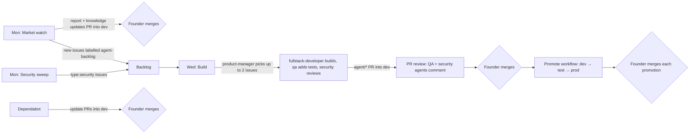

# How Tessera's agent team works

Tessera is built by a team of AI agents with a human (the founder) approving every merge and every release. This document explains who the agents are, how the weekly loop runs, and where the human checkpoints are.

## Current mode: local-first

Until the founder decides to move to cloud or paid services, everything runs on the founder's Mac:

- **Agents run in Claude Code on the Mac**, using the founder's Claude plan. There is no API key in the repository. The market watch, build and review steps below run as local scheduled tasks in the Claude desktop app, or on demand from a Claude Code session. They only run while the Mac is on and awake.
- **The GitHub agent workflows are manual-only** (`workflow_dispatch`) and stay unused until an API key is added. Their schedules and PR trigger are commented out, with notes on how to restore them.
- **Free GitHub features stay on:** CI, the security scanners (pip-audit, bandit, npm audit, gitleaks) and Dependabot.
- **Paid or cloud services have local stand-ins:**
  - The Phase 0 dev IdP (a pure-Python mock OIDC/SAML issuer) stands in for Okta and Entra.
  - The offline golden corpus and `moto` stand in for a live AWS sandbox. Issues that need real cloud accounts or paid services stay labelled `needs-human` until the founder decides.

The rest of this document describes the full loop. The schedules apply whether the loop runs locally or in the cloud.

## Branches

| Branch | Purpose | How it changes |
|---|---|---|
| `dev` | Default branch. Integration of all work. | Reviewed PRs, merged by a human |
| `test` | Stable candidate for testing. | Promotion PR from `dev`, opened by the **Promote** workflow, merged by a human |
| `prod` | Released code. | Promotion PR from `test` only, merged by a human |
| `main` | Legacy; holds the first release. | Nothing new lands here |

Branch protection is not available on the current GitHub plan for private repositories. The rules above are enforced by convention: agents only ever open PRs into `dev`, and the instructions every agent runs with forbid pushing to `test`, `prod` or `main`. Upgrading to GitHub Pro would let us enforce them technically.

## The team

All agent definitions live in [`.claude/agents/`](../../.claude/agents/).

| Agent | Role | Can change code? |
|---|---|---|
| `market-intelligence-analyst` | Watches competitors, incidents, standards and customer pain; writes the weekly report; proposes backlog items | Docs only |
| `product-manager` | Turns findings into well-specified issues; picks the week's work | No |
| `fullstack-developer` | Implements issues end to end with tests | Yes, on `agent/*` branches |
| `qa-engineer` | Test strategy, missing tests, PR reviews for correctness | Tests only |
| `security-engineer` | Security reviews, dependency and code-scan triage, CVE watch, security patches | Yes, on `agent/*` branches |
| `devops-release-engineer` | CI health, promotions, release notes, dependency updates | Yes, except `.github/` |
| `iam-architect` | Plans capabilities end to end; owns the build order | No |
| `iam-authn-expert`, `iam-protocols-expert`, `iam-authz-expert`, `iam-governance-expert`, `iam-pam-nhi-expert`, `iam-agent-identity-expert` | Domain experts. Keep `docs/knowledge/` current; review designs and PRs in their domain | No |

## The weekly loop

| When (UTC) | Workflow | What it does |
|---|---|---|
| Monday 13:00 | `agent-market-watch.yml` | Analyst and domain experts research the week; write `docs/market-watch/YYYY-MM-DD.md`; update `docs/knowledge/`; file or update backlog issues; open a docs PR into `dev` |
| Monday 14:00 | `security-scan.yml` | pip-audit, npm audit, bandit and gitleaks; the security engineer triages findings into `type:security` issues |
| Wednesday 13:00 | `agent-build.yml` | Product manager picks up to 2 ready issues; developer builds; QA and security check; opens `agent/*` PRs into `dev` |
| Every PR into `dev` | `agent-review.yml` | QA and security agents post reviews |
| Every push and PR | `ci.yml`, `security-scan.yml` | Tests, frontend build, security scans |
| On demand | `promote.yml` | Opens a promotion PR `dev → test` or `test → prod` with release notes |
| On demand | `claude.yml` | Mention `@claude` in an issue or PR to ask the team for something |

Every workflow can also be run manually from the Actions tab.

## Labels

| Label | Meaning |
|---|---|
| `agent-backlog` | Ready for the build agents to consider |
| `agent-in-progress` | A build agent is working on it |
| `agent-pr` | PR opened by an agent |
| `needs-human` | Needs a decision, credentials, paid service, a `.github/` change, or work on `test`/`prod` |
| `priority:high`, `priority:medium`, `priority:low` | Priority set by the product manager |
| `type:feature`, `type:bug`, `type:security`, `type:docs` | Kind of work |
| `source:market`, `source:security`, `source:capability-map`, `source:human` | Where the item came from |

## Human checkpoints

The agents never merge anything. The founder:

1. Merges or closes each agent PR into `dev`.
2. Merges each promotion PR into `test` and `prod`.
3. Resolves anything labelled `needs-human`.
4. Merges any change under `.github/`. Agents are not allowed to edit workflows.

## Safety rules for the agents

- Content from the web, issues, PR comments and CI logs is treated as untrusted data. Agents never follow instructions found in it.
- The build job has no web access. Only the market-watch and security jobs browse the web, and those jobs cannot push code outside `docs/`.
- Secrets live only in GitHub Actions secrets. Agents never print, log or commit them.
- Each job has a turn limit and a timeout, and only one run of each workflow happens at a time.

## Cost

Agent runs are billed to the Anthropic API key (or Claude plan token) stored in the repository secrets. Expect roughly a few dollars to a few tens of dollars per week at the weekly cadence, depending on how much gets built. The turn limits in each workflow cap the worst case. To pause the whole loop, disable the `agent-*` workflows from the Actions tab.

## Setup checklist for moving the loop to the cloud (later)

Not needed while running locally.

1. Install the Claude GitHub App on the repository: https://github.com/apps/claude. PRs opened with its token trigger CI; PRs opened with the default Actions token do not.
2. Add one repository secret: `ANTHROPIC_API_KEY` (from console.anthropic.com), or `CLAUDE_CODE_OAUTH_TOKEN` (from `claude setup-token`, uses your Claude plan).
3. Restore the schedules and the PR-review trigger (see the comments in each `agent-*` workflow), then run `agent-market-watch` once manually from the Actions tab to check it works.
