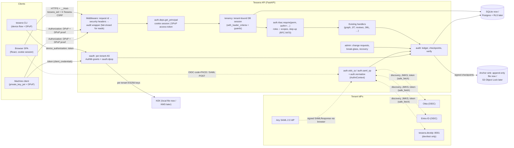

# Phase 0 design: make Tessera safe to connect

| | |
|---|---|
| Status | Draft for review |
| Author | iam-architect |
| Date | 2026-10-08 |
| Phase | 0 (see [`docs/knowledge/README.md`](../knowledge/README.md), "Build order") |
| Requirements covered | D1·M1–M4, M7–M10, S16; D2·M1, M7–M9; D4·M22; spec §10.2, §10.5 |
| Reviewers to sign off | `iam-authn-expert` (sections 8, 9, 11, 15), `iam-protocols-expert` (sections 6, 9, 10, 16), `iam-authz-expert` (section 12, the role model), `iam-governance-expert` (section 13, the audit ledger) |

**Exit criteria.** An admin signs in through Okta with a passkey. Every API call is authenticated and audited. The tenant isolation tests pass.

---

## Contents

1. [Summary of key decisions](#1-summary-of-key-decisions)
2. [Goals and non-goals](#2-goals-and-non-goals)
3. [Current state of the MVP](#3-current-state-of-the-mvp)
4. [Threat model (STRIDE)](#4-threat-model-stride)
5. [Architecture](#5-architecture)
6. [Libraries](#6-libraries)
7. [Data model](#7-data-model)
8. [Normalized AuthnContext](#8-normalized-authncontext)
9. [Authentication flows](#9-authentication-flows)
10. [Tokens: format, lifetimes and validation](#10-tokens-format-lifetimes-and-validation)
11. [Browser sessions and CSRF](#11-browser-sessions-and-csrf)
12. [Authorization: roles, scopes and step-up](#12-authorization-roles-scopes-and-step-up)
13. [Audit ledger](#13-audit-ledger)
14. [Tenant isolation enforcement](#14-tenant-isolation-enforcement)
15. [Recovery and admin-change hardening](#15-recovery-and-admin-change-hardening)
16. [API changes](#16-api-changes)
17. [Frontend changes](#17-frontend-changes)
18. [Configuration and the local dev IdP](#18-configuration-and-the-local-dev-idp)
19. [Implementation plan (ordered PRs)](#19-implementation-plan-ordered-prs)
20. [Test plan mapped to exit criteria](#20-test-plan-mapped-to-exit-criteria)
21. [Carrying this to production](#21-carrying-this-to-production)
22. [Open questions](#22-open-questions)
23. [Knowledge-base corrections found while designing](#23-knowledge-base-corrections-found-while-designing)
24. [References](#24-references)

---

## 1. Summary of key decisions

| # | Decision | Why |
|---|---|---|
| K1 | Tessera is a **relying party** to each tenant's IdP (OIDC RP and SAML SP). It never stores user passwords or second factors. Passkeys are enforced by the IdP and **proved to Tessera through `acr`/`amr`**. | D1·§8.1 and the README's rule 1: integrate with IdPs and don't rebuild them. |
| K2 | **Browser = server-side session cookie (BFF pattern). CLI and machines = short-lived JWT access tokens bound with DPoP.** Access tokens never reach browser JavaScript. | Removes token theft from the SPA, keeps one token format for non-browser clients, and follows RFC 9700 and the browser-app BCP. |
| K3 | Tessera runs a **small OAuth 2.1 authorization server per tenant** (issuer `https://<host>/t/<slug>`). It supports only three grants: device code (CLI), refresh token (rotating, DPoP-bound) and client credentials with `private_key_jwt` (automation). There is no authorization-code grant for third parties in Phase 0. | D2·M7–M9. A small surface means fewer edge cases. Per-tenant issuers and keys mean one tenant's key cannot mint tokens for another (the Storm-0558 lesson). |
| K4 | **Authlib 1.8.0** for the OIDC client and the AS grant logic, **joserfc 1.7.5** for all JOSE work, **pysaml2 7.5.5** (with the `xmlsec1` binary) for SAML, and **py_webauthn 3.0.1** only for break-glass keys. DPoP is our own module of about 200 lines on joserfc, because no maintained Python AS library implements RFC 9449. | Section 6 gives the reasons and the version evidence. |
| K5 | A **normalized `AuthnContext`** is recorded for every login and step-up. It carries `aal`, `phishing_resistant`, `methods`, `auth_time`, raw `acr`/`amr`, and how phishing resistance was established. Admin roles are **active only when the session's context is phishing-resistant**. | D1·M2, M4. |
| K6 | **Step-up** uses RFC 9470 semantics. Policy changes and approvals need phishing-resistant authentication no more than 15 minutes old. Admin changes need it no more than 5 minutes old. The IdP is forced to re-authenticate, and Tessera checks that `auth_time` is fresh rather than trusting it. | D1·M3. |
| K7 | **Tenant isolation in three layers.** (1) The SQLAlchemy session carries a tenant and fails closed: every ORM SELECT, UPDATE and DELETE gets `with_loader_criteria(tenant_id == …)`, and flush and load hooks reject cross-tenant objects. (2) Raw SQL is banned by a lint test. (3) In production, Postgres RLS with `FORCE ROW LEVEL SECURITY` and a per-transaction `app.tenant_id`. | Spec §10.2. |
| K8 | **Audit ledger.** Each tenant has a SHA-256 hash chain over RFC 8785 (JCS) canonical JSON. Rows are append-only (DB triggers in SQLite, REVOKE plus trigger in Postgres). Ed25519-signed checkpoints are written every 5 minutes to an anchor sink: a local append-only file in dev, S3 Object Lock in production. `python -m tessera.audit verify` checks the chain. Domain events commit atomically with the change they describe. A read whose audit write fails returns 503. | D4·M22, D1·M9, spec §10.5. |
| K9 | **Admin changes are two-person, step-up-gated and cooled off.** IdP connection trust changes, admin role grants and break-glass enrolment need a second admin and wait 24 h. Admin roles are never granted from IdP group claims. | D1·M10, the Scattered Spider persistence pattern. |
| K10 | **Recovery without the IdP** uses two device-bound FIDO2 security keys per tenant (AAL3, attestation checked, backup-eligible keys refused). If those are lost too, recovery is operator-assisted with two operators, verified tenant security contacts and a 72 h cooling-off. There is no email or phone reset path. | D1·§4.6, help-desk social engineering. |
| K11 | **A pure-Python dev IdP** (`tessera.devidp`, a separate process on :8001) issues real signed OIDC tokens and SAML assertions. It emulates Okta, Entra and generic claim profiles and has fault injection for negative tests. Real Okta and Entra are pure configuration. | You can run everything locally without Docker or Okta. |

**PR sequence** (section 19): PR1 tenancy foundation → PR2 config, crypto and keys → PR3 audit ledger → PR4 dev IdP → PR5 auth core (principals, sessions, RBAC, every route protected) → PR6 OIDC login → PR7 frontend sign-in → PR8 step-up → PR9 SAML → PR10 OAuth AS, device flow, DPoP and the reference CLI → PR11 machine clients → PR12 admin-change and recovery → PR13 break-glass → PR14 Postgres RLS → PR15 exit-criteria gate.

---

## 2. Goals and non-goals

### 2.1 Goals

1. **G1. Per-tenant SSO.** Each tenant configures one or more OIDC or SAML 2.0 IdP connections. Users are keyed by the immutable `(connection, subject)` pair and never by email.
2. **G2. A normalized `AuthnContext`** that policies, step-up and the audit ledger use.
3. **G3. Phishing-resistant admin access.** `tenant_admin` and `policy_admin` are inactive in sessions without phishing-resistant authentication.
4. **G4. Step-up** for policy changes (grant revoke, HRIS execute), approvals (JIT approve, review decisions) and admin changes, using RFC 9470 challenges for both browser and CLI.
5. **G5. API authentication on every route** except a small explicit allowlist. That means cookie sessions for the browser and DPoP-bound access tokens (≤ 10 min) for the CLI and machine clients.
6. **G6. CLI sign-in** via the RFC 8628 device flow with device-code phishing mitigations, DPoP (RFC 9449), and rotating refresh tokens with reuse detection.
7. **G7. An append-only, tamper-evident audit ledger** covering every API call, every authentication event, every decision and every admin change, with an offline verifier.
8. **G8. Multi-tenant isolation** of every existing and new table, proved by automated cross-tenant tests at the ORM, API, graph and token layers.
9. **G9. Hardened recovery and admin-change paths**: two-person approval, cooling-off, notifications, break-glass and no weak resets.
10. **G10. Runs locally** with SQLite and a pure-Python dev IdP. Real Okta and Entra work through configuration alone. The design carries forward to Postgres with RLS.

### 2.2 Non-goals for Phase 0

- Tessera as a general IdP, or a hosted login for customers without an IdP (D1·C19, later).
- Native passkeys for ordinary users. Only break-glass uses WebAuthn directly.
- SSF/CAEP/RISC receiver, OIDC back-channel logout, and binding downstream cloud credentials to sessions (Phase 3, D1·M5–M6).
- Workload identity federation into Tessera (GitHub OIDC to Tessera), token exchange (RFC 8693), RAR and PAR. These come in Phases 1–3.
- Cedar-based platform authorization. Phase 0 ships a static role-to-permission map designed so it translates to Cedar later (spec §5.8).
- SCIM provisioning of Tessera's own users. Users are created just-in-time at first login, and admins through the admin-change flow.
- Users belonging to several tenants (MSPs, consultants). One `PlatformUser` belongs to one tenant.
- Production key custody in KMS or HSM. This phase ships the interface and a local KEK. See section 21.
- Device posture and risk signals. The `AuthnContext.device` and `risk` fields exist but stay empty.
- The Go CLI. Phase 0 ships a Python **reference CLI** that fixes the protocol contract. The Go CLI implements the same contract later (spec §14.1).

---

## 3. Current state of the MVP

What I found in `mvp/` and what each finding means for this design:

| Finding | Where | Consequence |
|---|---|---|
| No authentication on any route. CORS is `allow_origins=["*"]`. | `api/app.py` | Every route needs an auth dependency. CORS must be restricted. |
| Callers choose their own actor. `RevokeIn.actor`, `DecisionIn.approver` and `ReviewDecisionIn.reviewer` are request-body fields, and the UI hard-codes `security-oncall@larkspur.example`. | `api/app.py`, `pages/JIT.tsx`, `pages/Reviews.tsx` | This is a spoofing and repudiation hole. The fields are removed and the actor comes from the authenticated principal. |
| The audit log is a plain mutable table. `audit(session, actor, action, **detail)` adds a row. | `audit.py`, `models.AuditLog` | Replaced by the hash-chained `audit_events`. The `audit()` signature stays as a shim so call sites in `jit.py`, `jml.py`, `reviews.py` and `api/app.py` keep working. |
| Every table is global, with no `tenant_id`. Uniqueness is global, for example `UniqueConstraint("system","external_id")`, `Identity.external_id unique`, `GrantEdge (src,dst)` and `HrisEvent.external_id unique`. | `models.py` | Add `tenant_id` everywhere and widen every unique constraint to start with `tenant_id`. |
| Primary keys are global integer sequences, and graph node keys are `"account:12"` and similar. | `models.py`, `graph.py` | IDs are guessable across tenants. Isolation must make another tenant's IDs look nonexistent (404), including node keys passed to `/api/simulate`. |
| Access goes through ORM `select()`, `session.get()` and `session.delete()`, plus **one ORM bulk delete** (`ingest.py:167 delete(AgentDelegation)`) and **two Core inserts** (`ingest.py:193,203 UsageEvent.__table__.insert()`). | `ingest.py` | The ORM criteria cover the first two. The Core inserts bypass ORM events, so they must add `tenant_id` explicitly. A lint test bans other `__table__` and `text()` use. |
| `GraphSnapshot.from_db(session)` loads the whole graph through `session.scalars(select(...))`. | `graph.py` | With a tenant-scoped session the graph is per-tenant automatically. Nothing changes in `graph.py`. |
| A background sweeper uses `SessionLocal()` with no context. | `api/app.py` lifespan | Must loop over tenants with one tenant session each. |
| The frontend calls `fetch('/api'+path)` through a Vite proxy (`/api` → :8000). The footer hard-codes the tenant name. | `frontend/src/api.ts`, `vite.config.ts`, `App.tsx` | Same-origin cookies work through the proxy. Add CSRF header and 401/step-up handling, and proxy `/t/*` and `/.well-known/*`. |
| Schema is built with `create_all`, and the DB is reseeded freely. | `db.py`, `seed.py` | Phase 0 can change the schema without migrations. Alembic arrives with Postgres (PR14). |

---

## 4. Threat model (STRIDE)

Scope: Tessera's own control plane, meaning the API, UI, CLI, auth endpoints, admin paths, audit and DB. Assets, in priority order: (a) the tenant's access graph and decisions (the attacker's "skeleton key"), (b) authority to change access (revoke, approve, apply), (c) the admin plane (IdP trust, roles, clients), (d) audit integrity, (e) Tessera signing keys.

| ID | STRIDE | Threat and scenario | Mitigation in this design | Residual / later |
|---|---|---|---|---|
| S1 | Spoofing | **Forged or confused ID token**: `alg:none`, RS→HS confusion, `kid`/`jku` injection, wrong `aud`/`iss`, or an ID token replayed as an access token. | joserfc with an explicit per-connection algorithm allow-list (asymmetric only). Keys come only from the pinned issuer's JWKS, and `jku`/`x5u`/`jwk` headers are ignored. Exact `iss` and `aud` checks, `azp` when there are several audiences, `nonce`, `exp`/`iat` with 60 s leeway. ID tokens are never accepted by the API (`typ`/`aud` differ). §9.1, §10.4. | Fix new JOSE advisories by pinning patched versions (both JWT libraries had several advisories in 2026). |
| S2 | Spoofing | **SAML signature wrapping (XSW), comment injection, unsigned assertion inside a signed response, Golden SAML.** | pysaml2 with schema validation, `want_assertions_signed=True`, signing cert pinned per connection, X.509-only key handling (CVE-2021-21239 fix), `allow_unsolicited=False`, `InResponseTo`, Audience, Destination and Recipient checks, one-time assertion IDs. A negative corpus covers XSW1–8. §9.2. | Golden SAML (stolen IdP key) cannot be detected by the SP. Later: alert on new signing certs (D2·M23). |
| S3 | Spoofing | **Actor spoofing in request bodies** (exists today). | Body fields removed. The actor always comes from the authenticated principal. | |
| S4 | Spoofing | **Account takeover through email-based linking** (nOAuth). | Users are keyed on `(idp_connection_id, subject)`. Email is display-only. SAML requires a persistent NameID or a configured immutable attribute. | |
| S5 | Spoofing | **Login CSRF and IdP-initiated injection.** | Each login transaction is bound to a `__Host-` cookie and checked against `state` and `nonce` (OIDC) or `RelayState` and `InResponseTo` (SAML). Unsolicited SAML responses are rejected. | |
| S6 | Spoofing | **Device-code phishing** (Storm-2372 pattern). | The device grant is limited to the first-party `tessera-cli` client. The `user_code` lives 5 min and must be typed: there is no `verification_uri_complete` and no QR code. The approval page shows the client, the requester's IP and the time, with a warning. Approval needs re-authentication within 5 min. Each tenant can disable the device grant. Every event is audited. §9.3. | Users can still be talked into approving. That is detectable from the audit (IP mismatch). |
| S7 | Spoofing | **Stolen access or refresh token replay** (infostealer, logs, HAR files). | DPoP binding (`cnf.jkt`) on every CLI and machine token. Access tokens last ≤ 10 min. Refresh tokens rotate and are DPoP-bound, and reuse revokes the whole family and the session. The `sid` is checked live on each request, so revocation is immediate. Tokens are never logged. | A stolen DPoP private key from the CLI host. Later: non-exportable keys in the Go CLI (Secure Enclave or TPM). |
| S8 | Spoofing | **Session cookie theft or fixation.** | `__Host-` cookie, `HttpOnly`, `Secure`, `SameSite=Lax`. Only a hash is stored server-side. The cookie is rotated at login, step-up and role change. Idle and absolute timeouts follow AAL targets. Sessions can be revoked server-side. | DBSC binding later (D1·C21). |
| S9 | Spoofing | **Rogue IdP connection or new admin added for persistence** (Scattered Spider). | Admin-change requests need two different admins with step-up, a 24 h cooling-off that any admin can cancel, and notifications to all admins and security contacts. §15. | |
| T1 | Tampering | **Audit log edited or deleted** by an attacker or insider with DB access. | Hash chain, triggers that block UPDATE and DELETE, an app DB role without UPDATE/DELETE in Postgres, signed checkpoints anchored outside the DB, and a verifier. §13. | A DB superuser can rewrite the tail after the last checkpoint. That window is at most 5 min. |
| T2 | Tampering | **CSRF on state-changing calls.** | `SameSite=Lax`, a session-bound `X-Tessera-CSRF` header on unsafe methods, an `Origin` allow-list check, and JSON-only bodies. | |
| T3 | Tampering | **OAuth code injection or mix-up** against Tessera as RP. | PKCE S256, one redirect URI per connection, `state`, the RFC 9207 `iss` check when the IdP advertises it, and `nonce`. | |
| T4 | Tampering | **Tenant config tampering through the API** (acr mapping, `assume_phishing_resistant`). | These are admin-change types (two-person, cooled off). §15. | |
| R1 | Repudiation | An approver denies approving, or a step-up did not really happen. | Every decision records the principal, session, `AuthnContext` (aal, phr, auth_time, acr, amr) and the requirement it met. Step-up checks `auth_time ≥ transaction start`. | |
| I1 | Info disclosure | **Cross-tenant reads** through guessable integer IDs, node keys, background jobs or raw SQL. | Three layers. §14. Responses for another tenant's IDs are 404, never 403. | |
| I2 | Info disclosure | Tokens or secrets in logs, URLs or `Referer`. | No tokens in the browser. Authorization, Cookie and DPoP headers are scrubbed from logs. `Referrer-Policy: no-referrer`. Codes are POSTed, not passed in query strings, where we control it. | |
| I3 | Info disclosure / EoP | **SSRF** through tenant-configured discovery, JWKS or SAML metadata URLs. | `safe_fetch`: HTTPS only, no private, loopback or link-local IPs (checked after DNS resolution), no cross-host redirects, 5 s timeout, 512 KiB limit. Dev can allow `127.0.0.1` only. | |
| I4 | Info disclosure | **Tenant enumeration** through home-realm discovery. | Generic responses, rate limits, and no listing of connection names before a tenant slug is given. | Low impact. |
| D1 | DoS | Oversized JWS or JWT, XML bombs, device-poll floods, brute force of user codes. | Size caps before parsing (8 KiB for JWTs, 256 KiB for SAML POSTs). pysaml2 parses with defusedxml. `slow_down` on polling, per-IP and per-session rate limits on `/token`, `/device_authorization` and the device verify endpoint. | In-process limiter in Phase 0, Valkey later. |
| D2 | DoS | An audit outage blocks reads (fail-closed). | Chosen on purpose: a read of customer data whose audit write fails returns 503. It is monitored. | |
| E1 | EoP | **IdP group claim grants admin.** | Group-to-role mapping can only grant `viewer`, `operator` or `auditor`. Admin roles come only from explicit assignment through an admin change. | |
| E2 | EoP | **A weakly authenticated session uses an admin role.** | Role activation needs `AuthnContext.phishing_resistant`. Sensitive actions need step-up. | |
| E3 | EoP | **The tenant filter is bypassed** by raw SQL, Core statements or a missing context. | Missing context raises (fail closed). Lint tests ban `text()`, `exec_driver_sql` and `__table__` outside an allowlist. A model-coverage meta-test. RLS in production. | |
| E4 | EoP | **Recovery abuse** (help desk, email reset). | No email or phone recovery. Break-glass needs hardware keys. Operator recovery needs two operators, verified contacts and 72 h cooling-off with notification. §15. | |
| E5 | EoP | **One rogue admin removes the other admins.** | Removing another admin's role is also two-person. Self-removal is single-person, but the last two admins cannot drop below `min_admins`. | |
| E6 | EoP | **Theft of a Tessera signing key.** | Per-tenant ES256 keys encrypted under a KEK (KMS in production). `kid` must belong to the tenant named by `iss`. 30-day rotation. A tenant's key can be revoked on its own. | |

---

## 5. Architecture

### 5.1 Component diagram



### 5.2 Request pipeline

1. **`RequestIdMiddleware`** assigns `request_id` (UUIDv4) and stores it in a contextvar.
2. **`SecurityHeadersMiddleware`** adds `Content-Security-Policy: default-src 'self'; frame-ancestors 'none'`, `X-Content-Type-Options: nosniff`, `Referrer-Policy: no-referrer`, `Cache-Control: no-store` on `/api/auth/*` and `/t/*`, and HSTS in production.
3. **`AuditMiddleware`** (section 13.4) wraps the call. After the response is computed it writes an `http.request` event using `request.state.principal`, the route template and the status.
4. **Route dependency `get_principal`** (section 12.3) authenticates through the cookie or DPoP path, builds a `Principal`, sets `request.state.principal`, and yields a **tenant-bound DB session**.
5. **`require(permission, authn=...)`** checks roles, scopes and the authentication requirement. If the requirement is not met it raises `StepUpRequired` (401 with RFC 9470 parameters).
6. The handler runs. Domain `audit()` calls inside it join the handler's transaction.

### 5.3 New backend modules

```
mvp/backend/tessera/
  config.py              Settings from env; production guard rails (§18)
  tenancy.py             TenantScoped mixin, tenant/system sessions, ORM guards (§14)
  crypto.py              KEK AEAD (AES-256-GCM), random tokens, hashing helpers
  keys.py                Per-tenant signing keys, JWKS, rotation; platform audit key
  httpx_safe.py          safe_fetch(): SSRF-guarded outbound HTTP
  ratelimit.py           In-process sliding-window limiter
  audit/                 (replaces audit.py)
    __init__.py          audit(session, actor, action, **detail) shim + record()
    models.py            AuditEvent, AuditChainHead, AuditCheckpoint
    ledger.py            canonicalization, hashing, append with per-tenant lock
    checkpoint.py        signed checkpoints + anchor sinks (file, s3 stub)
    verify.py            chain + checkpoint + anchor verification
    middleware.py        AuditMiddleware
    __main__.py          `python -m tessera.audit verify|checkpoint|export`
  auth/
    models.py            Tenant, IdPConnection, PlatformUser, ExternalLogin, RoleAssignment,
                         AuthnContextRecord, Session, LoginTransaction
    normalize.py         claim → AuthnContext mapping profiles (okta, entra, generic_oidc, saml, devmock)
    oidc_rp.py           discovery, auth URL, callback, ID-token validation (Authlib client + joserfc)
    saml_sp.py           pysaml2 SP config per connection, AuthnRequest, ACS validation
    sessions.py          create/rotate/touch/revoke sessions; cookie helpers
    csrf.py              CSRF token + Origin check
    rbac.py              roles, permissions, scopes, require()
    stepup.py            AuthnRequirement, StepUpRequired, RFC 9470 challenge rendering
    deps.py              get_principal, get_tenant_session, Principal dataclass
    routes.py            /api/auth/* routes
  oauth/
    models.py            ApiClient, DeviceGrant, RefreshToken, ReplayCache
    server.py            Authlib AuthorizationServer adapter for Starlette
    grants.py            DeviceCodeGrant, RefreshTokenGrant, ClientCredentialsGrant subclasses
    dpop.py              DPoP proof validation, nonces, jkt
    tokens.py            RFC 9068 access-token mint + verify
    routes.py            /t/{slug}/oauth/*, /.well-known/*
  admin/
    models.py            AdminChangeRequest, BreakGlassCredential, BootstrapInvitation, Notification
    changes.py           change-request state machine + appliers
    breakglass.py        WebAuthn registration/authentication (py_webauthn)
    recovery.py          operator recovery procedures
    notify.py            outbox + log/SMTP senders
    routes.py            /api/admin/*
    __main__.py          `python -m tessera.admin create-tenant|add-idp|invite-admin|recover-tenant|…`
  devidp/                Dev/test-only IdP (separate ASGI app, never imported by tessera.api)
    app.py, oidc.py, saml.py, users.yaml, profiles.py, faults.py
mvp/cli/                 Reference CLI (Python): tessera_cli/{__main__,auth,dpop,store}.py
```

---

## 6. Libraries

Versions and dates were checked against PyPI and the GitHub Security Advisory API on 2026-10-08.

| Purpose | Choice and pin | Latest release | Maintenance and security evidence | Why this, and what was rejected |
|---|---|---|---|---|
| OIDC client (RP) | **Authlib 1.8.0** (`authlib.integrations.httpx_client.AsyncOAuth2Client`) | 1.8.0, 2026-08-30 | Active (commits on 2026-10-08). Several 2025–26 advisories, all patched within weeks: GHSA-wvwj-cvrp-7pv5 (JWS JWK header injection, fixed 1.6.9), GHSA-7wc2-qxgw-g8gg (`alg:none`, fixed 1.6.7), GHSA-r95x-qfjj-fjj2 (open redirect, fixed 1.7.1). | Mature OAuth client with PKCE and RFC 9207 support. We do **not** use the Starlette integration, which needs signed-cookie session middleware. We store `state`, `nonce` and PKCE server-side in `LoginTransaction`, and we validate ID tokens ourselves with joserfc so every check is visible in our code. |
| AS grant logic | **Authlib 1.8.0** server classes (`authlib.oauth2.rfc6749.AuthorizationServer`, `rfc8628.DeviceCodeGrant`, `RefreshTokenGrant`, `ClientCredentialsGrant`, `rfc7523.JWTBearerClientAssertion`, `rfc7009`, `rfc7662`, `rfc8414`, `rfc9068`) | same | Authlib 1.8 lists RFC 6749, 7009, 7523, 7636, 7662, 8414, 8628, 9068 and 9207. There is no Starlette server integration (Flask and Django only), so we write a thin adapter (`oauth/server.py`, about 150 lines). | D2·§8.4 says to embed a proven engine rather than write one. Rejected: a hand-rolled AS (edge-case risk) and Ory Hydra or Keycloak (not runnable here without Docker, and heavier than needed). **Fallback** if the adapter spike in PR10 runs over 2 days: hand-write the three grants on joserfc, with the same tests. |
| DPoP (RFC 9449) | **Our own `oauth/dpop.py`** on joserfc | — | Authlib 1.8 does not list RFC 9449. Neither does any maintained Python AS library I found. | The spec is small and self-contained: proof validation, `jkt`, nonces and `ath`. Tests use the RFC 9449 examples. |
| JOSE (JWS, JWT, JWK) | **joserfc 1.7.5** | 1.7.5, 2026-08-29 | Active. It fixes GHSA-9pg5-8c7x-5hfx and GHSA-jpxq-7h8p-2q76 (both published 2026-10-06, affecting ≤ 1.7.4). Authlib 1.7+ uses joserfc internally, and `authlib.jose` was deprecated in 1.7 and removed in 1.8. | One JOSE stack to patch, shared with Authlib. Decoding and claim validation are separate steps, which makes validation explicit. Its algorithm registry lets us set a strict allow-list. **PyJWT 2.15.1** was rejected: it is just as maintained, but it would be a second JOSE stack, and it had 10 advisories in September 2026 alone, including HS/asymmetric confusion bypasses (GHSA-ffc3-869f-jxw9, GHSA-p4g4-x82p-q773). `python-jose` was rejected as effectively unmaintained. |
| SAML 2.0 SP | **pysaml2 7.5.5** + system `xmlsec1` (≥ 1.3) | 7.5.5, 2026-09-17 | Active (pushed 2026-09-28). Its last advisories are the 2021 XSW and key-type CVEs (CVE-2021-21238 and -21239), fixed in 6.5.0 by schema validation and X.509-only keys. | A full SP implementation with schema validation and a regular release cadence. **python3-saml 1.16.0** was rejected because its last PyPI release was 2023-10-09, three years without a release for security-critical XML code. **signxml 5.1.0** is kept as the fallback if `xmlsec1` packaging becomes a blocker. It is a good XML-DSig library but not an SP, so we would own more protocol logic. |
| WebAuthn (break-glass only) | **webauthn (py_webauthn) 3.0.1** | 3.0.1, 2026-09-25 | Active (Duo Labs). | Needed only because break-glass has to work when the IdP is down or misconfigured (§15.4). Ordinary passkeys stay with the IdP. |
| Canonical JSON for audit | **rfc8785 0.1.4** (Trail of Bits) | 0.1.4, 2024-09 | Small, finished and stable. | JCS gives byte-exact canonicalization that a Go or Rust verifier can reproduce. Homemade `json.dumps(sort_keys=True)` differs across languages in number and Unicode handling. |
| Crypto primitives | **cryptography 50.0.2** | 2026-09-30 | Active (PyCA). | AES-256-GCM for the KEK, ES256 and Ed25519 key generation. |
| HTTP client | httpx 0.28.1 (already pinned) | | | Used through `safe_fetch` (SSRF guard). |
| Migrations (PR14) | Alembic 1.20.0, psycopg 3.3.6 | 2026-09 | Active. | Introduced together with Postgres. |

`requirements.txt` additions: `authlib==1.8.0`, `joserfc==1.7.5`, `pysaml2==7.5.5`, `webauthn==3.0.1`, `rfc8785==0.1.4`, `cryptography==50.0.2`. System packages: `brew install libxmlsec1` (macOS) or `apt-get install xmlsec1` (Debian/Ubuntu). SAML tests **skip with a clear message** when `xmlsec1` is missing, so developers who don't work on SAML are not blocked. CI must install it and **fails** if the SAML suite is skipped (`TESSERA_REQUIRE_SAML_TESTS=1`).

Dependency hygiene: pin exact versions, run `pip-audit` in CI (added in PR2), and require a security owner to review any bump of Authlib, joserfc or pysaml2 within 7 days of an advisory.

---

## 7. Data model

### 7.1 Conventions

- Every tenant-owned table gets `tenant_id` (`sqlalchemy.Uuid`; CHAR(32) in SQLite, native `uuid` in Postgres) through the `TenantScoped` mixin. It is non-null, indexed and a foreign key to `tenants.id`.
- **Existing integer primary keys stay**, because the API contract and graph node keys depend on them. New tables use UUID primary keys (`uuid4` now, `uuidv7` in Postgres later).
- Every unique constraint starts with `tenant_id`.
- Secrets at rest (client secrets, private keys, PKCE verifiers) are encrypted with `crypto.seal(plaintext, aad=f"{tenant_id}|{table}|{column}")` (AES-256-GCM under the KEK). Bearer secrets (session cookies, refresh tokens, device codes, invitation codes) are **stored only as SHA-256 hashes**.
- Global (non-tenant) tables are an explicit allowlist: `tenants`, `platform_keys`, `replay_cache`. The meta-test in §14.4 enforces it.
- A reserved tenant row `slug="_platform"` (fixed UUID `00000000-0000-0000-0000-000000000001`) owns the platform audit chain, which holds events with no tenant, operator actions and isolation violations.

### 7.2 Tenancy mixin

```python
# tessera/tenancy.py
import uuid
from sqlalchemy import ForeignKey, Uuid
from sqlalchemy.orm import Mapped, declared_attr, mapped_column

PLATFORM_TENANT_ID = uuid.UUID("00000000-0000-0000-0000-000000000001")

class TenantScoped:
    """Mixin: every row belongs to exactly one tenant. See §14 for enforcement."""
    @declared_attr
    def tenant_id(cls) -> Mapped[uuid.UUID]:
        return mapped_column(Uuid, ForeignKey("tenants.id", ondelete="RESTRICT"),
                             nullable=False, index=True)
```

### 7.3 Changes to existing tables (`tessera/models.py`)

Every class below gains `TenantScoped`. The constraint changes are:

| Model (table) | Change |
|---|---|
| `Identity` (`identities`) | `external_id` is no longer globally unique. Becomes `UniqueConstraint("tenant_id","external_id")`. |
| `Account`, `Group`, `Resource`, `Permission`, `Secret` | `UniqueConstraint("system","external_id")` becomes `("tenant_id","system","external_id")`. |
| `GrantEdge` (`grant_edges`) | `UniqueConstraint("src","dst")` becomes `("tenant_id","src","dst")`. |
| `AgentDelegation`, `UsageEvent`, `ReviewCampaign`, `ReviewItem` | Add `tenant_id` only. Add index `("tenant_id","day")` on `usage_events`. |
| `AccessRequest` | Add `tenant_id`, `requested_by_user_id: Uuid \| None` (FK `platform_users.id`) and `decided_by_user_id: Uuid \| None`. `decided_by` (display string) stays for the UI. |
| `ReviewItem` | Add `decided_by_user_id: Uuid \| None`. |
| `HrisEvent` | `external_id unique` becomes `("tenant_id","external_id")`. Add `executed_by_user_id`. |
| `AuditLog` (`audit_log`) | **Removed.** Replaced by `audit_events` (§13). `GET /api/audit` keeps its response fields (`id, at, actor, action, detail`) and adds new ones. |

Foreign keys between tenant tables (`accounts.identity_id → identities.id`, and so on) stay single-column in SQLite. In Postgres (PR14) they become **composite** `(tenant_id, id)` references against a `UNIQUE (tenant_id, id)` on the parent, so the database itself refuses a cross-tenant reference.

### 7.4 New models

```python
# tessera/auth/models.py  (sketch: types abbreviated, all timestamps are timezone-naive UTC like the MVP)
import uuid
from datetime import datetime
from sqlalchemy import JSON, Boolean, DateTime, ForeignKey, Integer, LargeBinary, String, Text, UniqueConstraint, Uuid
from sqlalchemy.orm import Mapped, mapped_column
from ..models import Base
from ..tenancy import TenantScoped
from ..timeutil import utcnow

class Tenant(Base):                                  # GLOBAL table
    __tablename__ = "tenants"
    id: Mapped[uuid.UUID] = mapped_column(Uuid, primary_key=True, default=uuid.uuid4)
    slug: Mapped[str] = mapped_column(String(40), unique=True)       # ^[a-z0-9][a-z0-9-]{2,39}$, "_platform" reserved
    name: Mapped[str] = mapped_column(String(200))
    status: Mapped[str] = mapped_column(String(16), default="active")  # active | suspended | recovery
    cell: Mapped[str] = mapped_column(String(32), default="local")
    min_admins: Mapped[int] = mapped_column(Integer, default=2)
    settings: Mapped[dict] = mapped_column(JSON, default=dict)       # see §18.3 (timeouts, step-up windows, device grant on/off)
    security_contacts: Mapped[list] = mapped_column(JSON, default=list)  # [{name, email, phone_last4, verified_at}] for recovery (§15.5)
    created_at: Mapped[datetime] = mapped_column(DateTime, default=utcnow)

class IdPConnection(TenantScoped, Base):
    __tablename__ = "idp_connections"
    id: Mapped[uuid.UUID] = mapped_column(Uuid, primary_key=True, default=uuid.uuid4)
    name: Mapped[str] = mapped_column(String(100))
    protocol: Mapped[str] = mapped_column(String(8))               # oidc | saml
    profile: Mapped[str] = mapped_column(String(24))               # okta | entra | google | generic_oidc | generic_saml | dev_mock
    status: Mapped[str] = mapped_column(String(16), default="pending")  # pending | active | disabled
    is_default: Mapped[bool] = mapped_column(Boolean, default=False)
    verified_domains: Mapped[list] = mapped_column(JSON, default=list)  # home-realm discovery only, never identity matching
    # --- OIDC
    issuer: Mapped[str | None] = mapped_column(String(512))        # exact-match `iss`
    discovery_url: Mapped[str | None] = mapped_column(String(512)) # default issuer + /.well-known/openid-configuration
    client_id: Mapped[str | None] = mapped_column(String(256))
    client_auth_method: Mapped[str | None] = mapped_column(String(32))  # private_key_jwt | client_secret_basic
    client_secret_enc: Mapped[bytes | None] = mapped_column(LargeBinary) # sealed with KEK
    client_signing_kid: Mapped[str | None] = mapped_column(String(64))   # TenantSigningKey (purpose=idp_client_auth)
    scopes: Mapped[list] = mapped_column(JSON, default=lambda: ["openid", "email", "profile"])
    id_token_algs: Mapped[list] = mapped_column(JSON, default=lambda: ["RS256", "ES256", "PS256"])
    step_up_request: Mapped[dict] = mapped_column(JSON, default=dict)  # how to ask this IdP for each Tessera ACR (§8.3)
    discovery_cache: Mapped[dict | None] = mapped_column(JSON)
    jwks_cache: Mapped[dict | None] = mapped_column(JSON)
    jwks_cached_at: Mapped[datetime | None] = mapped_column(DateTime)
    # --- SAML
    idp_entity_id: Mapped[str | None] = mapped_column(String(512))
    idp_sso_url: Mapped[str | None] = mapped_column(String(512))
    idp_signing_certs: Mapped[list] = mapped_column(JSON, default=list)  # [{pem, sha256, not_after}]
    metadata_url: Mapped[str | None] = mapped_column(String(512))
    pin_certs: Mapped[bool] = mapped_column(Boolean, default=True)  # cert change = admin change (§15.2)
    sp_key_enc: Mapped[bytes | None] = mapped_column(LargeBinary)   # SP signing key for AuthnRequests
    sp_cert_pem: Mapped[str | None] = mapped_column(Text)
    subject_source: Mapped[str] = mapped_column(String(128), default="nameid_persistent")  # or attribute name, e.g. Entra objectidentifier
    attribute_map: Mapped[dict] = mapped_column(JSON, default=dict)  # email, display_name, groups
    # --- normalization and provisioning
    authn_mapping: Mapped[dict] = mapped_column(JSON, default=dict) # overrides to profile tables (§8.2)
    assume_phishing_resistant: Mapped[bool] = mapped_column(Boolean, default=False)  # admin-attested (§8.2 rule 4)
    groups_claim: Mapped[str | None] = mapped_column(String(64))
    group_role_mapping: Mapped[dict] = mapped_column(JSON, default=dict)  # {"okta-group": "viewer"}; admin roles REJECTED
    jit_provisioning: Mapped[bool] = mapped_column(Boolean, default=True)
    default_role: Mapped[str] = mapped_column(String(24), default="viewer")
    created_at: Mapped[datetime] = mapped_column(DateTime, default=utcnow)
    updated_at: Mapped[datetime] = mapped_column(DateTime, default=utcnow, onupdate=utcnow)
    last_change_request_id: Mapped[uuid.UUID | None] = mapped_column(Uuid)

class PlatformUser(TenantScoped, Base):
    """A person who signs in to Tessera. Distinct from `Identity`, which is a governed identity in the customer estate."""
    __tablename__ = "platform_users"
    id: Mapped[uuid.UUID] = mapped_column(Uuid, primary_key=True, default=uuid.uuid4)
    email: Mapped[str | None] = mapped_column(String(320))          # display + notifications only
    display_name: Mapped[str] = mapped_column(String(200))
    status: Mapped[str] = mapped_column(String(16), default="active")  # active | disabled
    is_break_glass: Mapped[bool] = mapped_column(Boolean, default=False)
    identity_id: Mapped[int | None] = mapped_column(ForeignKey("identities.id"))  # optional link to governed Identity (OQ1)
    created_at: Mapped[datetime] = mapped_column(DateTime, default=utcnow)
    last_login_at: Mapped[datetime | None] = mapped_column(DateTime)
    disabled_at: Mapped[datetime | None] = mapped_column(DateTime)
    disabled_reason: Mapped[str | None] = mapped_column(String(200))

class ExternalLogin(TenantScoped, Base):
    """Immutable link (connection, subject) -> user. The only way a login resolves to a user."""
    __tablename__ = "external_logins"
    __table_args__ = (UniqueConstraint("tenant_id", "idp_connection_id", "subject"),)
    id: Mapped[uuid.UUID] = mapped_column(Uuid, primary_key=True, default=uuid.uuid4)
    user_id: Mapped[uuid.UUID] = mapped_column(ForeignKey("platform_users.id"))
    idp_connection_id: Mapped[uuid.UUID] = mapped_column(ForeignKey("idp_connections.id"))
    issuer: Mapped[str] = mapped_column(String(512))                # recorded for evidence; must equal connection issuer/entity id
    subject: Mapped[str] = mapped_column(String(512))               # OIDC sub (Entra: oid via profile) | SAML persistent NameID/attr
    email_at_last_login: Mapped[str | None] = mapped_column(String(320))
    created_at: Mapped[datetime] = mapped_column(DateTime, default=utcnow)
    last_seen_at: Mapped[datetime | None] = mapped_column(DateTime)

class RoleAssignment(TenantScoped, Base):
    __tablename__ = "role_assignments"
    __table_args__ = (UniqueConstraint("tenant_id", "user_id", "role", "source"),)
    id: Mapped[uuid.UUID] = mapped_column(Uuid, primary_key=True, default=uuid.uuid4)
    user_id: Mapped[uuid.UUID] = mapped_column(ForeignKey("platform_users.id"))
    role: Mapped[str] = mapped_column(String(24))      # viewer | operator | auditor | policy_admin | tenant_admin
    source: Mapped[str] = mapped_column(String(16))    # manual | idp_group | bootstrap | break_glass
    granted_by_user_id: Mapped[uuid.UUID | None] = mapped_column(Uuid)
    change_request_id: Mapped[uuid.UUID | None] = mapped_column(Uuid)  # required for admin roles
    created_at: Mapped[datetime] = mapped_column(DateTime, default=utcnow)
    expires_at: Mapped[datetime | None] = mapped_column(DateTime)

class AuthnContextRecord(TenantScoped, Base):
    """One per successful authentication or step-up. Immutable once written."""
    __tablename__ = "authn_contexts"
    id: Mapped[uuid.UUID] = mapped_column(Uuid, primary_key=True, default=uuid.uuid4)
    user_id: Mapped[uuid.UUID] = mapped_column(ForeignKey("platform_users.id"))
    idp_connection_id: Mapped[uuid.UUID | None] = mapped_column(ForeignKey("idp_connections.id"))  # None for break-glass
    protocol: Mapped[str] = mapped_column(String(10))   # oidc | saml | webauthn
    purpose: Mapped[str] = mapped_column(String(16))    # login | step_up | device_approval | break_glass
    acr: Mapped[str | None] = mapped_column(String(256))            # raw, as asserted
    amr: Mapped[list] = mapped_column(JSON, default=list)           # raw, as asserted
    methods: Mapped[list] = mapped_column(JSON, default=list)       # normalized RFC 8176 vocabulary
    aal: Mapped[int] = mapped_column(Integer)                      # 0 unknown | 1 | 2 | 3
    phishing_resistant: Mapped[bool] = mapped_column(Boolean)
    phr_basis: Mapped[str] = mapped_column(String(24))  # acr | amr | connection_attestation | webauthn_attested | none
    tessera_acr: Mapped[str] = mapped_column(String(48))  # urn:tessera:acr:{aal1|aal2|phr|phrh}
    auth_time: Mapped[datetime] = mapped_column(DateTime)
    idp_session_id: Mapped[str | None] = mapped_column(String(256)) # OIDC sid / SAML SessionIndex
    device: Mapped[dict | None] = mapped_column(JSON)              # reserved (D1·S12)
    risk: Mapped[dict | None] = mapped_column(JSON)                # reserved (D1·S13)
    ip: Mapped[str | None] = mapped_column(String(45))
    user_agent: Mapped[str | None] = mapped_column(String(400))
    mapping_profile: Mapped[str] = mapped_column(String(24))
    mapping_version: Mapped[int] = mapped_column(Integer)
    claims_sha256: Mapped[str] = mapped_column(String(64))         # hash of validated raw claims/assertion, for evidence
    created_at: Mapped[datetime] = mapped_column(DateTime, default=utcnow)

class Session(TenantScoped, Base):
    __tablename__ = "sessions"
    id: Mapped[uuid.UUID] = mapped_column(Uuid, primary_key=True, default=uuid.uuid4)   # the `sid`
    user_id: Mapped[uuid.UUID] = mapped_column(ForeignKey("platform_users.id"))
    kind: Mapped[str] = mapped_column(String(12))         # browser | cli | break_glass
    secret_hash: Mapped[str | None] = mapped_column(String(64), unique=True)  # sha256(cookie secret); None for cli
    csrf_secret: Mapped[str | None] = mapped_column(String(64))
    initial_authn_context_id: Mapped[uuid.UUID] = mapped_column(ForeignKey("authn_contexts.id"))
    current_authn_context_id: Mapped[uuid.UUID] = mapped_column(ForeignKey("authn_contexts.id"))
    client_id: Mapped[str | None] = mapped_column(String(64))   # cli sessions: "tessera-cli"
    created_at: Mapped[datetime] = mapped_column(DateTime, default=utcnow)
    last_activity_at: Mapped[datetime] = mapped_column(DateTime, default=utcnow)
    idle_expires_at: Mapped[datetime] = mapped_column(DateTime)
    absolute_expires_at: Mapped[datetime] = mapped_column(DateTime)
    status: Mapped[str] = mapped_column(String(10), default="active")  # active | revoked | expired
    revoked_at: Mapped[datetime | None] = mapped_column(DateTime)
    revoked_reason: Mapped[str | None] = mapped_column(String(64))   # logout | admin | role_change | rt_reuse | user_disabled | idp_disabled
    ip_first: Mapped[str | None] = mapped_column(String(45))
    user_agent_first: Mapped[str | None] = mapped_column(String(400))

class LoginTransaction(TenantScoped, Base):
    """Pre-auth state for one OIDC/SAML round trip. Bound to the __Host-tessera_login cookie."""
    __tablename__ = "login_transactions"
    id: Mapped[uuid.UUID] = mapped_column(Uuid, primary_key=True, default=uuid.uuid4)
    cookie_hash: Mapped[str] = mapped_column(String(64), unique=True)
    idp_connection_id: Mapped[uuid.UUID] = mapped_column(ForeignKey("idp_connections.id"))
    purpose: Mapped[str] = mapped_column(String(16))     # login | step_up | device_approval | bootstrap
    state_hash: Mapped[str | None] = mapped_column(String(64))   # OIDC
    nonce: Mapped[str | None] = mapped_column(String(64))        # OIDC
    pkce_verifier_enc: Mapped[bytes | None] = mapped_column(LargeBinary)  # OIDC
    saml_request_id: Mapped[str | None] = mapped_column(String(128))      # SAML InResponseTo
    required_tessera_acr: Mapped[str | None] = mapped_column(String(48))
    max_age: Mapped[int | None] = mapped_column(Integer)
    session_id: Mapped[uuid.UUID | None] = mapped_column(Uuid)    # step_up / device_approval: the session being elevated
    expected_external_login_id: Mapped[uuid.UUID | None] = mapped_column(Uuid)  # step-up must be the same subject
    device_grant_id: Mapped[uuid.UUID | None] = mapped_column(Uuid)
    bootstrap_invitation_id: Mapped[uuid.UUID | None] = mapped_column(Uuid)
    return_to: Mapped[str] = mapped_column(String(512), default="/")  # validated: relative path, no "//", no scheme
    created_at: Mapped[datetime] = mapped_column(DateTime, default=utcnow)
    expires_at: Mapped[datetime] = mapped_column(DateTime)          # created_at + 10 min
    consumed_at: Mapped[datetime | None] = mapped_column(DateTime)
```

```python
# tessera/oauth/models.py
class ApiClient(TenantScoped, Base):
    __tablename__ = "api_clients"
    __table_args__ = (UniqueConstraint("tenant_id", "client_id"),)
    id: Mapped[uuid.UUID] = mapped_column(Uuid, primary_key=True, default=uuid.uuid4)
    client_id: Mapped[str] = mapped_column(String(64))       # "tessera-cli" (first party) | "tsc_<base32 16>"
    name: Mapped[str] = mapped_column(String(100))
    kind: Mapped[str] = mapped_column(String(16))            # first_party_cli | machine
    grant_types: Mapped[list] = mapped_column(JSON)          # cli: [device_code, refresh_token]; machine: [client_credentials]
    token_endpoint_auth_method: Mapped[str] = mapped_column(String(24))  # none (cli) | private_key_jwt (machine)
    jwks: Mapped[dict | None] = mapped_column(JSON)          # machine public keys (EC P-256 / Ed25519 only)
    dpop_required: Mapped[bool] = mapped_column(Boolean, default=True)
    allowed_scopes: Mapped[list] = mapped_column(JSON)       # subset of tessera:read|write|audit|admin
    roles: Mapped[list] = mapped_column(JSON, default=list)  # machine clients only: roles it acts with (no admin roles via API)
    owner_user_id: Mapped[uuid.UUID | None] = mapped_column(ForeignKey("platform_users.id"))  # required for machine (NHI owner rule)
    status: Mapped[str] = mapped_column(String(12), default="active")  # active | disabled
    created_at: Mapped[datetime] = mapped_column(DateTime, default=utcnow)
    last_used_at: Mapped[datetime | None] = mapped_column(DateTime)
    change_request_id: Mapped[uuid.UUID | None] = mapped_column(Uuid)

class DeviceGrant(TenantScoped, Base):
    __tablename__ = "device_grants"
    id: Mapped[uuid.UUID] = mapped_column(Uuid, primary_key=True, default=uuid.uuid4)
    client_id: Mapped[str] = mapped_column(String(64))
    device_code_hash: Mapped[str] = mapped_column(String(64), unique=True)
    user_code_hash: Mapped[str] = mapped_column(String(64), index=True)  # sha256(normalized code); unique among pending
    scope: Mapped[str] = mapped_column(String(200))
    required_tessera_acr: Mapped[str | None] = mapped_column(String(48))
    max_age: Mapped[int | None] = mapped_column(Integer)
    status: Mapped[str] = mapped_column(String(12), default="pending")  # pending | approved | denied | expired | consumed
    request_ip: Mapped[str | None] = mapped_column(String(45))
    request_user_agent: Mapped[str | None] = mapped_column(String(400))
    interval: Mapped[int] = mapped_column(Integer, default=5)
    last_polled_at: Mapped[datetime | None] = mapped_column(DateTime)
    created_at: Mapped[datetime] = mapped_column(DateTime, default=utcnow)
    expires_at: Mapped[datetime] = mapped_column(DateTime)        # +300 s
    approved_by_user_id: Mapped[uuid.UUID | None] = mapped_column(Uuid)
    approved_authn_context_id: Mapped[uuid.UUID | None] = mapped_column(Uuid)
    approved_at: Mapped[datetime | None] = mapped_column(DateTime)
    session_id: Mapped[uuid.UUID | None] = mapped_column(Uuid)    # cli Session created on approval
    lookup_failures: Mapped[int] = mapped_column(Integer, default=0)

class RefreshToken(TenantScoped, Base):
    __tablename__ = "refresh_tokens"
    id: Mapped[uuid.UUID] = mapped_column(Uuid, primary_key=True, default=uuid.uuid4)
    token_hash: Mapped[str] = mapped_column(String(64), unique=True)
    family_id: Mapped[uuid.UUID] = mapped_column(Uuid, index=True)
    parent_id: Mapped[uuid.UUID | None] = mapped_column(Uuid)
    session_id: Mapped[uuid.UUID] = mapped_column(ForeignKey("sessions.id"))
    user_id: Mapped[uuid.UUID] = mapped_column(ForeignKey("platform_users.id"))
    client_id: Mapped[str] = mapped_column(String(64))
    dpop_jkt: Mapped[str] = mapped_column(String(64))             # RFC 7638 thumbprint, b64url
    scope: Mapped[str] = mapped_column(String(200))
    issued_at: Mapped[datetime] = mapped_column(DateTime, default=utcnow)
    expires_at: Mapped[datetime] = mapped_column(DateTime)       # idle expiry
    absolute_expires_at: Mapped[datetime] = mapped_column(DateTime)  # = session.absolute_expires_at
    used_at: Mapped[datetime | None] = mapped_column(DateTime)   # set when rotated; reuse after this => family revoke
    revoked_at: Mapped[datetime | None] = mapped_column(DateTime)
    revoked_reason: Mapped[str | None] = mapped_column(String(32))

class ReplayCache(Base):                                         # GLOBAL table
    """DPoP proof jti, client-assertion jti, SAML assertion IDs. Rows expire."""
    __tablename__ = "replay_cache"
    namespace: Mapped[str] = mapped_column(String(16), primary_key=True)  # dpop | client_assertion | saml_assertion
    key_hash: Mapped[str] = mapped_column(String(64), primary_key=True)   # sha256(jkt|jti) etc.
    expires_at: Mapped[datetime] = mapped_column(DateTime, index=True)

# tessera/keys.py
class TenantSigningKey(TenantScoped, Base):
    __tablename__ = "tenant_signing_keys"
    kid: Mapped[str] = mapped_column(String(64), primary_key=True)   # f"{slug}-{yyyymmdd}-{rand6}"
    purpose: Mapped[str] = mapped_column(String(20))   # access_token | idp_client_auth
    alg: Mapped[str] = mapped_column(String(8), default="ES256")
    public_jwk: Mapped[dict] = mapped_column(JSON)
    private_key_enc: Mapped[bytes] = mapped_column(LargeBinary)
    status: Mapped[str] = mapped_column(String(10))    # next | active | retired | revoked
    created_at: Mapped[datetime] = mapped_column(DateTime, default=utcnow)
    activated_at: Mapped[datetime | None] = mapped_column(DateTime)
    retired_at: Mapped[datetime | None] = mapped_column(DateTime)

class PlatformKey(Base):                                          # GLOBAL table
    __tablename__ = "platform_keys"
    kid: Mapped[str] = mapped_column(String(64), primary_key=True)
    purpose: Mapped[str] = mapped_column(String(20))   # audit_checkpoint
    alg: Mapped[str] = mapped_column(String(8), default="EdDSA")    # Ed25519
    public_jwk: Mapped[dict] = mapped_column(JSON)
    private_key_enc: Mapped[bytes] = mapped_column(LargeBinary)
    status: Mapped[str] = mapped_column(String(10))
    created_at: Mapped[datetime] = mapped_column(DateTime, default=utcnow)
```

```python
# tessera/audit/models.py  (detailed in §13)
class AuditEvent(TenantScoped, Base):
    __tablename__ = "audit_events"
    __table_args__ = (UniqueConstraint("tenant_id", "seq"),)
    id: Mapped[uuid.UUID] = mapped_column(Uuid, primary_key=True, default=uuid.uuid4)
    seq: Mapped[int] = mapped_column(Integer)                       # 1..n per tenant, gapless
    occurred_at: Mapped[datetime] = mapped_column(DateTime)        # microsecond precision, UTC
    actor_type: Mapped[str] = mapped_column(String(16))   # user | api_client | system | operator | anonymous
    actor_id: Mapped[str | None] = mapped_column(String(64))
    actor_display: Mapped[str | None] = mapped_column(String(320))
    session_id: Mapped[str | None] = mapped_column(String(36))
    client_id: Mapped[str | None] = mapped_column(String(64))
    authn: Mapped[dict | None] = mapped_column(JSON)      # {ctx_id, aal, phr, acr, auth_time, auth_age_s}
    action: Mapped[str] = mapped_column(String(64), index=True)   # e.g. http.request, grant.revoke, auth.login.success
    target_type: Mapped[str | None] = mapped_column(String(32))
    target_id: Mapped[str | None] = mapped_column(String(128))
    outcome: Mapped[str] = mapped_column(String(12))      # success | denied | failure | error
    request_id: Mapped[str | None] = mapped_column(String(36))
    http: Mapped[dict | None] = mapped_column(JSON)       # {method, route, path_params, query_keys, status, latency_ms}
    ip: Mapped[str | None] = mapped_column(String(45))
    user_agent_sha256: Mapped[str | None] = mapped_column(String(64))
    policy_version: Mapped[str | None] = mapped_column(String(64))  # git SHA of policies at decision time
    detail: Mapped[dict] = mapped_column(JSON, default=dict)
    schema_version: Mapped[int] = mapped_column(Integer, default=1)
    prev_hash: Mapped[str] = mapped_column(String(64))
    hash: Mapped[str] = mapped_column(String(64), unique=True)

class AuditChainHead(TenantScoped, Base):
    __tablename__ = "audit_chain_heads"
    __table_args__ = (UniqueConstraint("tenant_id"),)
    id: Mapped[int] = mapped_column(primary_key=True)
    last_seq: Mapped[int] = mapped_column(Integer, default=0)
    last_hash: Mapped[str] = mapped_column(String(64))             # genesis hash initially
    updated_at: Mapped[datetime] = mapped_column(DateTime, default=utcnow)

class AuditCheckpoint(TenantScoped, Base):
    __tablename__ = "audit_checkpoints"
    __table_args__ = (UniqueConstraint("tenant_id", "seq"),)
    id: Mapped[uuid.UUID] = mapped_column(Uuid, primary_key=True, default=uuid.uuid4)
    seq: Mapped[int] = mapped_column(Integer)
    head_hash: Mapped[str] = mapped_column(String(64))
    created_at: Mapped[datetime] = mapped_column(DateTime, default=utcnow)
    jws: Mapped[str] = mapped_column(Text)                # compact JWS, EdDSA, platform key
    anchor_status: Mapped[str] = mapped_column(String(10), default="pending")  # pending | anchored | failed
    anchor_ref: Mapped[str | None] = mapped_column(String(512))  # file:line / s3 key+version
    anchored_at: Mapped[datetime | None] = mapped_column(DateTime)
```

```python
# tessera/admin/models.py  (detailed in §15)
class AdminChangeRequest(TenantScoped, Base):
    __tablename__ = "admin_change_requests"
    id: Mapped[uuid.UUID] = mapped_column(Uuid, primary_key=True, default=uuid.uuid4)
    type: Mapped[str] = mapped_column(String(40))          # see §15.2 table
    payload: Mapped[dict] = mapped_column(JSON)
    payload_sha256: Mapped[str] = mapped_column(String(64))  # approver approves exactly this
    summary: Mapped[str] = mapped_column(String(400))       # human-readable diff
    status: Mapped[str] = mapped_column(String(20))  # pending_approval | cooling_off | applied | rejected | cancelled | expired | failed
    requested_by_user_id: Mapped[uuid.UUID] = mapped_column(Uuid)
    requested_authn_context_id: Mapped[uuid.UUID] = mapped_column(Uuid)
    requested_at: Mapped[datetime] = mapped_column(DateTime, default=utcnow)
    approved_by_user_id: Mapped[uuid.UUID | None] = mapped_column(Uuid)
    approved_authn_context_id: Mapped[uuid.UUID | None] = mapped_column(Uuid)
    approved_at: Mapped[datetime | None] = mapped_column(DateTime)
    effective_at: Mapped[datetime | None] = mapped_column(DateTime)  # approved_at + cooling_off
    applied_at: Mapped[datetime | None] = mapped_column(DateTime)
    closed_by_user_id: Mapped[uuid.UUID | None] = mapped_column(Uuid)  # rejecter/canceller
    close_reason: Mapped[str | None] = mapped_column(String(400))
    expires_at: Mapped[datetime] = mapped_column(DateTime)  # requested_at + 72 h if not approved

class BreakGlassCredential(TenantScoped, Base):
    __tablename__ = "break_glass_credentials"
    id: Mapped[uuid.UUID] = mapped_column(Uuid, primary_key=True, default=uuid.uuid4)
    user_id: Mapped[uuid.UUID] = mapped_column(ForeignKey("platform_users.id"))  # is_break_glass user
    credential_id: Mapped[bytes] = mapped_column(LargeBinary, unique=True)
    public_key: Mapped[bytes] = mapped_column(LargeBinary)
    sign_count: Mapped[int] = mapped_column(Integer, default=0)
    aaguid: Mapped[str] = mapped_column(String(36))
    attestation_format: Mapped[str] = mapped_column(String(16))
    attestation_trust: Mapped[str] = mapped_column(String(16))   # basic | attca | mds_verified
    backup_eligible: Mapped[bool] = mapped_column(Boolean)      # must be False at registration
    transports: Mapped[list] = mapped_column(JSON, default=list)
    label: Mapped[str] = mapped_column(String(100))             # "Safe A, key 1"
    custodian: Mapped[str] = mapped_column(String(200))
    created_at: Mapped[datetime] = mapped_column(DateTime, default=utcnow)
    last_used_at: Mapped[datetime | None] = mapped_column(DateTime)
    revoked_at: Mapped[datetime | None] = mapped_column(DateTime)
    change_request_id: Mapped[uuid.UUID] = mapped_column(Uuid)

class BootstrapInvitation(TenantScoped, Base):
    __tablename__ = "bootstrap_invitations"
    id: Mapped[uuid.UUID] = mapped_column(Uuid, primary_key=True, default=uuid.uuid4)
    code_hash: Mapped[str] = mapped_column(String(64), unique=True)
    role: Mapped[str] = mapped_column(String(24), default="tenant_admin")
    idp_connection_id: Mapped[uuid.UUID] = mapped_column(Uuid)
    expected_email: Mapped[str | None] = mapped_column(String(320))  # shown, not trusted for matching
    reason: Mapped[str] = mapped_column(String(32))     # tenant_create | operator_recovery
    created_by_operators: Mapped[list] = mapped_column(JSON)   # operator ids (2 for recovery)
    not_before: Mapped[datetime] = mapped_column(DateTime)       # recovery: +72 h
    expires_at: Mapped[datetime] = mapped_column(DateTime)       # not_before + 24 h
    consumed_at: Mapped[datetime | None] = mapped_column(DateTime)
    consumed_by_user_id: Mapped[uuid.UUID | None] = mapped_column(Uuid)

class Notification(TenantScoped, Base):
    __tablename__ = "notifications"
    id: Mapped[uuid.UUID] = mapped_column(Uuid, primary_key=True, default=uuid.uuid4)
    kind: Mapped[str] = mapped_column(String(40))
    recipients: Mapped[list] = mapped_column(JSON)
    subject: Mapped[str] = mapped_column(String(200))
    body: Mapped[str] = mapped_column(Text)
    created_at: Mapped[datetime] = mapped_column(DateTime, default=utcnow)
    sent_at: Mapped[datetime | None] = mapped_column(DateTime)
    error: Mapped[str | None] = mapped_column(String(400))
```

### 7.5 How queries are scoped (summary; full mechanism in §14)

- Every request handler receives a session from `get_tenant_session` with `session.info["tenant_id"] = principal.tenant_id`. **No handler code changes** for reads. `select(Identity)`, `session.get(GrantEdge, id)` and the graph build are filtered automatically.
- Writes get `tenant_id` filled in by `before_flush`. Code may set it explicitly. A mismatch raises.
- Background jobs (JIT sweeper, checkpointer, change-request applier) iterate `select(Tenant)` in a **system session**, which may read only the global tables. They then open `tenant_session(t.id)` for each tenant.
- Operator CLIs (`python -m tessera.admin`) take `--tenant <slug>` and use a tenant session too. A system session is only for creating tenants and listing them.

---

## 8. Normalized AuthnContext

### 8.1 Shape (in-memory, used by policy and handlers)

```python
@dataclass(frozen=True)
class AuthnContext:
    id: uuid.UUID
    user_id: uuid.UUID
    protocol: Literal["oidc", "saml", "webauthn"]
    aal: int                    # 0 unknown, 1, 2, 3
    phishing_resistant: bool
    phr_basis: str              # acr | amr | connection_attestation | webauthn_attested | none
    methods: tuple[str, ...]    # RFC 8176 vocabulary: pwd, otp, sms, hwk, swk, pop, fpt, face, pin, mfa, user, kba
    acr: str | None             # raw IdP value
    amr: tuple[str, ...]        # raw IdP values
    tessera_acr: str            # urn:tessera:acr:aal1 | aal2 | phr | phrh
    auth_time: datetime
    idp_connection_id: uuid.UUID | None
    device: dict | None = None
    risk: dict | None = None

    def age(self, now) -> timedelta: return now - self.auth_time
    def satisfies(self, req: "AuthnRequirement", now) -> bool: ...
```

**The Tessera ACR vocabulary** is used in our challenges, tokens and audit:

| Tessera ACR | Meaning | Rank |
|---|---|---|
| `urn:tessera:acr:aal1` | Any successful authentication | 1 |
| `urn:tessera:acr:aal2` | MFA (NIST AAL2) | 2 |
| `urn:tessera:acr:phr` | AAL2 and phishing-resistant (for example a synced passkey) | 3 |
| `urn:tessera:acr:phrh` | Phishing-resistant with a device-bound, non-exportable key (AAL3-capable) | 4 |

`satisfies(req)` is true when the context's ACR rank ≥ the required rank, and `age ≤ req.max_age` if `max_age` is set.

### 8.2 Normalization rules (`auth/normalize.py`)

Inputs are validated ID-token claims (OIDC) or a validated assertion (SAML). Output is an `AuthnContextRecord`. **The default is the weakest result.** Phishing resistance is never inferred from vague signals.

1. **The IdP profile decides how to read claims.** Each profile is a versioned table (`mapping_version` is stored on every record, so evidence survives later changes to the mapping).
2. **Phishing resistance from `acr` is trusted only if Tessera requested that ACR in this transaction and the IdP returned it.** Okta silently ignores unsupported `acr_values`, so an `acr` we didn't ask for is not a phishing-resistance signal.
3. **Phishing resistance from `amr`** is used only for values the profile lists as phishing-resistant (for example Entra `fido`, or `hwk` together with `user`/`pin` when the connection explicitly sets `authn_mapping.phr_amr`).
4. **Connection attestation.** If `assume_phishing_resistant` is true, which can only be set through a two-person admin change (§15.2), every login through that connection is phr with `phr_basis="connection_attestation"`. This exists for IdPs, mostly SAML, that cannot express phishing resistance in the assertion while their app policy enforces it. The UI and audit label it plainly as an attestation, not a proof.
5. **`auth_time` is required.** OIDC: the `auth_time` claim. We always request it, since `max_age` forces it. If it is missing, the login is refused. SAML: `AuthnStatement/@AuthnInstant`.
6. **AAL mapping.** `phrh` → 3. `phr` → 2 (synced passkeys are capped at AAL2 by SP 800-63B-4). MFA (`mfa`, or ≥ 2 distinct factor classes) → 2. Otherwise 1. Unknown → 0 (cannot satisfy any requirement above `aal1`).
7. **Subject.** OIDC `sub` for Okta, Google and generic profiles. Entra: `oid` together with `tid` (the profile checks that `tid` equals the configured tenant ID). Never `email` or `preferred_username`.

| Profile | How Tessera requests assurance | Phishing-resistant if… | `phrh` if… | Notes |
|---|---|---|---|---|
| `okta` (Identity Engine; org or custom AS) | `acr_values=phr` (or `phrh`). Step-up adds `max_age=0` and `prompt=login`. | Returned `acr == "phr"` and `phr` was requested. | Returned `acr == "phrh"` and requested (Okta Verify only). | Okta docs: `phr` is currently satisfied only by the Passkey (FIDO2 WebAuthn) authenticator, `phrh` only by Okta Verify. Unsupported `acr_values` are ignored, hence rule 2. Okta's `amr` value for passkeys is not documented, so we key on `acr`. |
| `entra` | `claims={"id_token":{"acrs":{"essential":true,"values":["<ctx>"]}}}`, where `<ctx>` is a Conditional Access authentication context (for example `c1`) bound to the "Phishing-resistant MFA" authentication strength. Step-up adds `prompt=login`. | `acrs` claim contains the configured context, or `amr` contains `fido`. | Not determinable. Leave it unset unless an admin attests that the strength is limited to FIDO2 security keys or CBA. | Entra does not honour standard `acr_values`. **[unverified for 2026: confirm the `acrs` claim name and `amr` values against current Entra docs in PR6]** |
| `generic_oidc` | `acr_values` from `step_up_request.acr_values[tessera_acr]` if configured. Always `max_age`. | Rule 2 against the configured `phr_acr_values`, or rule 3, or rule 4. | Configured `phrh_acr_values`. | |
| `generic_saml` | `RequestedAuthnContext` (Comparison=`exact`) from `step_up_request.authn_context_class_refs`. Step-up sets `ForceAuthn="true"`. | The `AuthnContextClassRef` is in the configured phr list (and was requested), or a configured `amr`-style attribute (for example Entra's `http://schemas.microsoft.com/claims/authnmethodsreferences`), or rule 4. | Configured list. | Most SAML IdPs return `PasswordProtectedTransport` regardless of factor, so plan on rule 4 for SAML. |
| `dev_mock` | Same as `okta`, plus `entra` and `generic` emulations selectable per user. | Same as the emulated profile. | Same. | Dev and test only. Startup refuses it when `TESSERA_ENV=prod`. |

### 8.3 How a requirement becomes an IdP request

`IdPConnection.step_up_request` maps each Tessera ACR to IdP parameters. Profiles supply defaults, for example:

```json
{
  "urn:tessera:acr:phr":  {"acr_values": "phr"},
  "urn:tessera:acr:phrh": {"acr_values": "phrh"},
  "urn:tessera:acr:aal2": {"acr_values": "urn:okta:loa:2fa:any"}
}
```

Entra uses `{"claims": {...}}`. SAML uses `{"authn_context_class_refs": [...], "comparison": "exact"}`.

---

## 9. Authentication flows

### 9.1 Browser sign-in with OIDC (authorization code + PKCE)

```mermaid
sequenceDiagram
    autonumber
    participant U as Browser (SPA)
    participant T as Tessera API
    participant I as Tenant IdP (Okta)
    U->>T: GET /api/auth/discover?tenant=acme (or ?email=a@acme.com)
    T-->>U: {tenant:"acme", connections:[{id, name:"Okta"}]}  (generic if unknown)
    U->>T: GET /api/auth/login?tenant=acme&connection=<id>&return_to=/jit
    T->>T: create LoginTransaction(state, nonce, PKCE verifier, purpose=login,<br/>required_acr = tenant.login_acr default "phr" for admins*, expires +10 min)
    T-->>U: 302 to IdP authorize (response_type=code, client_id, redirect_uri=/api/auth/oidc/<conn>/callback,<br/>scope, state, nonce, code_challenge(S256), acr_values=phr, max_age=43200)<br/>Set-Cookie: __Host-tessera_login=<random>; HttpOnly; Secure; SameSite=None; Max-Age=600
    U->>I: authorize request
    I->>U: user authenticates with passkey (WebAuthn, origin-bound)
    I-->>U: 302 redirect_uri?code&state&iss
    U->>T: GET /api/auth/oidc/<conn>/callback?code&state&iss (+ login cookie)
    T->>T: load txn by sha256(cookie), check state hash, not consumed, not expired;<br/>if IdP metadata says authorization_response_iss_parameter_supported: iss must equal connection.issuer
    T->>I: POST token endpoint (code, code_verifier, redirect_uri, client auth: private_key_jwt)
    I-->>T: id_token (+ access_token, ignored except for userinfo)
    T->>T: validate ID token (§10.4 OIDC checklist): JWKS from pinned issuer, alg allow-list,<br/>iss, aud, azp, exp, iat, nonce, auth_time present and ≤ max_age
    T->>T: resolve ExternalLogin(conn, sub) → PlatformUser (JIT-create as default_role if allowed);<br/>normalize → AuthnContextRecord; create Session (rotate: new secret);<br/>audit auth.login.success (+ ctx)
    T-->>U: 302 return_to; Set-Cookie: __Host-tessera_sid=<secret>; HttpOnly; Secure; SameSite=Lax; Path=/<br/>clear __Host-tessera_login
    U->>T: GET /api/auth/session
    T-->>U: {user, tenant, roles, active_roles, authn:{aal, phr, auth_time}, csrf_token, expires}
```

\* **Which ACR to request at login.** `tenant.settings.login_acr`, default `urn:tessera:acr:phr`. Every login asks for phishing resistance. When the IdP cannot deliver it, the user still gets a session, but admin roles stay inactive (§12.2) and the UI shows a banner. Tenants may lower the default to `aal2` for non-admin users.

**Failure handling.** Every failure (state mismatch, IdP `error=`, validation failure, unknown subject with JIT disabled, disabled user) is audited as `auth.login.failure` with a machine-readable `reason`, and the user sees a generic error page that shows the `request_id`. ID-token contents are never echoed back.

### 9.2 Browser sign-in with SAML 2.0 (SP-initiated only)

```mermaid
sequenceDiagram
    autonumber
    participant U as Browser
    participant T as Tessera (SP)
    participant I as SAML IdP
    U->>T: GET /api/auth/login?tenant=acme&connection=<saml-conn>&return_to=/
    T->>T: LoginTransaction(purpose=login, saml_request_id=ID_x, expires +10 min)
    T-->>U: 302 IdP SSO URL (HTTP-Redirect binding): signed AuthnRequest{ID=ID_x, Destination,<br/>AssertionConsumerServiceURL=/api/auth/saml/<conn>/acs, NameIDPolicy persistent,<br/>RequestedAuthnContext (if configured), ForceAuthn (step-up only)}, RelayState=<txn id><br/>Set-Cookie: __Host-tessera_login (SameSite=None, needed for the cross-site POST back)
    U->>I: AuthnRequest
    I->>U: authenticate
    I-->>U: auto-POST form: SAMLResponse + RelayState
    U->>T: POST /api/auth/saml/<conn>/acs (+ login cookie)
    T->>T: size ≤ 256 KiB; txn = by cookie hash AND RelayState; pysaml2 parse_authn_request_response:<br/>schema-valid, Issuer = idp_entity_id, Assertion signature by pinned cert (required),<br/>Destination/Recipient = ACS URL, Audience = SP entity id, InResponseTo = txn.saml_request_id,<br/>NotBefore/NotOnOrAfter ±60 s, SubjectConfirmation bearer, exactly one Assertion;<br/>Assertion ID not in replay_cache (store until NotOnOrAfter)
    T->>T: subject = persistent NameID or configured immutable attribute;<br/>auth_time = AuthnInstant; normalize; Session; audit
    T-->>U: 303 return_to; Set-Cookie __Host-tessera_sid
```

pysaml2 settings per connection (`auth/saml_sp.py`):

```python
{
  "entityid": f"{PUBLIC_URL}/api/auth/saml/{conn.id}/metadata",
  "service": {"sp": {
      "endpoints": {"assertion_consumer_service": [(f"{PUBLIC_URL}/api/auth/saml/{conn.id}/acs", BINDING_HTTP_POST)]},
      "allow_unsolicited": False,               # no IdP-initiated SSO
      "authn_requests_signed": True,
      "want_assertions_signed": True,           # always require the Assertion itself to be signed
      "want_response_signed": False,            # accepted if present; never sufficient alone
      "name_id_format": NAMEID_FORMAT_PERSISTENT,
      "only_use_keys_in_metadata": True,
  }},
  "metadata": {"inline": [rendered_idp_metadata(conn)]},  # built from pinned certs, never fetched at login time
  "xmlsec_binary": settings.xmlsec_binary,
  "accepted_time_diff": 60,
  "key_file"/"cert_file": temp files from decrypted sp key (0600, deleted after use) or pysaml2 in-memory key support,
}
```

After pysaml2 returns, `saml_sp.py` asserts our own invariants as defense in depth: one Assertion, `assertion.issuer == conn.idp_entity_id`, the subject is non-empty and contains no XML comment artefacts (compare the canonical text value with the raw value), and AuthnInstant ≤ now + 60 s.

### 9.3 CLI sign-in: device authorization grant + DPoP

```mermaid
sequenceDiagram
    autonumber
    participant C as tessera CLI
    participant AS as Tessera AS (/t/acme)
    participant B as User's browser
    participant I as Tenant IdP
    participant RS as Tessera API
    C->>C: generate ES256 DPoP key pair (stored 0600 / keychain)
    C->>AS: POST /t/acme/oauth/device_authorization  client_id=tessera-cli, scope="tessera:read tessera:write"[, acr_values, max_age]
    AS->>AS: tenant allows device grant? client is first_party_cli? rate limit per IP;<br/>DeviceGrant(device_code 256-bit, user_code 8 chars BCDFGHJKLMNPQRSTVWXZ, ttl 300 s)
    AS-->>C: {device_code, user_code:"KDQV-TMWB", verification_uri:"https://<host>/device", expires_in:300, interval:5}
    C->>C: print code + URI (no verification_uri_complete, no QR)
    B->>RS: open /device (SPA). No session → sign-in (§9.1)
    B->>RS: POST /api/auth/device/lookup {user_code}
    RS-->>B: {client:"Tessera CLI", requested_at, request_ip, request_geo?, scope}  (≤5 failed lookups per session per 10 min)
    B->>RS: POST /api/auth/device/approve {user_code, decision:"approve"}
    alt session authn older than 5 min, or below required acr
        RS-->>B: 401 step_up_required {acr, max_age:300, step_up_url}
        B->>I: re-authenticate (prompt=login, max_age=0, acr_values=phr)  [§9.4]
        I-->>RS: callback → new AuthnContext (purpose=device_approval)
        B->>RS: POST /api/auth/device/approve (again)
    end
    RS->>RS: DeviceGrant.approved; create Session(kind=cli, current_authn_context = approving ctx,<br/>absolute expiry per §10.2); audit oauth.device.approved
    loop every interval
        C->>AS: POST /t/acme/oauth/token grant_type=urn:ietf:params:oauth:grant-type:device_code,<br/>device_code, client_id; header DPoP: <proof htm=POST htu=…/token>
        AS-->>C: 400 {error:"use_dpop_nonce"} + DPoP-Nonce (first time) / authorization_pending / slow_down
    end
    AS->>AS: validate DPoP proof (§10.5); bind jkt; mark grant consumed
    AS-->>C: {access_token (at+jwt, cnf.jkt), token_type:"DPoP", expires_in:600, refresh_token, scope}
    C->>RS: GET /api/summary  Authorization: DPoP <AT>; DPoP: <proof htm=GET htu=…/api/summary ath=…>
    RS->>RS: verify AT + proof + live session → Principal; audit http.request
    RS-->>C: 200
    Note over C,AS: refresh: grant_type=refresh_token + DPoP proof with the SAME key (jkt must match);<br/>old RT marked used; reuse of a used RT ⇒ revoke family + session, audit oauth.refresh.reuse_detected
```

**Device-code phishing controls** (D2·M7, D1 threat table):

1. Only clients with `kind=first_party_cli` may use the device grant. Machine clients cannot.
2. The `user_code` TTL is 300 s, and the code is usable once. The approval page shows the requesting IP, the time and the client name, and warns: *"Only approve if you just ran `tessera login` yourself. Tessera staff will never ask you for this code."*
3. Approval requires authentication within the last 300 s (`max_age=300`) at the session's required ACR. In practice the user re-authenticates with their passkey.
4. `tenant.settings.device_grant_enabled` (default true) lets a tenant turn the device grant off. The CLI then fails with a clear error. A loopback PKCE flow for the CLI is an open question (OQ6).
5. Rate limits: `device_authorization` 10/min/IP; `lookup` 5 failures per session per 10 min, after which the session is locked out of lookups for 10 min and an `oauth.device.lookup_bruteforce` audit event is written.
6. Polling faster than `interval` returns `slow_down` and adds 5 s to the interval (RFC 8628 §3.5).

### 9.4 Step-up (browser and CLI)

```mermaid
sequenceDiagram
    autonumber
    participant U as Browser
    participant T as Tessera API
    participant I as IdP
    U->>T: POST /api/jit/requests/12/approve  (cookie + X-Tessera-CSRF)
    T->>T: require("jit.approve", authn=STEP_UP_POLICY): ctx.phr? age ≤ 900 s? → NO
    T-->>U: 401 WWW-Authenticate: Bearer error="insufficient_user_authentication",<br/>error_description="Approvals need phishing-resistant sign-in in the last 15 minutes",<br/>acr_values="urn:tessera:acr:phr", max_age=900<br/>body {error:"step_up_required", acr, max_age, step_up_url:"/api/auth/step-up?acr=…&max_age=900&return_to=/jit"}
    U->>U: StepUpDialog explains why; store pending action {method,path,body,label} in sessionStorage
    U->>T: GET /api/auth/step-up?acr=urn:tessera:acr:phr&max_age=900&return_to=/jit
    T->>T: LoginTransaction(purpose=step_up, session_id, expected_external_login_id, started_at=now)
    T-->>U: 302 IdP authorize: prompt=login, max_age=0 (Okta Classic: 1), acr_values=phr (per §8.3), login_hint=<sub/email>
    U->>I: re-authenticate with passkey
    I-->>U: 302 callback
    U->>T: callback (OIDC) or ACS (SAML, ForceAuthn=true)
    T->>T: same validation as login, plus: subject == expected_external_login_id (else audit auth.step_up.subject_mismatch, 403),<br/>auth_time ≥ txn.created_at − 5 s (proves real re-authentication), acr satisfies requirement (rule 2)
    T->>T: new AuthnContextRecord(purpose=step_up); session.current_authn_context_id = it;<br/>rotate session secret + csrf; audit auth.step_up.success {required, presented}
    T-->>U: 302 /jit?stepup=ok ; Set-Cookie new __Host-tessera_sid
    U->>U: confirm dialog "Approve JIT request #12 now?" → re-send pending action
    U->>T: POST /api/jit/requests/12/approve → 200 (audit records ctx.aal, phr, auth_age)
```

**CLI.** When the API answers `401` with `WWW-Authenticate: DPoP error="insufficient_user_authentication", acr_values="…", max_age=…`, the CLI prints the reason and runs §9.3 again, passing `acr_values` and `max_age` to `device_authorization`. The new tokens replace the old ones, and the old refresh token is revoked through `/oauth/revoke`. The CLI does not retry the original command on its own. It asks the user to confirm first.

**Step-up failures.** If the IdP returns a weaker context, the response is a 403 page saying *"Your identity provider did not confirm a phishing-resistant sign-in (it returned acr=X). Contact your Okta administrator."* It is audited as `auth.step_up.insufficient`. Tessera never loops redirects. There is at most one automatic attempt per pending action.

### 9.5 Machine clients (client credentials)

`POST /t/{slug}/oauth/token` with `grant_type=client_credentials`, `client_assertion_type=urn:ietf:params:oauth:client-assertion-type:jwt-bearer`, `client_assertion=<JWT>` (RFC 7523: `iss=sub=client_id`, `aud` = the token endpoint URL exactly, `exp` ≤ 5 min after `iat`, `jti` unique, and `jti` stored in `replay_cache` until `exp`), the `DPoP` header (required when `dpop_required`), and `scope`. The response is an access token (10 min) with no refresh token. Machine clients act with their configured `roles`, which exclude `tenant_admin`, and they **cannot satisfy step-up**. Any route that requires step-up returns `403 {error:"interactive_authentication_required"}` to a machine principal. Approvals and policy changes are human-only in Phase 0.

### 9.6 Break-glass sign-in

`/t/{slug}/break-glass` (SPA) → `POST /api/auth/break-glass/options {tenant}` → WebAuthn `navigator.credentials.get` (userVerification=required, allowCredentials = the tenant's break-glass credentials) → `POST /api/auth/break-glass/verify`. On success Tessera creates a `Session(kind=break_glass)` with an AuthnContext of protocol=webauthn, aal=3, phr=true, phr_basis=webauthn_attested. The session lasts 60 min absolute and 15 min idle, and its only role is `break_glass`, scoped to §15.4. It immediately sends a **critical notification** to all tenant admins, the security contacts and Tessera security operations, and writes audit `auth.break_glass.used`.

---

## 10. Tokens: format, lifetimes and validation

### 10.1 Access token (RFC 9068 JWT, Tessera-issued)

Header:

```json
{"typ": "at+jwt", "alg": "ES256", "kid": "acme-20261008-k3f9qa"}
```

Payload (user via CLI):

```json
{
  "iss": "https://tessera.example.com/t/acme",
  "sub": "usr_5f0c4d2e-…",
  "aud": "https://tessera.example.com/api",
  "client_id": "tessera-cli",
  "iat": 1791460800,
  "nbf": 1791460800,
  "exp": 1791461400,
  "jti": "at_9b1e…(128-bit b64url)",
  "scope": "tessera:read tessera:write",
  "tid": "8d1f…-tenant-uuid",
  "sid": "2c7a…-session-uuid",
  "auth_time": 1791460500,
  "acr": "urn:tessera:acr:phr",
  "amr": ["hwk", "user"],
  "cnf": {"jkt": "0ZcOCORZNYy-DWpqq30jZyJGHTN0d2HglBV3uiguA4I"}
}
```

Machine clients: `sub = "cli_" + api_client.id`, no `sid`, `auth_time` or `acr`/`amr`, and `client_id` = its client_id.

**Roles are not in the token.** The resource server reads roles from the DB on each request, so role removal takes effect immediately and tokens stay small. `acr` and `auth_time` are informational. The live `AuthnContext` is loaded through `sid` (one indexed lookup). Lookups are cached for 5 s in-process, keyed by `sid`.

### 10.2 Lifetimes

| Artifact | Lifetime | Binding / notes |
|---|---|---|
| Login transaction (+ `__Host-tessera_login` cookie) | 10 min, single use | cookie hash + `state`/RelayState |
| Browser session, user with an active admin role | 15 min idle / **12 h** absolute | AAL3-style targets (D1·M8 privileged default) |
| Browser session, other users | 60 min idle / **24 h** absolute | AAL2 targets (SP 800-63B-4) |
| Break-glass session | 15 min idle / 60 min absolute | |
| Step-up freshness: policy changes and approvals | `max_age` = 900 s, `phr` | `STEP_UP_POLICY` |
| Step-up freshness: admin changes, device approval, break-glass enrolment | `max_age` = 300 s, `phr` | `STEP_UP_ADMIN` |
| Device code / user code | 300 s; poll interval 5 s (+5 s per `slow_down`) | first-party CLI only |
| Access token (user, CLI) | **600 s** (300 s if scope includes `tessera:admin`) | DPoP `cnf.jkt`; live `sid` check |
| Access token (machine) | 600 s | DPoP when `dpop_required` (default true) |
| Refresh token (CLI) | rotates on every use; idle 12 h; absolute = CLI session absolute (24 h, or 12 h when admin roles active) | DPoP-bound (`dpop_jkt`); reuse ⇒ family + session revoked |
| Client assertion (`private_key_jwt`) | `exp − iat` ≤ 300 s | `jti` replay cache |
| DPoP proof | `iat` ∈ [now − 60 s, now + 5 s]; `jti` remembered 120 s | `htm`, `htu`, `ath`, `nonce` |
| DPoP server nonce | rotates every 5 min; current and previous accepted | required at `/token`; optional at the RS (on if `TESSERA_DPOP_RS_NONCE=1`) |
| Signing key (per tenant, ES256) | active 30 days; published as `next` 7 days before activation; kept in JWKS 24 h after retirement | KEK-encrypted at rest |
| Audit checkpoint | every 5 min or 1000 events, whichever comes first | Ed25519 platform key |
| Bootstrap invitation | 24 h after `not_before`; single use | hash only stored |
| Admin change request | must be approved within 72 h; cooling-off per §15.2 | |

### 10.3 Opaque secrets

| Secret | Format | Stored as |
|---|---|---|
| Session cookie `__Host-tessera_sid` | 32 random bytes, b64url (43 chars) | `sha256` hex |
| Refresh token | `trt_` + 32 random bytes b64url | `sha256` hex |
| Device code | 32 random bytes b64url | `sha256` hex |
| User code | 8 chars from `BCDFGHJKLMNPQRSTVWXZ` (≈ 34.6 bits), shown as `XXXX-XXXX`; input normalized (uppercase, strip `-` and spaces) | `sha256` hex |
| Bootstrap invitation code | `tbi_` + 32 random bytes | `sha256` hex |
| CSRF token | 32 random bytes; HMAC(session.csrf_secret, "csrf") | derived |

All are generated with `secrets.token_bytes`, and all comparisons are constant-time (`hmac.compare_digest`) after hashing.

### 10.4 Validation rules (RFC 8725 / RFC 9068 / RFC 9700 checklist)

**Tessera access tokens at the resource server** (`oauth/tokens.py::verify_access_token`):

1. The token must be ≤ 8 KiB, and the `Authorization` scheme must be `DPoP` when the token has `cnf`. A bound token under the `Bearer` scheme is rejected (RFC 9449 §7.1). Phase 0 issues no unbound user tokens.
2. Parse the header without trusting it: `typ` must equal `at+jwt` (case-insensitive per RFC 9068 §4), `alg` must be in `{"ES256"}`, `kid` must be present, and `jku`, `x5u`, `jwk`, `x5c` and `crit` must be absent (reject if present).
3. Read the unverified `iss`. It must match `^{PUBLIC_URL}/t/([a-z0-9-]+)$`. Resolve the tenant by slug, then load **only that tenant's** keys with status `active`, `next` or `retired` (not `revoked`). `kid` must be among them. **A key from tenant A can never verify a token whose `iss` is tenant B.**
4. Verify the signature with joserfc and an explicit registry allowing only `ES256`.
5. Claims: `iss` exact; `aud` equals `TESSERA_API_AUDIENCE`, and a list `aud` is rejected; `exp > now − 30 s`; `iat ≤ now + 30 s`; `nbf` if present; `tid` equals the tenant resolved from `iss`; `client_id` must be an active `ApiClient` of that tenant; `scope` must be present.
6. If `sid` is present, the session must be active, unexpired, of kind `cli` and belong to `sub`, and the user must be active.
7. DPoP proof validation (§10.5) with `ath = b64url(sha256(access_token))`, and `cnf.jkt` must equal the proof key's thumbprint.

**ID tokens from IdPs** (`auth/oidc_rp.py::validate_id_token`):

1. Size ≤ 16 KiB. `alg` in `connection.id_token_algs ∩ discovery.id_token_signing_alg_values_supported ∩ {RS256, PS256, ES256, EdDSA}`. HS* and `none` are never accepted.
2. Keys come from the JWKS fetched via `safe_fetch` from the discovery document's `jwks_uri`, whose host must equal the issuer host or a profile allowlist (Okta: same host; Entra: `login.microsoftonline.com`). Cached for 1 h. On an unknown `kid`, refetch at most once per 60 s.
3. `iss` exact match with `connection.issuer`. Entra multi-tenant `{tenantid}` templates are not supported; configure the tenant-specific issuer.
4. `aud` contains `client_id`. If there are several audiences, `azp` must equal `client_id`.
5. `exp`, `iat` (≤ now + 60 s, ≥ now − 10 min), and `nonce` equal to the transaction nonce.
6. `auth_time` present. When `max_age` was sent, `now − auth_time ≤ max_age + 60 s`. For step-up, also `auth_time ≥ txn.created_at − 5 s`.
7. Ignore `at_hash` unless present. Never call the API with the IdP access token beyond `userinfo` (optional, profile-dependent).

### 10.5 DPoP validation (`oauth/dpop.py`, RFC 9449 §4.3)

```python
def validate_proof(proof: str, *, method: str, url: str, access_token: str | None,
                   expected_jkt: str | None, require_nonce: bool, now: datetime) -> str:  # returns jkt
    # 1. exactly one DPoP header; size ≤ 4 KiB
    # 2. header: typ == "dpop+jwt"; alg in {"ES256", "EdDSA"}; jwk present, public only (no "d"),
    #    kty EC/P-256 or OKP/Ed25519; no kid/jku/x5u/x5c
    # 3. verify signature with header.jwk (joserfc, registry restricted to ES256/EdDSA)
    # 4. claims: jti (≤ 64 chars), htm == method, htu == normalize(url) (scheme+host+path, no query/fragment;
    #    computed from TESSERA_PUBLIC_URL + request.url.path, never from Host header),
    #    iat within [now-60s, now+5s]
    # 5. if require_nonce: nonce ∈ {current, previous} else raise UseDpopNonce(new_nonce)
    # 6. if access_token: ath == b64url(sha256(access_token.encode("ascii")))
    # 7. jkt = RFC 7638 thumbprint(jwk); if expected_jkt and jkt != expected_jkt: invalid_dpop_proof
    # 8. replay: INSERT replay_cache(namespace="dpop", key=sha256(jkt+"|"+jti), expires=now+120s); conflict ⇒ reject
    return jkt
```

Nonces are stateless: `b64url(ts_bucket || HMAC(nonce_key, ts_bucket))`, where `ts_bucket = floor(unix/300)` and `nonce_key` is derived from the KEK with HKDF and the label `"dpop-nonce"`. Errors: `400 {"error":"invalid_dpop_proof"}` at `/token`, and `401 WWW-Authenticate: DPoP error="invalid_dpop_proof"` at the RS.

### 10.6 Key management

- `keys.ensure_keys(tenant)` runs at tenant creation and daily from the background loop. It keeps exactly one `active` key and one `next` key per tenant and purpose, and moves keys through `next → active → retired` (24 h, then removed from JWKS but kept in the DB for evidence).
- JWKS: `GET /t/{slug}/.well-known/jwks.json` returns public JWKs for keys that are `next`, `active` or `retired` and not yet past 24 h, with `Cache-Control: max-age=300`.
- Emergency revocation: `python -m tessera.admin revoke-signing-key --tenant acme --kid …` marks the key `revoked`. Tokens signed with it fail at once. A new key is activated, and every CLI session of the tenant must refresh. Refresh tokens are not signed, so they keep working.
- The platform audit key (Ed25519) rotates yearly. Old public keys are kept forever so old checkpoints can be verified, and they are published at `GET /api/audit/keys`.

---

## 11. Browser sessions and CSRF

- **Cookie.** `__Host-tessera_sid=<secret>; Path=/; Secure; HttpOnly; SameSite=Lax`, with no `Domain` attribute. Max-Age is unset (a session cookie). Server-side expiry is authoritative.
- **Dev without TLS.** Chrome and Firefox treat `http://localhost` as a secure context and accept `Secure` and `__Host-` cookies there, so the production cookie settings work on `http://localhost:5173`. Safari does not. For Safari, `TESSERA_COOKIE_SECURE=false` switches to `tessera_sid` without the `Secure` flag. That setting is only allowed when `TESSERA_ENV=dev` and the `PUBLIC_URL` host is `localhost` or `127.0.0.1`.
- **Touch.** Each authenticated request updates `last_activity_at` and `idle_expires_at`. Writes are throttled to once per 60 s per session.
- **Rotation.** A new secret is issued at login, step-up and role change. The old hash is replaced in the same row, which keeps the same `sid` for audit continuity.
- **Revocation triggers.** Logout. An admin disables the user or removes a role. The IdP connection is disabled or its trust is changed. A refresh-token reuse is detected. Break-glass "lock tenant" is used. User status becomes disabled. All of these revoke every session of the affected user, or of all users of a disabled connection, and the refresh tokens that hang off them.
- **CSRF.** `GET /api/auth/session` returns `csrf_token`. The SPA sends it as `X-Tessera-CSRF` on POST, PUT, PATCH and DELETE. The server checks it in constant time, and also checks that `Origin` (or `Referer` when `Origin` is missing) is in `{PUBLIC_URL origin} ∪ TESSERA_CORS_ORIGINS`. Non-JSON content types on `/api/*` mutations are rejected with 415. The exceptions are the SAML ACS and the OIDC callback, which are protected by the login transaction instead.
- **CORS.** Remove `allow_origins=["*"]`. In production the UI is same-origin, so CORS is off. In dev, `TESSERA_CORS_ORIGINS=http://localhost:5173` with `allow_credentials=True`, and only when `TESSERA_ENV=dev`.

---

## 12. Authorization: roles, scopes and step-up

### 12.1 Roles and permissions (static map in `auth/rbac.py`, Cedar-ready)

| Permission | viewer | operator | auditor | policy_admin | tenant_admin | break_glass |
|---|---|---|---|---|---|---|
| `graph.read` (summary, identities, groups, resources, graph, NHI, recommendations, policies, violations, simulate, dry-run revoke, JIT and review lists, HRIS lists and plans, leaver plan, connectors list) | ✓ | ✓ | ✓ | ✓ | ✓ | |
| `jit.request` | | ✓ | | ✓ | | |
| `jit.decide` (approve) | | ✓ | | ✓ | | |
| `jit.deny_revoke` | | ✓ | | ✓ | | |
| `reviews.manage` (create campaign) | | ✓ | | ✓ | | |
| `reviews.decide` | | ✓ | | ✓ | | |
| `hris.simulate_event` | | ✓ | | ✓ | | |
| `grants.revoke` (apply), `hris.execute`, `jit.sweep`, `connectors.sync` | | | | ✓ | | |
| `audit.read`, `audit.verify` | | | ✓ | | ✓ | |
| `admin.read` (users, connections, clients, change requests) | | | ✓ | | ✓ | ✓ |
| `admin.change.request`, `admin.change.approve`, `admin.users.disable`, `admin.sessions.revoke` | | | | | ✓ | |
| `breakglass.recover` (§15.4) | | | | | | ✓ |

`tenant_admin` deliberately does **not** include data-plane write permissions. Separation of duties: admins manage the platform, and policy admins change access. One person may hold both roles.

### 12.2 Role activation

`Principal.active_roles = {r ∈ assigned_roles | authn_ctx meets ROLE_FLOOR[r]}` where:

| Role | Floor (session's current AuthnContext) |
|---|---|
| viewer, auditor, operator | `aal2` (tenant setting `require_phr_for_all` raises this to `phr`) |
| policy_admin, tenant_admin | `phr` |
| break_glass | webauthn, aal3 |

Roles that are assigned but inactive are returned by `/api/auth/session` as `inactive_roles`, with the reason. The UI shows *"Your admin role is inactive because you signed in without a phishing-resistant method. [Re-authenticate]"*, which links to step-up.

### 12.3 Scopes (token principals)

`effective_permissions = perms(active_roles) ∩ perms(scope)`, where `tessera:read` covers `graph.read`, `tessera:write` covers the operator and policy_admin data-plane permissions, `tessera:audit` covers `audit.*`, and `tessera:admin` covers `admin.*`. Cookie principals have every scope implicitly.

### 12.4 The dependency

```python
# auth/deps.py
@dataclass(frozen=True)
class Principal:
    kind: Literal["user", "api_client"]
    tenant_id: uuid.UUID
    user_id: uuid.UUID | None
    client_id: str | None
    display: str
    session_id: uuid.UUID | None
    authn: AuthnContext | None
    assigned_roles: frozenset[str]
    active_roles: frozenset[str]
    scopes: frozenset[str] | None   # None = cookie session
    via: Literal["cookie", "dpop"]

def get_principal(request: Request) -> Principal: ...          # 401 login_required / invalid_token
def get_tenant_session(p: Principal = Depends(get_principal)) -> Iterator[Session]: ...

def require(permission: str, authn: AuthnRequirement | None = None):
    def dep(p: Principal = Depends(get_principal)) -> Principal:
        if permission not in effective_permissions(p):
            raise HTTPException(403, {"error": "forbidden", "permission": permission})
        if authn:
            if p.kind == "api_client":
                raise HTTPException(403, {"error": "interactive_authentication_required"})
            if not p.authn.satisfies(authn, utcnow()):
                raise StepUpRequired(authn)       # rendered per §9.4, audited as auth.step_up.challenge
        return p
    return dep

STEP_UP_POLICY = AuthnRequirement(tessera_acr="urn:tessera:acr:phr", max_age=900)
STEP_UP_ADMIN  = AuthnRequirement(tessera_acr="urn:tessera:acr:phr", max_age=300)
```

Every route declares its requirement in the decorator, for example `dependencies=[Depends(require("jit.decide", STEP_UP_POLICY))]`. The exact assignment per route is in §16.2. A meta-test (§20) fails if any non-public route lacks a `require` dependency.

---

## 13. Audit ledger

### 13.1 Properties

- **Append-only.** No code path updates or deletes `audit_events`. SQLite enforces this with triggers. Postgres adds privileges: the app role has only `INSERT, SELECT` on `audit_events` and `audit_checkpoints`, plus `UPDATE` on `audit_chain_heads` and on `audit_checkpoints(anchor_status, anchor_ref, anchored_at)` only.
- **Tamper-evident.** Each tenant has its own hash chain, with signed checkpoints anchored outside the database.
- **Complete.** Every API call is recorded, along with every auth event, every decision with its `AuthnContext`, and every admin change. Domain events commit **in the same transaction** as the change they describe.
- **Privacy.** No tokens, cookies, secrets or request bodies of auth endpoints. User agents are stored as a hash. IPs are stored in full (security need; retention per OQ8).

### 13.2 Hashing

```python
GENESIS = lambda tenant_id: sha256(f"tessera-audit-genesis-v1:{tenant_id}".encode()).hexdigest()

def event_hash(e: AuditEvent) -> str:
    body = {
        "v": 1, "tenant_id": str(e.tenant_id), "seq": e.seq, "id": str(e.id),
        "occurred_at": e.occurred_at.strftime("%Y-%m-%dT%H:%M:%S.%fZ"),
        "actor": {"type": e.actor_type, "id": e.actor_id, "display": e.actor_display},
        "session_id": e.session_id, "client_id": e.client_id, "authn": e.authn,
        "action": e.action, "target": {"type": e.target_type, "id": e.target_id},
        "outcome": e.outcome, "request_id": e.request_id, "http": e.http, "ip": e.ip,
        "ua": e.user_agent_sha256, "policy_version": e.policy_version, "detail": e.detail,
        "prev_hash": e.prev_hash,
    }
    return sha256(b"tessera-audit-v1\x00" + rfc8785.dumps(body)).hexdigest()
```

Rules: `detail` must be JCS-serializable, so no floats. `audit.record()` converts floats to strings and datetimes to the RFC 3339 format above, and rejects anything else. That keeps the hash reproducible in Go and Rust.

### 13.3 Append

```python
# audit/ledger.py
_locks: dict[uuid.UUID, threading.Lock] = defaultdict(threading.Lock)   # SQLite / single process

def append(session: Session, **fields) -> AuditEvent:
    tid = session.info["tenant_id"]
    _acquire_for_txn(session, tid)              # lock held until after_commit/after_rollback of this session
    head = session.scalars(select(AuditChainHead).with_for_update()).one_or_none() \
           or _init_head(session, tid)          # Postgres: row lock serializes appenders per tenant
    e = AuditEvent(tenant_id=tid, seq=head.last_seq + 1, prev_hash=head.last_hash,
                   occurred_at=utcnow_us(), **fields)
    e.hash = event_hash(e)
    head.last_seq, head.last_hash, head.updated_at = e.seq, e.hash, utcnow()
    session.add(e)
    return e
```

- The backstop is the `UNIQUE (tenant_id, seq)` constraint plus `hash UNIQUE`. A race that slips past the lock fails the transaction rather than forking the chain.
- `audit(session, actor, action, **detail)`, the MVP shim, maps to `append()`. It takes actor fields from the request contextvar (`current_principal`). The `actor` string argument is used only when there is no principal (system jobs: actor_type `system`, actor_id `jit.sweeper`). Existing call sites keep working unchanged, and actors can no longer be spoofed.
- Events with no tenant (an unknown tenant slug at login, operator actions, `TenantContextMissing`, a cross-tenant load attempt) go to the `_platform` chain.

### 13.4 The `http.request` event and fail-closed behaviour

`AuditMiddleware` (`@app.middleware("http")`):

1. `response = await call_next(request)`. The handler has run, but the body has not been sent yet for `JSONResponse`.
2. Build the event: `action="http.request"`; actor from `request.state.principal`, or `anonymous` with the reason from `request.state.auth_failure`; `http = {method, route: request.scope["route"].path (template), path_params, query_keys: sorted keys only, status, latency_ms}`; `target_type` and `target_id` from the route's path params (for example `identity`/`42`).
3. Append it in a **new short transaction**, in the principal's tenant or `_platform`.
4. If the append fails: for `GET` and `HEAD` (reads of customer data), **replace the response with `503 {"error":"audit_unavailable","request_id":…}`**, so no data leaves without a record. For mutations, the domain event already committed with the change, so return the real response, log at `CRITICAL`, and increment `audit_write_failures_total`.

Excluded from `http.request`: `GET /api/health`, `GET /t/*/.well-known/*` and `GET /.well-known/*`. These are public and carry no tenant data. Their volume is counted in metrics.

### 13.5 What is logged (event catalogue)

| Area | Actions |
|---|---|
| HTTP | `http.request` (every non-excluded call, including 401, 403 and 404) |
| Login | `auth.login.start`, `auth.login.success` {ctx}, `auth.login.failure` {reason}, `auth.user.jit_created`, `auth.logout` |
| Step-up | `auth.step_up.challenge` {required, presented}, `auth.step_up.success`, `auth.step_up.insufficient`, `auth.step_up.subject_mismatch` |
| Sessions | `auth.session.created`, `.rotated`, `.revoked` {reason}, `.expired` (by the sweeper) |
| Authz | `authz.denied` {permission, active_roles}, `auth.role.inactive` (admin role suppressed by weak AuthnContext, once per session) |
| OAuth | `oauth.device.created`, `.lookup`, `.lookup_bruteforce`, `.approved`, `.denied`, `.expired`; `oauth.token.issued` {grant, client_id, jkt, scope}; `oauth.refresh.rotated`; `oauth.refresh.reuse_detected` (critical); `oauth.token.revoked`; `oauth.client_auth.failed`; `oauth.dpop.invalid` {reason} |
| Data-plane decisions (existing `audit()` calls, now with AuthnContext) | `grant.revoke`, `jit.request`, `jit.approve`, `jit.deny`, `jit.revoke`, `jit.expire`, `review.campaign_created`, `review.keep`, `review.revoke`, `jml.joiner`, `jml.mover`, `jml.leaver`, `connectors.sync`, plus a new `simulation.run` {edges, summary} |
| Admin | `admin.change.requested`, `.approved`, `.rejected`, `.cancelled`, `.applied`, `.expired`, `.failed`; `admin.user.disabled`; `admin.sessions.revoked`; `admin.signing_key.rotated`, `.revoked` |
| Break-glass and recovery | `auth.break_glass.used` (critical), `breakglass.action`, `recovery.operator.initiated`, `recovery.invitation.consumed` |
| Isolation | `tenancy.context_missing` (critical, platform chain), `tenancy.cross_tenant_load` (critical, platform chain) |
| Audit | `audit.checkpoint.created`, `audit.verify.run` {range, result}, `audit.export` |

Every decision event's `detail` also includes `policy_version`: the Git SHA of `backend/policies/` (from `git rev-parse HEAD:mvp/backend/policies`, computed at startup, falling back to a SHA-256 of the YAML files). This meets the README's rule that every decision records the policy version it used.

### 13.6 Checkpoints and anchoring

- Every 5 min, or after 1000 events, `audit/checkpoint.py` creates `AuditCheckpoint(seq, head_hash)` for each tenant with new events. It signs a compact JWS: header `{"alg":"EdDSA","kid":<platform kid>,"typ":"tessera-audit-checkpoint+jwt"}`, payload `{"iss": PUBLIC_URL, "tid", "slug", "seq", "head_hash", "iat"}`.
- The anchor sink is pluggable (`TESSERA_AUDIT_ANCHOR`):
  - `file:///…/var/audit-anchors.jsonl` (dev default). Open with `O_APPEND`, write one JSON line per checkpoint, then fsync. `anchor_ref = "file:<line-no>"`.
  - `s3://bucket/prefix` (production, PR14+). One object per checkpoint at `prefix/<tid>/<seq>.jws`, with the bucket in **Object Lock compliance mode** and retention of 7 years. `anchor_ref` is the key and version ID.
  - Later: an RFC 3161 timestamp or a transparency-log entry (Sigstore Rekor) for third-party time evidence, and customer-owned buckets.
- A checkpoint that fails to anchor is retried with backoff and alerts after 3 failures. Verification flags gaps in anchoring.

### 13.7 Verification

```
python -m tessera.audit verify --tenant acme|--all [--from-seq N] [--to-seq M]
                               [--anchors file:///…/audit-anchors.jsonl] [--json]
```

Steps:

1. Stream events by `seq`. Check there are no gaps, `prev_hash` linkage (genesis for seq 1), and `hash == event_hash(row)`.
2. For each checkpoint: verify the JWS against the platform public key (by `kid`, from `platform_keys`, which includes retired keys), and check that `head_hash` equals the hash of the event at that `seq`.
3. If `--anchors` is given: every checkpoint must appear in the anchor source with the same JWS, and the newest anchored checkpoint must be ≤ 10 min old.
4. Report `{tenant, events, first_seq, last_seq, checkpoints, anchored, result}`.

Exit codes: `0` ok, `2` hash mismatch, `3` seq gap or duplicate, `4` checkpoint signature invalid, `5` anchor missing or mismatched, `6` stale anchoring (warning-level unless `--strict`).

The same logic is exposed at `POST /api/audit/verify` (auditor, tenant_admin) and audited as `audit.verify.run`. `GET /api/audit/events/{id}/proof` returns the event, its neighbours' hashes and the covering checkpoint JWS, so an auditor can check one entry offline. **Phase 2 evolution:** batch events into Merkle trees (RFC 9162-style) per checkpoint to get logarithmic inclusion proofs in evidence packs.

### 13.8 Enforcement DDL

SQLite (run in `init_db` after `create_all`):

```sql
CREATE TRIGGER IF NOT EXISTS audit_events_no_update BEFORE UPDATE ON audit_events
BEGIN SELECT RAISE(ABORT, 'audit_events is append-only'); END;
CREATE TRIGGER IF NOT EXISTS audit_events_no_delete BEFORE DELETE ON audit_events
BEGIN SELECT RAISE(ABORT, 'audit_events is append-only'); END;
CREATE TRIGGER IF NOT EXISTS audit_ckpt_immutable BEFORE UPDATE OF seq, head_hash, jws, tenant_id ON audit_checkpoints
BEGIN SELECT RAISE(ABORT, 'audit_checkpoints core fields are immutable'); END;
CREATE TRIGGER IF NOT EXISTS audit_ckpt_no_delete BEFORE DELETE ON audit_checkpoints
BEGIN SELECT RAISE(ABORT, 'audit_checkpoints is append-only'); END;
```

`seed.py --reseed` drops the whole file, which is acceptable in dev. In production, retention purges run as a separate migration-owner role and write a `audit.retention.purged` checkpoint first (OQ8).

Postgres (PR14): the same as `plpgsql` triggers, plus `REVOKE UPDATE, DELETE, TRUNCATE ON audit_events, audit_checkpoints FROM tessera_app;`, with tables owned by `tessera_owner`.


---

## 14. Tenant isolation enforcement

### 14.1 Session-scoped tenant filter (`tessera/tenancy.py`)

```python
from contextlib import contextmanager
from sqlalchemy import event
from sqlalchemy.orm import Session, with_loader_criteria
from .db import SessionLocal

class TenantContextMissing(RuntimeError): ...
class CrossTenantAccess(RuntimeError): ...

GLOBAL_MODELS = {"Tenant", "PlatformKey", "ReplayCache"}     # meta-test keeps this honest

@contextmanager
def tenant_session(tenant_id: uuid.UUID):
    s = SessionLocal()
    s.info["tenant_id"] = tenant_id
    try:
        yield s
    finally:
        s.close()

@contextmanager
def system_session(reason: str):
    """Only for global tables (tenants, platform_keys, replay_cache). Any TenantScoped query raises."""
    s = SessionLocal()
    s.info["system_scope"] = reason
    try:
        yield s
    finally:
        s.close()

@event.listens_for(Session, "do_orm_execute")
def _apply_tenant_criteria(state):
    if not (state.is_select or state.is_update or state.is_delete):
        if state.is_insert and _touches_tenant_scoped(state.statement) and "tenant_id" not in state.session.info:
            raise TenantContextMissing("bulk insert of tenant-scoped rows without tenant context")
        return
    tid = state.session.info.get("tenant_id")
    if tid is None:
        if state.session.info.get("system_scope") and not _touches_tenant_scoped(state.statement):
            return
        _report_platform("tenancy.context_missing", state)   # best effort, separate session
        raise TenantContextMissing(str(state.statement)[:200])
    state.statement = state.statement.options(
        with_loader_criteria(TenantScoped, lambda cls: cls.tenant_id == tid, include_aliases=True)
    )

@event.listens_for(Session, "loaded_as_persistent")
def _check_loaded(session, instance):
    tid = session.info.get("tenant_id")
    if not isinstance(instance, TenantScoped):
        return
    if tid is None and type(instance).__name__ in session.info.get("lookup_bypass_models", ()):
        return                     # only sessions.lookup_by_secret_hash / login txn lookup (§14.2)
    if instance.tenant_id != tid:
        raise CrossTenantAccess(f"{type(instance).__name__} {getattr(instance, 'id', '?')}")

@event.listens_for(Session, "before_flush")
def _check_flush(session, flush_context, instances):
    tid = session.info.get("tenant_id")
    for obj in session.new:
        if isinstance(obj, TenantScoped):
            if tid is None:
                raise TenantContextMissing(f"insert {type(obj).__name__}")
            if obj.tenant_id is None:
                obj.tenant_id = tid
            elif obj.tenant_id != tid:
                raise CrossTenantAccess(f"insert {type(obj).__name__} into other tenant")
    for obj in list(session.dirty) + list(session.deleted):
        if isinstance(obj, TenantScoped):
            hist = inspect(obj).attrs.tenant_id.history
            if hist.has_changes() or obj.tenant_id != tid:
                raise CrossTenantAccess(f"modify {type(obj).__name__}")
```

Notes for the implementer:

- `with_loader_criteria` applies to ORM-enabled `select()`, `update()` and `delete()`, and it propagates to lazy loads and relationship loads (for example `Identity.accounts` in `list_identities`). `Session.get()` emits its SELECT through `do_orm_execute` when the object is not already in the identity map. Sessions are per request and per tenant, so the identity map cannot hold another tenant's objects. `loaded_as_persistent` is the backstop. **PR1 includes tests for each of these paths**, so a future SQLAlchemy behaviour change gets caught.
- **Core statements bypass ORM criteria.** `ingest.py` lines 193 and 203 (`UsageEvent.__table__.insert()`) must add `tenant_id` to every row through `tenancy.with_tenant(rows, session)`. A lint test (§14.4) bans `__table__`, `text(`, `exec_driver_sql` and `.connection()` in `tessera/` outside `tenancy.py`, `db.py`, `audit/ledger.py` (triggers) and `ingest.py` (the allowlisted inserts).
- `ingest.py:167 session.execute(delete(AgentDelegation))` becomes tenant-scoped automatically through the criteria. **Without PR1 it would delete every tenant's delegations.** It is the first regression test.
- **Graph node keys.** `/api/simulate` validates `add_edges` against `c.graph.g`, which is built from the tenant session, so another tenant's `account:12` is "unknown node" (400). `remove_edge_ids` and `revoke` use `session.get`, which returns `None` for other tenants and so gives 404. Nothing else changes in `graph.py`.
- **Background jobs.** The lifespan sweeper becomes:

```python
async def sweeper():
    while True:
        with contextlib.suppress(Exception):
            with system_session("jit.sweep") as sys:
                tenant_ids = sys.scalars(select(Tenant.id).where(Tenant.status == "active")).all()
            for tid in tenant_ids:
                with tenant_session(tid) as s:
                    jit.sweep_expired(s)
                    sessions.expire_idle(s)
                    admin.changes.apply_due(s)
                    audit.checkpoint.maybe_checkpoint(s)
        await asyncio.sleep(30)
```

- **Caches.** `usage.build_usage_index` and `load_policies()` are per request today. If caching is added later, cache keys must start with `tenant_id`, and a test enforces that.

### 14.2 How the tenant is chosen

| Entry point | Source of `tenant_id` |
|---|---|
| Browser `/api/*` | `Session.tenant_id` of the cookie's session, looked up in a system session by `secret_hash` (global unique). The tenant comes from that row, never from a header or query parameter. |
| DPoP token `/api/*` | `iss` → slug → tenant, cross-checked with `tid` |
| `/t/{slug}/oauth/*`, `/t/{slug}/.well-known/*` | path slug |
| `/api/auth/login`, `/api/auth/discover` | `tenant` query parameter (slug) or email domain (verified domains) |
| `/api/auth/oidc/{conn}/callback`, `/api/auth/saml/{conn}/acs` | `LoginTransaction` found by cookie hash (system lookup on a unique hash), whose `tenant_id` and `idp_connection_id` must equal `{conn}` |
| Background jobs and admin CLI | explicit iteration or `--tenant` |

The session lookup by hash in a system session is the **only** read of a tenant table outside a tenant session. It goes through `sessions.lookup_by_secret_hash()`, which opens a system session with `info["lookup_bypass_models"] = ("Session", "LoginTransaction")` and runs a statement with `execution_options(tenant_bypass="hash_lookup")`. Both `_apply_tenant_criteria` and `_check_loaded` honour the bypass only for those two models, only for a statement whose sole WHERE criterion is equality on the unique hash column, and only for SELECT. The caller then immediately switches to `tenant_session(row.tenant_id)`. This is tested, including a test that any other statement in such a session still raises.

### 14.3 Postgres row-level security (PR14, production)

```sql
-- for every TenantScoped table T:
ALTER TABLE T ENABLE ROW LEVEL SECURITY;
ALTER TABLE T FORCE ROW LEVEL SECURITY;
CREATE POLICY tenant_isolation ON T
  USING (tenant_id = current_setting('app.tenant_id', true)::uuid)
  WITH CHECK (tenant_id = current_setting('app.tenant_id', true)::uuid);
-- sessions + login_transactions: additional SELECT policy for the narrow hash lookup
CREATE POLICY lookup_by_hash ON sessions FOR SELECT
  USING (current_setting('app.lookup', true) = 'session_hash');
```

```python
@event.listens_for(Session, "after_begin")
def _set_pg_tenant(session, transaction, connection):
    if connection.dialect.name != "postgresql":
        return
    tid = session.info.get("tenant_id")
    connection.exec_driver_sql("SELECT set_config('app.tenant_id', %s, true)", (str(tid) if tid else "",))
```

- The app connects as `tessera_app`, which is NOSUPERUSER, NOBYPASSRLS and not the table owner. With no `app.tenant_id` set, `current_setting(..., true)` is NULL and **zero rows match (fail closed)**.
- `set_config(..., true)` is transaction-local, so pooled connections cannot leak a tenant into the next transaction.
- Composite foreign keys `(tenant_id, x_id) → (tenant_id, id)` (§7.3).
- The ORM filter stays on as the first layer. RLS is the backstop for bugs and raw SQL.

### 14.4 Isolation tests (land in PR1, extended per PR)

| Test | What it proves |
|---|---|
| `test_tenancy_orm.py::test_every_model_is_scoped_or_allowlisted` | Iterates `Base.registry.mappers`. Each class is `TenantScoped` or in `GLOBAL_MODELS`. A new unscoped model fails CI. |
| `::test_select_only_own_rows[Model]` (parametrized over every scoped model) | Two tenants seeded with the **same** external IDs. From B, `select(Model)` returns only B rows. |
| `::test_get_other_tenant_returns_none[Model]` | `s.get(Model, a_row.id)` in a B session returns `None`. |
| `::test_identity_map_backstop` | Manually `merge` an A object into a B session → `CrossTenantAccess`. |
| `::test_bulk_update_delete_scoped` | `update(GrantEdge)` and `delete(AgentDelegation)` from B leave A's rows untouched (row counts). |
| `::test_insert_wrong_tenant_raises`, `::test_tenant_id_immutable` | Flush guards. |
| `::test_missing_context_fails_closed` | `SessionLocal()` without context → `TenantContextMissing` on the first query, and a platform audit event. |
| `::test_lazy_load_scoped` | `identity.accounts` in B never contains A accounts, even when integer foreign keys are crafted to point across tenants. |
| `test_no_raw_sql.py` | AST and grep scan of `tessera/` for `text(`, `exec_driver_sql`, `.__table__`, `.connection()` outside the allowlist. |
| `test_tenancy_api.py::test_route_cross_tenant[route]` | Enumerates `app.routes`. For every route with path params, logged in as tenant B, calls it with tenant A's IDs (identity, group, request, campaign, item, event, change-request, connection, user). Expects **404** (or 400 for simulate node keys), never 200 or 403. |
| `::test_list_routes_never_leak` | Seeds tenant A with sentinel strings (`"ZZ-LARKSPUR-SENTINEL"` in names, emails, tags). For every GET route as B, the response JSON contains no sentinel. |
| `::test_graph_snapshot_scoped` | `GraphSnapshot.from_db(B)` node set ∩ A's node set = ∅. `/api/simulate` with an A node key → 400. |
| `test_tokens.py::test_cross_tenant_token_rejected` | A token minted with A's key but `iss`=B (or `tid`=B) → 401. A's valid token presented to `/t/B/...` → 401. |
| `::test_session_cookie_scoped` | A's session cookie only ever yields A data. No header or query parameter can switch the tenant. |
| `test_background_jobs.py::test_sweeper_per_tenant` | An expired JIT grant in A and B. The sweeper expires both, and each has a `jit.expire` audit in its **own** chain. |
| `test_pg_rls.py` (runs if `TESSERA_TEST_PG_URL` is set) | As `tessera_app`: no `app.tenant_id` → 0 rows. Set A → only A rows. Insert a B row under A → error. Raw `SELECT *` cannot bypass. |

---

## 15. Recovery and admin-change hardening

### 15.1 Principles

1. **Tessera never resets anyone's authenticator.** Users recover their passkey at their IdP. Tessera only sees the resulting `AuthnContext`.
2. **Every change that widens trust or privilege needs two people, step-up for both, and a delay.** Changes that narrow trust (disable, revoke) take effect immediately but are still audited and notified.
3. **No weak channel can restore admin access.** There is no email magic link, no SMS and no help-desk override.
4. **Recovery is at least as strong as normal admin sign-in** (D1·§4.6): device-bound hardware keys, or two operators plus verified contacts and a long delay.

### 15.2 Admin change requests

| `type` | Payload | Two-person | Cooling-off | Applies |
|---|---|---|---|---|
| `role.grant` (tenant_admin, policy_admin) | user_id, role | yes | **24 h** | creates `RoleAssignment(source=manual)` and revokes the target's sessions so roles re-evaluate |
| `role.grant` (viewer, operator, auditor) | user_id, role | no (single admin + `STEP_UP_ADMIN`) | 0 | |
| `role.revoke` of **another** user's admin role | user_id, role | yes | 0 | blocked if it would leave fewer than `min_admins` active admins |
| `role.revoke` of a non-admin role, or self-revoke | | no | 0 | |
| `idp_connection.create` | full config | yes | **24 h** | status starts `pending`. The connection becomes `active` after cooling-off and one successful **test login** by the requester through `/api/auth/login?connection=…&test=1` |
| `idp_connection.update_trust` (issuer, client_id, signing certs, metadata URL, discovery URL, subject source, `assume_phishing_resistant`, `authn_mapping`, `step_up_request`, `group_role_mapping`) | diff | yes | **24 h** | revokes all sessions through that connection on apply |
| `idp_connection.update_cosmetic` (name, verified_domains, is_default) | diff | no | 0 | |
| `idp_connection.disable` | id | no | 0 | immediate; revokes sessions; refused if it is the last active connection and no break-glass key exists |
| `api_client.create` / `.rotate_key` | config / new JWKS | no for read or write scopes; **yes** for `tessera:audit` | 0 | `tessera:admin` is never grantable to machine clients in Phase 0 |
| `breakglass.register` | user (break-glass), label, custodian | yes | **24 h** | after cooling-off, the requester completes WebAuthn registration within 24 h (§15.4) |
| `breakglass.revoke` | credential id | no | 0 | |
| `tenant.settings.update` (session timeouts within bounds, `login_acr`, `device_grant_enabled`, `require_phr_for_all`, `min_admins` ≥ 2) | diff | yes if it **weakens** a setting; no if it strengthens | 24 h if weakening | |
| `tenant.security_contacts.update` | list | yes | 24 h | |

**State machine.** `pending_approval` → (approve by a **different** tenant_admin with `STEP_UP_ADMIN`, payload hash matches) → `cooling_off` → (`effective_at` reached; the sweeper or `POST …/apply` calls `changes.apply()`) → `applied`. Also: → `rejected` (any other admin), → `cancelled` (any admin during `pending_approval` or `cooling_off`), → `expired` (72 h without approval), → `failed` (the applier raised; recorded with the error).

**Every transition** writes an audit event and queues a `Notification` to all tenant admins and the security contacts. The notification states what changed, who requested and approved it, when it takes effect, and how to cancel it. The UI shows a persistent banner for pending and cooling-off changes.

**Bootstrap (tenant with fewer than 2 admins).** Only `role.grant(tenant_admin)` is allowed, and it is single-person with a 24 h cooling-off and notification to the security contacts. Until two admins exist, `idp_connection.*` changes need operator co-sign through the admin CLI.

### 15.3 Tenant creation and first admin

```
python -m tessera.admin create-tenant --slug acme --name "Acme Corp" \
   --security-contact "Jane Doe <jane@acme.com>" --security-contact "Raj Patel <raj@acme.com>"
python -m tessera.admin add-idp --tenant acme --file okta.yaml        # status active (operator-created at bootstrap)
python -m tessera.admin invite-admin --tenant acme --connection <id> --email jane@acme.com
  → prints a one-time https://<host>/t/acme/bootstrap?code=tbi_… (24 h), sent out of band to the contact
```

Redeeming the code means signing in through the named connection with **phr** context (the transaction purpose is `bootstrap`). The resulting user gets `tenant_admin` with `source=bootstrap`. Audit `recovery.invitation.consumed` is written and a notification goes to all contacts.

### 15.4 Break-glass (IdP down, misconfigured or compromised)

- **Enrolment.** `breakglass.register` (two-person, 24 h). Then `POST /api/admin/break-glass/registration/options` and `/verify` (requester with `STEP_UP_ADMIN`). py_webauthn settings: `attestation="direct"`, `authenticator_attachment="cross-platform"`, `resident_key="discouraged"`, `user_verification="required"`, `rp_id=TESSERA_RP_ID`. **Reject** if the backup-eligible flag (BE) is set (synced passkeys are not allowed), if the attestation is `none` or `self`, or if the AAGUID is not in `tenant.settings.breakglass_aaguid_allowlist` when that list is set. In production, verify the attestation chain against FIDO MDS3 (open question OQ11 covers MDS fetching). At least two keys are recommended, held by different custodians in separate locations.
- **Use** (§9.6). The resulting `break_glass` role allows exactly: viewing admin state; `idp_connection.disable` and `idp_connection.update_trust` **without a second approver but with a 1 h cooling-off**; `role.grant(tenant_admin)` to a named user **with a 1 h cooling-off**; and revoking all sessions. Data-plane reads and writes are not allowed. Every action is audited as `breakglass.action` and fanned out to all admins and contacts. After use, an attestation form ("why was break-glass used") is required, and the next normal admin sign-in shows it until it is answered.
- **Monitoring.** Break-glass sign-ins appear on the dashboard for 30 days, and the audit export flags them.

### 15.5 Operator-assisted recovery (all admins and break-glass keys lost)

1. The customer contacts Tessera support. Support **does not act on the call**. The request must come from two **pre-registered security contacts** (`tenant.security_contacts`, verified at onboarding), each confirming through a signed email reply **and** a call-back to the phone number on file. Caller-supplied numbers are never used.
2. Two Tessera operators run `python -m tessera.admin recover-tenant --tenant acme --operator <id> --co-operator <id> --ticket <ref>`. The command requires both operators' own phishing-resistant authentication. In Phase 0 that is the operator CLI on a hardened host, logged to the platform chain. Later it moves to Tessera's own JIT (spec §10.5).
3. The tenant moves to `status=recovery`. A `BootstrapInvitation(reason=operator_recovery, not_before=now+72h)` is created. **Notifications go out immediately** to all existing admins, security contacts and the tenant's audit stream, saying recovery was requested and how to cancel it.
4. Any existing admin or break-glass holder can cancel during the 72 h by signing in. Cancellation is audited and notifies both operators.
5. After 72 h the invitation works like §15.3: sign in through the tenant IdP with phr. After use, the tenant returns to `active`, and a summary is sent to all contacts.

### 15.6 Session and token revocation on admin events

| Event | Revokes |
|---|---|
| User disabled | all sessions and refresh tokens of the user |
| Role granted or revoked | sessions of the target user (forces re-evaluation of `active_roles`) |
| IdP connection disabled or trust changed | all sessions whose initial AuthnContext came through that connection |
| Break-glass used | nothing automatically. The break-glass session may run "revoke all sessions". |
| Refresh-token reuse | the token family, the CLI session, and a critical audit event |
| Tenant suspended | everything for the tenant |

---

## 16. API changes

### 16.1 New routes

**Public** (exact allowlist, `auth/public_routes.py`. A meta-test asserts that every other route has `require()`.)

| Method | Path | Purpose |
|---|---|---|
| GET | `/api/health` | unchanged |
| GET | `/api/auth/discover?tenant=&email=` | home-realm discovery (generic response for unknown tenants, 20/min/IP) |
| GET | `/api/auth/login?tenant=&connection=&return_to=&test=` | start OIDC/SAML login (302) |
| GET | `/api/auth/oidc/{connection_id}/callback` | OIDC redirect URI |
| GET | `/api/auth/saml/{connection_id}/metadata` | SP metadata XML |
| POST | `/api/auth/saml/{connection_id}/acs` | SAML ACS (form POST) |
| GET | `/t/{slug}/bootstrap?code=` | redeem a bootstrap invitation (starts login with purpose=bootstrap) |
| POST | `/api/auth/break-glass/options` | WebAuthn assertion options |
| POST | `/api/auth/break-glass/verify` | WebAuthn assertion verification → break-glass session |
| GET | `/t/{slug}/.well-known/oauth-authorization-server` | RFC 8414 metadata (issuer, token, device_authorization, revocation, introspection, jwks_uri, `grant_types_supported`, `token_endpoint_auth_methods_supported=["none","private_key_jwt"]`, `dpop_signing_alg_values_supported=["ES256","EdDSA"]`, `authorization_response_iss_parameter_supported=true`) |
| GET | `/t/{slug}/.well-known/jwks.json` | tenant access-token JWKS |
| GET | `/.well-known/oauth-protected-resource` | RFC 9728: `{resource: API_AUDIENCE, authorization_servers: ["<PUBLIC_URL>/t/{slug}" template documented], bearer_methods_supported:["header"], dpop_bound_access_tokens_required: true}` |
| POST | `/t/{slug}/oauth/device_authorization` | RFC 8628 |
| POST | `/t/{slug}/oauth/token` | grants: `urn:ietf:params:oauth:grant-type:device_code`, `refresh_token`, `client_credentials` |
| POST | `/t/{slug}/oauth/revoke` | RFC 7009 (refresh tokens; access tokens are revoked by revoking their session) |
| POST | `/t/{slug}/oauth/introspect` | RFC 7662, machine clients with `tessera:introspect` only (for future gateways) |

**Authenticated: session and self-service**

| Method | Path | Requirement |
|---|---|---|
| GET | `/api/auth/session` | any principal: user, tenant, assigned and active roles, inactive roles with reasons, authn summary, csrf_token, expiry, permissions[] |
| POST | `/api/auth/logout` | any. Revokes the session and returns `{end_session_url?}` for RP-initiated logout at the IdP |
| GET | `/api/auth/step-up?acr=&max_age=&return_to=` | cookie session. Starts a step-up transaction (302) |
| GET | `/api/auth/sessions` | own sessions (browser and CLI) |
| DELETE | `/api/auth/sessions/{session_id}` | own session (or `admin.sessions.revoke`) |
| POST | `/api/auth/device/lookup` | cookie session. `{user_code}` → client, IP, time |
| POST | `/api/auth/device/approve` | cookie session + `STEP_UP_ADMIN` (max_age 300). `{user_code, decision: approve or deny}` |

**Authenticated: admin** (`admin.read` for GET, the stated permission for others)

| Method | Path | Requirement |
|---|---|---|
| GET | `/api/admin/users` · `/api/admin/users/{user_id}` | admin.read |
| POST | `/api/admin/users/{user_id}/disable` | admin.users.disable + STEP_UP_ADMIN |
| POST | `/api/admin/users/{user_id}/revoke-sessions` | admin.sessions.revoke + STEP_UP_ADMIN |
| GET | `/api/admin/idp-connections` · `/{connection_id}` | admin.read (secrets never returned) |
| GET | `/api/admin/api-clients` · `/{client_id}` | admin.read |
| GET | `/api/admin/change-requests?status=` · `/{id}` | admin.read |
| POST | `/api/admin/change-requests` | admin.change.request + STEP_UP_ADMIN. Body `{type, payload}`, response includes `summary` and `payload_sha256` |
| POST | `/api/admin/change-requests/{id}/approve` | admin.change.approve + STEP_UP_ADMIN. Body `{payload_sha256}`. Approver ≠ requester |
| POST | `/api/admin/change-requests/{id}/reject` · `/cancel` | admin.change.approve (reject) or admin.change.request (cancel) + STEP_UP_ADMIN |
| POST | `/api/admin/change-requests/{id}/apply` | admin.change.request. Only when `effective_at ≤ now`. The sweeper also applies. |
| POST | `/api/admin/break-glass/registration/options` · `/verify` | admin.change.request + STEP_UP_ADMIN + an applied `breakglass.register` request id |
| POST | `/api/admin/break-glass/actions/{action}` | break_glass role only (§15.4 actions) |

**Authenticated: audit**

| Method | Path | Requirement |
|---|---|---|
| GET | `/api/audit?limit=&before_seq=&action=&actor_id=&target_type=&target_id=&from=&to=` | audit.read. **Existing route, extended.** Keeps `id, at, actor, action, detail` and adds `seq, actor_type, outcome, target, authn, hash, prev_hash` |
| GET | `/api/audit/events/{event_id}/proof` | audit.read |
| GET | `/api/audit/checkpoints?from_seq=` | audit.read |
| GET | `/api/audit/keys` | audit.read (platform public keys) |
| POST | `/api/audit/verify` | audit.verify. `{from_seq?, to_seq?}` → verification report |
| GET | `/api/audit/export?from_seq=&to_seq=` | audit.read. NDJSON stream including hashes, for SIEM or offline verification |

### 16.2 Changes to existing routes

All existing routes **require authentication** and are tenant-scoped through `get_tenant_session` in place of `get_session`, and through `ctx_dep`, which now takes the tenant session. Response shapes are unchanged except where noted.

| Route | Requirement | Other change |
|---|---|---|
| `GET /api/connectors`, `GET /api/summary`, `GET /api/identities`, `GET /api/identities/{id}`, `GET /api/groups`, `GET /api/resources`, `GET /api/graph`, `GET /api/nhi`, `GET /api/least-privilege/recommendations`, `GET /api/policies`, `GET /api/violations`, `GET /api/jit/requests`, `GET /api/reviews/campaigns`, `GET /api/reviews/campaigns/{id}`, `GET /api/hris/events`, `GET /api/hris/events/{id}/plan`, `GET /api/jml/leaver-plan/{id}` | `graph.read` | none |
| `POST /api/simulate` | `graph.read` | adds a `simulation.run` audit event |
| `POST /api/least-privilege/revoke` | `dry_run=true`: `graph.read`. `dry_run=false`: `grants.revoke` + **STEP_UP_POLICY** (checked inside the handler, because the requirement depends on the body) | **`actor` field removed** |
| `POST /api/connectors/sync` | `connectors.sync` | |
| `POST /api/jit/requests` | `jit.request` | records `requested_by_user_id` |
| `POST /api/jit/requests/{id}/approve` | `jit.decide` + **STEP_UP_POLICY** | **`approver` body removed**. `decided_by` = principal display, `decided_by_user_id` set |
| `POST /api/jit/requests/{id}/deny`, `/revoke` | `jit.deny_revoke` | body removed |
| `POST /api/jit/sweep` | `jit.sweep` | |
| `POST /api/reviews/campaigns` | `reviews.manage` | |
| `POST /api/reviews/items/{id}/decision` | `reviews.decide` + **STEP_UP_POLICY** (keep is an attestation; revoke changes access) | **`reviewer` field removed** |
| `POST /api/hris/events` | `hris.simulate_event` | |
| `POST /api/hris/events/{id}/execute` | `hris.execute` + **STEP_UP_POLICY** | `executed_by_user_id` |
| `GET /api/audit` | `audit.read` | extended (above) |

The `jit_decide` route uses the path parameter `{action}`. It is split into three explicit routes (`/approve`, `/deny`, `/revoke`) so each can declare its own requirement. The URLs stay the same.

**Error contract** (all `/api/*`):

| Status | Body `error` | Meaning |
|---|---|---|
| 401 | `login_required` | no or expired session. `WWW-Authenticate: DPoP` for token clients |
| 401 | `invalid_token` / `invalid_dpop_proof` / `use_dpop_nonce` | token problems (`DPoP-Nonce` header on the last) |
| 401 | `step_up_required` | plus `acr`, `max_age`, `step_up_url` and the RFC 9470 header |
| 403 | `forbidden` | missing permission (`permission` included) |
| 403 | `role_inactive` | permission needs an admin role that is inactive under the current AuthnContext |
| 403 | `interactive_authentication_required` | machine client on a step-up route |
| 403 | `csrf_failed` | |
| 404 | `not_found` | includes another tenant's objects |
| 503 | `audit_unavailable` | read refused because the audit write failed |

---

## 17. Frontend changes

All in `mvp/frontend/src/`.

| File | Change |
|---|---|
| `api.ts` | `fetch(..., {credentials: "same-origin"})`. Add the `X-Tessera-CSRF` header on non-GET requests (token from the session store). Central error handling: `401 login_required` → `window.location = "/login?return_to=" + current`; `401 step_up_required` → throw `StepUpError` carrying `{acr, max_age, step_up_url}`; `403 role_inactive` → throw `RoleInactiveError`; `503 audit_unavailable` → a specific message. Export `apiAction(label, path, body)` for mutating calls: it catches `StepUpError`, stores `{label, path, body, method}` in `sessionStorage["tessera.pendingAction"]` and redirects to `step_up_url`. |
| **new** `auth.tsx` | `SessionProvider` loads `/api/auth/session` once and exposes `useSession()` → `{user, tenant, roles, activeRoles, inactiveRoles, authn, csrf, can(perm)}`. Unauthenticated → render `<Login/>`. Also `<PendingActionResumer/>`: on load with `?stepup=ok`, if a pending action exists, show a confirm dialog "Resume: Approve JIT request #12?" then send it. Clear it on cancel. Discard it after 10 min. |
| **new** `pages/Login.tsx` | Tenant slug or work email → `/api/auth/discover` → one button per connection → `/api/auth/login?...`. Links to `/t/<slug>/break-glass`. Shows the `?error=` code and request id from failed logins. |
| **new** `pages/DeviceApprove.tsx` (`/device`) | Code entry (auto-formats `XXXX-XXXX`) → lookup → shows client, IP, time and the phishing warning → Approve or Deny (handles step-up). |
| **new** `pages/BreakGlass.tsx` (`/t/:slug/break-glass`) | WebAuthn `navigator.credentials.get` with options from the API. Uses the browser API directly; no library. |
| **new** `components/StepUpDialog.tsx` | Explains why ("Approvals require a phishing-resistant sign-in within the last 15 minutes") with a Continue button. |
| **new** `components/UserMenu.tsx` | Name, tenant, a badge `AAL2 · phishing-resistant · signed in 12 min ago`, an inactive-role warning with a "Re-authenticate" link, "My sessions", "Sign out". |
| **new** `pages/admin/Users.tsx`, `IdpConnections.tsx`, `ChangeRequests.tsx`, `ApiClients.tsx`, `pages/AuditLog.tsx`, `pages/MySessions.tsx` | Admin and audit views. ChangeRequests shows the diff, `payload_sha256`, requester and approver, a cooling-off countdown, and Approve, Reject and Cancel. AuditLog has filters, chain fields, "Verify chain" (calls `/api/audit/verify`) and an export link. |
| `App.tsx` | Wrap in `SessionProvider`. Add an "Admin" nav section shown when `can("admin.read")`, and "Audit log" when `can("audit.read")`. The footer shows `session.tenant.name` instead of the hard-coded "Larkspur Labs". Add a banner when changes are pending or cooling off. Add routes `/login`, `/device`, `/t/:slug/break-glass`, `/admin/*`, `/audit`, `/sessions`. |
| `pages/JIT.tsx` | Remove `{approver: ...}`. Use `apiAction`. Hide Approve unless `can("jit.decide")`. |
| `pages/Reviews.tsx` | Remove `reviewer`. Use `apiAction`. |
| `pages/LeastPrivilege.tsx`, `pages/Lifecycle.tsx` | Mutations go through `apiAction` (revoke apply, HRIS execute). |
| `vite.config.ts` | Proxy `/api`, `/t`, `/.well-known` to the backend. The dev IdP runs on its own origin (`http://127.0.0.1:8001`) and is not proxied, so it behaves like a real third-party IdP. |
| `index.html` | `<meta http-equiv="Content-Security-Policy">` is not used. The CSP header comes from the server in production. In dev, Vite serves without CSP. |

The UI hides controls the user lacks permission for. That is for usability only, and the server enforces every check. No tokens are ever stored in `localStorage` or `sessionStorage`. The pending action contains only the request description.

---

## 18. Configuration and the local dev IdP

### 18.1 Environment variables (`tessera/config.py`)

| Variable | Default (dev) | Production | Purpose |
|---|---|---|---|
| `TESSERA_ENV` | `dev` | `prod` | Enables guard rails (§18.4) |
| `TESSERA_PUBLIC_URL` | `http://localhost:5173` | `https://<cell host>` | Issuer base, redirect URIs, `htu`, cookie scope |
| `TESSERA_API_AUDIENCE` | `{PUBLIC_URL}/api` | same | Access-token `aud` |
| `TESSERA_DB` | `sqlite:///backend/tessera.db` | `postgresql+psycopg://tessera_app@…` | |
| `TESSERA_KEK` / `TESSERA_KEK_FILE` | auto-generated `backend/var/dev-kek` (0600) | **required**. KMS key ARN once `TESSERA_KMS_KEY_ID` is supported | Seals secrets and private keys |
| `TESSERA_COOKIE_SECURE` | `true` | `true` (forced) | §11 |
| `TESSERA_CORS_ORIGINS` | `http://localhost:5173` | empty | |
| `TESSERA_TRUSTED_PROXIES` | `127.0.0.1` | LB CIDRs | Client IP from `X-Forwarded-For` only from these |
| `TESSERA_OUTBOUND_ALLOW_LOOPBACK` | `true` | `false` (forced) | `safe_fetch` may reach 127.0.0.1 (dev IdP) |
| `TESSERA_XMLSEC_BINARY` | `xmlsec1` from PATH | path | pysaml2 |
| `TESSERA_AUDIT_ANCHOR` | `file://backend/var/audit-anchors.jsonl` | `s3://…` | §13.6 |
| `TESSERA_AUDIT_CHECKPOINT_SECONDS` / `_EVENTS` | `300` / `1000` | same | |
| `TESSERA_AT_TTL_SECONDS` | `600` | `600` (≤ 900 enforced) | |
| `TESSERA_DEVICE_CODE_TTL_SECONDS` | `300` | `300` (≤ 600 enforced) | |
| `TESSERA_DPOP_RS_NONCE` | `0` | `1` recommended | |
| `TESSERA_RP_ID` | `localhost` | cell host | WebAuthn RP ID |
| `TESSERA_NOTIFY` | `log` | `smtp://…` | Notification sender |
| `TESSERA_DEV_IDP_URL` | `http://127.0.0.1:8001` | unset | Seeds the `dev_mock` connection |
| `TESSERA_REQUIRE_SAML_TESTS` | unset | `1` in CI | |

### 18.2 Per-tenant IdP configuration files (operator CLI input)

**Okta (OIDC, Identity Engine, org authorization server).**

```yaml
name: Okta
protocol: oidc
profile: okta
issuer: https://acme.okta.com              # or https://acme.okta.com/oauth2/default (custom AS)
client_id: 0oa1b2c3d4EXAMPLE
client_auth_method: private_key_jwt        # Tessera generates the key; register its public JWK in Okta
scopes: [openid, email, profile, groups]
verified_domains: [acme.com]
groups_claim: groups
group_role_mapping: {"Tessera Viewers": viewer, "Tessera Operators": operator}
# step_up_request defaults from profile: phr -> acr_values=phr, phrh -> acr_values=phrh
```

Okta-side setup (runbook in PR15): create an OIDC **Web** app with grant type Authorization Code, sign-in redirect URI `https://<host>/api/auth/oidc/<connection-id>/callback`, client authentication "Public key / Private key" with Tessera's JWK, and a groups claim. Enable the **Passkey (FIDO2 WebAuthn)** authenticator. Set the app's authentication policy to require a phishing-resistant possession factor.

**Entra ID (OIDC).**

```yaml
name: Microsoft Entra ID
protocol: oidc
profile: entra
issuer: https://login.microsoftonline.com/<tenant-guid>/v2.0
client_id: <app-id>
client_auth_method: private_key_jwt         # certificate credential on the app registration
entra_tenant_id: <tenant-guid>              # profile checks tid
step_up_request:
  urn:tessera:acr:phr: {claims: {id_token: {acrs: {essential: true, values: [c1]}}}}
# Conditional Access: auth context c1 -> grant "Require authentication strength: Phishing-resistant MFA"
```

**Generic SAML.**

```yaml
name: Corp SAML
protocol: saml
profile: generic_saml
idp_entity_id: https://idp.corp.example/saml
idp_sso_url: https://idp.corp.example/saml/sso
idp_signing_certs: [{pem: "-----BEGIN CERTIFICATE-----..."}]
subject_source: nameid_persistent
attribute_map: {email: "urn:oid:0.9.2342.19200300.100.1.3", display_name: displayName, groups: memberOf}
step_up_request:
  urn:tessera:acr:phr: {authn_context_class_refs: ["urn:corp:ac:phishing-resistant"], comparison: exact}
authn_mapping: {phr_authn_context_class_refs: ["urn:corp:ac:phishing-resistant"]}
```

### 18.3 Tenant settings (`Tenant.settings`, bounded)

| Key | Default | Allowed range |
|---|---|---|
| `login_acr` | `urn:tessera:acr:phr` | aal2, phr, phrh |
| `require_phr_for_all` | false | |
| `session_admin_idle_s` / `_absolute_s` | 900 / 43200 | 300–3600 / 3600–43200 |
| `session_user_idle_s` / `_absolute_s` | 3600 / 86400 | 900–14400 / 3600–86400 |
| `step_up_policy_max_age_s` | 900 | 60–900 |
| `step_up_admin_max_age_s` | 300 | 60–300 |
| `device_grant_enabled` | true | |
| `breakglass_aaguid_allowlist` | [] | AAGUIDs |
| `cooling_off_s` | 86400 | 3600–604800 |

### 18.4 Production guard rails

At startup with `TESSERA_ENV=prod`, Tessera refuses to start if any of these hold: `PUBLIC_URL` is not https; `COOKIE_SECURE` is false; there is no KEK or KMS key; `CORS_ORIGINS` contains `*`; `OUTBOUND_ALLOW_LOOPBACK` is true; any `idp_connections.profile == "dev_mock"` exists; `TESSERA_DEV_IDP_URL` is set; the audit anchor is `file://`. In addition, `tessera.devidp` raises at import if `TESSERA_ENV=prod`.

### 18.5 Dev IdP (`tessera.devidp`): pure Python, separate process

- **What it is.** A FastAPI app started by `run.sh` on `127.0.0.1:8001` (`uvicorn tessera.devidp.app:app`). In tests it is mounted through `httpx.ASGITransport` and injected into `safe_fetch`'s client factory, with no network. It is never imported by `tessera.api`, and a test asserts that.
- **Keys.** It generates its own RS256 key (OIDC) and an X.509 cert and key (SAML) into `backend/var/devidp/` on first start. They are separate from Tessera's keys.
- **OIDC endpoints.** `/.well-known/openid-configuration`, `/authorize` (an HTML page: pick a user from `users.yaml`, pick a method — *Passkey (phishing-resistant)*, *Password + OTP*, *Password only* — and pick a profile emulation: Okta, Entra or generic), `/token` (code + PKCE S256 enforced; `client_secret_basic` or `private_key_jwt`), `/jwks`, `/userinfo`, `/logout`. It emits `iss` in the authorization response, `sid`, `auth_time`, `nonce`, and `acr`/`amr` per the emulated profile: Okta returns `acr=phr` only if `phr` was requested and Passkey was chosen, and ignores other `acr_values`; Entra emits `acrs`/`amr:["fido"]`. It honours `prompt=login` and `max_age` by re-showing the page and updating `auth_time`.
- **SAML endpoints.** `/saml/metadata`, `/saml/sso` (HTTP-Redirect AuthnRequest → the same picker → auto-POST form). Responses are signed with pysaml2's IdP `Server`. `AuthnContextClassRef` is per method.
- **Users** (`devidp/users.yaml`):

```yaml
- {sub: "00u-alice-admin", email: alice.admin@larkspur.example, name: "Alice (tenant admin)", tenant: larkspur, groups: ["Tessera Viewers"]}
- {sub: "00u-ivan-admin2", email: ivan.admin@larkspur.example, name: "Ivan (2nd admin)", tenant: larkspur}
- {sub: "00u-pat-policy", email: pat.policy@larkspur.example, name: "Pat (policy admin)", tenant: larkspur}
- {sub: "00u-olu-operator", email: olu@larkspur.example, name: "Olu (operator)", tenant: larkspur, groups: ["Tessera Operators"]}
- {sub: "00u-vic-viewer", email: vic@larkspur.example, name: "Vic (viewer)", tenant: larkspur, groups: ["Tessera Viewers"]}
- {sub: "00u-gina-globex", email: gina@globex.example, name: "Gina (Globex admin)", tenant: globex}
```

- **Fault injection** (tests only; query parameter `fault=` on `/authorize`, or `POST /_faults` when `DEVIDP_FAULTS=1`): `wrong_iss`, `wrong_aud`, `alg_none`, `hs256_with_pubkey`, `expired`, `future_iat`, `nonce_mismatch`, `missing_auth_time`, `stale_auth_time`, `kid_unknown`, `jku_header`, `sub_change_on_stepup`, `acr_unrequested`, `no_iss_param`, plus SAML: `unsigned_assertion`, `signed_response_unsigned_assertion`, `xsw1`…`xsw8`, `comment_in_nameid`, `wrong_audience`, `wrong_recipient`, `expired`, `replay`, `unsolicited`, `wrong_in_response_to`.
- **Seeding.** `python -m tessera.seed` creates tenants `larkspur` (the existing demo company) and `globex` (the `TinyConnector` world with a sentinel), one `dev_mock` OIDC connection per tenant pointing at `TESSERA_DEV_IDP_URL`, one `dev_mock` SAML connection for `larkspur`, the bootstrap admins (Alice and Ivan as `tenant_admin`, Pat as `policy_admin`, Gina for Globex) and the first-party `tessera-cli` client per tenant.
- **`run.sh`.** Starts devidp (:8001), the API (:8000) and the UI (:5173). `./run.sh test` needs no running servers.


---

## 19. Implementation plan (ordered PRs)

Each PR leaves `./run.sh` and `./run.sh test` green and can be merged on its own. Paths are relative to `mvp/`. Rough sizes assume one engineer. The total fits the README's estimate of about 4 weeks with two engineers working in parallel after PR3: PR4 and PR9 can proceed alongside PR5–PR8.

### PR1: Tenancy foundation (2–3 days)

- **Files:** `backend/tessera/tenancy.py` (new), `models.py` (mixin on all models, widened unique constraints, remove nothing yet), `auth/models.py` (new, `Tenant` only), `db.py` (`get_session` → `get_tenant_session` placeholder that uses `TESSERA_DEV_DEFAULT_TENANT` in dev, `system_session`), `ingest.py` (`with_tenant()` for the two Core inserts), `seed.py` (create `larkspur` and `globex` tenants, seed each in its own tenant session), `api/app.py` (sweeper loop per tenant; `Depends(get_session)` → `Depends(get_tenant_session)`), `jit.py`, `jml.py` and `reviews.py` (no logic change), `tests/conftest.py` (`two_tenants` fixture, sentinel data).
- **Tests:** `tests/test_tenancy_orm.py` (all ORM rows in §14.4), `tests/test_no_raw_sql.py`, `tests/test_background_jobs.py::test_sweeper_per_tenant`. All existing tests pass under the `tiny` tenant.
- **Done when:** the meta-test lists every model, and the existing UI works against tenant `larkspur` by default.

### PR2: Config, crypto, keys, safe outbound HTTP (1–2 days)

- **Files:** `tessera/config.py`, `crypto.py` (AES-GCM seal and open with AAD, `random_secret`, `sha256_hex`), `keys.py` (`TenantSigningKey`, `PlatformKey`, `ensure_keys`, `jwks_for`), `httpx_safe.py`, `ratelimit.py`, `requirements.txt` (+cryptography, joserfc, rfc8785), CI `pip-audit` step (`run.sh audit-deps`).
- **Tests:** `test_crypto.py` (round trip, wrong AAD fails, tamper fails), `test_keys.py` (rotation states, JWKS content, kid naming, a revoked key is excluded), `test_safe_fetch.py` (blocks 10/8, 169.254.169.254, `[::1]` unless dev loopback, redirect to another host, oversize, http scheme in prod), `test_config_guardrails.py` (prod refuses each unsafe setting).

### PR3: Audit ledger (2–3 days)

- **Files:** `tessera/audit/` package (replaces `audit.py`; `audit()` shim keeps its signature), `audit/models.py`, `ledger.py`, `checkpoint.py` (file sink), `verify.py`, `middleware.py` (actor `anonymous` until PR5), `__main__.py`; `db.py` (triggers); `models.py` (delete `AuditLog`); `api/app.py` (register middleware; `/api/audit` reads `audit_events` with the old fields plus new ones; add `/api/audit/verify`, `/checkpoints`, `/events/{id}/proof`, `/export`, `/keys` — unauthenticated until PR5, behind the dev default tenant); `frontend/src/pages/AuditLog.tsx` (new, read-only list).
- **Tests:** `test_audit_ledger.py`: chain links; hash reproducible from JCS (a golden vector, also committed as `tests/golden/audit_v1.json` for the future Go verifier); UPDATE and DELETE blocked by triggers; editing a row via a raw sqlite3 connection with the triggers dropped → `verify` exit 2; deleting the middle row → exit 3; forged checkpoint → exit 4; missing anchor line → exit 5; concurrent appends from 8 threads → gapless seq; `audit()` shim records the system actor; read with a broken audit DB → 503; mutation domain event commits atomically (a rollback leaves no event).

### PR4: Dev IdP (2 days, parallel with PR3)

- **Files:** `tessera/devidp/{app.py, oidc.py, saml.py (stub until PR9), profiles.py, faults.py, users.yaml}`, `run.sh` (start :8001), `README.md` (dev sign-in section).
- **Tests:** `test_devidp.py`: discovery document shape; PKCE enforced; ID token validates with joserfc against its JWKS; each fault produces the intended defect; Okta emulation ignores unrequested `acr_values`; `test_devidp_not_imported_by_api` (import graph check).

### PR5: Auth core: principals, sessions, RBAC, every route protected (3 days)

- **Files:** `auth/models.py` (`IdPConnection`, `PlatformUser`, `ExternalLogin`, `RoleAssignment`, `AuthnContextRecord`, `Session`, `LoginTransaction`), `auth/normalize.py` (all profiles), `auth/sessions.py`, `auth/csrf.py`, `auth/rbac.py`, `auth/stepup.py` (types only; challenges in PR8), `auth/deps.py`, `auth/public_routes.py`, `auth/routes.py` (`/api/auth/session`, `/logout`, `/sessions`), `api/app.py` (every route gets `Depends(require(...))` per §16.2; remove the `actor`, `approver` and `reviewer` fields; split `jit_decide`; CORS from config; security headers), `jit.py`, `reviews.py`, `jml.py` (store `*_by_user_id`), `audit/middleware.py` (principal-aware), `tessera/testing.py` (test-only `login_as(client, user, ctx=…)` that creates a Session row directly; refuses outside `TESSERA_ENV=test`), and removal of the `TESSERA_DEV_DEFAULT_TENANT` fallback.
- **Tests:** `test_authn_normalize.py` (table-driven: every row of §8.2 for each profile, including "phr not requested → not phr"), `test_sessions.py` (idle and absolute expiry, rotation, revocation, cookie flags, hash-only storage), `test_csrf.py`, `test_rbac_routes.py` (role × route matrix generated from §16.2: expected 200, 403 or 401), **`test_route_coverage.py`** (enumerates `app.routes`: each non-public route returns 401 unauthenticated and has a `require` dependency; each authenticated call produces exactly one `http.request` audit event with the right route template), `test_role_activation.py` (admin role inactive without phr).
- **Frontend:** none yet. The UI breaks against an authenticated backend, so PR5 and PR7 must be merged in the same release train. During the gap, `TESSERA_ENV=dev` exposes `POST /api/auth/dev-login` (test and dev only, guarded by §18.4) used by the Login page placeholder. PR7 removes it.

### PR6: OIDC browser login (2–3 days)

- **Files:** `auth/oidc_rp.py`, `auth/routes.py` (`/discover`, `/login`, `/oidc/{id}/callback`), `admin/__main__.py` (`create-tenant`, `add-idp`, `invite-admin`), `admin/models.py` (`BootstrapInvitation`), `seed.py` (dev_mock connections, bootstrap admins), `requirements.txt` (+authlib).
- **Tests:** `test_oidc_login.py`: happy path through devidp via ASGITransport (Okta and Entra emulation) → session with the expected AuthnContext; every OIDC fault from §18.5 → login refused with the right audit reason; state reuse, expired transaction, cookie missing, `iss` param mismatch; JIT provisioning on and off; email change at the IdP does not create a new user (subject keyed); group mapping cannot grant admin; disabled user refused; bootstrap invitation single use and phr required.

### PR7: Frontend sign-in (2 days)

- **Files:** `frontend/src/api.ts`, `auth.tsx`, `pages/Login.tsx`, `components/UserMenu.tsx`, `pages/MySessions.tsx`, `App.tsx`, `pages/JIT.tsx`, `pages/Reviews.tsx`, `vite.config.ts`. Remove `dev-login`.
- **Tests:** `npm run build` (tsc) in CI; `tests/test_frontend_contract.py` (backend: `/api/auth/session` schema snapshot); manual checklist in the PR description (login with devidp as each role; inactive admin banner when signing in with "Password + OTP").

### PR8: Step-up (2 days)

- **Files:** `auth/stepup.py` (challenge rendering: RFC 9470 header + JSON), `auth/routes.py` (`/api/auth/step-up`, callback handling for `purpose=step_up`), `api/app.py` (STEP_UP_POLICY on the routes in §16.2, the in-handler check for `revoke` when `dry_run=false`), frontend `components/StepUpDialog.tsx`, `apiAction` and `PendingActionResumer` in `api.ts` and `auth.tsx`, `pages/LeastPrivilege.tsx`, `pages/Lifecycle.tsx`.
- **Tests:** `test_stepup.py`: approve without phr → 401 with exact header syntax; with phr older than 15 min → 401; the step-up flow through devidp → retry → 200 with the audit containing required vs presented; `stale_auth_time` fault (the IdP did not really re-authenticate) → refused; `sub_change_on_stepup` → 403 and audit; machine principal → 403 `interactive_authentication_required`; the session cookie value changes after step-up.

### PR9: SAML SP (3 days, parallel with PR6–PR8)

- **Files:** `auth/saml_sp.py`, `auth/routes.py` (`/saml/{id}/metadata`, `/saml/{id}/acs`), `devidp/saml.py`, `requirements.txt` (+pysaml2), `run.sh` (check for `xmlsec1` and print the install hint), CI installs `xmlsec1`.
- **Tests:** `test_saml.py` (skips if no xmlsec1 unless `TESSERA_REQUIRE_SAML_TESTS=1`): happy path; each SAML fault in §18.5 (XSW1–8 generated by `tests/saml_xsw.py` from a valid response using lxml) → refused; replayed assertion → refused; unsolicited → refused; `ForceAuthn` step-up updates `auth_time`; connection-attestation phr labelled `phr_basis=connection_attestation`.

### PR10: OAuth AS: device flow, DPoP, refresh rotation, reference CLI (4–5 days)

- **Files:** `oauth/models.py`, `oauth/server.py` (Authlib adapter: `StarletteOAuth2Request`, `create_json_request`, `handle_response`, `query_client`, `save_token`), `oauth/grants.py` (`TesseraDeviceCodeGrant(DeviceCodeGrant)`, `TesseraRefreshTokenGrant(RefreshTokenGrant)` with rotation and reuse detection, using Authlib hooks to run DPoP validation in `after_validate_token_request` and add `cnf` in `process_token`), `oauth/dpop.py`, `oauth/tokens.py` (mint and verify), `oauth/routes.py` (all `/t/{slug}/...` and `/.well-known/oauth-protected-resource`), `auth/deps.py` (DPoP token principal path), `auth/routes.py` (`/api/auth/device/lookup`, `/approve`), `frontend/src/pages/DeviceApprove.tsx`, `cli/` (new: `pyproject.toml`, `tessera_cli/__main__.py` with `login|whoami|api|logout`, `dpop.py`, `store.py` saving `~/.config/tessera/credentials.json` 0600 with the DPoP private key and refresh token).
- **Spike rule:** day 1 builds the Authlib adapter for the device grant only. If it is not working by the end of day 2, switch to the fallback in §6 (hand-written grants on joserfc). The tests below are the same either way.
- **Tests:** `test_dpop.py` (RFC 9449 §4.3 checks one by one: typ, alg none/HS256, private key in jwk, htm, htu with query and wrong host, stale and future iat, replayed jti, missing or wrong ath, nonce flow, jkt mismatch, Bearer scheme with a bound token), `test_access_tokens.py` (typ, alg, kid and tenant binding, aud, exp, `sid` revoked → 401, user disabled → 401, cross-tenant key → 401, jku header → 401), `test_oauth_device.py` (full flow via TestClient; `authorization_pending`, `slow_down`, `expired_token`, `access_denied`; a machine client cannot use the device grant; tenant setting disabled; lookup brute-force lockout; approval requires `max_age` 300 step-up; no `verification_uri_complete` in the response), `test_refresh_rotation.py` (rotation; reuse → family and session revoked plus a critical audit; a different DPoP key → `invalid_grant`; idle and absolute expiry), `test_metadata.py` (RFC 8414 and 9728 documents), `cli/tests/test_cli_e2e.py` (the CLI against an in-process app).

### PR11: Machine clients (1–2 days)

- **Files:** `oauth/grants.py` (`ClientCredentialsGrant` + `JWTBearerClientAssertion` with the `jti` replay cache and an exact `aud` check), `admin/routes.py` (`GET /api/admin/api-clients`; creation goes through change requests in PR12, so in PR11 it is created through `python -m tessera.admin add-client`).
- **Tests:** `test_client_credentials.py` (assertion signed with an unregistered key, `aud` mismatch, `exp` > 5 min, replayed `jti`, HS256 assertion, missing DPoP when required; roles ∩ scope enforcement; step-up routes → 403).

### PR12: Admin-change workflow, notifications, operator recovery (3–4 days)

- **Files:** `admin/models.py` (`AdminChangeRequest`, `Notification`), `admin/changes.py` (validators and appliers per type in §15.2), `admin/notify.py`, `admin/recovery.py`, `admin/routes.py` (all `/api/admin/*` except break-glass), `admin/__main__.py` (`recover-tenant`, `revoke-signing-key`), the sweeper (`apply_due`, expire), frontend `pages/admin/{Users,IdpConnections,ChangeRequests,ApiClients}.tsx` and the banner in `App.tsx`.
- **Tests:** `test_admin_changes.py`: requester cannot approve their own request; approval needs `STEP_UP_ADMIN` (5 min); payload hash mismatch → 409; cooling-off enforced (apply before `effective_at` → 409; freeze time to after → applied); cancel during cooling-off; 72 h expiry; `min_admins` floor; group mapping to an admin role rejected; trust change revokes connection sessions; notifications queued for each transition; IdP connection activation requires a successful test login. `test_recovery.py`: operator recovery needs two different operators; `not_before` 72 h; cancellation by an existing admin; invitation needs phr.

### PR13: Break-glass (2 days)

- **Files:** `admin/breakglass.py`, `admin/models.py` (`BreakGlassCredential`), routes in `auth/routes.py` and `admin/routes.py`, `frontend/src/pages/BreakGlass.tsx`, `requirements.txt` (+webauthn).
- **Tests:** `test_breakglass.py` uses py_webauthn's test vectors and a software authenticator helper (`tests/soft_authenticator.py` producing packed attestation with a test CA): BE flag set → rejected; `none` attestation → rejected; AAGUID not allowlisted → rejected; sign-count regression → rejected; break-glass session limited to the §15.4 actions (data routes → 403); critical notification and audit on use; 60 min expiry.

### PR14: Postgres + RLS readiness (2–3 days; may slip to Phase 1 without affecting Phase 0 exit)

- **Files:** `db.py` (psycopg URL support, `after_begin` `set_config`), `db/postgres/rls.sql` (generated from metadata by `python -m tessera.db gen-rls`), `alembic/` baseline, composite foreign keys, `requirements.txt` (+alembic, psycopg), `audit/checkpoint.py` (S3 Object Lock sink behind `TESSERA_AUDIT_ANCHOR=s3://`, tested with a stub).
- **Tests:** `test_pg_rls.py` (§14.4), the full suite against Postgres when `TESSERA_TEST_PG_URL` is set (CI job with a Postgres service where available).

### PR15: Phase 0 exit gate (1–2 days)

- **Files:** `docs/runbooks/okta-passkey-signin.md` (the manual E2E runbook), `tests/test_exit_criteria.py` (aggregates the markers below), `README.md` ("Known gaps" updated: authentication now exists), and a security review checklist sign-off by `iam-authn-expert` and `iam-protocols-expert`.
- **Tests:** see §20. The **live Okta check** is run by a person against an Okta Integrator Free Plan org, and its evidence (audit export + verify output + redacted ID-token claims) is attached to the PR.

---

## 20. Test plan mapped to exit criteria

### 20.1 Exit criterion 1: "An admin signs in through Okta with a passkey"

| # | Test | Type | Evidence |
|---|---|---|---|
| E1.1 | `test_oidc_login.py::test_okta_profile_passkey_admin`: devidp (Okta emulation) user `alice-admin` chooses Passkey. Tessera requested `acr_values=phr` and receives `acr=phr`. The session's AuthnContext is `{aal:2, phishing_resistant:true, phr_basis:"acr"}`, `tenant_admin` is active, and `auth.login.success` is in the chain. | automated | CI |
| E1.2 | Same user chooses Password + OTP: `acr=urn:okta:loa:2fa:any` → aal2, phr false → `tenant_admin` **inactive**, and `/api/admin/*` returns 403 `role_inactive`. | automated | CI |
| E1.3 | `acr_unrequested` fault: IdP returns `phr` without it being requested → **not** phr. | automated | CI |
| E1.4 | Every OIDC negative fault (§18.5) is refused. | automated | CI |
| E1.5 | **Live Okta**: an Okta Integrator Free Plan org with a Passkey (FIDO2 WebAuthn) authenticator and an app sign-in policy requiring phishing-resistant authentication. The runbook steps are `create-tenant` → `add-idp okta.yaml` → `invite-admin` → sign in with the passkey (a platform passkey on macOS Touch ID or a YubiKey) → the user menu shows "phishing-resistant". `GET /api/auth/session` shows `authn.phishing_resistant=true, acr=phr` → step-up approve of a JIT request succeeds with a fresh passkey prompt → `python -m tessera.audit verify --tenant <slug>` exits 0. | manual, recorded | PR15 attachment: redacted claims, audit export, verify output |
| E1.6 | **Live Okta, negative**: the same admin signs in with password + Okta Verify push (if allowed by a test policy). The admin role is inactive. | manual | PR15 attachment |

### 20.2 Exit criterion 2: "Every API call is authenticated and audited"

| # | Test | Type |
|---|---|---|
| E2.1 | `test_route_coverage.py::test_all_routes_require_auth`: for each `APIRoute` not in `PUBLIC_ROUTES`, an unauthenticated call (cookie and token variants) → 401. The public list is snapshot-tested, so adding to it requires a reviewed diff. | automated |
| E2.2 | `::test_all_routes_declare_permission`: every non-public route's dependency tree contains a `require()` instance. | automated |
| E2.3 | `::test_every_call_audited[route]`: for each route (with valid fixtures), one authenticated call increases that tenant's chain by ≥ 1 `http.request` event with matching `route`, `status`, actor and authn. 401 and 403 calls are audited too (actor `anonymous`, or the user with outcome `denied`). | automated |
| E2.4 | `test_audit_ledger.py::test_read_fails_closed`: audit append raises → GET returns 503 and no body data. | automated |
| E2.5 | `test_audit_ledger.py` tamper suite → `verify` detects each kind of tampering (exit codes 2–5). | automated |
| E2.6 | Decision events carry `authn` and `policy_version` (JIT approve, review decision, revoke, HRIS execute). | automated |
| E2.7 | The CLI path: `tessera api GET /api/summary` with a DPoP token → audited with `client_id=tessera-cli` and `session_id`. | automated (cli e2e) |
| E2.8 | `test_frontend_contract.py` and a manual UI pass: no UI request works without a session, and the audit log page shows the user's own actions. | automated + manual |

### 20.3 Exit criterion 3: "Tenant isolation tests pass"

All of §14.4 is grouped under the pytest marker `isolation` (`pytest -m isolation`). The suite must cover 100% of models (meta-test) and 100% of routes with path parameters (enumerated). It runs on SQLite in every CI run and on Postgres with RLS when available.

### 20.4 Cross-cutting security tests

- `test_dpop.py`, `test_access_tokens.py`, `test_refresh_rotation.py`, `test_client_credentials.py` (RFC 9449, 9068, 8725 and 7523 checklists).
- `test_saml.py` (XSW corpus).
- `test_admin_changes.py`, `test_recovery.py`, `test_breakglass.py` (D1·M10).
- `test_headers.py` (CSP, frame-ancestors, no-store on auth responses, cookie attributes).
- `test_logging_scrub.py` (Authorization, Cookie, DPoP, `code`, `SAMLResponse` and refresh tokens never appear in captured logs).
- `test_ratelimit.py` (device lookup, token, discover).
- Dependency audit: `pip-audit` with no known vulnerabilities in pinned versions, as a CI gate.

---

## 21. Carrying this to production

| Concern | Phase 0 (MVP) | Production (spec §10, §12) |
|---|---|---|
| Language/runtime | Python FastAPI | Go API (same OpenAPI contract, same token formats, same audit hash v1, which the Go verifier checks against `tests/golden/audit_v1.json`) |
| Tenant isolation | ORM criteria + guards + lint | + Postgres RLS (`FORCE`, `set_config` per transaction), composite foreign keys, non-owner app role. Pooled versus dedicated cells per spec §10.1 |
| Keys | KEK file, AES-GCM, per-tenant ES256 keys in DB | KMS envelope encryption with per-tenant KEK (BYOK per spec §10.3); signing in KMS or HSM (`ECC_NIST_P256` sign API) so private keys never leave KMS. Then `TenantSigningKey.private_key_enc` becomes a KMS key ARN |
| Audit anchor | local JSONL | S3 Object Lock (compliance, 7 years) per cell; optional customer bucket; RFC 3161 or transparency log; Merkle batching (Phase 2) |
| Replay cache, rate limits, nonce | DB table / in-process | Valkey with TTL keys, cluster-wide |
| Notifications | log / SMTP | email + Slack + the customer's SIEM stream (OCSF) |
| Platform authz | static role map | Cedar policies (spec §5.8). Role and permission names here become Cedar actions |
| Operator recovery | admin CLI on a hardened host | Tessera's own JIT with two-person approval (spec §10.5) |
| CLI | Python reference | Go `tessera` CLI with keychain or Secure Enclave non-exportable DPoP keys |
| SSO breadth | Okta, Entra, generic OIDC/SAML | + Google, Ping, JumpCloud profiles; back-channel logout; SSF/CAEP (Phase 3) |

---

## 22. Open questions

| # | Question | Owner | Proposed default |
|---|---|---|---|
| OQ1 | Should `PlatformUser` link to a governed `Identity` so Tessera can block **self-approval** of JIT requests and reviews of one's own access? | iam-governance-expert | Yes in Phase 1. Phase 0 blocks approver == requester at the `PlatformUser` level only, where `requested_by_user_id` exists. |
| OQ2 | Users in several tenants (MSPs, Tessera support, consultants)? | product | Not in Phase 0. One user per tenant, with separate sessions. |
| OQ3 | Is a 503 on reads when audit fails acceptable to design partners? | product + iam-governance-expert | Yes for Phase 0. Revisit if SLOs suffer. |
| OQ4 | Default cooling-off of 24 h and operator recovery delay of 72 h: acceptable to design partners? | product | Keep. Tenants can lengthen, not shorten below 1 h. |
| OQ5 | Entra: confirm the `acrs` claim and `amr` values (`fido`) for phishing-resistant authentication strength in 2026; confirm Okta's `amr` for passkeys. | iam-protocols-expert | Verify in PR6 against live tenants; we key on `acr`/`acrs`, not `amr`. |
| OQ6 | Offer a loopback-redirect PKCE flow for the CLI (RFC 8252) as an alternative where tenants disable the device grant? | iam-protocols-expert | Phase 1 (the Go CLI). |
| OQ7 | Who owns the S3 anchor account, and do customers want anchors in their own bucket? | platform | Tessera-owned per cell; customer export available. |
| OQ8 | Audit retention versus GDPR erasure: personal data (IP, email display) sits in an immutable chain. | legal + iam-governance-expert | Pseudonymize `actor_display` and `ip` with a per-tenant key (crypto-shredding) before Phase 1 GA; the hash covers the pseudonymized values. |
| OQ9 | Require AAL3 (device-bound) for `tenant_admin` rather than phr (AAL2, synced passkeys allowed)? | iam-authn-expert | Phase 0: phr. Offer a `phrh` tenant setting. Okta `phrh` currently means Okta Verify only, which limits feasibility. |
| OQ10 | Is Authlib's server adapter worth it versus hand-rolled grants? | iam-protocols-expert | Decide after the PR10 spike (§19). |
| OQ11 | FIDO MDS3 fetching and caching for break-glass attestation trust in production. | iam-authn-expert | Phase 1: a nightly MDS3 BLOB fetch with JWT signature verification. |
| OQ12 | Should Tessera honour IdP back-channel logout in Phase 0 to cut session lifetime after IdP logout? | iam-protocols-expert | Phase 3 with SSF. Short idle timeouts cover the gap. |
| OQ13 | Python is "never in the hot path in production" (spec §12). Does any Phase 0 code ship to production? | architecture | No. Contracts, tests, golden vectors and the data model carry forward; the code is rewritten in Go. |

---

## 23. Knowledge-base corrections found while designing

Per the README's rule that an expert who finds a gap should fix the document in the same PR. These belong in PR15 or in a docs-only PR:

1. **D1 §4.2** shows Tessera sending `acr_values=urn:tessera:acr:phr` to the IdP. IdPs do not understand Tessera's URNs, and Okta **silently ignores** unsupported values. The Tessera ACR has to be translated per IdP: Okta `phr`/`phrh`, Entra auth context through the `claims` parameter (`acrs`). Phishing resistance must only be trusted when the IdP returns an ACR that Tessera requested. Add this to D1 §4.2 and D2 §4.2.
2. **D1 §5.1 / §8.2 M4**: record that Okta's `phr` is satisfied today only by the Passkey (FIDO2 WebAuthn) authenticator and `phrh` only by Okta Verify (Okta step-up guide, retrieved 2026-10-08). So "AAL3 admin via Okta passkey" is not available. `phr` maps to AAL2.
3. **D1 §8.5** names `py_webauthn`. The PyPI package is `webauthn` (3.0.1, 2026-09-25).
4. **D2 §8.4** says to embed a proven engine. Add: in Python, Authlib 1.8 covers RFC 8628, 9068, 7523, 7662, 7009, 8414 and 9207 but **not DPoP (RFC 9449)**, and it has no Starlette or FastAPI server integration. Also add the SAML library assessment: python3-saml has had no release since 2023-10; pysaml2 7.5.5 (2026-09) is maintained.
5. **D2 §6 JWT**: both mainstream Python JOSE libraries (PyJWT and joserfc) had multiple 2026 advisories, including algorithm-confusion and empty-signature bypasses. Recommend exact pinning, `pip-audit` in CI, and explicit `alg`/`typ` allow-lists, since library defaults have regressed before (PyJWT GHSA-gvp8-978c-rx2q).

---

## 24. References

Standards: RFC 6749, RFC 7009, RFC 7515–7519, RFC 7523, RFC 7636, RFC 7638, RFC 7662, RFC 8176, RFC 8414, RFC 8628, RFC 8725, RFC 8785, RFC 9068, RFC 9207, RFC 9449, RFC 9470, RFC 9700, RFC 9728; OpenID Connect Core 1.0; SAML 2.0 Core and Bindings; NIST SP 800-63B-4; W3C WebAuthn Level 3.

Library and vendor evidence (retrieved 2026-10-08):
- PyPI JSON API for authlib 1.8.0, joserfc 1.7.5, pyjwt 2.15.1, pysaml2 7.5.5, python3-saml 1.16.0, webauthn 3.0.1, rfc8785 0.1.4, cryptography 50.0.2, alembic 1.20.0, psycopg 3.3.6.
- GitHub Security Advisories: `authlib/authlib`, `authlib/joserfc`, `jpadilla/pyjwt`, `IdentityPython/pysaml2` (GHSA-f4g9-h89h-jgv9, GHSA-5p3x-r448-pc62).
- [Authlib documentation, v1.8.0: supported specifications](https://docs.authlib.org/en/latest/)
- [Authlib joserfc migration notes](https://docs.authlib.org/en/latest/upgrades/jose.html)
- [Okta: step-up authentication with ACR values (phr, phrh, max_age)](https://developer.okta.com/docs/guides/step-up-authentication/main/)
- [Okta: AMR claims mapping](https://developer.okta.com/docs/guides/configure-amr-claims-mapping/main/)
- Internal: `docs/knowledge/README.md`, `docs/knowledge/01-authentication-and-identity-proofing.md` §4.2, §4.5, §4.6, §6, §8; `docs/knowledge/02-federation-and-protocols.md` §4.1, §4.2, §4.8, §6, §8; `docs/product-architecture-spec.md` §5.8, §10, §12, §14.
