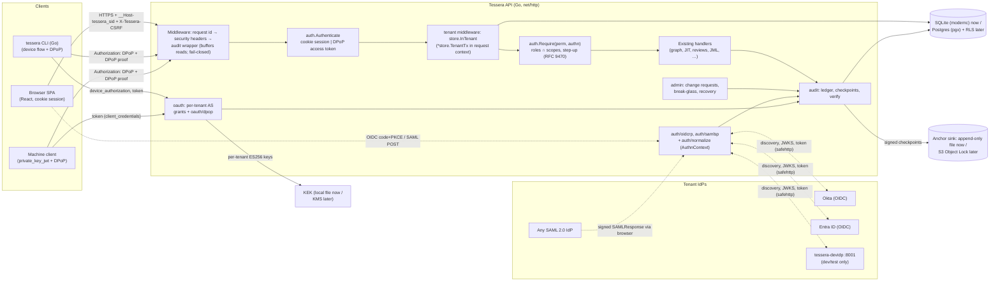

# Phase 0 design: make Tessera safe to connect

| | |
|---|---|
| Status | Draft for review (v2: re-targeted to the Go backend) |
| Author | iam-architect |
| Date | 2026-10-08 (v1, Python); 2026-10-09 (v2, Go) |
| Phase | 0 (see [`docs/knowledge/README.md`](../knowledge/README.md), "Build order") |
| Requirements covered | D1·M1–M4, M7–M10, S16; D2·M1, M7–M9; D4·M22; spec §10.2, §10.5 |
| Reviewers to sign off | `iam-authn-expert` (sections 8, 9, 11, 15), `iam-protocols-expert` (sections 6, 9, 10, 16), `iam-authz-expert` (section 12, the role model), `iam-governance-expert` (section 13, the audit ledger) |

**Exit criteria.** An admin signs in through Okta with a passkey. Every API call is authenticated and audited. The tenant isolation tests pass.

---

## Changes from v1 (Python)

The founder decided that Tessera's backend is **Go**: API, auth, connectors, workflows and CLI, plus the AWS effective-permission engine (Rust only if profiling later shows Go is too slow). The frontend stays React + TypeScript. The Python MVP backend is being ported to Go under `mvp/server/` (module `github.com/nischalravi/tessera/mvp/server`, stdlib `net/http`, `log/slog`, `database/sql` with `modernc.org/sqlite`, plain SQL, no ORM). This design now targets that code. **Every security property, threat mitigation, lifetime, route, error contract and exit criterion is unchanged.** What changed:

| Area | v1 (Python) | v2 (Go) |
|---|---|---|
| Where the code goes | `mvp/backend/tessera/…` | `mvp/server/internal/…`, `mvp/server/cmd/…` (§5.3) |
| OIDC RP | Authlib 1.8.0 client | `coreos/go-oidc/v3` v3.21.0 + `golang.org/x/oauth2` v0.37.0 |
| JOSE | joserfc 1.7.5 | `go-jose/go-jose/v4` v4.1.5 (algorithm allow-list is a required argument) |
| SAML SP | pysaml2 7.5.5 + `xmlsec1` binary | `russellhaering/gosaml2` v0.12.0 + `goxmldsig` ≥ v1.6.1, pure Go. `crewjam/saml` rejected (unmaintained, pins a goxmldsig vulnerable to CVE-2026-33487) |
| OAuth AS | Authlib server classes + Starlette adapter, fallback hand-written | `zitadel/oidc/v3` v3.51.13 `op` behind an adapter, same spike rule and the same hand-written fallback. `ory/fosite` rejected (no release since 2024-12, device grant unreleased) |
| DPoP | own module on joserfc | own `internal/oauth/dpop` on go-jose (no Go AS library implements RFC 9449) |
| WebAuthn | py_webauthn 3.0.1 | `go-webauthn/webauthn` v0.18.2 |
| JCS | rfc8785 0.1.4 | `gowebpki/jcs` v1.0.2 |
| Crypto | `cryptography` | Go standard library only (`crypto/cipher`, `crypto/hkdf`, `crypto/ed25519`, …) |
| Data model | SQLAlchemy models | Go structs + SQL DDL (§7) |
| Tenant isolation layer 1 | Session-bound loader criteria and flush hooks | `store.TenantTx`: the only handle on tenant tables, cannot exist without a `tenancy.ID`, binds `@tenant` itself (§14.1) |
| Tenant isolation layer 2 | Lint banning `text()` and `__table__` | Test banning `database/sql`, drivers and query calls outside `internal/store`, plus a lint of every SQL statement inside it (§14.4) |
| Tenant isolation layer 3 | Postgres RLS | Unchanged (Postgres RLS, `FORCE`, `set_config` per transaction), driver `pgx/v5` ≥ v5.9.2 |
| Request pipeline | FastAPI dependencies and Starlette middleware | `net/http` middleware and a route table with declared permissions (§5.2, §12.4) |
| Fail-closed audit for reads | replace the JSONResponse before it is sent | buffer the response; flush only after the audit append succeeds (§13.4) |
| Tests | pytest, markers, Hypothesis | `go test -race`, table-driven tests, `TestIsolation_*` naming, native fuzzing, JSON parity fixtures in `testdata/parity/` (§20) |
| Supply chain gates | pip-audit, bandit | `govulncheck`, `gosec`, `go vet`, `staticcheck` |
| Dev IdP | Python ASGI app | `cmd/tessera-devidp` + `internal/devidp`, in-process via `httptest` in tests |
| CLI | Python reference CLI in Phase 0, Go later | The Go CLI (`cmd/tessera-cli`) from Phase 0. The non-goal "Go CLI later" is gone |
| Operator commands | `python -m tessera.admin …`, `python -m tessera.audit …` | `tessera admin …`, `tessera audit …` |
| Names in prose | `STEP_UP_POLICY`, `STEP_UP_ADMIN`, `require(...)` | Kept as design names; in Go they are `auth.StepUpPolicy`, `auth.StepUpAdmin`, `auth.Require(...)` |
| PR1 precondition | none | **Blocked until the Go port PR (branch `go-backend`) is merged** |

---

## Contents

0. [Changes from v1 (Python)](#changes-from-v1-python)
1. [Summary of key decisions](#1-summary-of-key-decisions)
2. [Goals and non-goals](#2-goals-and-non-goals)
3. [Current state of the MVP](#3-current-state-of-the-mvp)
4. [Threat model (STRIDE)](#4-threat-model-stride)
5. [Architecture](#5-architecture)
6. [Libraries](#6-libraries)
7. [Data model](#7-data-model)
8. [Normalized AuthnContext](#8-normalized-authncontext)
9. [Authentication flows](#9-authentication-flows)
10. [Tokens: format, lifetimes and validation](#10-tokens-format-lifetimes-and-validation)
11. [Browser sessions and CSRF](#11-browser-sessions-and-csrf)
12. [Authorization: roles, scopes and step-up](#12-authorization-roles-scopes-and-step-up)
13. [Audit ledger](#13-audit-ledger)
14. [Tenant isolation enforcement](#14-tenant-isolation-enforcement)
15. [Recovery and admin-change hardening](#15-recovery-and-admin-change-hardening)
16. [API changes](#16-api-changes)
17. [Frontend changes](#17-frontend-changes)
18. [Configuration and the local dev IdP](#18-configuration-and-the-local-dev-idp)
19. [Implementation plan (ordered PRs)](#19-implementation-plan-ordered-prs)
20. [Test plan mapped to exit criteria](#20-test-plan-mapped-to-exit-criteria)
21. [Carrying this to production](#21-carrying-this-to-production)
22. [Open questions](#22-open-questions)
23. [Knowledge-base corrections found while designing](#23-knowledge-base-corrections-found-while-designing)
24. [References](#24-references)

---

## 1. Summary of key decisions

| # | Decision | Why |
|---|---|---|
| K1 | Tessera is a **relying party** to each tenant's IdP (OIDC RP and SAML SP). It never stores user passwords or second factors. Passkeys are enforced by the IdP and **proved to Tessera through `acr`/`amr`**. | D1·§8.1 and the README's rule 1: integrate with IdPs and don't rebuild them. |
| K2 | **Browser = server-side session cookie (BFF pattern). CLI and machines = short-lived JWT access tokens bound with DPoP.** Access tokens never reach browser JavaScript. | Removes token theft from the SPA, keeps one token format for non-browser clients, and follows RFC 9700 and the browser-app BCP. |
| K3 | Tessera runs a **small OAuth 2.1 authorization server per tenant** (issuer `https://<host>/t/<slug>`). It supports only three grants: device code (CLI), refresh token (rotating, DPoP-bound) and client credentials with `private_key_jwt` (automation). There is no authorization-code grant for third parties in Phase 0. | D2·M7–M9. A small surface means fewer edge cases. Per-tenant issuers and keys mean one tenant's key cannot mint tokens for another (the Storm-0558 lesson). |
| K4 | **go-oidc v3.21.0 + x/oauth2 v0.37.0** for the OIDC client, **go-jose v4.1.5** for all JOSE work, **gosaml2 v0.12.0 with goxmldsig ≥ v1.6.1** (pure Go, no `xmlsec1`) for SAML, **zitadel/oidc v3.51.13** for the AS grant logic (with a hand-written fallback), and **go-webauthn v0.18.2** only for break-glass keys. DPoP is our own package of about 300 lines on go-jose, because no maintained Go AS library implements RFC 9449. | Section 6 gives the reasons and the version evidence. |
| K5 | A **normalized `AuthnContext`** is recorded for every login and step-up. It carries `aal`, `phishing_resistant`, `methods`, `auth_time`, raw `acr`/`amr`, and how phishing resistance was established. Admin roles are **active only when the session's context is phishing-resistant**. | D1·M2, M4. |
| K6 | **Step-up** uses RFC 9470 semantics. Policy changes and approvals need phishing-resistant authentication no more than 15 minutes old. Admin changes need it no more than 5 minutes old. The IdP is forced to re-authenticate, and Tessera checks that `auth_time` is fresh rather than trusting it. | D1·M3. |
| K7 | **Tenant isolation in three layers.** (1) Only `internal/store` can run SQL, and tenant tables are reachable only through a `*store.TenantTx` that cannot be built without a `tenancy.ID` and that binds `tenant_id = @tenant` into every statement itself; it fails closed. (2) A test forbids `database/sql`, driver imports and query calls outside `internal/store`, and a lint test checks every statement inside it. (3) In production, Postgres RLS with `FORCE ROW LEVEL SECURITY` and a per-transaction `app.tenant_id`. | Spec §10.2. |
| K8 | **Audit ledger.** Each tenant has a SHA-256 hash chain over RFC 8785 (JCS) canonical JSON. Rows are append-only (DB triggers in SQLite, REVOKE plus trigger in Postgres). Ed25519-signed checkpoints are written every 5 minutes to an anchor sink: a local append-only file in dev, S3 Object Lock in production. `tessera audit verify` checks the chain. Domain events commit atomically with the change they describe. A read whose audit write fails returns 503. | D4·M22, D1·M9, spec §10.5. |
| K9 | **Admin changes are two-person, step-up-gated and cooled off.** IdP connection trust changes, admin role grants and break-glass enrolment need a second admin and wait 24 h. Admin roles are never granted from IdP group claims. | D1·M10, the Scattered Spider persistence pattern. |
| K10 | **Recovery without the IdP** uses two device-bound FIDO2 security keys per tenant (AAL3, attestation checked, backup-eligible keys refused). If those are lost too, recovery is operator-assisted with two operators, verified tenant security contacts and a 72 h cooling-off. There is no email or phone reset path. | D1·§4.6, help-desk social engineering. |
| K11 | **A Go dev IdP** (`cmd/tessera-devidp`, a separate process on :8001) issues real signed OIDC tokens and SAML assertions. It emulates Okta, Entra and generic claim profiles and has fault injection for negative tests. Real Okta and Entra are pure configuration. | You can run everything locally without Docker or Okta. |

**PR sequence** (section 19): PR1 tenancy foundation → PR2 config, crypto and keys → PR3 audit ledger → PR4 dev IdP → PR5 auth core (principals, sessions, RBAC, every route protected) → PR6 OIDC login → PR7 frontend sign-in → PR8 step-up → PR9 SAML → PR10 OAuth AS, device flow, DPoP and the reference CLI → PR11 machine clients → PR12 admin-change and recovery → PR13 break-glass → PR14 Postgres RLS → PR15 exit-criteria gate.

---

## 2. Goals and non-goals

### 2.1 Goals

1. **G1. Per-tenant SSO.** Each tenant configures one or more OIDC or SAML 2.0 IdP connections. Users are keyed by the immutable `(connection, subject)` pair and never by email.
2. **G2. A normalized `AuthnContext`** that policies, step-up and the audit ledger use.
3. **G3. Phishing-resistant admin access.** `tenant_admin` and `policy_admin` are inactive in sessions without phishing-resistant authentication.
4. **G4. Step-up** for policy changes (grant revoke, HRIS execute), approvals (JIT approve, review decisions) and admin changes, using RFC 9470 challenges for both browser and CLI.
5. **G5. API authentication on every route** except a small explicit allowlist. That means cookie sessions for the browser and DPoP-bound access tokens (≤ 10 min) for the CLI and machine clients.
6. **G6. CLI sign-in** via the RFC 8628 device flow with device-code phishing mitigations, DPoP (RFC 9449), and rotating refresh tokens with reuse detection.
7. **G7. An append-only, tamper-evident audit ledger** covering every API call, every authentication event, every decision and every admin change, with an offline verifier.
8. **G8. Multi-tenant isolation** of every existing and new table, proved by automated cross-tenant tests at the ORM, API, graph and token layers.
9. **G9. Hardened recovery and admin-change paths**: two-person approval, cooling-off, notifications, break-glass and no weak resets.
10. **G10. Runs locally** with SQLite (pure-Go driver, no cgo) and a Go dev IdP. Real Okta and Entra work through configuration alone. The design carries forward to Postgres with RLS.

### 2.2 Non-goals for Phase 0

- Tessera as a general IdP, or a hosted login for customers without an IdP (D1·C19, later).
- Native passkeys for ordinary users. Only break-glass uses WebAuthn directly.
- SSF/CAEP/RISC receiver, OIDC back-channel logout, and binding downstream cloud credentials to sessions (Phase 3, D1·M5–M6).
- Workload identity federation into Tessera (GitHub OIDC to Tessera), token exchange (RFC 8693), RAR and PAR. These come in Phases 1–3.
- Cedar-based platform authorization. Phase 0 ships a static role-to-permission map designed so it translates to Cedar later (spec §5.8).
- SCIM provisioning of Tessera's own users. Users are created just-in-time at first login, and admins through the admin-change flow.
- Users belonging to several tenants (MSPs, consultants). One `PlatformUser` belongs to one tenant.
- Production key custody in KMS or HSM. This phase ships the interface and a local KEK. See section 21.
- Device posture and risk signals. The `AuthnContext.device` and `risk` fields exist but stay empty.
- The full Go CLI. Phase 0 ships only its sign-in subset (`login`, `whoami`, `api`, `logout`) in `cmd/tessera-cli`, which fixes the protocol contract. The rest of the CLI (spec §14.1) builds on it later.

---

## 3. Current state of the MVP

What I found in the Python MVP (`mvp/backend/`) and what each finding means for this design. The Go port (`mvp/server/`) reproduces the same behaviour and API contract (that is what its parity fixtures check), so every finding carries over: the "Where" column names the Python file and, in brackets, the Go package that replaces it.

| Finding | Where | Consequence |
|---|---|---|
| No authentication on any route. CORS is `allow_origins=["*"]`. | `api/app.py` [`internal/api`] | Every route needs authentication middleware and a declared permission. CORS must be restricted. |
| Callers choose their own actor. `RevokeIn.actor`, `DecisionIn.approver` and `ReviewDecisionIn.reviewer` are request-body fields, and the UI hard-codes `security-oncall@larkspur.example`. | `api/app.py` [`internal/api`], `pages/JIT.tsx`, `pages/Reviews.tsx` | This is a spoofing and repudiation hole. The fields are removed and the actor comes from the authenticated principal. |
| The audit log is a plain mutable table. `audit(session, actor, action, **detail)` adds a row. | `audit.py`, `models.AuditLog` [the port's audit helper in `internal/store`] | Replaced by the hash-chained `audit_events`. `audit.Record(ctx, tx, action, …)` keeps the same call shape so call sites in `internal/jit`, `internal/jml`, `internal/reviews` and `internal/api` change mechanically. |
| Every table is global, with no `tenant_id`. Uniqueness is global, for example `UniqueConstraint("system","external_id")`, `Identity.external_id unique`, `GrantEdge (src,dst)` and `HrisEvent.external_id unique`. | `models.py` [`internal/store` schema] | Add `tenant_id` everywhere and widen every unique constraint to start with `tenant_id`. |
| Primary keys are global integer sequences, and graph node keys are `"account:12"` and similar. | `models.py`, `graph.py` [`internal/store`, `internal/graph`] | IDs are guessable across tenants. Isolation must make another tenant's IDs look nonexistent (404), including node keys passed to `/api/simulate`. |
| Access goes through ORM `select()`, `session.get()` and `session.delete()`, plus **one bulk delete** of all agent delegations (`ingest.py:167`) and **two bulk inserts** of usage events (`ingest.py:193,203`). In the port these are plain SQL statements in `internal/store`. | `ingest.py` [`internal/store`, `internal/connectors`] | Every statement gains a `tenant_id = @tenant` predicate (or column) bound by `TenantTx`. The unscoped bulk delete is the first regression test (§14.1). |
| `GraphSnapshot.from_db(session)` loads the whole graph. | `graph.py` [`internal/graph`] | The Go builder takes a `*store.TenantTx`, so the graph is per-tenant by construction. No graph logic changes. |
| A background sweeper uses `SessionLocal()` with no context. | `api/app.py` lifespan [the port's sweeper goroutine] | Must loop over tenants with one tenant transaction each (`ForEachActiveTenant`). |
| The frontend calls `fetch('/api'+path)` through a Vite proxy (`/api` → :8000). The footer hard-codes the tenant name. | `frontend/src/api.ts`, `vite.config.ts`, `App.tsx` | Same-origin cookies work through the proxy. Add CSRF header and 401/step-up handling, and proxy `/t/*` and `/.well-known/*`. |
| Schema is built at startup, and the DB is reseeded freely. | `db.py`, `seed.py` [`internal/store` embedded DDL, `internal/seed`] | Phase 0 can change the schema without migrations. goose migrations arrive with Postgres (PR14). |

---

## 4. Threat model (STRIDE)

Scope: Tessera's own control plane, meaning the API, UI, CLI, auth endpoints, admin paths, audit and DB. Assets, in priority order: (a) the tenant's access graph and decisions (the attacker's "skeleton key"), (b) authority to change access (revoke, approve, apply), (c) the admin plane (IdP trust, roles, clients), (d) audit integrity, (e) Tessera signing keys.

| ID | STRIDE | Threat and scenario | Mitigation in this design | Residual / later |
|---|---|---|---|---|
| S1 | Spoofing | **Forged or confused ID token**: `alg:none`, RS→HS confusion, `kid`/`jku` injection, wrong `aud`/`iss`, or an ID token replayed as an access token. | go-jose v4 with an explicit per-connection algorithm allow-list (asymmetric only; the list is a required argument of `ParseSigned`). Keys come only from the pinned issuer's JWKS, and `jku`/`x5u`/`jwk` headers are ignored. Exact `iss` and `aud` checks, `azp` when there are several audiences, `nonce`, `exp`/`iat` with 60 s leeway. ID tokens are never accepted by the API (`typ`/`aud` differ). §9.1, §10.4. | Fix new JOSE advisories by pinning patched versions (go-jose had GO-2026-4945 in 2026; `govulncheck` gates CI). |
| S2 | Spoofing | **SAML signature wrapping (XSW), comment injection, unsigned assertion inside a signed response, Golden SAML.** | gosaml2 with goxmldsig ≥ v1.6.1 (fixes CVE-2026-33487), the `encoding/xml` round-trip validator, a required signed Assertion, signing cert pinned per connection (X.509 only, from config, never from `KeyInfo`), only the verified assertion element consumed, no IdP-initiated SSO, `InResponseTo`, Audience, Destination and Recipient checks, one-time assertion IDs. A negative corpus covers XSW1–8. §9.2. | Golden SAML (stolen IdP key) cannot be detected by the SP. Later: alert on new signing certs (D2·M23). |
| S3 | Spoofing | **Actor spoofing in request bodies** (exists today). | Body fields removed. The actor always comes from the authenticated principal. | |
| S4 | Spoofing | **Account takeover through email-based linking** (nOAuth). | Users are keyed on `(idp_connection_id, subject)`. Email is display-only. SAML requires a persistent NameID or a configured immutable attribute. | |
| S5 | Spoofing | **Login CSRF and IdP-initiated injection.** | Each login transaction is bound to a `__Host-` cookie and checked against `state` and `nonce` (OIDC) or `RelayState` and `InResponseTo` (SAML). Unsolicited SAML responses are rejected. | |
| S6 | Spoofing | **Device-code phishing** (Storm-2372 pattern). | The device grant is limited to the first-party `tessera-cli` client. The `user_code` lives 5 min and must be typed: there is no `verification_uri_complete` and no QR code. The approval page shows the client, the requester's IP and the time, with a warning. Approval needs re-authentication within 5 min. Each tenant can disable the device grant. Every event is audited. §9.3. | Users can still be talked into approving. That is detectable from the audit (IP mismatch). |
| S7 | Spoofing | **Stolen access or refresh token replay** (infostealer, logs, HAR files). | DPoP binding (`cnf.jkt`) on every CLI and machine token. Access tokens last ≤ 10 min. Refresh tokens rotate and are DPoP-bound, and reuse revokes the whole family and the session. The `sid` is checked live on each request, so revocation is immediate. Tokens are never logged. | A stolen DPoP private key from the CLI host. Later: non-exportable keys in the Go CLI (Secure Enclave or TPM). |
| S8 | Spoofing | **Session cookie theft or fixation.** | `__Host-` cookie, `HttpOnly`, `Secure`, `SameSite=Lax`. Only a hash is stored server-side. The cookie is rotated at login, step-up and role change. Idle and absolute timeouts follow AAL targets. Sessions can be revoked server-side. | DBSC binding later (D1·C21). |
| S9 | Spoofing | **Rogue IdP connection or new admin added for persistence** (Scattered Spider). | Admin-change requests need two different admins with step-up, a 24 h cooling-off that any admin can cancel, and notifications to all admins and security contacts. §15. | |
| T1 | Tampering | **Audit log edited or deleted** by an attacker or insider with DB access. | Hash chain, triggers that block UPDATE and DELETE, an app DB role without UPDATE/DELETE in Postgres, signed checkpoints anchored outside the DB, and a verifier. §13. | A DB superuser can rewrite the tail after the last checkpoint. That window is at most 5 min. |
| T2 | Tampering | **CSRF on state-changing calls.** | `SameSite=Lax`, a session-bound `X-Tessera-CSRF` header on unsafe methods, an `Origin` allow-list check, and JSON-only bodies. | |
| T3 | Tampering | **OAuth code injection or mix-up** against Tessera as RP. | PKCE S256, one redirect URI per connection, `state`, the RFC 9207 `iss` check when the IdP advertises it, and `nonce`. | |
| T4 | Tampering | **Tenant config tampering through the API** (acr mapping, `assume_phishing_resistant`). | These are admin-change types (two-person, cooled off). §15. | |
| R1 | Repudiation | An approver denies approving, or a step-up did not really happen. | Every decision records the principal, session, `AuthnContext` (aal, phr, auth_time, acr, amr) and the requirement it met. Step-up checks `auth_time ≥ transaction start`. | |
| I1 | Info disclosure | **Cross-tenant reads** through guessable integer IDs, node keys, background jobs or raw SQL. | Three layers. §14. Responses for another tenant's IDs are 404, never 403. | |
| I2 | Info disclosure | Tokens or secrets in logs, URLs or `Referer`. | No tokens in the browser. Authorization, Cookie and DPoP headers are scrubbed from logs. `Referrer-Policy: no-referrer`. Codes are POSTed, not passed in query strings, where we control it. | |
| I3 | Info disclosure / EoP | **SSRF** through tenant-configured discovery, JWKS or SAML metadata URLs. | `safehttp.Client()`: HTTPS only, no private, loopback or link-local IPs (checked after DNS resolution), no cross-host redirects, 5 s timeout, 512 KiB limit. Dev can allow `127.0.0.1` only. | |
| I4 | Info disclosure | **Tenant enumeration** through home-realm discovery. | Generic responses, rate limits, and no listing of connection names before a tenant slug is given. | Low impact. |
| D1 | DoS | Oversized JWS or JWT, XML bombs, device-poll floods, brute force of user codes. | Size caps before parsing (8 KiB for JWTs, 256 KiB for SAML POSTs). Go's `encoding/xml` does not expand external entities or DTDs; gosaml2 also rejects DEFLATE bombs (CVE-2023-26483 fix) and goxmldsig 1.6.1 limits canonicalization node counts. `slow_down` on polling, per-IP and per-session rate limits on `/token`, `/device_authorization` and the device verify endpoint. | In-process limiter in Phase 0, Valkey later. |
| D2 | DoS | An audit outage blocks reads (fail-closed). | Chosen on purpose: a read of customer data whose audit write fails returns 503. It is monitored. | |
| E1 | EoP | **IdP group claim grants admin.** | Group-to-role mapping can only grant `viewer`, `operator` or `auditor`. Admin roles come only from explicit assignment through an admin change. | |
| E2 | EoP | **A weakly authenticated session uses an admin role.** | Role activation needs `AuthnContext.phishing_resistant`. Sensitive actions need step-up. | |
| E3 | EoP | **The tenant filter is bypassed** by raw SQL, Core statements or a missing context. | A zero `tenancy.ID` fails closed. Only `internal/store` can import `database/sql`, and every statement there is linted for its tenant predicate. A schema-coverage meta-test. RLS in production. | |
| E4 | EoP | **Recovery abuse** (help desk, email reset). | No email or phone recovery. Break-glass needs hardware keys. Operator recovery needs two operators, verified contacts and 72 h cooling-off with notification. §15. | |
| E5 | EoP | **One rogue admin removes the other admins.** | Removing another admin's role is also two-person. Self-removal is single-person, but the last two admins cannot drop below `min_admins`. | |
| E6 | EoP | **Theft of a Tessera signing key.** | Per-tenant ES256 keys encrypted under a KEK (KMS in production). `kid` must belong to the tenant named by `iss`. 30-day rotation. A tenant's key can be revoked on its own. | |

---

## 5. Architecture

### 5.1 Component diagram



### 5.2 Request pipeline

Standard `net/http` middleware (`func(http.Handler) http.Handler`), composed once in `internal/api/router.go`:

1. **`RequestID`** assigns `request_id` (UUIDv4), stores it in the request `context.Context` and adds it to the request-scoped `*slog.Logger`.
2. **`SecurityHeaders`** adds `Content-Security-Policy: default-src 'self'; frame-ancestors 'none'`, `X-Content-Type-Options: nosniff`, `Referrer-Policy: no-referrer`, `Cache-Control: no-store` on `/api/auth/*` and `/t/*`, and HSTS in production.
3. **`audit.Middleware`** (section 13.4) wraps the call with a buffering `http.ResponseWriter`. After the handler returns it writes an `http.request` event using the principal from the context, the route pattern (`r.Pattern`, Go 1.23+) and the status, and only then flushes the buffered response.
4. **`auth.Authenticate`** (section 12.4) authenticates through the cookie or DPoP path, builds a `*auth.Principal` and stores it in the context. Public routes skip it; every other route fails with 401 when it is missing.
5. **`tenant.Middleware`** opens `store.InTenant(ctx, principal.TenantID, …)` and stores the `*store.TenantTx` in the context for the handler. The transaction commits after the handler returns without error and rolls back otherwise.
6. **`auth.Require(permission, authn)`** checks roles, scopes and the authentication requirement. If the requirement is not met it writes a step-up challenge (401 with RFC 9470 parameters).
7. The handler runs. Domain `audit.Record(ctx, tx, …)` calls inside it use the same `*store.TenantTx`, so they commit atomically with the change.

Routes are registered only through `api.Router.Handle(pattern, Route{Perm, Authn, Public}, handler)`, which records each route in a table. Tests enumerate that table (§20), because a plain `http.ServeMux` cannot list its patterns.

### 5.3 New backend packages

All under `mvp/server/` (module `github.com/nischalravi/tessera/mvp/server`). Existing packages (`internal/{api,store,graph,policy,leastpriv,jit,reviews,jml,nhi,connectors,seed}`) keep their names.

```
cmd/
  tessera/                  existing binary; new subcommands:
                              tessera serve | seed | audit verify|checkpoint|export
                              tessera admin create-tenant|add-idp|invite-admin|add-client|recover-tenant|revoke-signing-key
  tessera-devidp/           dev/test-only IdP binary (§18.5); refuses to start when TESSERA_ENV=prod
  tessera-cli/              user CLI (Phase 0 subset: login | whoami | api | logout)
internal/
  config/                   Settings from env; production guard rails (§18)
  tenancy/                  tenancy.ID type, Platform tenant constant (§7.2)
  store/                    THE ONLY package that imports database/sql or a driver (§14)
    db.go                   Open(dsn), InTenant, InSystem, ForEachActiveTenant
    tenant_tx.go            TenantTx and its statement executor (binds @tenant itself)
    system_tx.go            SystemTx: global tables + the two hash lookups (§14.2)
    model_*.go              structs from §7.4
    repo_*.go               one file per aggregate (identities, grants, sessions, audit, …)
    schema/*.sql            embedded DDL (§7.5); postgres/ variants and rls.sql (PR14)
  seal/                     KEK AEAD (AES-256-GCM, crypto/cipher), random secrets, SHA-256 helpers
  keys/                     Per-tenant signing keys, JWKS, rotation; platform audit key
  safehttp/                 Client(): SSRF-guarded outbound HTTP (custom net.Dialer Control hook)
  ratelimit/                In-process limiter on golang.org/x/time/rate, keyed per IP/session
  audit/
    ledger.go               canonicalization (JCS), hashing, Append(ctx, tx, Event)
    record.go               Record(ctx, tx, action, …) — replaces the MVP audit helper
    checkpoint.go           signed checkpoints + anchor sinks (file, s3 stub)
    verify.go               chain + checkpoint + anchor verification
    middleware.go           http.request event, fail-closed reads
  auth/
    principal.go            Principal, AuthnContext, context helpers
    normalize/              claim → AuthnContext mapping profiles (okta, entra, generic_oidc, saml, devmock)
    oidcrp/                 discovery, auth URL, callback, ID-token validation (go-oidc + go-jose)
    samlsp/                 gosaml2 SP per connection, AuthnRequest, ACS validation
    sessions.go             create/rotate/touch/revoke sessions; cookie helpers
    csrf.go                 CSRF token + Origin check
    rbac.go                 roles, permissions, scopes, Require()
    stepup.go               AuthnRequirement, step-up challenge rendering (RFC 9470)
    middleware.go           Authenticate, tenant middleware
    routes.go               /api/auth/* handlers
  oauth/
    server.go               per-tenant AS: zitadel/oidc op adapter or hand-written grants (§6)
    grants.go               device_code, refresh_token (rotation + reuse detection), client_credentials
    clientauth.go           private_key_jwt (RFC 7523) with jti replay cache
    dpop/                   DPoP proof validation, nonces, jkt (RFC 9449)
    tokens.go               RFC 9068 access-token mint + verify
    routes.go               /t/{slug}/oauth/*, /.well-known/*
  admin/
    changes.go              change-request state machine + appliers
    breakglass.go           WebAuthn registration/authentication (go-webauthn)
    recovery.go             operator recovery procedures
    notify.go               outbox + log/SMTP senders
    routes.go               /api/admin/*
  devidp/                   Dev/test-only IdP (never imported by internal/api; enforced by a test)
    oidc.go, saml.go, users.yaml, profiles.go, faults.go
  cliauth/                  CLI side of device flow + DPoP, credential store (used by cmd/tessera-cli)
```

---

## 6. Libraries

Versions, dates and advisories were checked on 2026-10-08 against the Go module proxy (`proxy.golang.org/<module>/@latest`), the Go vulnerability database and OSV (`api.osv.dev`, which merges GO- and GHSA- ids), and each repository's GitHub security advisories.

**Toolchain.** `go.mod` declares `go 1.26` and `toolchain go1.27.2`. The supported Go releases on that date are 1.27 (go1.27.2) and 1.26 (go1.26.9). Go 1.26 is the floor because go-webauthn and zitadel/oidc require it. A modern `go` directive also matters for security: goxmldsig's CVE-2026-33487 only bites code compiled with pre-1.22 loop-variable semantics.

| Purpose | Choice and pin | Latest release | Maintenance and security evidence | Why this, and what was rejected |
|---|---|---|---|---|
| OIDC client (RP) | **`github.com/coreos/go-oidc/v3` v3.21.0** for discovery, JWKS (`RemoteKeySet`) and the base ID-token verifier, plus **`golang.org/x/oauth2` v0.37.0** for the code exchange and PKCE (`GenerateVerifier`, `S256ChallengeOption`, `VerifierOption`) | go-oidc 2026-09-01; x/oauth2 2026-08-25 | go-oidc: Apache-2.0, active (pushed 2026-09-09), no advisories. x/oauth2: Go team, BSD-3; one advisory, GO-2025-3488 / CVE-2025-22868 (memory exhaustion in the `jws` package from malformed tokens, fixed v0.27.0). We never import `x/oauth2/jws`. | The standard pairing in Go. Both take an injected `*http.Client` (`oidc.ClientContext`, `oauth2.HTTPClient`), so every fetch goes through `safehttp`. go-oidc's verifier is configured with an explicit `SupportedSigningAlgs` and our own extra checks (`azp`, `nonce`, `auth_time`, `iat` window, size cap) run after it, so every check in §10.4 is visible in our code. `state`, `nonce` and the PKCE verifier stay server-side in `LoginTransaction`. |
| JOSE (JWS, JWT, JWK) | **`github.com/go-jose/go-jose/v4` v4.1.5** | 2026-09-03 | Apache-2.0, active (pushed 2026-10-08). Advisories, all fixed: GO-2024-2631 / CVE-2024-28180 (JWE decompression bomb, 4.0.1), GO-2025-3485 / CVE-2025-27144 (header-parsing DoS, 4.0.5), GO-2026-4945 / CVE-2026-34986 (panic in JWE decryption, 4.1.4). We use JWS only, never JWE. | v4's `jose.ParseSigned` and `jwt.ParseSigned` **require** the list of allowed algorithms as an argument, so an algorithm allow-list is enforced by the API, not by convention. RFC 7638 thumbprints (`JSONWebKey.Thumbprint(crypto.SHA256)`), ES256 and EdDSA are built in. It is the JOSE stack go-oidc and zitadel/oidc already use, so there is one JOSE library to patch. **`lestrrat-go/jwx`** (v3.3.0 and a new v4.5.0, MIT) was rejected: it would be a second JOSE stack, it is mid-way through a v3/v4 split, and GHSA-4cf7-xm37-g63h (2026-09-08, unescaped custom member names allowed injecting extra signed fields) shows a serialization-layer bug class we would rather not carry. |
| SAML 2.0 SP | **`github.com/russellhaering/gosaml2` v0.12.0**, with **`github.com/russellhaering/goxmldsig` ≥ v1.6.1** pinned in our `go.mod`, `github.com/beevik/etree` v1.8.1 and `github.com/mattermost/xml-roundtrip-validator` v0.1.0 | gosaml2 2026-08-05; goxmldsig 2026-08-04 | gosaml2: Apache-2.0, active, patched twice in 2026: GO-2026-4760 (CBC padding panic) and GO-2026-4764 (unsigned LogoutRequest accepted), both fixed 0.11.0. v0.12.0 also rejects unsigned LogoutResponses. Older: GHSA-5684-g483-2249 (signature bypass, 0.5.0), GO-2021-0060 / CVE-2020-29509 (encoding/xml round-trip auth bypass, 0.6.0), CVE-2020-7711 (nil deref, 0.7.0), GO-2023-1602 / CVE-2023-26483 (deflate bomb, 0.9.0). goxmldsig: CVE-2020-15216 (signature bypass, 1.1.0), CVE-2020-7711 (1.1.1), **GO-2026-4753 / CVE-2026-33487 (signature bypass through loop-variable capture in `validateSignature`, fixed 1.6.0)**; 1.6.1 adds node limits during canonicalization. etree: no advisories. xml-roundtrip-validator: dormant since 2020, no advisories, and still the standard guard against the `encoding/xml` round-trip bugs (CVE-2020-29509/-29510/-29511). | An actively patched SP library with a pure-Go XML-DSig stack, so no `xmlsec1` system binary. **`crewjam/saml` was rejected**: its last release is v0.5.1 (2025-04-14), it has a history of critical XML-signature bypasses (CVE-2020-15216, CVE-2020-27846, and CVE-2022-41912 where multiple `Assertion` elements bypassed the check), and its `main` still pins goxmldsig v1.4.0, which is vulnerable to CVE-2026-33487. PRs to upgrade that dependency and to fix a KeyInfo-injection bypass were closed unmerged in 2026. Regardless of library, §9.2 requires a signed Assertion, consumes **only the assertion element that was verified**, and the XSW corpus plus a fuzz target run in CI. |
| OAuth AS grant logic | **`github.com/zitadel/oidc/v3` v3.51.13** (`pkg/op`, ≥ v3.47.0 required), behind our adapter in `oauth/server.go`. **Fallback:** the three grants hand-written on go-jose (see PR10 spike rule). | 2026-10-06 | Apache-2.0, very active (pushed 2026-10-07). Released support for RFC 8628 device authorization, RFC 7523 JWT profile, PKCE and token exchange. One advisory: GHSA-j8gq-92xf-382c (2026-08-24): opaque access tokens were encrypted without authentication, so a holder could forge the subject. Fixed v3.47.0. We issue only JWT access tokens, but pin above the fix anyway. Refresh-token rotation and reuse detection are **left to the storage implementation**. Its only DPoP code is an experimental helper for the draft "OpenID Connect Key Binding", not RFC 9449. | D2·§8.4 says to embed a proven engine rather than write one. **`ory/fosite` was rejected**: its last release is v0.49.0 (2024-12-12), its device-grant handler is unreleased (on `master` only), it has no DPoP (issue #829 stale), and open issue #876 (2026-05) reports that Request Objects signed with `alg=none` are accepted when the client registered no algorithm. Its refresh-rotation semantics are better, but release stagnation is disqualifying for a security-critical dependency. Ory Hydra and Keycloak were rejected as before (not embeddable, heavier than needed). The adapter maps zitadel's `op.Storage` to our `store` repositories, registers only the three grant types, and serves a per-tenant issuer from the `/t/{slug}` path. |
| DPoP (RFC 9449) | **Our own `internal/oauth/dpop`** on go-jose v4 | — | Neither zitadel/oidc nor fosite implements RFC 9449 (checked in source on 2026-10-08). | The spec is small and self-contained: proof validation, `jkt`, nonces and `ath`. Tests use the RFC 9449 examples, and a `FuzzValidateProof` target runs in CI. |
| WebAuthn (break-glass only) | **`github.com/go-webauthn/webauthn` v0.18.2** | 2026-09-19 | BSD-3, active (pushed 2026-10-08), no advisories in OSV or GHSA. Supports packed, tpm, android-key, android-safetynet, fido-u2f, apple and compound attestation, plus an attestation-policy module. Requires Go 1.26. | Needed only because break-glass has to work when the IdP is down or misconfigured (§15.4). Ordinary passkeys stay with the IdP. |
| Canonical JSON for audit | **`github.com/gowebpki/jcs` v1.0.2** | 2026-09-21 | Apache-2.0, maintained. A cleaned-up fork of Anders Rundgren's reference implementation, made with his permission. | JCS gives byte-exact canonicalization that any other verifier (Python, JS, Rust) can reproduce. `cyberphone/json-canonicalization` (the reference) is untagged and dormant since 2024-12. Plain `encoding/json` with sorted map keys is **not** JCS (number and Unicode escaping differ). |
| Crypto primitives | Go standard library: `crypto/aes` + `crypto/cipher` (AES-256-GCM), `crypto/ecdsa` (P-256), `crypto/ed25519`, `crypto/hkdf` (stdlib since Go 1.24), `crypto/rand`, `crypto/subtle`, `crypto/hmac`, `crypto/sha256` | ships with Go 1.26/1.27 | Go security team; patched through toolchain point releases (pin `toolchain go1.27.2`). | No third-party crypto. `golang.org/x/crypto` is **not** needed in Phase 0. If it is ever added, pin ≥ v0.56.0 (a long run of 2026 `ssh` advisories, fixed by 0.56.0) and never use its deprecated `openpgp` package (GO-2026-5932). |
| SQLite driver | **`modernc.org/sqlite` v1.60.1** (already used by the Go port) | 2026-09-29 | No advisories. Pure Go, so no cgo. | Matches the port. DSN sets `_pragma=foreign_keys(1)`, `_pragma=busy_timeout(5000)` and `_txlock=immediate`. |
| Postgres driver and migrations (PR14) | **`github.com/jackc/pgx/v5` v5.11.0** (through `pgx/v5/stdlib` for `database/sql`); **`github.com/pressly/goose/v3` v3.28.0** | pgx 2026-09-07; goose 2026-09-02 | pgx: MIT. Advisories: GO-2024-2606 / CVE-2024-27304 (SQL injection through protocol message size overflow, 5.5.4), CVE-2026-33815/-33816 (memory safety, 5.9.0), **GO-2026-5004 / CVE-2026-41889 (SQL injection through placeholder confusion with dollar-quoted strings, fixed 5.9.2)**. Never use pgx v4 or `pgproto3/v2` (GO-2026-4518, unfixed). goose: no advisories. | Introduced together with Postgres. **Pin pgx ≥ v5.9.2.** Our SQL never uses dollar-quoted strings in parameterized statements, and a lint test (§14.4) enforces that. goose runs embedded SQL migrations, which fits the no-ORM rule. `golang-migrate` v4.20.1 is the equivalent alternative. |
| IDs | `github.com/google/uuid` (exact version pinned in PR1) | | BSD-3, Google-maintained, no advisories at the time of writing. | v4 now, v7 (`NewV7`) for Postgres keys later. |
| YAML (IdP config files, dev IdP users, policies) | **`go.yaml.in/yaml/v3` v3.0.5** | 2026-07-26 | Maintained by the YAML organization (`github.com/yaml/go-yaml`, pushed 2026-10-03). `gopkg.in/yaml.v3` is frozen at v3.0.1 (2022) and its repository is archived. | Decoding uses `KnownFields(true)` and size limits. If the Go port has already chosen a YAML library, keep a single one. |
| Rate limiting | **`golang.org/x/time/rate` v0.16.0** | 2026-08-19 | Go team. | Token buckets per key in a bounded LRU. Valkey later (§21). |
| HTTP | Go standard library `net/http` (as in the port) | | | `safehttp` wraps it with a custom `net.Dialer.Control` hook that checks every resolved IP (§4 I3). |

**`go.mod` additions:** the modules above, at the pinned versions. `go.sum` is committed. **No new cgo dependency and no system package**, so the old `xmlsec1` requirement and the "skip SAML tests if missing" rule disappear: the SAML suite always runs.

**Dependency hygiene.** Exact versions in `go.mod`. `govulncheck ./...` (golang.org/x/vuln v1.8.0) runs in CI as a gate in PR2. `gosec` (v2.29.0) and `staticcheck` (2026.2.1) run in the weekly security scan and on PRs. A security owner must review any bump of go-oidc, go-jose, gosaml2, goxmldsig, zitadel/oidc or go-webauthn within 7 days of an advisory. Because gosaml2 depends on goxmldsig and two dormant XML modules (`etree`, `xml-roundtrip-validator`), the XML stack is listed in the weekly sweep explicitly.

---

## 7. Data model

### 7.1 Conventions

- Every tenant-owned table has `tenant_id` (`TEXT` holding the canonical lower-case UUID string in SQLite; native `uuid` in Postgres). It is `NOT NULL`, indexed and a foreign key to `tenants(id)`. In Go it is always the named type `tenancy.ID`, never a bare `string` or `uuid.UUID`, so the compiler stops a user ID being passed where a tenant ID belongs.
- **Existing integer primary keys stay**, because the API contract, the parity fixtures and graph node keys depend on them. New tables use UUID primary keys (`uuid.New()` v4 now, `uuid.NewV7()` in Postgres later; `github.com/google/uuid`).
- Every unique constraint starts with `tenant_id`.
- Secrets at rest (client secrets, private keys, PKCE verifiers) are encrypted with `seal.Seal(plaintext, aad)`, where `aad = tenantID + "|" + table + "|" + column` (AES-256-GCM under the KEK). Bearer secrets (session cookies, refresh tokens, device codes, invitation codes) are **stored only as SHA-256 hashes**.
- Global (non-tenant) tables are an explicit allowlist, `store.GlobalTables = {"tenants", "platform_keys", "replay_cache", "schema_migrations"}`. The meta-test in §14.4 enforces it against the live schema.
- A reserved tenant row `slug="_platform"` (fixed UUID `00000000-0000-0000-0000-000000000001`) owns the platform audit chain, which holds events with no tenant, operator actions and isolation violations.
- Timestamps are UTC. Go uses `time.Time` (always `.UTC()`); SQLite stores RFC 3339 text with microseconds (`2006-01-02T15:04:05.000000Z`), Postgres `timestamptz`. Nullable columns are pointer fields (`*time.Time`, `*string`) in Go.
- JSON columns are `TEXT` holding JSON in SQLite and `jsonb` in Postgres. In Go they are typed structs or slices with explicit `json` tags and are decoded with `DisallowUnknownFields`, never `map[string]any`, except `detail` in audit events (§13.2).
- **All SQL lives in `internal/store`** (§14). Struct definitions live in `internal/store` too (`store/model_*.go`) so other packages use the types without being able to issue queries.

### 7.2 Tenancy types

```go
// internal/tenancy/tenancy.go
package tenancy

// ID identifies a tenant. The zero value is invalid; store.InTenant rejects it.
type ID struct{ u uuid.UUID }

var Platform = MustParse("00000000-0000-0000-0000-000000000001")

func Parse(s string) (ID, error)
func MustParse(s string) ID
func (id ID) String() string
func (id ID) IsZero() bool
// Value/Scan implement driver.Valuer and sql.Scanner. They are used only inside internal/store.
```

`tenancy.ID` deliberately has no exported field and no conversion from `uuid.UUID`. The only constructors are `Parse` (for values read back from trusted rows: a session row, a verified token's `tid`, a path slug resolved in the store) and the store itself.

### 7.3 Changes to existing tables (`internal/store/schema/0001_tenancy.sql`)

Every existing table gains `tenant_id TEXT NOT NULL REFERENCES tenants(id)` and an index on it. The constraint changes are:

| Table | Change |
|---|---|
| `identities` | `external_id` is no longer globally unique. Becomes `UNIQUE (tenant_id, external_id)`. |
| `accounts`, `groups`, `resources`, `permissions`, `secrets` | `UNIQUE (system, external_id)` becomes `UNIQUE (tenant_id, system, external_id)`. |
| `grant_edges` | `UNIQUE (src, dst)` becomes `UNIQUE (tenant_id, src, dst)`. |
| `agent_delegations`, `usage_events`, `review_campaigns`, `review_items` | Add `tenant_id` only. Add index `(tenant_id, day)` on `usage_events`. |
| `access_requests` | Add `tenant_id`, `requested_by_user_id TEXT NULL REFERENCES platform_users(id)` and `decided_by_user_id TEXT NULL`. `decided_by` (display string) stays for the UI. |
| `review_items` | Add `decided_by_user_id TEXT NULL`. |
| `hris_events` | `external_id UNIQUE` becomes `UNIQUE (tenant_id, external_id)`. Add `executed_by_user_id TEXT NULL`. |
| `audit_log` | **Removed.** Replaced by `audit_events` (§13). `GET /api/audit` keeps its response fields (`id, at, actor, action, detail`) and adds new ones. |

The matching Go structs in `internal/store` gain a `TenantID tenancy.ID` field. Repository methods never take it as a parameter; they fill it from the transaction (§14.1).

Foreign keys between tenant tables (`accounts.identity_id → identities.id`, and so on) stay single-column in SQLite. In Postgres (PR14) they become **composite** `(tenant_id, id)` references against a `UNIQUE (tenant_id, id)` on the parent, so the database itself refuses a cross-tenant reference.

### 7.4 New tables: Go structs

```go
// internal/store/model_auth.go  (sketch; JSON tags and some fields abbreviated)
package store

type Tenant struct { // GLOBAL table
	ID               tenancy.ID
	Slug             string            // ^[a-z0-9][a-z0-9-]{2,39}$, "_platform" reserved
	Name             string
	Status           string            // active | suspended | recovery
	Cell             string            // "local"
	MinAdmins        int               // default 2
	Settings         TenantSettings    // §18.3 (timeouts, step-up windows, device grant on/off)
	SecurityContacts []SecurityContact // {Name, Email, PhoneLast4, VerifiedAt} for recovery (§15.5)
	CreatedAt        time.Time
}

type IdPConnection struct {
	ID        uuid.UUID
	TenantID  tenancy.ID
	Name      string
	Protocol  string // oidc | saml
	Profile   string // okta | entra | google | generic_oidc | generic_saml | dev_mock
	Status    string // pending | active | disabled
	IsDefault bool
	VerifiedDomains []string // home-realm discovery only, never identity matching
	// --- OIDC
	Issuer           *string // exact-match `iss`
	DiscoveryURL     *string // default issuer + /.well-known/openid-configuration
	ClientID         *string
	ClientAuthMethod *string // private_key_jwt | client_secret_basic
	ClientSecretEnc  []byte  // sealed with KEK
	ClientSigningKID *string // TenantSigningKey (purpose=idp_client_auth)
	Scopes           []string          // default ["openid","email","profile"]
	IDTokenAlgs      []string          // default ["RS256","ES256","PS256"]
	StepUpRequest    StepUpRequestMap  // how to ask this IdP for each Tessera ACR (§8.3)
	DiscoveryCache   json.RawMessage
	JWKSCache        json.RawMessage
	JWKSCachedAt     *time.Time
	// --- SAML
	IdPEntityID     *string
	IdPSSOURL       *string
	IdPSigningCerts []PinnedCert // {PEM, SHA256, NotAfter}
	MetadataURL     *string
	PinCerts        bool    // default true; cert change = admin change (§15.2)
	SPKeyEnc        []byte  // SP signing key for AuthnRequests
	SPCertPEM       *string
	SubjectSource   string  // "nameid_persistent" or an attribute name, e.g. Entra objectidentifier
	AttributeMap    AttributeMap // email, display_name, groups
	// --- normalization and provisioning
	AuthnMapping            AuthnMapping      // overrides to profile tables (§8.2)
	AssumePhishingResistant bool              // admin-attested (§8.2 rule 4)
	GroupsClaim             *string
	GroupRoleMapping        map[string]string // {"okta-group": "viewer"}; admin roles REJECTED
	JITProvisioning         bool              // default true
	DefaultRole             string            // default "viewer"
	CreatedAt, UpdatedAt    time.Time
	LastChangeRequestID     *uuid.UUID
}

// PlatformUser is a person who signs in to Tessera. Distinct from Identity,
// which is a governed identity in the customer estate.
type PlatformUser struct {
	ID             uuid.UUID
	TenantID       tenancy.ID
	Email          *string // display + notifications only
	DisplayName    string
	Status         string  // active | disabled
	IsBreakGlass   bool
	IdentityID     *int64  // optional link to governed Identity (OQ1)
	CreatedAt      time.Time
	LastLoginAt    *time.Time
	DisabledAt     *time.Time
	DisabledReason *string
}

// ExternalLogin is the immutable link (connection, subject) -> user.
// It is the only way a login resolves to a user.
type ExternalLogin struct {
	ID               uuid.UUID
	TenantID         tenancy.ID
	UserID           uuid.UUID
	IdPConnectionID  uuid.UUID
	Issuer           string  // recorded for evidence; must equal connection issuer/entity id
	Subject          string  // OIDC sub (Entra: oid via profile) | SAML persistent NameID/attr
	EmailAtLastLogin *string
	CreatedAt        time.Time
	LastSeenAt       *time.Time
}

type RoleAssignment struct {
	ID               uuid.UUID
	TenantID         tenancy.ID
	UserID           uuid.UUID
	Role             Role    // viewer | operator | auditor | policy_admin | tenant_admin
	Source           string  // manual | idp_group | bootstrap | break_glass
	GrantedByUserID  *uuid.UUID
	ChangeRequestID  *uuid.UUID // required for admin roles
	CreatedAt        time.Time
	ExpiresAt        *time.Time
}

// AuthnContextRecord: one per successful authentication or step-up. Immutable once written.
type AuthnContextRecord struct {
	ID                uuid.UUID
	TenantID          tenancy.ID
	UserID            uuid.UUID
	IdPConnectionID   *uuid.UUID // nil for break-glass
	Protocol          string     // oidc | saml | webauthn
	Purpose           string     // login | step_up | device_approval | break_glass
	ACR               *string    // raw, as asserted
	AMR               []string   // raw, as asserted
	Methods           []string   // normalized RFC 8176 vocabulary
	AAL               int        // 0 unknown | 1 | 2 | 3
	PhishingResistant bool
	PhrBasis          string     // acr | amr | connection_attestation | webauthn_attested | none
	TesseraACR        string     // urn:tessera:acr:{aal1|aal2|phr|phrh}
	AuthTime          time.Time
	IdPSessionID      *string    // OIDC sid / SAML SessionIndex
	Device            json.RawMessage // reserved (D1·S12)
	Risk              json.RawMessage // reserved (D1·S13)
	IP                *string
	UserAgent         *string
	MappingProfile    string
	MappingVersion    int
	ClaimsSHA256      string     // hash of validated raw claims/assertion, for evidence
	CreatedAt         time.Time
}

type Session struct {
	ID                     uuid.UUID // the `sid`
	TenantID               tenancy.ID
	UserID                 uuid.UUID
	Kind                   string  // browser | cli | break_glass
	SecretHash             *string // sha256(cookie secret); nil for cli. Globally UNIQUE (§14.2)
	CSRFSecret             *string
	InitialAuthnContextID  uuid.UUID
	CurrentAuthnContextID  uuid.UUID
	ClientID               *string // cli sessions: "tessera-cli"
	CreatedAt              time.Time
	LastActivityAt         time.Time
	IdleExpiresAt          time.Time
	AbsoluteExpiresAt      time.Time
	Status                 string  // active | revoked | expired
	RevokedAt              *time.Time
	RevokedReason          *string // logout | admin | role_change | rt_reuse | user_disabled | idp_disabled
	IPFirst                *string
	UserAgentFirst         *string
}

// LoginTransaction is pre-auth state for one OIDC/SAML round trip,
// bound to the __Host-tessera_login cookie.
type LoginTransaction struct {
	ID                       uuid.UUID
	TenantID                 tenancy.ID
	CookieHash               string  // globally UNIQUE (§14.2)
	IdPConnectionID          uuid.UUID
	Purpose                  string  // login | step_up | device_approval | bootstrap
	StateHash                *string // OIDC
	Nonce                    *string // OIDC
	PKCEVerifierEnc          []byte  // OIDC
	SAMLRequestID            *string // SAML InResponseTo
	RequiredTesseraACR       *string
	MaxAge                   *int
	SessionID                *uuid.UUID // step_up / device_approval: the session being elevated
	ExpectedExternalLoginID  *uuid.UUID // step-up must be the same subject
	DeviceGrantID            *uuid.UUID
	BootstrapInvitationID    *uuid.UUID
	ReturnTo                 string     // validated: relative path, no "//", no scheme
	CreatedAt                time.Time
	ExpiresAt                time.Time  // CreatedAt + 10 min
	ConsumedAt               *time.Time
}
```

```go
// internal/store/model_oauth.go
type APIClient struct {
	ID                      uuid.UUID
	TenantID                tenancy.ID
	ClientID                string   // "tessera-cli" (first party) | "tsc_<base32 16>"
	Name                    string
	Kind                    string   // first_party_cli | machine
	GrantTypes              []string // cli: [device_code, refresh_token]; machine: [client_credentials]
	TokenEndpointAuthMethod string   // none (cli) | private_key_jwt (machine)
	JWKS                    json.RawMessage // machine public keys (EC P-256 / Ed25519 only)
	DPoPRequired            bool     // default true
	AllowedScopes           []string // subset of tessera:read|write|audit|admin
	Roles                   []Role   // machine clients only (no admin roles via API)
	OwnerUserID             *uuid.UUID // required for machine (NHI owner rule)
	Status                  string   // active | disabled
	CreatedAt               time.Time
	LastUsedAt              *time.Time
	ChangeRequestID         *uuid.UUID
}

type DeviceGrant struct {
	ID                      uuid.UUID
	TenantID                tenancy.ID
	ClientID                string
	DeviceCodeHash          string // UNIQUE
	UserCodeHash            string // sha256(normalized code); unique among pending
	Scope                   string
	RequiredTesseraACR      *string
	MaxAge                  *int
	Status                  string // pending | approved | denied | expired | consumed
	RequestIP               *string
	RequestUserAgent        *string
	Interval                int    // default 5
	LastPolledAt            *time.Time
	CreatedAt               time.Time
	ExpiresAt               time.Time // +300 s
	ApprovedByUserID        *uuid.UUID
	ApprovedAuthnContextID  *uuid.UUID
	ApprovedAt              *time.Time
	SessionID               *uuid.UUID // cli Session created on approval
	LookupFailures          int
}

type RefreshToken struct {
	ID                uuid.UUID
	TenantID          tenancy.ID
	TokenHash         string     // UNIQUE
	FamilyID          uuid.UUID
	ParentID          *uuid.UUID
	SessionID         uuid.UUID
	UserID            uuid.UUID
	ClientID          string
	DPoPJKT           string     // RFC 7638 thumbprint, b64url
	Scope             string
	IssuedAt          time.Time
	ExpiresAt         time.Time  // idle expiry
	AbsoluteExpiresAt time.Time  // = session.AbsoluteExpiresAt
	UsedAt            *time.Time // set when rotated; reuse after this => family revoke
	RevokedAt         *time.Time
	RevokedReason     *string
}

// ReplayCache is a GLOBAL table: DPoP proof jti, client-assertion jti, SAML assertion IDs. Rows expire.
type ReplayEntry struct {
	Namespace string    // dpop | client_assertion | saml_assertion
	KeyHash   string    // sha256(jkt|jti) etc.
	ExpiresAt time.Time
}

// internal/store/model_keys.go
type TenantSigningKey struct {
	KID           string     // "{slug}-{yyyymmdd}-{rand6}"
	TenantID      tenancy.ID
	Purpose       string     // access_token | idp_client_auth
	Alg           string     // ES256
	PublicJWK     json.RawMessage
	PrivateKeyEnc []byte
	Status        string     // next | active | retired | revoked
	CreatedAt     time.Time
	ActivatedAt   *time.Time
	RetiredAt     *time.Time
}

type PlatformKey struct { // GLOBAL table
	KID           string
	Purpose       string // audit_checkpoint
	Alg           string // EdDSA (Ed25519)
	PublicJWK     json.RawMessage
	PrivateKeyEnc []byte
	Status        string
	CreatedAt     time.Time
}
```

```go
// internal/store/model_audit.go  (detailed in §13)
type AuditEvent struct {
	ID              uuid.UUID
	TenantID        tenancy.ID
	Seq             int64      // 1..n per tenant, gapless
	OccurredAt      time.Time  // microsecond precision, UTC
	ActorType       string     // user | api_client | system | operator | anonymous
	ActorID         *string
	ActorDisplay    *string
	SessionID       *string
	ClientID        *string
	Authn           *AuditAuthn // {CtxID, AAL, Phr, ACR, AuthTime, AuthAgeS}
	Action          string      // e.g. http.request, grant.revoke, auth.login.success
	TargetType      *string
	TargetID        *string
	Outcome         string      // success | denied | failure | error
	RequestID       *string
	HTTP            *AuditHTTP  // {Method, Route, PathParams, QueryKeys, Status, LatencyMS}
	IP              *string
	UserAgentSHA256 *string
	PolicyVersion   *string     // git SHA of policies at decision time
	Detail          map[string]any // JCS-serializable only (§13.2)
	SchemaVersion   int         // 1
	PrevHash        string
	Hash            string      // UNIQUE
}

type AuditChainHead struct {
	TenantID  tenancy.ID // UNIQUE
	LastSeq   int64
	LastHash  string     // genesis hash initially
	UpdatedAt time.Time
}

type AuditCheckpoint struct {
	ID           uuid.UUID
	TenantID     tenancy.ID
	Seq          int64
	HeadHash     string
	CreatedAt    time.Time
	JWS          string     // compact JWS, EdDSA, platform key
	AnchorStatus string     // pending | anchored | failed
	AnchorRef    *string    // file:line / s3 key+version
	AnchoredAt   *time.Time
}
```

```go
// internal/store/model_admin.go  (detailed in §15)
type AdminChangeRequest struct {
	ID                       uuid.UUID
	TenantID                 tenancy.ID
	Type                     string          // see §15.2 table
	Payload                  json.RawMessage // decoded per Type into a typed struct
	PayloadSHA256            string          // approver approves exactly this
	Summary                  string          // human-readable diff
	Status                   string          // pending_approval | cooling_off | applied | rejected | cancelled | expired | failed
	RequestedByUserID        uuid.UUID
	RequestedAuthnContextID  uuid.UUID
	RequestedAt              time.Time
	ApprovedByUserID         *uuid.UUID
	ApprovedAuthnContextID   *uuid.UUID
	ApprovedAt               *time.Time
	EffectiveAt              *time.Time // ApprovedAt + cooling-off
	AppliedAt                *time.Time
	ClosedByUserID           *uuid.UUID // rejecter/canceller
	CloseReason              *string
	ExpiresAt                time.Time  // RequestedAt + 72 h if not approved
}

type BreakGlassCredential struct {
	ID                uuid.UUID
	TenantID          tenancy.ID
	UserID            uuid.UUID // is_break_glass user
	CredentialID      []byte    // UNIQUE
	PublicKey         []byte
	SignCount         uint32
	AAGUID            string
	AttestationFormat string
	AttestationTrust  string    // basic | attca | mds_verified
	BackupEligible    bool      // must be false at registration
	Transports        []string
	Label             string    // "Safe A, key 1"
	Custodian         string
	CreatedAt         time.Time
	LastUsedAt        *time.Time
	RevokedAt         *time.Time
	ChangeRequestID   uuid.UUID
}

type BootstrapInvitation struct {
	ID                 uuid.UUID
	TenantID           tenancy.ID
	CodeHash           string    // UNIQUE
	Role               Role      // tenant_admin
	IdPConnectionID    uuid.UUID
	ExpectedEmail      *string   // shown, not trusted for matching
	Reason             string    // tenant_create | operator_recovery
	CreatedByOperators []string  // operator ids (2 for recovery)
	NotBefore          time.Time // recovery: +72 h
	ExpiresAt          time.Time // NotBefore + 24 h
	ConsumedAt         *time.Time
	ConsumedByUserID   *uuid.UUID
}

type Notification struct {
	ID         uuid.UUID
	TenantID   tenancy.ID
	Kind       string
	Recipients []string
	Subject    string
	Body       string
	CreatedAt  time.Time
	SentAt     *time.Time
	Error      *string
}
```

### 7.5 New tables: SQL DDL (SQLite dialect, `internal/store/schema/0002_auth.sql` and siblings)

The schema is embedded with `//go:embed schema/*.sql` and applied in order by `store.Migrate`. Phase 0 still reseeds freely; versioned migrations with `goose` arrive with Postgres in PR14. Postgres DDL is generated from the same files with type substitutions (`TEXT` UUID → `uuid`, JSON `TEXT` → `jsonb`, `INTEGER` boolean → `boolean`, timestamps → `timestamptz`) and checked by a test that diffs the two schemas' column sets.

```sql
-- GLOBAL
CREATE TABLE tenants (
  id                TEXT PRIMARY KEY,                  -- uuid
  slug              TEXT NOT NULL UNIQUE CHECK (slug GLOB '[a-z0-9_]*'),
  name              TEXT NOT NULL,
  status            TEXT NOT NULL DEFAULT 'active' CHECK (status IN ('active','suspended','recovery')),
  cell              TEXT NOT NULL DEFAULT 'local',
  min_admins        INTEGER NOT NULL DEFAULT 2 CHECK (min_admins >= 2),
  settings          TEXT NOT NULL DEFAULT '{}',        -- JSON, §18.3
  security_contacts TEXT NOT NULL DEFAULT '[]',        -- JSON
  created_at        TEXT NOT NULL
);

CREATE TABLE idp_connections (
  id                         TEXT PRIMARY KEY,
  tenant_id                  TEXT NOT NULL REFERENCES tenants(id) ON DELETE RESTRICT,
  name                       TEXT NOT NULL,
  protocol                   TEXT NOT NULL CHECK (protocol IN ('oidc','saml')),
  profile                    TEXT NOT NULL,
  status                     TEXT NOT NULL DEFAULT 'pending' CHECK (status IN ('pending','active','disabled')),
  is_default                 INTEGER NOT NULL DEFAULT 0,
  verified_domains           TEXT NOT NULL DEFAULT '[]',
  issuer TEXT, discovery_url TEXT, client_id TEXT, client_auth_method TEXT,
  client_secret_enc BLOB, client_signing_kid TEXT,
  scopes                     TEXT NOT NULL DEFAULT '["openid","email","profile"]',
  id_token_algs              TEXT NOT NULL DEFAULT '["RS256","ES256","PS256"]',
  step_up_request            TEXT NOT NULL DEFAULT '{}',
  discovery_cache TEXT, jwks_cache TEXT, jwks_cached_at TEXT,
  idp_entity_id TEXT, idp_sso_url TEXT,
  idp_signing_certs          TEXT NOT NULL DEFAULT '[]',
  metadata_url TEXT,
  pin_certs                  INTEGER NOT NULL DEFAULT 1,
  sp_key_enc BLOB, sp_cert_pem TEXT,
  subject_source             TEXT NOT NULL DEFAULT 'nameid_persistent',
  attribute_map              TEXT NOT NULL DEFAULT '{}',
  authn_mapping              TEXT NOT NULL DEFAULT '{}',
  assume_phishing_resistant  INTEGER NOT NULL DEFAULT 0,
  groups_claim TEXT,
  group_role_mapping         TEXT NOT NULL DEFAULT '{}',
  jit_provisioning           INTEGER NOT NULL DEFAULT 1,
  default_role               TEXT NOT NULL DEFAULT 'viewer' CHECK (default_role IN ('viewer','operator','auditor')),
  created_at TEXT NOT NULL, updated_at TEXT NOT NULL,
  last_change_request_id TEXT,
  UNIQUE (tenant_id, id)
);
CREATE INDEX idp_connections_tenant ON idp_connections(tenant_id);

CREATE TABLE platform_users (
  id TEXT PRIMARY KEY,
  tenant_id TEXT NOT NULL REFERENCES tenants(id) ON DELETE RESTRICT,
  email TEXT, display_name TEXT NOT NULL,
  status TEXT NOT NULL DEFAULT 'active' CHECK (status IN ('active','disabled')),
  is_break_glass INTEGER NOT NULL DEFAULT 0,
  identity_id INTEGER REFERENCES identities(id),
  created_at TEXT NOT NULL, last_login_at TEXT, disabled_at TEXT, disabled_reason TEXT,
  UNIQUE (tenant_id, id)
);
CREATE INDEX platform_users_tenant ON platform_users(tenant_id);

CREATE TABLE external_logins (
  id TEXT PRIMARY KEY,
  tenant_id TEXT NOT NULL REFERENCES tenants(id) ON DELETE RESTRICT,
  user_id TEXT NOT NULL REFERENCES platform_users(id),
  idp_connection_id TEXT NOT NULL REFERENCES idp_connections(id),
  issuer TEXT NOT NULL, subject TEXT NOT NULL,
  email_at_last_login TEXT, created_at TEXT NOT NULL, last_seen_at TEXT,
  UNIQUE (tenant_id, idp_connection_id, subject)
);

CREATE TABLE role_assignments (
  id TEXT PRIMARY KEY,
  tenant_id TEXT NOT NULL REFERENCES tenants(id) ON DELETE RESTRICT,
  user_id TEXT NOT NULL REFERENCES platform_users(id),
  role TEXT NOT NULL CHECK (role IN ('viewer','operator','auditor','policy_admin','tenant_admin','break_glass')),
  source TEXT NOT NULL CHECK (source IN ('manual','idp_group','bootstrap','break_glass')),
  granted_by_user_id TEXT, change_request_id TEXT,
  created_at TEXT NOT NULL, expires_at TEXT,
  UNIQUE (tenant_id, user_id, role, source),
  -- E1: IdP groups can never confer admin roles; admin roles need a change request or bootstrap
  CHECK (NOT (source = 'idp_group' AND role IN ('policy_admin','tenant_admin','break_glass'))),
  CHECK (role NOT IN ('policy_admin','tenant_admin') OR source = 'bootstrap' OR change_request_id IS NOT NULL)
);

CREATE TABLE authn_contexts (
  id TEXT PRIMARY KEY,
  tenant_id TEXT NOT NULL REFERENCES tenants(id) ON DELETE RESTRICT,
  user_id TEXT NOT NULL REFERENCES platform_users(id),
  idp_connection_id TEXT REFERENCES idp_connections(id),
  protocol TEXT NOT NULL CHECK (protocol IN ('oidc','saml','webauthn')),
  purpose TEXT NOT NULL CHECK (purpose IN ('login','step_up','device_approval','break_glass','bootstrap')),
  acr TEXT, amr TEXT NOT NULL DEFAULT '[]', methods TEXT NOT NULL DEFAULT '[]',
  aal INTEGER NOT NULL CHECK (aal BETWEEN 0 AND 3),
  phishing_resistant INTEGER NOT NULL,
  phr_basis TEXT NOT NULL, tessera_acr TEXT NOT NULL,
  auth_time TEXT NOT NULL, idp_session_id TEXT,
  device TEXT, risk TEXT, ip TEXT, user_agent TEXT,
  mapping_profile TEXT NOT NULL, mapping_version INTEGER NOT NULL,
  claims_sha256 TEXT NOT NULL, created_at TEXT NOT NULL
);
CREATE TRIGGER authn_contexts_immutable BEFORE UPDATE ON authn_contexts
BEGIN SELECT RAISE(ABORT, 'authn_contexts is immutable'); END;

CREATE TABLE sessions (
  id TEXT PRIMARY KEY,
  tenant_id TEXT NOT NULL REFERENCES tenants(id) ON DELETE RESTRICT,
  user_id TEXT NOT NULL REFERENCES platform_users(id),
  kind TEXT NOT NULL CHECK (kind IN ('browser','cli','break_glass')),
  secret_hash TEXT UNIQUE,
  csrf_secret TEXT,
  initial_authn_context_id TEXT NOT NULL REFERENCES authn_contexts(id),
  current_authn_context_id TEXT NOT NULL REFERENCES authn_contexts(id),
  client_id TEXT,
  created_at TEXT NOT NULL, last_activity_at TEXT NOT NULL,
  idle_expires_at TEXT NOT NULL, absolute_expires_at TEXT NOT NULL,
  status TEXT NOT NULL DEFAULT 'active' CHECK (status IN ('active','revoked','expired')),
  revoked_at TEXT, revoked_reason TEXT, ip_first TEXT, user_agent_first TEXT
);
CREATE INDEX sessions_tenant_user ON sessions(tenant_id, user_id);

CREATE TABLE login_transactions (
  id TEXT PRIMARY KEY,
  tenant_id TEXT NOT NULL REFERENCES tenants(id) ON DELETE RESTRICT,
  cookie_hash TEXT NOT NULL UNIQUE,
  idp_connection_id TEXT NOT NULL REFERENCES idp_connections(id),
  purpose TEXT NOT NULL CHECK (purpose IN ('login','step_up','device_approval','bootstrap')),
  state_hash TEXT, nonce TEXT, pkce_verifier_enc BLOB, saml_request_id TEXT,
  required_tessera_acr TEXT, max_age INTEGER,
  session_id TEXT, expected_external_login_id TEXT, device_grant_id TEXT, bootstrap_invitation_id TEXT,
  return_to TEXT NOT NULL DEFAULT '/',
  created_at TEXT NOT NULL, expires_at TEXT NOT NULL, consumed_at TEXT
);

CREATE TABLE api_clients (
  id TEXT PRIMARY KEY,
  tenant_id TEXT NOT NULL REFERENCES tenants(id) ON DELETE RESTRICT,
  client_id TEXT NOT NULL, name TEXT NOT NULL,
  kind TEXT NOT NULL CHECK (kind IN ('first_party_cli','machine')),
  grant_types TEXT NOT NULL,
  token_endpoint_auth_method TEXT NOT NULL CHECK (token_endpoint_auth_method IN ('none','private_key_jwt')),
  jwks TEXT, dpop_required INTEGER NOT NULL DEFAULT 1,
  allowed_scopes TEXT NOT NULL, roles TEXT NOT NULL DEFAULT '[]',
  owner_user_id TEXT REFERENCES platform_users(id),
  status TEXT NOT NULL DEFAULT 'active' CHECK (status IN ('active','disabled')),
  created_at TEXT NOT NULL, last_used_at TEXT, change_request_id TEXT,
  UNIQUE (tenant_id, client_id),
  CHECK (kind <> 'machine' OR owner_user_id IS NOT NULL)
);

CREATE TABLE device_grants (
  id TEXT PRIMARY KEY,
  tenant_id TEXT NOT NULL REFERENCES tenants(id) ON DELETE RESTRICT,
  client_id TEXT NOT NULL,
  device_code_hash TEXT NOT NULL UNIQUE,
  user_code_hash TEXT NOT NULL,
  scope TEXT NOT NULL, required_tessera_acr TEXT, max_age INTEGER,
  status TEXT NOT NULL DEFAULT 'pending' CHECK (status IN ('pending','approved','denied','expired','consumed')),
  request_ip TEXT, request_user_agent TEXT,
  interval INTEGER NOT NULL DEFAULT 5, last_polled_at TEXT,
  created_at TEXT NOT NULL, expires_at TEXT NOT NULL,
  approved_by_user_id TEXT, approved_authn_context_id TEXT, approved_at TEXT,
  session_id TEXT, lookup_failures INTEGER NOT NULL DEFAULT 0
);
CREATE INDEX device_grants_user_code ON device_grants(tenant_id, user_code_hash);
CREATE UNIQUE INDEX device_grants_pending_user_code ON device_grants(tenant_id, user_code_hash) WHERE status = 'pending';

CREATE TABLE refresh_tokens (
  id TEXT PRIMARY KEY,
  tenant_id TEXT NOT NULL REFERENCES tenants(id) ON DELETE RESTRICT,
  token_hash TEXT NOT NULL UNIQUE,
  family_id TEXT NOT NULL, parent_id TEXT,
  session_id TEXT NOT NULL REFERENCES sessions(id),
  user_id TEXT NOT NULL REFERENCES platform_users(id),
  client_id TEXT NOT NULL, dpop_jkt TEXT NOT NULL, scope TEXT NOT NULL,
  issued_at TEXT NOT NULL, expires_at TEXT NOT NULL, absolute_expires_at TEXT NOT NULL,
  used_at TEXT, revoked_at TEXT, revoked_reason TEXT
);
CREATE INDEX refresh_tokens_family ON refresh_tokens(tenant_id, family_id);

-- GLOBAL
CREATE TABLE replay_cache (
  namespace TEXT NOT NULL CHECK (namespace IN ('dpop','client_assertion','saml_assertion')),
  key_hash  TEXT NOT NULL,
  expires_at TEXT NOT NULL,
  PRIMARY KEY (namespace, key_hash)
);
CREATE INDEX replay_cache_expiry ON replay_cache(expires_at);

CREATE TABLE tenant_signing_keys (
  kid TEXT PRIMARY KEY,
  tenant_id TEXT NOT NULL REFERENCES tenants(id) ON DELETE RESTRICT,
  purpose TEXT NOT NULL CHECK (purpose IN ('access_token','idp_client_auth')),
  alg TEXT NOT NULL DEFAULT 'ES256' CHECK (alg = 'ES256'),
  public_jwk TEXT NOT NULL, private_key_enc BLOB NOT NULL,
  status TEXT NOT NULL CHECK (status IN ('next','active','retired','revoked')),
  created_at TEXT NOT NULL, activated_at TEXT, retired_at TEXT
);
CREATE UNIQUE INDEX tenant_signing_keys_one_active ON tenant_signing_keys(tenant_id, purpose) WHERE status = 'active';

-- GLOBAL
CREATE TABLE platform_keys (
  kid TEXT PRIMARY KEY,
  purpose TEXT NOT NULL CHECK (purpose = 'audit_checkpoint'),
  alg TEXT NOT NULL DEFAULT 'EdDSA' CHECK (alg = 'EdDSA'),
  public_jwk TEXT NOT NULL, private_key_enc BLOB NOT NULL,
  status TEXT NOT NULL, created_at TEXT NOT NULL
);

CREATE TABLE audit_events (
  id TEXT PRIMARY KEY,
  tenant_id TEXT NOT NULL REFERENCES tenants(id) ON DELETE RESTRICT,
  seq INTEGER NOT NULL,
  occurred_at TEXT NOT NULL,
  actor_type TEXT NOT NULL CHECK (actor_type IN ('user','api_client','system','operator','anonymous')),
  actor_id TEXT, actor_display TEXT, session_id TEXT, client_id TEXT,
  authn TEXT,
  action TEXT NOT NULL,
  target_type TEXT, target_id TEXT,
  outcome TEXT NOT NULL CHECK (outcome IN ('success','denied','failure','error')),
  request_id TEXT, http TEXT, ip TEXT, user_agent_sha256 TEXT, policy_version TEXT,
  detail TEXT NOT NULL DEFAULT '{}',
  schema_version INTEGER NOT NULL DEFAULT 1,
  prev_hash TEXT NOT NULL,
  hash TEXT NOT NULL UNIQUE,
  UNIQUE (tenant_id, seq)
);
CREATE INDEX audit_events_action ON audit_events(tenant_id, action);

CREATE TABLE audit_chain_heads (
  tenant_id TEXT PRIMARY KEY REFERENCES tenants(id) ON DELETE RESTRICT,
  last_seq INTEGER NOT NULL DEFAULT 0,
  last_hash TEXT NOT NULL,
  updated_at TEXT NOT NULL
);

CREATE TABLE audit_checkpoints (
  id TEXT PRIMARY KEY,
  tenant_id TEXT NOT NULL REFERENCES tenants(id) ON DELETE RESTRICT,
  seq INTEGER NOT NULL, head_hash TEXT NOT NULL,
  created_at TEXT NOT NULL, jws TEXT NOT NULL,
  anchor_status TEXT NOT NULL DEFAULT 'pending' CHECK (anchor_status IN ('pending','anchored','failed')),
  anchor_ref TEXT, anchored_at TEXT,
  UNIQUE (tenant_id, seq)
);

CREATE TABLE admin_change_requests (
  id TEXT PRIMARY KEY,
  tenant_id TEXT NOT NULL REFERENCES tenants(id) ON DELETE RESTRICT,
  type TEXT NOT NULL, payload TEXT NOT NULL, payload_sha256 TEXT NOT NULL, summary TEXT NOT NULL,
  status TEXT NOT NULL CHECK (status IN ('pending_approval','cooling_off','applied','rejected','cancelled','expired','failed')),
  requested_by_user_id TEXT NOT NULL, requested_authn_context_id TEXT NOT NULL, requested_at TEXT NOT NULL,
  approved_by_user_id TEXT, approved_authn_context_id TEXT, approved_at TEXT,
  effective_at TEXT, applied_at TEXT, closed_by_user_id TEXT, close_reason TEXT,
  expires_at TEXT NOT NULL,
  CHECK (approved_by_user_id IS NULL OR approved_by_user_id <> requested_by_user_id)   -- two-person rule, also enforced in code
);

CREATE TABLE break_glass_credentials (
  id TEXT PRIMARY KEY,
  tenant_id TEXT NOT NULL REFERENCES tenants(id) ON DELETE RESTRICT,
  user_id TEXT NOT NULL REFERENCES platform_users(id),
  credential_id BLOB NOT NULL UNIQUE, public_key BLOB NOT NULL,
  sign_count INTEGER NOT NULL DEFAULT 0, aaguid TEXT NOT NULL,
  attestation_format TEXT NOT NULL, attestation_trust TEXT NOT NULL,
  backup_eligible INTEGER NOT NULL CHECK (backup_eligible = 0),
  transports TEXT NOT NULL DEFAULT '[]', label TEXT NOT NULL, custodian TEXT NOT NULL,
  created_at TEXT NOT NULL, last_used_at TEXT, revoked_at TEXT,
  change_request_id TEXT NOT NULL
);

CREATE TABLE bootstrap_invitations (
  id TEXT PRIMARY KEY,
  tenant_id TEXT NOT NULL REFERENCES tenants(id) ON DELETE RESTRICT,
  code_hash TEXT NOT NULL UNIQUE,
  role TEXT NOT NULL DEFAULT 'tenant_admin',
  idp_connection_id TEXT NOT NULL,
  expected_email TEXT,
  reason TEXT NOT NULL CHECK (reason IN ('tenant_create','operator_recovery')),
  created_by_operators TEXT NOT NULL,
  not_before TEXT NOT NULL, expires_at TEXT NOT NULL,
  consumed_at TEXT, consumed_by_user_id TEXT
);

CREATE TABLE notifications (
  id TEXT PRIMARY KEY,
  tenant_id TEXT NOT NULL REFERENCES tenants(id) ON DELETE RESTRICT,
  kind TEXT NOT NULL, recipients TEXT NOT NULL, subject TEXT NOT NULL, body TEXT NOT NULL,
  created_at TEXT NOT NULL, sent_at TEXT, error TEXT
);
```

Every connection is opened with `PRAGMA foreign_keys = ON` (set through the DSN `_pragma=foreign_keys(1)`), and the tenancy test suite asserts it is on. `CHECK` constraints duplicate the most important application rules (E1, two-person approval, no backup-eligible break-glass keys) as a backstop, not as the primary check.

### 7.6 How queries are scoped (summary; full mechanism in §14)

- Every request handler receives a `*store.TenantTx` from the request context. It is created by the tenant middleware with the principal's tenant. **Repository methods take no tenant argument.** The tenant comes from the transaction, and every statement binds it itself.
- Inserts set `tenant_id` from the transaction. A struct passed in with a different non-zero `TenantID` is an error (`store.ErrCrossTenant`), never silently overwritten.
- Background jobs (JIT sweeper, checkpointer, change-request applier) call `db.ForEachActiveTenant(ctx, fn)`, which lists tenants through the global-table API and then runs `fn` inside `db.InTenant(ctx, t, …)` for each one.
- The operator CLI (`tessera admin …`) takes `--tenant <slug>` and uses a tenant transaction too. A `SystemTx` is only for creating and listing tenants, the replay cache, platform keys and the two hash lookups in §14.2.

---

## 8. Normalized AuthnContext

### 8.1 Shape (in-memory, used by policy and handlers)

```go
// internal/auth/principal.go — immutable after construction; copied by value.
type AuthnContext struct {
	ID                uuid.UUID
	UserID            uuid.UUID
	Protocol          string     // oidc | saml | webauthn
	AAL               int        // 0 unknown, 1, 2, 3
	PhishingResistant bool
	PhrBasis          string     // acr | amr | connection_attestation | webauthn_attested | none
	Methods           []string   // RFC 8176 vocabulary: pwd, otp, sms, hwk, swk, pop, fpt, face, pin, mfa, user, kba
	ACR               string     // raw IdP value ("" if absent)
	AMR               []string   // raw IdP values
	TesseraACR        ACR        // urn:tessera:acr:aal1 | aal2 | phr | phrh
	AuthTime          time.Time
	IdPConnectionID   *uuid.UUID
	Device, Risk      json.RawMessage // reserved
}

func (c AuthnContext) Age(now time.Time) time.Duration { return now.Sub(c.AuthTime) }
func (c AuthnContext) Satisfies(req AuthnRequirement, now time.Time) bool
```

**The Tessera ACR vocabulary** is used in our challenges, tokens and audit:

| Tessera ACR | Meaning | Rank |
|---|---|---|
| `urn:tessera:acr:aal1` | Any successful authentication | 1 |
| `urn:tessera:acr:aal2` | MFA (NIST AAL2) | 2 |
| `urn:tessera:acr:phr` | AAL2 and phishing-resistant (for example a synced passkey) | 3 |
| `urn:tessera:acr:phrh` | Phishing-resistant with a device-bound, non-exportable key (AAL3-capable) | 4 |

`satisfies(req)` is true when the context's ACR rank ≥ the required rank, and `age ≤ req.max_age` if `max_age` is set.

### 8.2 Normalization rules (`internal/auth/normalize`)

Inputs are validated ID-token claims (OIDC) or a validated assertion (SAML). Output is a `store.AuthnContextRecord`. **The default is the weakest result.** Phishing resistance is never inferred from vague signals.

1. **The IdP profile decides how to read claims.** Each profile is a versioned table (`mapping_version` is stored on every record, so evidence survives later changes to the mapping).
2. **Phishing resistance from `acr` is trusted only if Tessera requested that ACR in this transaction and the IdP returned it.** Okta silently ignores unsupported `acr_values`, so an `acr` we didn't ask for is not a phishing-resistance signal.
3. **Phishing resistance from `amr`** is used only for values the profile lists as phishing-resistant (for example Entra `fido`, or `hwk` together with `user`/`pin` when the connection explicitly sets `authn_mapping.phr_amr`).
4. **Connection attestation.** If `assume_phishing_resistant` is true, which can only be set through a two-person admin change (§15.2), every login through that connection is phr with `phr_basis="connection_attestation"`. This exists for IdPs, mostly SAML, that cannot express phishing resistance in the assertion while their app policy enforces it. The UI and audit label it plainly as an attestation, not a proof.
5. **`auth_time` is required.** OIDC: the `auth_time` claim. We always request it, since `max_age` forces it. If it is missing, the login is refused. SAML: `AuthnStatement/@AuthnInstant`.
6. **AAL mapping.** `phrh` → 3. `phr` → 2 (synced passkeys are capped at AAL2 by SP 800-63B-4). MFA (`mfa`, or ≥ 2 distinct factor classes) → 2. Otherwise 1. Unknown → 0 (cannot satisfy any requirement above `aal1`).
7. **Subject.** OIDC `sub` for Okta, Google and generic profiles. Entra: `oid` together with `tid` (the profile checks that `tid` equals the configured tenant ID). Never `email` or `preferred_username`.

| Profile | How Tessera requests assurance | Phishing-resistant if… | `phrh` if… | Notes |
|---|---|---|---|---|
| `okta` (Identity Engine; org or custom AS) | `acr_values=phr` (or `phrh`). Step-up adds `max_age=0` and `prompt=login`. | Returned `acr == "phr"` and `phr` was requested. | Returned `acr == "phrh"` and requested (Okta Verify only). | Okta docs: `phr` is currently satisfied only by the Passkey (FIDO2 WebAuthn) authenticator, `phrh` only by Okta Verify. Unsupported `acr_values` are ignored, hence rule 2. Okta's `amr` value for passkeys is not documented, so we key on `acr`. |
| `entra` | `claims={"id_token":{"acrs":{"essential":true,"values":["<ctx>"]}}}`, where `<ctx>` is a Conditional Access authentication context (for example `c1`) bound to the "Phishing-resistant MFA" authentication strength. Step-up adds `prompt=login`. | `acrs` claim contains the configured context, or `amr` contains `fido`. | Not determinable. Leave it unset unless an admin attests that the strength is limited to FIDO2 security keys or CBA. | Entra does not honour standard `acr_values`. **[unverified for 2026: confirm the `acrs` claim name and `amr` values against current Entra docs in PR6]** |
| `generic_oidc` | `acr_values` from `step_up_request.acr_values[tessera_acr]` if configured. Always `max_age`. | Rule 2 against the configured `phr_acr_values`, or rule 3, or rule 4. | Configured `phrh_acr_values`. | |
| `generic_saml` | `RequestedAuthnContext` (Comparison=`exact`) from `step_up_request.authn_context_class_refs`. Step-up sets `ForceAuthn="true"`. | The `AuthnContextClassRef` is in the configured phr list (and was requested), or a configured `amr`-style attribute (for example Entra's `http://schemas.microsoft.com/claims/authnmethodsreferences`), or rule 4. | Configured list. | Most SAML IdPs return `PasswordProtectedTransport` regardless of factor, so plan on rule 4 for SAML. |
| `dev_mock` | Same as `okta`, plus `entra` and `generic` emulations selectable per user. | Same as the emulated profile. | Same. | Dev and test only. Startup refuses it when `TESSERA_ENV=prod`. |

### 8.3 How a requirement becomes an IdP request

`IdPConnection.step_up_request` maps each Tessera ACR to IdP parameters. Profiles supply defaults, for example:

```json
{
  "urn:tessera:acr:phr":  {"acr_values": "phr"},
  "urn:tessera:acr:phrh": {"acr_values": "phrh"},
  "urn:tessera:acr:aal2": {"acr_values": "urn:okta:loa:2fa:any"}
}
```

Entra uses `{"claims": {...}}`. SAML uses `{"authn_context_class_refs": [...], "comparison": "exact"}`.

---

## 9. Authentication flows

### 9.1 Browser sign-in with OIDC (authorization code + PKCE)

```mermaid
sequenceDiagram
    autonumber
    participant U as Browser (SPA)
    participant T as Tessera API
    participant I as Tenant IdP (Okta)
    U->>T: GET /api/auth/discover?tenant=acme (or ?email=a@acme.com)
    T-->>U: {tenant:"acme", connections:[{id, name:"Okta"}]}  (generic if unknown)
    U->>T: GET /api/auth/login?tenant=acme&connection=<id>&return_to=/jit
    T->>T: create LoginTransaction(state, nonce, PKCE verifier, purpose=login,<br/>required_acr = tenant.login_acr default "phr" for admins*, expires +10 min)
    T-->>U: 302 to IdP authorize (response_type=code, client_id, redirect_uri=/api/auth/oidc/<conn>/callback,<br/>scope, state, nonce, code_challenge(S256), acr_values=phr, max_age=43200)<br/>Set-Cookie: __Host-tessera_login=<random>; HttpOnly; Secure; SameSite=None; Max-Age=600
    U->>I: authorize request
    I->>U: user authenticates with passkey (WebAuthn, origin-bound)
    I-->>U: 302 redirect_uri?code&state&iss
    U->>T: GET /api/auth/oidc/<conn>/callback?code&state&iss (+ login cookie)
    T->>T: load txn by sha256(cookie), check state hash, not consumed, not expired;<br/>if IdP metadata says authorization_response_iss_parameter_supported: iss must equal connection.issuer
    T->>I: POST token endpoint (code, code_verifier, redirect_uri, client auth: private_key_jwt)
    I-->>T: id_token (+ access_token, ignored except for userinfo)
    T->>T: validate ID token (§10.4 OIDC checklist): JWKS from pinned issuer, alg allow-list,<br/>iss, aud, azp, exp, iat, nonce, auth_time present and ≤ max_age
    T->>T: resolve ExternalLogin(conn, sub) → PlatformUser (JIT-create as default_role if allowed);<br/>normalize → AuthnContextRecord; create Session (rotate: new secret);<br/>audit auth.login.success (+ ctx)
    T-->>U: 302 return_to; Set-Cookie: __Host-tessera_sid=<secret>; HttpOnly; Secure; SameSite=Lax; Path=/<br/>clear __Host-tessera_login
    U->>T: GET /api/auth/session
    T-->>U: {user, tenant, roles, active_roles, authn:{aal, phr, auth_time}, csrf_token, expires}
```

\* **Which ACR to request at login.** `tenant.settings.login_acr`, default `urn:tessera:acr:phr`. Every login asks for phishing resistance. When the IdP cannot deliver it, the user still gets a session, but admin roles stay inactive (§12.2) and the UI shows a banner. Tenants may lower the default to `aal2` for non-admin users.

**Failure handling.** Every failure (state mismatch, IdP `error=`, validation failure, unknown subject with JIT disabled, disabled user) is audited as `auth.login.failure` with a machine-readable `reason`, and the user sees a generic error page that shows the `request_id`. ID-token contents are never echoed back.

### 9.2 Browser sign-in with SAML 2.0 (SP-initiated only)

```mermaid
sequenceDiagram
    autonumber
    participant U as Browser
    participant T as Tessera (SP)
    participant I as SAML IdP
    U->>T: GET /api/auth/login?tenant=acme&connection=<saml-conn>&return_to=/
    T->>T: LoginTransaction(purpose=login, saml_request_id=ID_x, expires +10 min)
    T-->>U: 302 IdP SSO URL (HTTP-Redirect binding): signed AuthnRequest{ID=ID_x, Destination,<br/>AssertionConsumerServiceURL=/api/auth/saml/<conn>/acs, NameIDPolicy persistent,<br/>RequestedAuthnContext (if configured), ForceAuthn (step-up only)}, RelayState=<txn id><br/>Set-Cookie: __Host-tessera_login (SameSite=None, needed for the cross-site POST back)
    U->>I: AuthnRequest
    I->>U: authenticate
    I-->>U: auto-POST form: SAMLResponse + RelayState
    U->>T: POST /api/auth/saml/<conn>/acs (+ login cookie)
    T->>T: size ≤ 256 KiB (http.MaxBytesReader); txn = by cookie hash AND RelayState; gosaml2 RetrieveAssertionInfo:<br/>round-trip-safe XML, Issuer = idp_entity_id, Assertion signature by pinned cert (required),<br/>Destination/Recipient = ACS URL, Audience = SP entity id, InResponseTo = txn.saml_request_id,<br/>NotBefore/NotOnOrAfter ±60 s, SubjectConfirmation bearer, exactly one Assertion;<br/>Assertion ID not in replay_cache (store until NotOnOrAfter)
    T->>T: subject = persistent NameID or configured immutable attribute;<br/>auth_time = AuthnInstant; normalize; Session; audit
    T-->>U: 303 return_to; Set-Cookie __Host-tessera_sid
```

gosaml2 settings per connection (`internal/auth/samlsp/sp.go`):

```go
sp := &saml2.SAMLServiceProvider{
	IdentityProviderSSOURL:      *conn.IdPSSOURL,
	IdentityProviderIssuer:      *conn.IdPEntityID,               // Issuer must match exactly
	ServiceProviderIssuer:       publicURL + "/api/auth/saml/" + conn.ID.String() + "/metadata",
	AssertionConsumerServiceURL: publicURL + "/api/auth/saml/" + conn.ID.String() + "/acs",
	AudienceURI:                 publicURL + "/api/auth/saml/" + conn.ID.String() + "/metadata",
	IDPCertificateStore:         pinnedCertStore(conn.IdPSigningCerts), // pinned certs only; never from metadata at login time or KeyInfo
	SPKeyStore:                  spKeyStore(conn),                      // decrypted SP key, in memory only
	SignAuthnRequests:           true,
	NameIdFormat:                saml2.NameIdFormatPersistent,
	SkipSignatureValidation:     false,
	AllowMissingAttributes:      false,
	Clock:                       dsig.NewFakeClock(clk),               // injected clock; ±60 s skew handled in our checks
}
```

gosaml2 by default accepts a signed Response *or* a signed Assertion. Tessera requires the **Assertion** itself to be signed: before handing the document to gosaml2, `samlsp` parses it with etree (after `xmlrt.ValidateAll` on the raw bytes) and refuses any response without exactly one `Assertion` carrying an enveloped `Signature` that references that assertion's `ID`. After gosaml2 returns, `samlsp` asserts our own invariants as defense in depth: the values used (subject, `AuthnInstant`, attributes, audience) come only from the verified assertion that gosaml2 returned, not from a second parse; one Assertion; `Issuer == conn.IdPEntityID`; `InResponseTo == txn.SAMLRequestID`; `Destination` and `Recipient` equal the ACS URL; the subject is non-empty and contains no XML comment artefacts (compare the canonical text value with the raw value); `NotBefore`/`NotOnOrAfter` within ±60 s; `AuthnInstant ≤ now + 60 s`; and the assertion ID is inserted into `replay_cache` until `NotOnOrAfter`.

### 9.3 CLI sign-in: device authorization grant + DPoP

```mermaid
sequenceDiagram
    autonumber
    participant C as tessera CLI
    participant AS as Tessera AS (/t/acme)
    participant B as User's browser
    participant I as Tenant IdP
    participant RS as Tessera API
    C->>C: generate ES256 DPoP key pair (stored 0600 / keychain)
    C->>AS: POST /t/acme/oauth/device_authorization  client_id=tessera-cli, scope="tessera:read tessera:write"[, acr_values, max_age]
    AS->>AS: tenant allows device grant? client is first_party_cli? rate limit per IP;<br/>DeviceGrant(device_code 256-bit, user_code 8 chars BCDFGHJKLMNPQRSTVWXZ, ttl 300 s)
    AS-->>C: {device_code, user_code:"KDQV-TMWB", verification_uri:"https://<host>/device", expires_in:300, interval:5}
    C->>C: print code + URI (no verification_uri_complete, no QR)
    B->>RS: open /device (SPA). No session → sign-in (§9.1)
    B->>RS: POST /api/auth/device/lookup {user_code}
    RS-->>B: {client:"Tessera CLI", requested_at, request_ip, request_geo?, scope}  (≤5 failed lookups per session per 10 min)
    B->>RS: POST /api/auth/device/approve {user_code, decision:"approve"}
    alt session authn older than 5 min, or below required acr
        RS-->>B: 401 step_up_required {acr, max_age:300, step_up_url}
        B->>I: re-authenticate (prompt=login, max_age=0, acr_values=phr)  [§9.4]
        I-->>RS: callback → new AuthnContext (purpose=device_approval)
        B->>RS: POST /api/auth/device/approve (again)
    end
    RS->>RS: DeviceGrant.approved; create Session(kind=cli, current_authn_context = approving ctx,<br/>absolute expiry per §10.2); audit oauth.device.approved
    loop every interval
        C->>AS: POST /t/acme/oauth/token grant_type=urn:ietf:params:oauth:grant-type:device_code,<br/>device_code, client_id; header DPoP: <proof htm=POST htu=…/token>
        AS-->>C: 400 {error:"use_dpop_nonce"} + DPoP-Nonce (first time) / authorization_pending / slow_down
    end
    AS->>AS: validate DPoP proof (§10.5); bind jkt; mark grant consumed
    AS-->>C: {access_token (at+jwt, cnf.jkt), token_type:"DPoP", expires_in:600, refresh_token, scope}
    C->>RS: GET /api/summary  Authorization: DPoP <AT>; DPoP: <proof htm=GET htu=…/api/summary ath=…>
    RS->>RS: verify AT + proof + live session → Principal; audit http.request
    RS-->>C: 200
    Note over C,AS: refresh: grant_type=refresh_token + DPoP proof with the SAME key (jkt must match);<br/>old RT marked used; reuse of a used RT ⇒ revoke family + session, audit oauth.refresh.reuse_detected
```

**Device-code phishing controls** (D2·M7, D1 threat table):

1. Only clients with `kind=first_party_cli` may use the device grant. Machine clients cannot.
2. The `user_code` TTL is 300 s, and the code is usable once. The approval page shows the requesting IP, the time and the client name, and warns: *"Only approve if you just ran `tessera login` yourself. Tessera staff will never ask you for this code."*
3. Approval requires authentication within the last 300 s (`max_age=300`) at the session's required ACR. In practice the user re-authenticates with their passkey.
4. `tenant.settings.device_grant_enabled` (default true) lets a tenant turn the device grant off. The CLI then fails with a clear error. A loopback PKCE flow for the CLI is an open question (OQ6).
5. Rate limits: `device_authorization` 10/min/IP; `lookup` 5 failures per session per 10 min, after which the session is locked out of lookups for 10 min and an `oauth.device.lookup_bruteforce` audit event is written.
6. Polling faster than `interval` returns `slow_down` and adds 5 s to the interval (RFC 8628 §3.5).

### 9.4 Step-up (browser and CLI)

```mermaid
sequenceDiagram
    autonumber
    participant U as Browser
    participant T as Tessera API
    participant I as IdP
    U->>T: POST /api/jit/requests/12/approve  (cookie + X-Tessera-CSRF)
    T->>T: Require(PermJITDecide, StepUpPolicy): ctx.phr? age ≤ 900 s? → NO
    T-->>U: 401 WWW-Authenticate: Bearer error="insufficient_user_authentication",<br/>error_description="Approvals need phishing-resistant sign-in in the last 15 minutes",<br/>acr_values="urn:tessera:acr:phr", max_age=900<br/>body {error:"step_up_required", acr, max_age, step_up_url:"/api/auth/step-up?acr=…&max_age=900&return_to=/jit"}
    U->>U: StepUpDialog explains why; store pending action {method,path,body,label} in sessionStorage
    U->>T: GET /api/auth/step-up?acr=urn:tessera:acr:phr&max_age=900&return_to=/jit
    T->>T: LoginTransaction(purpose=step_up, session_id, expected_external_login_id, started_at=now)
    T-->>U: 302 IdP authorize: prompt=login, max_age=0 (Okta Classic: 1), acr_values=phr (per §8.3), login_hint=<sub/email>
    U->>I: re-authenticate with passkey
    I-->>U: 302 callback
    U->>T: callback (OIDC) or ACS (SAML, ForceAuthn=true)
    T->>T: same validation as login, plus: subject == expected_external_login_id (else audit auth.step_up.subject_mismatch, 403),<br/>auth_time ≥ txn.created_at − 5 s (proves real re-authentication), acr satisfies requirement (rule 2)
    T->>T: new AuthnContextRecord(purpose=step_up); session.current_authn_context_id = it;<br/>rotate session secret + csrf; audit auth.step_up.success {required, presented}
    T-->>U: 302 /jit?stepup=ok ; Set-Cookie new __Host-tessera_sid
    U->>U: confirm dialog "Approve JIT request #12 now?" → re-send pending action
    U->>T: POST /api/jit/requests/12/approve → 200 (audit records ctx.aal, phr, auth_age)
```

**CLI.** When the API answers `401` with `WWW-Authenticate: DPoP error="insufficient_user_authentication", acr_values="…", max_age=…`, the CLI prints the reason and runs §9.3 again, passing `acr_values` and `max_age` to `device_authorization`. The new tokens replace the old ones, and the old refresh token is revoked through `/oauth/revoke`. The CLI does not retry the original command on its own. It asks the user to confirm first.

**Step-up failures.** If the IdP returns a weaker context, the response is a 403 page saying *"Your identity provider did not confirm a phishing-resistant sign-in (it returned acr=X). Contact your Okta administrator."* It is audited as `auth.step_up.insufficient`. Tessera never loops redirects. There is at most one automatic attempt per pending action.

### 9.5 Machine clients (client credentials)

`POST /t/{slug}/oauth/token` with `grant_type=client_credentials`, `client_assertion_type=urn:ietf:params:oauth:client-assertion-type:jwt-bearer`, `client_assertion=<JWT>` (RFC 7523: `iss=sub=client_id`, `aud` = the token endpoint URL exactly, `exp` ≤ 5 min after `iat`, `jti` unique, and `jti` stored in `replay_cache` until `exp`), the `DPoP` header (required when `dpop_required`), and `scope`. The response is an access token (10 min) with no refresh token. Machine clients act with their configured `roles`, which exclude `tenant_admin`, and they **cannot satisfy step-up**. Any route that requires step-up returns `403 {error:"interactive_authentication_required"}` to a machine principal. Approvals and policy changes are human-only in Phase 0.

### 9.6 Break-glass sign-in

`/t/{slug}/break-glass` (SPA) → `POST /api/auth/break-glass/options {tenant}` → WebAuthn `navigator.credentials.get` (userVerification=required, allowCredentials = the tenant's break-glass credentials) → `POST /api/auth/break-glass/verify`. On success Tessera creates a `Session(kind=break_glass)` with an AuthnContext of protocol=webauthn, aal=3, phr=true, phr_basis=webauthn_attested. The session lasts 60 min absolute and 15 min idle, and its only role is `break_glass`, scoped to §15.4. It immediately sends a **critical notification** to all tenant admins, the security contacts and Tessera security operations, and writes audit `auth.break_glass.used`.

---

## 10. Tokens: format, lifetimes and validation

### 10.1 Access token (RFC 9068 JWT, Tessera-issued)

Header:

```json
{"typ": "at+jwt", "alg": "ES256", "kid": "acme-20261008-k3f9qa"}
```

Payload (user via CLI):

```json
{
  "iss": "https://tessera.example.com/t/acme",
  "sub": "usr_5f0c4d2e-…",
  "aud": "https://tessera.example.com/api",
  "client_id": "tessera-cli",
  "iat": 1791460800,
  "nbf": 1791460800,
  "exp": 1791461400,
  "jti": "at_9b1e…(128-bit b64url)",
  "scope": "tessera:read tessera:write",
  "tid": "8d1f…-tenant-uuid",
  "sid": "2c7a…-session-uuid",
  "auth_time": 1791460500,
  "acr": "urn:tessera:acr:phr",
  "amr": ["hwk", "user"],
  "cnf": {"jkt": "0ZcOCORZNYy-DWpqq30jZyJGHTN0d2HglBV3uiguA4I"}
}
```

Machine clients: `sub = "cli_" + api_client.id`, no `sid`, `auth_time` or `acr`/`amr`, and `client_id` = its client_id.

**Roles are not in the token.** The resource server reads roles from the DB on each request, so role removal takes effect immediately and tokens stay small. `acr` and `auth_time` are informational. The live `AuthnContext` is loaded through `sid` (one indexed lookup). Lookups are cached for 5 s in-process, keyed by `sid`.

### 10.2 Lifetimes

| Artifact | Lifetime | Binding / notes |
|---|---|---|
| Login transaction (+ `__Host-tessera_login` cookie) | 10 min, single use | cookie hash + `state`/RelayState |
| Browser session, user with an active admin role | 15 min idle / **12 h** absolute | AAL3-style targets (D1·M8 privileged default) |
| Browser session, other users | 60 min idle / **24 h** absolute | AAL2 targets (SP 800-63B-4) |
| Break-glass session | 15 min idle / 60 min absolute | |
| Step-up freshness: policy changes and approvals | `max_age` = 900 s, `phr` | `STEP_UP_POLICY` |
| Step-up freshness: admin changes, device approval, break-glass enrolment | `max_age` = 300 s, `phr` | `STEP_UP_ADMIN` |
| Device code / user code | 300 s; poll interval 5 s (+5 s per `slow_down`) | first-party CLI only |
| Access token (user, CLI) | **600 s** (300 s if scope includes `tessera:admin`) | DPoP `cnf.jkt`; live `sid` check |
| Access token (machine) | 600 s | DPoP when `dpop_required` (default true) |
| Refresh token (CLI) | rotates on every use; idle 12 h; absolute = CLI session absolute (24 h, or 12 h when admin roles active) | DPoP-bound (`dpop_jkt`); reuse ⇒ family + session revoked |
| Client assertion (`private_key_jwt`) | `exp − iat` ≤ 300 s | `jti` replay cache |
| DPoP proof | `iat` ∈ [now − 60 s, now + 5 s]; `jti` remembered 120 s | `htm`, `htu`, `ath`, `nonce` |
| DPoP server nonce | rotates every 5 min; current and previous accepted | required at `/token`; optional at the RS (on if `TESSERA_DPOP_RS_NONCE=1`) |
| Signing key (per tenant, ES256) | active 30 days; published as `next` 7 days before activation; kept in JWKS 24 h after retirement | KEK-encrypted at rest |
| Audit checkpoint | every 5 min or 1000 events, whichever comes first | Ed25519 platform key |
| Bootstrap invitation | 24 h after `not_before`; single use | hash only stored |
| Admin change request | must be approved within 72 h; cooling-off per §15.2 | |

### 10.3 Opaque secrets

| Secret | Format | Stored as |
|---|---|---|
| Session cookie `__Host-tessera_sid` | 32 random bytes, b64url (43 chars) | `sha256` hex |
| Refresh token | `trt_` + 32 random bytes b64url | `sha256` hex |
| Device code | 32 random bytes b64url | `sha256` hex |
| User code | 8 chars from `BCDFGHJKLMNPQRSTVWXZ` (≈ 34.6 bits), shown as `XXXX-XXXX`; input normalized (uppercase, strip `-` and spaces) | `sha256` hex |
| Bootstrap invitation code | `tbi_` + 32 random bytes | `sha256` hex |
| CSRF token | 32 random bytes; HMAC(session.csrf_secret, "csrf") | derived |

All are generated with `crypto/rand` (`rand.Read`; user codes by rejection sampling over the alphabet), and all comparisons are constant-time (`subtle.ConstantTimeCompare` or `hmac.Equal`) after hashing.

### 10.4 Validation rules (RFC 8725 / RFC 9068 / RFC 9700 checklist)

**Tessera access tokens at the resource server** (`internal/oauth/tokens.go: VerifyAccessToken`):

1. The token must be ≤ 8 KiB, and the `Authorization` scheme must be `DPoP` when the token has `cnf`. A bound token under the `Bearer` scheme is rejected (RFC 9449 §7.1). Phase 0 issues no unbound user tokens.
2. Parse the header without trusting it: `typ` must equal `at+jwt` (case-insensitive per RFC 9068 §4), `alg` must be in `{"ES256"}`, `kid` must be present, and `jku`, `x5u`, `jwk`, `x5c` and `crit` must be absent (reject if present).
3. Read the unverified `iss`. It must match `^{PUBLIC_URL}/t/([a-z0-9-]+)$`. Resolve the tenant by slug, then load **only that tenant's** keys with status `active`, `next` or `retired` (not `revoked`). `kid` must be among them. **A key from tenant A can never verify a token whose `iss` is tenant B.**
4. Verify the signature with go-jose: `jwt.ParseSigned(token, []jose.SignatureAlgorithm{jose.ES256})`, then `Claims(key, …)` with the tenant key selected by `kid`.
5. Claims: `iss` exact; `aud` equals `TESSERA_API_AUDIENCE`, and a list `aud` is rejected; `exp > now − 30 s`; `iat ≤ now + 30 s`; `nbf` if present; `tid` equals the tenant resolved from `iss`; `client_id` must be an active `ApiClient` of that tenant; `scope` must be present.
6. If `sid` is present, the session must be active, unexpired, of kind `cli` and belong to `sub`, and the user must be active.
7. DPoP proof validation (§10.5) with `ath = b64url(sha256(access_token))`, and `cnf.jkt` must equal the proof key's thumbprint.

**ID tokens from IdPs** (`internal/auth/oidcrp: ValidateIDToken`; go-oidc's `IDTokenVerifier` with `SupportedSigningAlgs` set, followed by our own checks for every item below that go-oidc does not cover, such as `azp`, `nonce`, `auth_time` and the `iat` window):

1. Size ≤ 16 KiB. `alg` in `connection.id_token_algs ∩ discovery.id_token_signing_alg_values_supported ∩ {RS256, PS256, ES256, EdDSA}`. HS* and `none` are never accepted.
2. Keys come from the JWKS fetched via `safehttp` from the discovery document's `jwks_uri`, whose host must equal the issuer host or a profile allowlist (Okta: same host; Entra: `login.microsoftonline.com`). Cached for 1 h. On an unknown `kid`, refetch at most once per 60 s.
3. `iss` exact match with `connection.issuer`. Entra multi-tenant `{tenantid}` templates are not supported; configure the tenant-specific issuer.
4. `aud` contains `client_id`. If there are several audiences, `azp` must equal `client_id`.
5. `exp`, `iat` (≤ now + 60 s, ≥ now − 10 min), and `nonce` equal to the transaction nonce.
6. `auth_time` present. When `max_age` was sent, `now − auth_time ≤ max_age + 60 s`. For step-up, also `auth_time ≥ txn.created_at − 5 s`.
7. Ignore `at_hash` unless present. Never call the API with the IdP access token beyond `userinfo` (optional, profile-dependent).

### 10.5 DPoP validation (`internal/oauth/dpop`, RFC 9449 §4.3)

```go
type ProofParams struct {
	Method       string // r.Method
	URL          string // TESSERA_PUBLIC_URL + r.URL.Path; never built from the Host header
	AccessToken  string // "" at /token
	ExpectedJKT  string // "" when not bound yet
	RequireNonce bool
	Now          time.Time
}

// ValidateProof returns the RFC 7638 thumbprint of the proof key.
// Errors are *ProofError{Code: "invalid_dpop_proof" | "use_dpop_nonce", NewNonce: …}.
func (v *Validator) ValidateProof(ctx context.Context, headers http.Header, p ProofParams) (jkt string, err error)
// 1. exactly one DPoP header (len(headers.Values("DPoP")) == 1); size ≤ 4 KiB
// 2. jose.ParseSigned(proof, []jose.SignatureAlgorithm{jose.ES256, jose.EdDSA});
//    exactly one signature; header typ == "dpop+jwt"; header.JSONWebKey present and IsPublic();
//    kty EC/P-256 or OKP/Ed25519; no kid/jku/x5u/x5c/crit
// 3. verify the signature with header.JSONWebKey
// 4. claims: jti (≤ 64 chars), htm == Method, htu == normalize(URL) (scheme+host+path, no query/fragment),
//    iat within [Now-60s, Now+5s]
// 5. if RequireNonce: nonce ∈ {current, previous} else use_dpop_nonce with a new nonce
// 6. if AccessToken != "": ath == b64url(sha256(AccessToken))
// 7. jkt = b64url(jwk.Thumbprint(crypto.SHA256)); if ExpectedJKT != "" && jkt != ExpectedJKT: invalid_dpop_proof
//    (compared with subtle.ConstantTimeCompare)
// 8. replay: SystemTx.InsertReplay("dpop", sha256(jkt+"|"+jti), Now+120s); unique-key conflict ⇒ reject
```

Nonces are stateless: `b64url(ts_bucket || HMAC-SHA256(nonce_key, ts_bucket))`, where `ts_bucket = floor(unix/300)` and `nonce_key` is derived from the KEK with `crypto/hkdf` and the label `"dpop-nonce"`. Errors: `400 {"error":"invalid_dpop_proof"}` at `/token`, and `401 WWW-Authenticate: DPoP error="invalid_dpop_proof"` at the RS.

### 10.6 Key management

- `keys.EnsureKeys(ctx, tx)` runs at tenant creation and daily from the background loop. It keeps exactly one `active` key and one `next` key per tenant and purpose, and moves keys through `next → active → retired` (24 h, then removed from JWKS but kept in the DB for evidence).
- JWKS: `GET /t/{slug}/.well-known/jwks.json` returns public JWKs for keys that are `next`, `active` or `retired` and not yet past 24 h, with `Cache-Control: max-age=300`.
- Emergency revocation: `tessera admin revoke-signing-key --tenant acme --kid …` marks the key `revoked`. Tokens signed with it fail at once. A new key is activated, and every CLI session of the tenant must refresh. Refresh tokens are not signed, so they keep working.
- The platform audit key (Ed25519) rotates yearly. Old public keys are kept forever so old checkpoints can be verified, and they are published at `GET /api/audit/keys`.

---

## 11. Browser sessions and CSRF

- **Cookie.** `__Host-tessera_sid=<secret>; Path=/; Secure; HttpOnly; SameSite=Lax`, with no `Domain` attribute. Max-Age is unset (a session cookie). Server-side expiry is authoritative. Cookies are built with `http.Cookie{Secure: true, HttpOnly: true, SameSite: http.SameSiteLaxMode, Path: "/"}` in one helper, and a test checks the serialized header.
- **Dev without TLS.** Chrome and Firefox treat `http://localhost` as a secure context and accept `Secure` and `__Host-` cookies there, so the production cookie settings work on `http://localhost:5173`. Safari does not. For Safari, `TESSERA_COOKIE_SECURE=false` switches to `tessera_sid` without the `Secure` flag. That setting is only allowed when `TESSERA_ENV=dev` and the `PUBLIC_URL` host is `localhost` or `127.0.0.1`.
- **Touch.** Each authenticated request updates `last_activity_at` and `idle_expires_at`. Writes are throttled to once per 60 s per session.
- **Rotation.** A new secret is issued at login, step-up and role change. The old hash is replaced in the same row, which keeps the same `sid` for audit continuity.
- **Revocation triggers.** Logout. An admin disables the user or removes a role. The IdP connection is disabled or its trust is changed. A refresh-token reuse is detected. Break-glass "lock tenant" is used. User status becomes disabled. All of these revoke every session of the affected user, or of all users of a disabled connection, and the refresh tokens that hang off them.
- **CSRF.** `GET /api/auth/session` returns `csrf_token`. The SPA sends it as `X-Tessera-CSRF` on POST, PUT, PATCH and DELETE. The server checks it in constant time, and also checks that `Origin` (or `Referer` when `Origin` is missing) is in `{PUBLIC_URL origin} ∪ TESSERA_CORS_ORIGINS`. Non-JSON content types on `/api/*` mutations are rejected with 415. The exceptions are the SAML ACS and the OIDC callback, which are protected by the login transaction instead.
- **CORS.** Remove `allow_origins=["*"]`. In production the UI is same-origin, so CORS is off. In dev, `TESSERA_CORS_ORIGINS=http://localhost:5173` with credentials allowed (a small exact-match CORS middleware; no wildcard), and only when `TESSERA_ENV=dev`.

---

## 12. Authorization: roles, scopes and step-up

### 12.1 Roles and permissions (static map in `internal/auth/rbac.go`, Cedar-ready)

| Permission | viewer | operator | auditor | policy_admin | tenant_admin | break_glass |
|---|---|---|---|---|---|---|
| `graph.read` (summary, identities, groups, resources, graph, NHI, recommendations, policies, violations, simulate, dry-run revoke, JIT and review lists, HRIS lists and plans, leaver plan, connectors list) | ✓ | ✓ | ✓ | ✓ | ✓ | |
| `jit.request` | | ✓ | | ✓ | | |
| `jit.decide` (approve) | | ✓ | | ✓ | | |
| `jit.deny_revoke` | | ✓ | | ✓ | | |
| `reviews.manage` (create campaign) | | ✓ | | ✓ | | |
| `reviews.decide` | | ✓ | | ✓ | | |
| `reviews.export` (auditor export of a frozen review population, issue #110) | | ✓ | ✓ | ✓ | | |
| `hris.simulate_event` | | ✓ | | ✓ | | |
| `grants.revoke` (apply), `hris.execute`, `jit.sweep`, `connectors.sync` | | | | ✓ | | |
| `audit.read`, `audit.verify` | | | ✓ | | ✓ | |
| `admin.read` (users, connections, clients, change requests) | | | ✓ | | ✓ | ✓ |
| `admin.change.request`, `admin.change.approve`, `admin.users.disable`, `admin.sessions.revoke` | | | | | ✓ | |
| `breakglass.recover` (§15.4) | | | | | | ✓ |

`tenant_admin` deliberately does **not** include data-plane write permissions. Separation of duties: admins manage the platform, and policy admins change access. One person may hold both roles.

### 12.2 Role activation

`Principal.active_roles = {r ∈ assigned_roles | authn_ctx meets ROLE_FLOOR[r]}` where:

| Role | Floor (session's current AuthnContext) |
|---|---|
| viewer, auditor, operator | `aal2` (tenant setting `require_phr_for_all` raises this to `phr`) |
| policy_admin, tenant_admin | `phr` |
| break_glass | webauthn, aal3 |

Roles that are assigned but inactive are returned by `/api/auth/session` as `inactive_roles`, with the reason. The UI shows *"Your admin role is inactive because you signed in without a phishing-resistant method. [Re-authenticate]"*, which links to step-up.

### 12.3 Scopes (token principals)

`effective_permissions = perms(active_roles) ∩ perms(scope)`, where `tessera:read` covers `graph.read`, `tessera:write` covers the operator and policy_admin data-plane permissions, `tessera:audit` covers `audit.*`, and `tessera:admin` covers `admin.*`. Cookie principals have every scope implicitly.

### 12.4 The middleware and route declaration

```go
// internal/auth/principal.go
type Principal struct {
	Kind          string // "user" | "api_client"
	TenantID      tenancy.ID
	UserID        *uuid.UUID
	ClientID      string
	Display       string
	SessionID     *uuid.UUID
	Authn         *AuthnContext // nil for api_client
	AssignedRoles RoleSet
	ActiveRoles   RoleSet
	Scopes        ScopeSet // nil = cookie session (all scopes implicitly)
	Via           string   // "cookie" | "dpop"
}

func PrincipalFrom(ctx context.Context) (*Principal, bool)

// Authenticate resolves the cookie or DPoP token, writes 401 login_required / invalid_token
// on failure, and stores the Principal in the context.
func (a *Authenticator) Authenticate(next http.Handler) http.Handler

// Require returns middleware enforcing a permission and an optional authentication requirement.
func Require(perm Permission, authn *AuthnRequirement) func(http.Handler) http.Handler {
	return func(next http.Handler) http.Handler {
		return http.HandlerFunc(func(w http.ResponseWriter, r *http.Request) {
			p, _ := PrincipalFrom(r.Context())
			if !EffectivePermissions(p).Has(perm) {
				writeError(w, r, 403, "forbidden", map[string]any{"permission": perm}) // or role_inactive
				return
			}
			if authn != nil {
				if p.Kind == "api_client" {
					writeError(w, r, 403, "interactive_authentication_required", nil)
					return
				}
				if !p.Authn.Satisfies(*authn, clock.Now(r.Context())) {
					WriteStepUpChallenge(w, r, *authn) // rendered per §9.4, audited as auth.step_up.challenge
					return
				}
			}
			next.ServeHTTP(w, r)
		})
	}
}

var (
	StepUpPolicy = AuthnRequirement{ACR: ACRPhr, MaxAge: 900 * time.Second}
	StepUpAdmin  = AuthnRequirement{ACR: ACRPhr, MaxAge: 300 * time.Second}
)
```

Every route declares its requirement where it is registered, for example `r.Handle("POST /api/jit/requests/{id}/approve", api.Route{Perm: auth.PermJITDecide, Authn: &auth.StepUpPolicy}, h.approveJIT)`. `Router.Handle` wraps the handler with `Authenticate`, the tenant middleware and `Require` in that order, records the route, and panics at startup if a non-public route has no permission. The exact assignment per route is in §16.2. A meta-test (§20) fails if any non-public route lacks a permission.

---

## 13. Audit ledger

### 13.1 Properties

- **Append-only.** No code path updates or deletes `audit_events`. SQLite enforces this with triggers. Postgres adds privileges: the app role has only `INSERT, SELECT` on `audit_events` and `audit_checkpoints`, plus `UPDATE` on `audit_chain_heads` and on `audit_checkpoints(anchor_status, anchor_ref, anchored_at)` only.
- **Tamper-evident.** Each tenant has its own hash chain, with signed checkpoints anchored outside the database.
- **Complete.** Every API call is recorded, along with every auth event, every decision with its `AuthnContext`, and every admin change. Domain events commit **in the same transaction** as the change they describe.
- **Privacy.** No tokens, cookies, secrets or request bodies of auth endpoints. User agents are stored as a hash. IPs are stored in full (security need; retention per OQ8).

### 13.2 Hashing

```go
// internal/audit/ledger.go
func Genesis(t tenancy.ID) string {
	sum := sha256.Sum256([]byte("tessera-audit-genesis-v1:" + t.String()))
	return hex.EncodeToString(sum[:])
}

const tsLayout = "2006-01-02T15:04:05.000000Z" // UTC, microseconds

type hashBody struct { // field names are the JSON keys; JCS sorts them anyway
	V             int            `json:"v"`
	TenantID      string         `json:"tenant_id"`
	Seq           int64          `json:"seq"`
	ID            string         `json:"id"`
	OccurredAt    string         `json:"occurred_at"`
	Actor         actor          `json:"actor"`   // {type, id, display}
	SessionID     *string        `json:"session_id"`
	ClientID      *string        `json:"client_id"`
	Authn         *store.AuditAuthn `json:"authn"`
	Action        string         `json:"action"`
	Target        target         `json:"target"`  // {type, id}
	Outcome       string         `json:"outcome"`
	RequestID     *string        `json:"request_id"`
	HTTP          *store.AuditHTTP `json:"http"`
	IP            *string        `json:"ip"`
	UA            *string        `json:"ua"`
	PolicyVersion *string        `json:"policy_version"`
	Detail        map[string]any `json:"detail"`
	PrevHash      string         `json:"prev_hash"`
}

func EventHash(e store.AuditEvent) (string, error) {
	raw, err := json.Marshal(toHashBody(e)) // nil pointers serialize as null, as in v1
	if err != nil {
		return "", err
	}
	canon, err := jcs.Transform(raw) // github.com/gowebpki/jcs, RFC 8785
	if err != nil {
		return "", err
	}
	h := sha256.New()
	h.Write([]byte("tessera-audit-v1\x00"))
	h.Write(canon)
	return hex.EncodeToString(h.Sum(nil)), nil
}
```

Rules: `detail` must be JCS-serializable with no floats. `audit.Record` accepts only `string`, `bool`, integers that fit in ±2^53, `nil`, `[]any` and `map[string]any` of those, `time.Time` (converted to the layout above) and `fmt.Stringer` (converted to a string). It rejects anything else, including `float64`, with an error. That keeps the hash reproducible by any JCS implementation. The byte layout is the same as v1, so `testdata/golden/audit_v1.json` is the cross-language contract.

### 13.3 Append

```go
// internal/audit/ledger.go
func Append(ctx context.Context, tx *store.TenantTx, e store.AuditEvent) (store.AuditEvent, error) {
	// SQLite: transactions begin IMMEDIATE (_txlock=immediate), so one writer holds the
	// database lock until commit. Postgres: the SELECT … FOR UPDATE row lock on the head
	// serializes appenders per tenant.
	head, err := tx.AuditHeadForUpdate(ctx) // creates the head with Genesis(tenant) if missing
	if err != nil {
		return e, err
	}
	e.Seq, e.PrevHash = head.LastSeq+1, head.LastHash
	e.OccurredAt = clock.Now(ctx).UTC().Truncate(time.Microsecond)
	if e.Hash, err = EventHash(e); err != nil {
		return e, err
	}
	if err := tx.InsertAuditEvent(ctx, e); err != nil { // tenant_id bound by the store
		return e, err
	}
	return e, tx.UpdateAuditHead(ctx, e.Seq, e.Hash)
}
```

- The backstop is the `UNIQUE (tenant_id, seq)` constraint plus `hash UNIQUE`. A race that slips past the lock fails the transaction rather than forking the chain.
- `audit.Record(ctx, tx, action, detail)`, the replacement for the MVP helper, maps to `Append()`. It takes actor fields from the `*auth.Principal` in the context. The `actor` string argument is used only when there is no principal (system jobs: actor_type `system`, actor_id `jit.sweeper`). Existing call sites keep working unchanged, and actors can no longer be spoofed.
- Events with no tenant (an unknown tenant slug at login, operator actions, `TenantContextMissing`, a cross-tenant load attempt) go to the `_platform` chain.

### 13.4 The `http.request` event and fail-closed behaviour

`audit.Middleware` (`internal/audit/middleware.go`):

1. Call the next handler with a buffering `http.ResponseWriter` that captures status, headers and body. Nothing reaches the client yet. (Go writes are streamed by default, so buffering is what makes fail-closed possible.)
2. Build the event: `action="http.request"`; actor from the `*auth.Principal` in the context, or `anonymous` with the reason the authenticator recorded; `http = {method, route: r.Pattern (the registered pattern, not the raw path), path_params, query_keys: sorted keys only, status, latency_ms}`; `target_type` and `target_id` from the route's path params (for example `identity`/`42`).
3. Append it in a **new short transaction**, in the principal's tenant or `_platform`.
4. If the append fails: for `GET` and `HEAD` (reads of customer data), **discard the buffer and write `503 {"error":"audit_unavailable","request_id":…}`**, so no data leaves without a record. For mutations, the domain event already committed with the change, so flush the real response, log at `ERROR` with `critical=true`, and increment `audit_write_failures_total`. Otherwise flush the buffer. *(PR3 review)* A mutation is only treated this way if it actually committed a domain event in this request (the store counts committed events through the request's `AuditContext`); a non-GET that committed none (a validation error, a no-op sweep) gets the same 503 as a read. Routes whose POST response is computed data rather than a change (`POST /api/simulate`) are marked `answersRead` and always fail closed, because the JIT sweep before their analysis may commit an unrelated `jit.expire` event. `TestAudit_EveryRouteFailsClosed` enumerates every registered route against a failing append. (`simulation.run` from §13.5 is not added in PR3: it would change the recorded parity fixtures; with the route failing closed, no simulation result leaves unrecorded.)
5. **Streaming exception.** `GET /api/audit/export` streams NDJSON and cannot be buffered. It writes its `http.request` event (outcome `success`, status 200) **before** the first byte, and returns 503 if that write fails. A later stream error is recorded as a second event. *(PR3 review)* The route bypasses `http.TimeoutHandler` (which buffers the whole body in memory and cuts it at the 30 s handler timeout): it reads 500 events per read transaction and writes them as chunked NDJSON, and runs under an explicit stream timeout (`api.Config.StreamTimeout`, default 15 min) applied to its context and, through `http.ResponseController`, to the connection's write deadline. An export that needs longer is split with `from_seq`/`to_seq`; when the deadline cuts a stream short, the `audit.export` event has outcome `error`.

Excluded from `http.request`: `GET /api/health`, `GET /t/*/.well-known/*` and `GET /.well-known/*`. These are public and carry no tenant data. Their volume is counted in metrics.

### 13.5 What is logged (event catalogue)

| Area | Actions |
|---|---|
| HTTP | `http.request` (every non-excluded call, including 401, 403 and 404) |
| Login | `auth.login.start`, `auth.login.success` {ctx}, `auth.login.failure` {reason}, `auth.user.jit_created`, `auth.logout` |
| Step-up | `auth.step_up.challenge` {required, presented}, `auth.step_up.success`, `auth.step_up.insufficient`, `auth.step_up.subject_mismatch` |
| Sessions | `auth.session.created`, `.rotated`, `.revoked` {reason}, `.expired` (by the sweeper) |
| Authz | `authz.denied` {permission, active_roles}, `auth.role.inactive` (admin role suppressed by weak AuthnContext, once per session) |
| OAuth | `oauth.device.created`, `.lookup`, `.lookup_bruteforce`, `.approved`, `.denied`, `.expired`; `oauth.token.issued` {grant, client_id, jkt, scope}; `oauth.refresh.rotated`; `oauth.refresh.reuse_detected` (critical); `oauth.token.revoked`; `oauth.client_auth.failed`; `oauth.dpop.invalid` {reason} |
| Data-plane decisions (existing `audit()` calls, now with AuthnContext) | `grant.revoke`, `jit.request`, `jit.approve`, `jit.deny`, `jit.revoke`, `jit.expire`, `review.campaign_created`, `review.keep`, `review.revoke`, `jml.joiner`, `jml.mover`, `jml.leaver`, `connectors.sync`, plus a new `simulation.run` {edges, summary} |
| Admin | `admin.change.requested`, `.approved`, `.rejected`, `.cancelled`, `.applied`, `.expired`, `.failed`; `admin.user.disabled`; `admin.sessions.revoked`; `admin.signing_key.rotated`, `.revoked` |
| Break-glass and recovery | `auth.break_glass.used` (critical), `breakglass.action`, `recovery.operator.initiated`, `recovery.invitation.consumed` |
| Isolation | `tenancy.context_missing` (critical, platform chain), `tenancy.cross_tenant_load` (critical, platform chain) |
| Audit | `audit.checkpoint.created`, `audit.verify.run` {range, result}, `audit.export` |

Every decision event's `detail` also includes `policy_version`: the Git tree SHA of the policies directory (from `git rev-parse HEAD:<policies dir>`, computed at startup; the directory is `mvp/backend/policies` until the Go port moves it, and is configured in one constant), falling back to a SHA-256 of the YAML files. This meets the README's rule that every decision records the policy version it used.

### 13.6 Checkpoints and anchoring

- Every 5 min, or after 1000 events, `audit.MaybeCheckpoint` creates `AuditCheckpoint(seq, head_hash)` for each tenant with new events. It signs a compact JWS: header `{"alg":"EdDSA","kid":<platform kid>,"typ":"tessera-audit-checkpoint+jwt"}`, payload `{"iss": PUBLIC_URL, "tid", "slug", "seq", "head_hash", "iat"}`.
- The anchor sink is pluggable (`TESSERA_AUDIT_ANCHOR`):
  - `file:///…/var/audit-anchors.jsonl` (dev default). Open with `os.O_APPEND|os.O_WRONLY`, write one JSON line per checkpoint, then `f.Sync()`. `anchor_ref = "file:<line-no>"`.
  - `s3://bucket/prefix` (production, PR14+). One object per checkpoint at `prefix/<tid>/<seq>.jws`, with the bucket in **Object Lock compliance mode** and retention of 7 years. `anchor_ref` is the key and version ID.
  - Later: an RFC 3161 timestamp or a transparency-log entry (Sigstore Rekor) for third-party time evidence, and customer-owned buckets.
- A checkpoint that fails to anchor is retried with backoff and alerts after 3 failures. Verification flags gaps in anchoring.

### 13.7 Verification

```
tessera audit verify --tenant acme|--all [--from-seq N] [--to-seq M]
                     [--anchors file:///…/audit-anchors.jsonl] [--json]
```

Steps:

1. Stream events by `seq`. Check there are no gaps, `prev_hash` linkage (genesis for seq 1), and `hash == event_hash(row)`.
2. For each checkpoint: verify the JWS against the platform public key (by `kid`, from `platform_keys`, which includes retired keys), and check that `head_hash` equals the hash of the event at that `seq`.
3. If `--anchors` is given: every checkpoint must appear in the anchor source with the same JWS, and the newest anchored checkpoint must be ≤ 10 min old.
4. Report `{tenant, events, first_seq, last_seq, checkpoints, anchored, result}`.

Exit codes (`os.Exit` from `cmd/tessera`): `0` ok, `2` hash mismatch, `3` seq gap or duplicate, `4` checkpoint signature invalid, `5` anchor missing or mismatched, `6` stale anchoring (warning-level unless `--strict`).

**Truncation** (added in PR3 review). Deleting the newest events leaves a chain whose links are all valid, so step 1 alone misses it. Verification therefore also requires the chain to reach (a) its head row and (b) the newest checkpoint whose JWS verifies, taken from `audit_checkpoints` or, with `--anchors`, from the anchor source, whichever is later: the event at that `seq` must exist with the signed `head_hash`, and no seq after it may be missing. A failure is exit `3` (a gap at the tail) with problem kind `truncated`. Anchor lines that no platform key verifies (another database's after a dev reseed, or a revoked key) are counted as `anchors_unverified` and ignored. **Residual window:** a database owner can delete the tail, the checkpoint rows after the cut, and rewind `audit_chain_heads` (dropping the triggers). Without `--anchors` that is undetectable; with `--anchors` only the events after the newest *anchored* checkpoint can disappear unseen. That window is bounded by the checkpoint interval (§13.6: 5 min or 1000 events, whichever first) plus anchoring latency, and stale anchoring (exit `6`) flags a chain whose oldest unanchored event is older than 10 min. Shrinking it further needs a shorter interval or per-event anchoring (Phase 2 Merkle batches).

The same logic is exposed at `POST /api/audit/verify` (auditor, tenant_admin) and audited as `audit.verify.run`. `GET /api/audit/events/{id}/proof` returns the event, its neighbours' hashes and the covering checkpoint JWS, so an auditor can check one entry offline. **Phase 2 evolution:** batch events into Merkle trees (RFC 9162-style) per checkpoint to get logarithmic inclusion proofs in evidence packs.

### 13.8 Enforcement DDL

SQLite (part of `internal/store/schema/0004_audit.sql`, applied by `store.Migrate`):

```sql
CREATE TRIGGER IF NOT EXISTS audit_events_no_update BEFORE UPDATE ON audit_events
BEGIN SELECT RAISE(ABORT, 'audit_events is append-only'); END;
CREATE TRIGGER IF NOT EXISTS audit_events_no_delete BEFORE DELETE ON audit_events
BEGIN SELECT RAISE(ABORT, 'audit_events is append-only'); END;
CREATE TRIGGER IF NOT EXISTS audit_ckpt_immutable BEFORE UPDATE OF seq, head_hash, jws, tenant_id ON audit_checkpoints
BEGIN SELECT RAISE(ABORT, 'audit_checkpoints core fields are immutable'); END;
CREATE TRIGGER IF NOT EXISTS audit_ckpt_no_delete BEFORE DELETE ON audit_checkpoints
BEGIN SELECT RAISE(ABORT, 'audit_checkpoints is append-only'); END;
```

`tessera seed --reseed` drops the whole file, which is acceptable in dev. In production, retention purges run as a separate migration-owner role and write a `audit.retention.purged` checkpoint first (OQ8).

Postgres (PR14): the same as `plpgsql` triggers, plus `REVOKE UPDATE, DELETE, TRUNCATE ON audit_events, audit_checkpoints FROM tessera_app;`, with tables owned by `tessera_owner`.


---

## 14. Tenant isolation enforcement

There is no ORM, so the v1 design (SQLAlchemy loader criteria and flush hooks) is replaced by a **tenant-scoped repository layer whose types make an unscoped query impossible to write outside one package**, and by tests that keep that package honest. The three layers are unchanged in intent:

1. **Types.** Only `internal/store` can run SQL. Tenant tables are reachable only through a `*store.TenantTx`, which cannot exist without a valid `tenancy.ID`, and whose executor binds the tenant itself.
2. **Static checks.** A test forbids `database/sql`, driver imports and raw query calls anywhere outside `internal/store`, and a statement lint checks every SQL statement inside it.
3. **Postgres RLS** in production, with `FORCE ROW LEVEL SECURITY` and a per-transaction `app.tenant_id`.

### 14.1 The tenant-scoped store (`internal/store`)

```go
package store

var (
	ErrNoTenant      = errors.New("store: tenant context missing")   // fail closed
	ErrCrossTenant   = errors.New("store: cross-tenant access")
	ErrNotFound      = errors.New("store: not found")                // also returned for other tenants' ids
)

// DB wraps *sql.DB. The field is unexported and there is no accessor:
// no other package can obtain a *sql.DB, *sql.Tx or *sql.Conn.
type DB struct{ sql *sql.DB; dialect dialect }

// TenantTx is the only handle on tenant-owned tables.
type TenantTx struct {
	tx     *sql.Tx
	tenant tenancy.ID // set once by InTenant; no setter
}

// InTenant runs fn in one transaction scoped to t. A zero tenancy.ID returns ErrNoTenant
// and writes a tenancy.context_missing event to the platform chain.
// On Postgres the first statement is SELECT set_config('app.tenant_id', $1, true).
func (d *DB) InTenant(ctx context.Context, t tenancy.ID, fn func(*TenantTx) error) error

// SystemTx can touch only GlobalTables (tenants, platform_keys, replay_cache,
// schema_migrations) plus the two narrow lookups in §14.2.
type SystemTx struct{ tx *sql.Tx; reason string }
func (d *DB) InSystem(ctx context.Context, reason string, fn func(*SystemTx) error) error

// ForEachActiveTenant lists active tenants in a SystemTx, then calls fn for each
// tenant inside its own InTenant transaction. Background jobs use only this.
func (d *DB) ForEachActiveTenant(ctx context.Context, fn func(context.Context, *TenantTx) error) error

func (tx *TenantTx) Tenant() tenancy.ID
```

**Statements.** Every statement that touches a tenant table is a package-level value of type `tstmt` registered in `store.statements` at init. Its SQL uses the named parameter `@tenant` for the tenant predicate. The executor binds it from the transaction; callers cannot pass it:

```go
type tstmt struct{ name, sql string } // unexported; constructed only by tq()

var identitiesList = tq("identities.list", `
	SELECT i.id, i.external_id, i.display_name, i.email, i.kind, i.status
	FROM identities i
	WHERE i.tenant_id = @tenant
	ORDER BY i.display_name`)

var grantEdgeGet = tq("grant_edges.get", `
	SELECT e.id, e.src, e.dst, e.relation, e.source
	FROM grant_edges e
	WHERE e.tenant_id = @tenant AND e.id = @id`)

func (tx *TenantTx) query(ctx context.Context, s tstmt, args ...sql.NamedArg) (*sql.Rows, error) {
	for _, a := range args {
		if a.Name == "tenant" {
			return nil, ErrCrossTenant // a caller tried to supply the tenant
		}
	}
	return tx.tx.QueryContext(ctx, s.sql, append(args, sql.Named("tenant", tx.tenant.String()))...)
}

// Repositories are methods on *TenantTx and take no tenant argument.
func (tx *TenantTx) Identities(ctx context.Context) ([]Identity, error)
func (tx *TenantTx) GrantEdge(ctx context.Context, id int64) (GrantEdge, error) // ErrNotFound for other tenants
func (tx *TenantTx) DeleteAgentDelegations(ctx context.Context) (int64, error)  // scoped DELETE
func (tx *TenantTx) InsertUsageEvents(ctx context.Context, rows []UsageEvent) error
```

Rules the store enforces:
- **Reads.** Every `FROM`/`JOIN` of a tenant table has `<alias>.tenant_id = @tenant`. Joins between tenant tables also join on `tenant_id`. Another tenant's integer ID therefore yields `ErrNotFound`, which the API maps to 404.
- **Writes.** `INSERT` lists `tenant_id` with the value `@tenant`. `UPDATE` and `DELETE` have `tenant_id = @tenant` in `WHERE`. `tenant_id` never appears in an `UPDATE … SET` list. A struct passed to an insert with a non-zero `TenantID` different from the transaction's returns `ErrCrossTenant`.
- **Bulk statements.** `ingest`'s former Core inserts and the bulk delete of agent delegations become `InsertUsageEvents` and `DeleteAgentDelegations`. Both are scoped by construction. **The unscoped bulk delete in the Python MVP would have deleted every tenant's delegations; its Go equivalent is the first regression test.**
- **No dynamic SQL.** Statements are constants. The only variable fragments allowed are `ORDER BY` columns and `IN (…)` placeholder lists, built by two helpers that accept a closed set of column names and a count. String concatenation of user input into SQL is a lint failure.

**Handlers.** Handlers get the transaction with `tx := store.TxFrom(ctx)`. `TxFrom` panics if the tenant middleware did not run (a programming error caught by the route-coverage test), and the recovery middleware turns that into a 500 plus a `tenancy.context_missing` event.

**Graph.** `graph.Build(ctx, tx *store.TenantTx)` replaces the old whole-database graph load. The snapshot is per-tenant because its only input is a tenant transaction. Graph node keys (`account:12`) are resolved against that snapshot, so another tenant's key is an "unknown node" (400 on `/api/simulate`).

**Background jobs.** The JIT sweeper becomes:

```go
func (s *Sweeper) Run(ctx context.Context) {
	t := time.NewTicker(30 * time.Second)
	defer t.Stop()
	for {
		err := s.db.ForEachActiveTenant(ctx, func(ctx context.Context, tx *store.TenantTx) error {
			return errors.Join(
				jit.SweepExpired(ctx, tx),
				auth.ExpireIdleSessions(ctx, tx),
				admin.ApplyDue(ctx, tx),
				audit.MaybeCheckpoint(ctx, tx),
			)
		})
		if err != nil {
			s.log.ErrorContext(ctx, "sweeper", "err", err) // per-tenant errors do not stop other tenants
		}
		select {
		case <-ctx.Done():
			return
		case <-t.C:
		}
	}
}
```

**Caches.** Usage indexes and loaded policies are per request today. If caching is added later, the cache key type must embed `tenancy.ID` as its first field, and a test enforces that for every type that implements the cache interface.

### 14.2 How the tenant is chosen

| Entry point | Source of `tenant_id` |
|---|---|
| Browser `/api/*` | The cookie's `sessions` row, found by `SystemTx.LookupSessionBySecretHash(hash)` (globally unique hash). The tenant comes from that row, never from a header or query parameter. |
| DPoP token `/api/*` | `iss` → slug → tenant (through `SystemTx.TenantBySlug`), cross-checked with `tid` |
| `/t/{slug}/oauth/*`, `/t/{slug}/.well-known/*` | path slug (`r.PathValue("slug")`) |
| `/api/auth/login`, `/api/auth/discover` | `tenant` query parameter (slug) or email domain (verified domains) |
| `/api/auth/oidc/{conn}/callback`, `/api/auth/saml/{conn}/acs` | `LoginTransaction` found by cookie hash through `SystemTx.LookupLoginTxnByCookieHash`, whose `tenant_id` and `idp_connection_id` must equal `{conn}` |
| Background jobs and the admin CLI | `ForEachActiveTenant`, or `--tenant` |

The two hash lookups are the **only** reads of tenant tables outside a `TenantTx`. They are dedicated methods on `SystemTx`, not a bypass flag:

```go
// Returns only the identifiers needed to open the right tenant transaction.
func (s *SystemTx) LookupSessionBySecretHash(ctx context.Context, hash string) (tenancy.ID, uuid.UUID, error)
func (s *SystemTx) LookupLoginTxnByCookieHash(ctx context.Context, hash string) (tenancy.ID, uuid.UUID, error)
```

Each runs exactly one statement whose only predicate is equality on the unique hash column, and returns `(tenant_id, id)`, not the row. The caller then opens `InTenant(tenantID)` and loads the row through the normal tenant-scoped repository, which re-applies `tenant_id = @tenant`. In Postgres these two statements run under a dedicated `SELECT` policy (§14.3). Tests cover both methods and show that no other `SystemTx` method returns tenant-table data.

### 14.3 Postgres row-level security (PR14, production)

```sql
-- for every tenant-scoped table T (generated by `tessera admin gen-rls` from the schema):
ALTER TABLE T ENABLE ROW LEVEL SECURITY;
ALTER TABLE T FORCE ROW LEVEL SECURITY;
CREATE POLICY tenant_isolation ON T
  USING (tenant_id = current_setting('app.tenant_id', true)::uuid)
  WITH CHECK (tenant_id = current_setting('app.tenant_id', true)::uuid);
-- sessions + login_transactions: additional SELECT policy for the narrow hash lookup
CREATE POLICY lookup_by_hash ON sessions FOR SELECT
  USING (current_setting('app.lookup', true) = 'session_hash');
CREATE POLICY lookup_by_hash ON login_transactions FOR SELECT
  USING (current_setting('app.lookup', true) = 'login_cookie_hash');
```

```go
// store/db.go, inside InTenant, Postgres dialect only. Transaction-local (is_local = true).
if _, err := tx.ExecContext(ctx, `SELECT set_config('app.tenant_id', $1, true)`, t.String()); err != nil {
	return err
}
// SystemTx.LookupSessionBySecretHash sets app.lookup = 'session_hash' the same way, in its own transaction.
```

- The app connects as `tessera_app`, which is NOSUPERUSER, NOBYPASSRLS and not the table owner. With no `app.tenant_id` set, `current_setting(..., true)` is NULL and **zero rows match (fail closed)**.
- `set_config(..., true)` is transaction-local, so pooled `pgx` connections cannot leak a tenant into the next transaction. `InTenant` never runs statements outside its transaction.
- Composite foreign keys `(tenant_id, x_id) → (tenant_id, id)` (§7.3).
- The repository layer stays on as the first layer. RLS is the backstop for bugs in hand-written SQL.

### 14.4 Isolation tests (land in PR1, extended per PR)

All isolation tests are named `TestIsolation_*` so they can be run as a group with `go test -race -run '^TestIsolation' ./...`. They use a shared fixture, `storetest.TwoTenants(t)`, which seeds tenants A and B with the **same** external IDs and with sentinel strings (`"ZZ-LARKSPUR-SENTINEL"`) in A's names, emails and tags.

| Test | What it proves |
|---|---|
| `store/isolation_test.go: TestIsolation_EveryTableScopedOrAllowlisted` | After `Migrate`, reads `sqlite_master` (and `information_schema` on Postgres). Each table either has `tenant_id NOT NULL` with a foreign key to `tenants`, or is in `GlobalTables`. A new unscoped table fails CI. |
| `TestIsolation_EveryStatementBindsTenant` | Iterates `store.statements`. Each statement that names a tenant table has a `tenant_id = @tenant` conjunct for **every** tenant-table alias (`FROM`, `JOIN`, `UPDATE`, `DELETE FROM`), an `INSERT` column list containing `tenant_id` bound to `@tenant`, and no `tenant_id` in a `SET` list. Uses a small SQL tokenizer in the test (comment- and string-literal aware); it rejects statements it cannot parse rather than skipping them. |
| `TestIsolation_RepoReturnsOnlyOwnRows` (table-driven over every list repository) | From B, each list method returns only B rows. |
| `TestIsolation_GetOtherTenantNotFound` (table-driven over every get-by-id repository) | Getting A's row ID inside B's transaction returns `ErrNotFound`. |
| `TestIsolation_BulkUpdateDeleteScoped` | `DeleteAgentDelegations`, grant-edge updates and the JIT sweep run in B leave A's rows untouched (row counts before and after). |
| `TestIsolation_InsertWrongTenantRejected`, `TestIsolation_TenantIDNeverUpdated` | Inserting a struct whose `TenantID` is A inside B's transaction returns `ErrCrossTenant`; no statement updates `tenant_id`. |
| `TestIsolation_ZeroTenantFailsClosed` | `InTenant` with the zero `tenancy.ID` returns `ErrNoTenant` and writes a `tenancy.context_missing` event to the platform chain. A handler reached without the tenant middleware gets 500, not data. |
| `TestIsolation_CallerCannotBindTenant` | Passing `sql.Named("tenant", …)` to any repository helper returns `ErrCrossTenant`. |
| `TestIsolation_CrossTenantForeignKeys` | Integer foreign keys crafted to point at A's rows (for example an account whose `identity_id` is A's identity) never surface A's data through a join in B. |
| `internal/archtest/archtest_test.go: TestIsolation_NoRawSQLOutsideStore` | Parses every `.go` file in the module with `go/parser`. Outside `internal/store` (including `_test.go` files of other packages), it fails on imports of `database/sql`, `database/sql/driver`, `modernc.org/sqlite`, `github.com/jackc/pgx/...`, and on selector calls named `Query`, `QueryContext`, `QueryRow`, `QueryRowContext`, `Exec`, `ExecContext`, `Prepare`, `PrepareContext`, `Raw` or `Conn`. Also fails on `unsafe` and on `reflect` use that reads unexported fields, outside an allowlist. |
| `TestIsolation_DevIdPNotImportedByAPI` | `go list -deps ./internal/api/...` (through `golang.org/x/tools/go/packages` or `go list -json`) does not contain `internal/devidp`. |
| `internal/api/isolation_test.go: TestIsolation_RouteCrossTenant` (table over `api.Routes()`) | For every route with path parameters, signed in as tenant B, call it with tenant A's IDs (identity, group, request, campaign, item, event, change-request, connection, user). Expect **404** (or 400 for simulate node keys), never 200 or 403. |
| `TestIsolation_ListRoutesNeverLeak` | For every GET route, as B, the response body contains no A sentinel. |
| `TestIsolation_GraphSnapshotScoped` | `graph.Build` for B shares no node with A's snapshot. `/api/simulate` with an A node key → 400. |
| `internal/oauth/isolation_test.go: TestIsolation_CrossTenantTokenRejected` | A token minted with A's key but `iss`=B (or `tid`=B) → 401. A's valid token presented to `/t/B/...` → 401. |
| `internal/auth/isolation_test.go: TestIsolation_SessionCookieScoped` | A's session cookie only ever yields A data. No header or query parameter can switch the tenant. |
| `internal/jit/isolation_test.go: TestIsolation_SweeperPerTenant` | An expired JIT grant in A and in B. The sweeper expires both, and each has a `jit.expire` audit event in its **own** chain. |
| `store/pg_isolation_test.go: TestIsolation_PostgresRLS` (runs if `TESSERA_TEST_PG_URL` is set; required in CI when `TESSERA_REQUIRE_PG_TESTS=1`) | As `tessera_app`: no `app.tenant_id` → 0 rows. Set A → only A rows. Insert a B row under A → error. A hand-written `SELECT *` run through a test-only escape hatch in the store package cannot bypass RLS. |

All of these run under `go test -race`.

---

## 15. Recovery and admin-change hardening

### 15.1 Principles

1. **Tessera never resets anyone's authenticator.** Users recover their passkey at their IdP. Tessera only sees the resulting `AuthnContext`.
2. **Every change that widens trust or privilege needs two people, step-up for both, and a delay.** Changes that narrow trust (disable, revoke) take effect immediately but are still audited and notified.
3. **No weak channel can restore admin access.** There is no email magic link, no SMS and no help-desk override.
4. **Recovery is at least as strong as normal admin sign-in** (D1·§4.6): device-bound hardware keys, or two operators plus verified contacts and a long delay.

### 15.2 Admin change requests

| `type` | Payload | Two-person | Cooling-off | Applies |
|---|---|---|---|---|
| `role.grant` (tenant_admin, policy_admin) | user_id, role | yes | **24 h** | creates `RoleAssignment(source=manual)` and revokes the target's sessions so roles re-evaluate |
| `role.grant` (viewer, operator, auditor) | user_id, role | no (single admin + `STEP_UP_ADMIN`) | 0 | |
| `role.revoke` of **another** user's admin role | user_id, role | yes | 0 | blocked if it would leave fewer than `min_admins` active admins |
| `role.revoke` of a non-admin role, or self-revoke | | no | 0 | |
| `idp_connection.create` | full config | yes | **24 h** | status starts `pending`. The connection becomes `active` after cooling-off and one successful **test login** by the requester through `/api/auth/login?connection=…&test=1` |
| `idp_connection.update_trust` (issuer, client_id, signing certs, metadata URL, discovery URL, subject source, `assume_phishing_resistant`, `authn_mapping`, `step_up_request`, `group_role_mapping`) | diff | yes | **24 h** | revokes all sessions through that connection on apply |
| `idp_connection.update_cosmetic` (name, verified_domains, is_default) | diff | no | 0 | |
| `idp_connection.disable` | id | no | 0 | immediate; revokes sessions; refused if it is the last active connection and no break-glass key exists |
| `api_client.create` / `.rotate_key` | config / new JWKS | no for read or write scopes; **yes** for `tessera:audit` | 0 | `tessera:admin` is never grantable to machine clients in Phase 0 |
| `breakglass.register` | user (break-glass), label, custodian | yes | **24 h** | after cooling-off, the requester completes WebAuthn registration within 24 h (§15.4) |
| `breakglass.revoke` | credential id | no | 0 | |
| `tenant.settings.update` (session timeouts within bounds, `login_acr`, `device_grant_enabled`, `require_phr_for_all`, `min_admins` ≥ 2) | diff | yes if it **weakens** a setting; no if it strengthens | 24 h if weakening | |
| `tenant.security_contacts.update` | list | yes | 24 h | |

**State machine.** `pending_approval` → (approve by a **different** tenant_admin with `STEP_UP_ADMIN`, payload hash matches) → `cooling_off` → (`effective_at` reached; the sweeper or `POST …/apply` calls `admin.Apply`) → `applied`. Also: → `rejected` (any other admin), → `cancelled` (any admin during `pending_approval` or `cooling_off`), → `expired` (72 h without approval), → `failed` (the applier raised; recorded with the error).

**Every transition** writes an audit event and queues a `Notification` to all tenant admins and the security contacts. The notification states what changed, who requested and approved it, when it takes effect, and how to cancel it. The UI shows a persistent banner for pending and cooling-off changes.

**Bootstrap (tenant with fewer than 2 admins).** Only `role.grant(tenant_admin)` is allowed, and it is single-person with a 24 h cooling-off and notification to the security contacts. Until two admins exist, `idp_connection.*` changes need operator co-sign through the admin CLI.

### 15.3 Tenant creation and first admin

```
tessera admin create-tenant --slug acme --name "Acme Corp" \
   --security-contact "Jane Doe <jane@acme.com>" --security-contact "Raj Patel <raj@acme.com>"
tessera admin add-idp --tenant acme --file okta.yaml        # status active (operator-created at bootstrap)
tessera admin invite-admin --tenant acme --connection <id> --email jane@acme.com
  → prints a one-time https://<host>/t/acme/bootstrap?code=tbi_… (24 h), sent out of band to the contact
```

Redeeming the code means signing in through the named connection with **phr** context (the transaction purpose is `bootstrap`). The resulting user gets `tenant_admin` with `source=bootstrap`. Audit `recovery.invitation.consumed` is written and a notification goes to all contacts.

### 15.4 Break-glass (IdP down, misconfigured or compromised)

- **Enrolment.** `breakglass.register` (two-person, 24 h). Then `POST /api/admin/break-glass/registration/options` and `/verify` (requester with `STEP_UP_ADMIN`). go-webauthn settings: `AttestationPreference: protocol.PreferDirectAttestation`, `AuthenticatorSelection{AuthenticatorAttachment: protocol.CrossPlatform, ResidentKey: protocol.ResidentKeyRequirementDiscouraged, UserVerification: protocol.VerificationRequired}`, `RPID: TESSERA_RP_ID`. After `FinishRegistration` returns, our code checks the flags and attestation itself. **Reject** if the backup-eligible flag (BE) is set (synced passkeys are not allowed), if the attestation is `none` or `self`, or if the AAGUID is not in `tenant.settings.breakglass_aaguid_allowlist` when that list is set. In production, verify the attestation chain against FIDO MDS3 (open question OQ11 covers MDS fetching). At least two keys are recommended, held by different custodians in separate locations.
- **Use** (§9.6). The resulting `break_glass` role allows exactly: viewing admin state; `idp_connection.disable` and `idp_connection.update_trust` **without a second approver but with a 1 h cooling-off**; `role.grant(tenant_admin)` to a named user **with a 1 h cooling-off**; and revoking all sessions. Data-plane reads and writes are not allowed. Every action is audited as `breakglass.action` and fanned out to all admins and contacts. After use, an attestation form ("why was break-glass used") is required, and the next normal admin sign-in shows it until it is answered.
- **Monitoring.** Break-glass sign-ins appear on the dashboard for 30 days, and the audit export flags them.

### 15.5 Operator-assisted recovery (all admins and break-glass keys lost)

1. The customer contacts Tessera support. Support **does not act on the call**. The request must come from two **pre-registered security contacts** (`tenant.security_contacts`, verified at onboarding), each confirming through a signed email reply **and** a call-back to the phone number on file. Caller-supplied numbers are never used.
2. Two Tessera operators run `tessera admin recover-tenant --tenant acme --operator <id> --co-operator <id> --ticket <ref>`. The command requires both operators' own phishing-resistant authentication. In Phase 0 that is the operator CLI on a hardened host, logged to the platform chain. Later it moves to Tessera's own JIT (spec §10.5).
3. The tenant moves to `status=recovery`. A `BootstrapInvitation(reason=operator_recovery, not_before=now+72h)` is created. **Notifications go out immediately** to all existing admins, security contacts and the tenant's audit stream, saying recovery was requested and how to cancel it.
4. Any existing admin or break-glass holder can cancel during the 72 h by signing in. Cancellation is audited and notifies both operators.
5. After 72 h the invitation works like §15.3: sign in through the tenant IdP with phr. After use, the tenant returns to `active`, and a summary is sent to all contacts.

### 15.6 Session and token revocation on admin events

| Event | Revokes |
|---|---|
| User disabled | all sessions and refresh tokens of the user |
| Role granted or revoked | sessions of the target user (forces re-evaluation of `active_roles`) |
| IdP connection disabled or trust changed | all sessions whose initial AuthnContext came through that connection |
| Break-glass used | nothing automatically. The break-glass session may run "revoke all sessions". |
| Refresh-token reuse | the token family, the CLI session, and a critical audit event |
| Tenant suspended | everything for the tenant |

---

## 16. API changes

### 16.1 New routes

**Public** (exact allowlist, `internal/api/public_routes.go`. A meta-test asserts that every other route declares a permission.)

| Method | Path | Purpose |
|---|---|---|
| GET | `/api/health` | unchanged |
| GET | `/api/auth/discover?tenant=&email=` | home-realm discovery (generic response for unknown tenants, 20/min/IP) |
| GET | `/api/auth/login?tenant=&connection=&return_to=&test=` | start OIDC/SAML login (302) |
| GET | `/api/auth/oidc/{connection_id}/callback` | OIDC redirect URI |
| GET | `/api/auth/saml/{connection_id}/metadata` | SP metadata XML |
| POST | `/api/auth/saml/{connection_id}/acs` | SAML ACS (form POST) |
| GET | `/t/{slug}/bootstrap?code=` | redeem a bootstrap invitation (starts login with purpose=bootstrap) |
| POST | `/api/auth/break-glass/options` | WebAuthn assertion options |
| POST | `/api/auth/break-glass/verify` | WebAuthn assertion verification → break-glass session |
| GET | `/t/{slug}/.well-known/oauth-authorization-server` | RFC 8414 metadata (issuer, token, device_authorization, revocation, introspection, jwks_uri, `grant_types_supported`, `token_endpoint_auth_methods_supported=["none","private_key_jwt"]`, `dpop_signing_alg_values_supported=["ES256","EdDSA"]`, `authorization_response_iss_parameter_supported=true`) |
| GET | `/t/{slug}/.well-known/jwks.json` | tenant access-token JWKS |
| GET | `/.well-known/oauth-protected-resource` | RFC 9728: `{resource: API_AUDIENCE, authorization_servers: ["<PUBLIC_URL>/t/{slug}" template documented], bearer_methods_supported:["header"], dpop_bound_access_tokens_required: true}` |
| POST | `/t/{slug}/oauth/device_authorization` | RFC 8628 |
| POST | `/t/{slug}/oauth/token` | grants: `urn:ietf:params:oauth:grant-type:device_code`, `refresh_token`, `client_credentials` |
| POST | `/t/{slug}/oauth/revoke` | RFC 7009 (refresh tokens; access tokens are revoked by revoking their session) |
| POST | `/t/{slug}/oauth/introspect` | RFC 7662, machine clients with `tessera:introspect` only (for future gateways) |

**Authenticated: session and self-service**

| Method | Path | Requirement |
|---|---|---|
| GET | `/api/auth/session` | any principal: user, tenant, assigned and active roles, inactive roles with reasons, authn summary, csrf_token, expiry, permissions[] |
| POST | `/api/auth/logout` | any. Revokes the session and returns `{end_session_url?}` for RP-initiated logout at the IdP |
| GET | `/api/auth/step-up?acr=&max_age=&return_to=` | cookie session. Starts a step-up transaction (302) |
| GET | `/api/auth/sessions` | own sessions (browser and CLI) |
| DELETE | `/api/auth/sessions/{session_id}` | own session (or `admin.sessions.revoke`) |
| POST | `/api/auth/device/lookup` | cookie session. `{user_code}` → client, IP, time |
| POST | `/api/auth/device/approve` | cookie session + `STEP_UP_ADMIN` (max_age 300). `{user_code, decision: approve or deny}` |

**Authenticated: admin** (`admin.read` for GET, the stated permission for others)

| Method | Path | Requirement |
|---|---|---|
| GET | `/api/admin/users` · `/api/admin/users/{user_id}` | admin.read |
| POST | `/api/admin/users/{user_id}/disable` | admin.users.disable + STEP_UP_ADMIN |
| POST | `/api/admin/users/{user_id}/revoke-sessions` | admin.sessions.revoke + STEP_UP_ADMIN |
| GET | `/api/admin/idp-connections` · `/{connection_id}` | admin.read (secrets never returned) |
| GET | `/api/admin/api-clients` · `/{client_id}` | admin.read |
| GET | `/api/admin/change-requests?status=` · `/{id}` | admin.read |
| POST | `/api/admin/change-requests` | admin.change.request + STEP_UP_ADMIN. Body `{type, payload}`, response includes `summary` and `payload_sha256` |
| POST | `/api/admin/change-requests/{id}/approve` | admin.change.approve + STEP_UP_ADMIN. Body `{payload_sha256}`. Approver ≠ requester |
| POST | `/api/admin/change-requests/{id}/reject` · `/cancel` | admin.change.approve (reject) or admin.change.request (cancel) + STEP_UP_ADMIN |
| POST | `/api/admin/change-requests/{id}/apply` | admin.change.request. Only when `effective_at ≤ now`. The sweeper also applies. |
| POST | `/api/admin/break-glass/registration/options` · `/verify` | admin.change.request + STEP_UP_ADMIN + an applied `breakglass.register` request id |
| POST | `/api/admin/break-glass/actions/{action}` | break_glass role only (§15.4 actions) |
| GET | `/api/admin/break-glass` | admin.read: keys, open enrolments, uses of the last 30 days (added in PR13) |
| POST | `/api/admin/break-glass/uses/{use_id}/attest` | admin.change.request: why break-glass was used (added in PR13) |

**Authenticated: audit**

| Method | Path | Requirement |
|---|---|---|
| GET | `/api/audit?limit=&before_seq=&action=&actor_id=&target_type=&target_id=&from=&to=` | audit.read. **Existing route, extended.** Keeps `id, at, actor, action, detail` and adds `seq, actor_type, outcome, target, authn, hash, prev_hash`. `limit` defaults to 100 and is clamped to 1000 (`api.MaxAuditLimit`); a negative `limit` is a 422 and `0` returns `[]`; page with `before_seq` |
| GET | `/api/audit/events/{event_id}/proof` | audit.read |
| GET | `/api/audit/checkpoints?from_seq=` | audit.read |
| GET | `/api/audit/keys` | audit.read (platform public keys) |
| POST | `/api/audit/verify` | audit.verify. `{from_seq?, to_seq?}` → verification report |
| GET | `/api/audit/export?from_seq=&to_seq=` | audit.read. NDJSON stream including hashes, for SIEM or offline verification |

### 16.2 Changes to existing routes

All existing routes **require authentication** and are tenant-scoped: handlers take the `*store.TenantTx` from the request context instead of a global database handle, and the per-request graph context is built from that transaction. Response shapes are unchanged except where noted.

| Route | Requirement | Other change |
|---|---|---|
| `GET /api/connectors`, `GET /api/summary`, `GET /api/identities`, `GET /api/identities/{id}`, `GET /api/groups`, `GET /api/resources`, `GET /api/graph`, `GET /api/nhi`, `GET /api/least-privilege/recommendations`, `GET /api/policies`, `GET /api/violations`, `GET /api/jit/requests`, `GET /api/reviews/campaigns`, `GET /api/reviews/campaigns/{id}`, `GET /api/hris/events`, `GET /api/hris/events/{id}/plan`, `GET /api/jml/leaver-plan/{id}` | `graph.read` | none |
| `POST /api/simulate` | `graph.read` | adds a `simulation.run` audit event |
| `POST /api/least-privilege/revoke` | `dry_run=true`: `graph.read`. `dry_run=false`: `grants.revoke` + **STEP_UP_POLICY** (checked inside the handler, because the requirement depends on the body) | **`actor` field removed** |
| `POST /api/connectors/sync` | `connectors.sync` | |
| `POST /api/jit/requests` | `jit.request` | records `requested_by_user_id` |
| `POST /api/jit/requests/{id}/approve` | `jit.decide` + **STEP_UP_POLICY** | **`approver` body removed**. `decided_by` = principal display, `decided_by_user_id` set |
| `POST /api/jit/requests/{id}/deny`, `/revoke` | `jit.deny_revoke` | body removed |
| `POST /api/jit/sweep` | `jit.sweep` | |
| `POST /api/reviews/campaigns` | `reviews.manage` | |
| `POST /api/reviews/items/{id}/decision` | `reviews.decide` + **STEP_UP_POLICY** (keep is an attestation; revoke changes access) | **`reviewer` field removed** |
| `POST /api/hris/events` | `hris.simulate_event` | |
| `POST /api/hris/events/{id}/execute` | `hris.execute` + **STEP_UP_POLICY** | `executed_by_user_id` |
| `GET /api/audit` | `audit.read` | extended (above) |

The JIT decide route uses the path parameter `{action}`. It is split into three explicit routes (`/approve`, `/deny`, `/revoke`) so each can declare its own requirement. The URLs stay the same.

**Error contract** (all `/api/*`):

| Status | Body `error` | Meaning |
|---|---|---|
| 401 | `login_required` | no or expired session. `WWW-Authenticate: DPoP` for token clients |
| 401 | `invalid_token` / `invalid_dpop_proof` / `use_dpop_nonce` | token problems (`DPoP-Nonce` header on the last) |
| 401 | `step_up_required` | plus `acr`, `max_age`, `step_up_url` and the RFC 9470 header |
| 403 | `forbidden` | missing permission (`permission` included) |
| 403 | `role_inactive` | permission needs an admin role that is inactive under the current AuthnContext |
| 403 | `interactive_authentication_required` | machine client on a step-up route |
| 403 | `csrf_failed` | |
| 404 | `not_found` | includes another tenant's objects |
| 503 | `audit_unavailable` | read refused because the audit write failed |

---

## 17. Frontend changes

All in `mvp/frontend/src/`.

| File | Change |
|---|---|
| `api.ts` | `fetch(..., {credentials: "same-origin"})`. Add the `X-Tessera-CSRF` header on non-GET requests (token from the session store). Central error handling: `401 login_required` → `window.location = "/login?return_to=" + current`; `401 step_up_required` → throw `StepUpError` carrying `{acr, max_age, step_up_url}`; `403 role_inactive` → throw `RoleInactiveError`; `503 audit_unavailable` → a specific message. Export `apiAction(label, path, body)` for mutating calls: it catches `StepUpError`, stores `{label, path, body, method}` in `sessionStorage["tessera.pendingAction"]` and redirects to `step_up_url`. |
| **new** `auth.tsx` | `SessionProvider` loads `/api/auth/session` once and exposes `useSession()` → `{user, tenant, roles, activeRoles, inactiveRoles, authn, csrf, can(perm)}`. Unauthenticated → render `<Login/>`. Also `<PendingActionResumer/>`: on load with `?stepup=ok`, if a pending action exists, show a confirm dialog "Resume: Approve JIT request #12?" then send it. Clear it on cancel. Discard it after 10 min. |
| **new** `pages/Login.tsx` | Tenant slug or work email → `/api/auth/discover` → one button per connection → `/api/auth/login?...`. Links to `/t/<slug>/break-glass`. Shows the `?error=` code and request id from failed logins. |
| **new** `pages/DeviceApprove.tsx` (`/device`) | Code entry (auto-formats `XXXX-XXXX`) → lookup → shows client, IP, time and the phishing warning → Approve or Deny (handles step-up). |
| **new** `pages/BreakGlass.tsx` (`/t/:slug/break-glass`) | WebAuthn `navigator.credentials.get` with options from the API. Uses the browser API directly; no library. |
| **new** `components/StepUpDialog.tsx` | Explains why ("Approvals require a phishing-resistant sign-in within the last 15 minutes") with a Continue button. |
| **new** `components/UserMenu.tsx` | Name, tenant, a badge `AAL2 · phishing-resistant · signed in 12 min ago`, an inactive-role warning with a "Re-authenticate" link, "My sessions", "Sign out". |
| **new** `pages/admin/Users.tsx`, `IdpConnections.tsx`, `ChangeRequests.tsx`, `ApiClients.tsx`, `pages/AuditLog.tsx`, `pages/MySessions.tsx` | Admin and audit views. ChangeRequests shows the diff, `payload_sha256`, requester and approver, a cooling-off countdown, and Approve, Reject and Cancel. AuditLog has filters, chain fields, "Verify chain" (calls `/api/audit/verify`) and an export link. |
| `App.tsx` | Wrap in `SessionProvider`. Add an "Admin" nav section shown when `can("admin.read")`, and "Audit log" when `can("audit.read")`. The footer shows `session.tenant.name` instead of the hard-coded "Larkspur Labs". Add a banner when changes are pending or cooling off. Add routes `/login`, `/device`, `/t/:slug/break-glass`, `/admin/*`, `/audit`, `/sessions`. |
| `pages/JIT.tsx` | Remove `{approver: ...}`. Use `apiAction`. Hide Approve unless `can("jit.decide")`. |
| `pages/Reviews.tsx` | Remove `reviewer`. Use `apiAction`. |
| `pages/LeastPrivilege.tsx`, `pages/Lifecycle.tsx` | Mutations go through `apiAction` (revoke apply, HRIS execute). |
| `vite.config.ts` | Proxy `/api`, `/t`, `/.well-known` to the backend. The dev IdP runs on its own origin (`http://127.0.0.1:8001`) and is not proxied, so it behaves like a real third-party IdP. |
| `index.html` | `<meta http-equiv="Content-Security-Policy">` is not used. The CSP header comes from the server in production. In dev, Vite serves without CSP. |

The UI hides controls the user lacks permission for. That is for usability only, and the server enforces every check. No tokens are ever stored in `localStorage` or `sessionStorage`. The pending action contains only the request description.

---

## 18. Configuration and the local dev IdP

### 18.1 Environment variables (`internal/config`)

| Variable | Default (dev) | Production | Purpose |
|---|---|---|---|
| `TESSERA_ENV` | `dev` | `prod` | Enables guard rails (§18.4) |
| `TESSERA_PUBLIC_URL` | `http://localhost:5173` | `https://<cell host>` | Issuer base, redirect URIs, `htu`, cookie scope |
| `TESSERA_API_AUDIENCE` | `{PUBLIC_URL}/api` | same | Access-token `aud` |
| `TESSERA_DB` | `file:server/var/tessera.db` (modernc SQLite DSN; the port's existing default wins if it differs) | `postgres://tessera_app@…` (pgx) | |
| `TESSERA_KEK` / `TESSERA_KEK_FILE` | auto-generated `server/var/dev-kek` (0600) | **required**. KMS key ARN once `TESSERA_KMS_KEY_ID` is supported | Seals secrets and private keys |
| `TESSERA_COOKIE_SECURE` | `true` | `true` (forced) | §11 |
| `TESSERA_CORS_ORIGINS` | `http://localhost:5173` | empty | |
| `TESSERA_TRUSTED_PROXIES` | `127.0.0.1` | LB CIDRs | Client IP from `X-Forwarded-For` only from these |
| `TESSERA_OUTBOUND_ALLOW_LOOPBACK` | `true` | `false` (forced) | `safehttp` may reach 127.0.0.1 (dev IdP) |
| `TESSERA_AUDIT_ANCHOR` | `file://server/var/audit-anchors.jsonl` | `s3://…` | §13.6 |
| `TESSERA_AUDIT_CHECKPOINT_SECONDS` / `_EVENTS` | `300` / `1000` | same | |
| `TESSERA_AT_TTL_SECONDS` | `600` | `600` (≤ 900 enforced) | |
| `TESSERA_DEVICE_CODE_TTL_SECONDS` | `300` | `300` (≤ 600 enforced) | |
| `TESSERA_DPOP_RS_NONCE` | `0` | `1` recommended | |
| `TESSERA_RP_ID` | `localhost` | cell host | WebAuthn RP ID |
| `TESSERA_NOTIFY` | `log` | `smtp://…` | Notification sender |
| `TESSERA_DEV_IDP_URL` | `http://127.0.0.1:8001` | unset | Seeds the `dev_mock` connection |
| `TESSERA_REQUIRE_PG_TESTS` | unset | `1` in the CI job that has a Postgres service | Fails instead of skipping the Postgres suite |

### 18.2 Per-tenant IdP configuration files (operator CLI input)

**Okta (OIDC, Identity Engine, org authorization server).**

```yaml
name: Okta
protocol: oidc
profile: okta
issuer: https://acme.okta.com              # or https://acme.okta.com/oauth2/default (custom AS)
client_id: 0oa1b2c3d4EXAMPLE
client_auth_method: private_key_jwt        # Tessera generates the key; register its public JWK in Okta
scopes: [openid, email, profile, groups]
verified_domains: [acme.com]
groups_claim: groups
group_role_mapping: {"Tessera Viewers": viewer, "Tessera Operators": operator}
# step_up_request defaults from profile: phr -> acr_values=phr, phrh -> acr_values=phrh
```

Okta-side setup (runbook in PR15): create an OIDC **Web** app with grant type Authorization Code, sign-in redirect URI `https://<host>/api/auth/oidc/<connection-id>/callback`, client authentication "Public key / Private key" with Tessera's JWK, and a groups claim. Enable the **Passkey (FIDO2 WebAuthn)** authenticator. Set the app's authentication policy to require a phishing-resistant possession factor.

**Entra ID (OIDC).**

```yaml
name: Microsoft Entra ID
protocol: oidc
profile: entra
issuer: https://login.microsoftonline.com/<tenant-guid>/v2.0
client_id: <app-id>
client_auth_method: private_key_jwt         # certificate credential on the app registration
entra_tenant_id: <tenant-guid>              # profile checks tid
step_up_request:
  urn:tessera:acr:phr: {claims: {id_token: {acrs: {essential: true, values: [c1]}}}}
# Conditional Access: auth context c1 -> grant "Require authentication strength: Phishing-resistant MFA"
```

**Generic SAML.**

```yaml
name: Corp SAML
protocol: saml
profile: generic_saml
idp_entity_id: https://idp.corp.example/saml
idp_sso_url: https://idp.corp.example/saml/sso
idp_signing_certs: [{pem: "-----BEGIN CERTIFICATE-----..."}]
subject_source: nameid_persistent
attribute_map: {email: "urn:oid:0.9.2342.19200300.100.1.3", display_name: displayName, groups: memberOf}
step_up_request:
  urn:tessera:acr:phr: {authn_context_class_refs: ["urn:corp:ac:phishing-resistant"], comparison: exact}
authn_mapping: {phr_authn_context_class_refs: ["urn:corp:ac:phishing-resistant"]}
```

### 18.3 Tenant settings (`Tenant.settings`, bounded)

| Key | Default | Allowed range |
|---|---|---|
| `login_acr` | `urn:tessera:acr:phr` | aal2, phr, phrh |
| `require_phr_for_all` | false | |
| `session_admin_idle_s` / `_absolute_s` | 900 / 43200 | 300–3600 / 3600–43200 |
| `session_user_idle_s` / `_absolute_s` | 3600 / 86400 | 900–14400 / 3600–86400 |
| `step_up_policy_max_age_s` | 900 | 60–900 |
| `step_up_admin_max_age_s` | 300 | 60–300 |
| `device_grant_enabled` | true | |
| `breakglass_aaguid_allowlist` | [] | AAGUIDs |
| `cooling_off_s` | 86400 | 3600–604800 |

### 18.4 Production guard rails

At startup with `TESSERA_ENV=prod`, Tessera refuses to start if any of these hold: `PUBLIC_URL` is not https; `COOKIE_SECURE` is false; there is no KEK or KMS key; `CORS_ORIGINS` contains `*`; `OUTBOUND_ALLOW_LOOPBACK` is true; any `idp_connections.profile == "dev_mock"` exists; `TESSERA_DEV_IDP_URL` is set; the audit anchor is `file://`. In addition, `tessera-devidp` exits at startup if `TESSERA_ENV=prod`, and the production `tessera` binary does not link `internal/devidp` (checked by the dependency test in §14.4).

### 18.5 Dev IdP (`cmd/tessera-devidp`): Go, separate process

- **What it is.** A small `net/http` server (`internal/devidp`, binary `cmd/tessera-devidp`) started by `run.sh` on `127.0.0.1:8001`. In tests it runs in-process on `httptest.NewServer`, and the test `safehttp` client is configured to allow that loopback address only. It is never imported by `internal/api`, and a test asserts that.
- **Keys.** It generates its own RS256 key (OIDC) and an X.509 cert and key (SAML) into `server/var/devidp/` on first start. They are separate from Tessera's keys.
- **OIDC endpoints.** `/.well-known/openid-configuration`, `/authorize` (an HTML page: pick a user from `users.yaml`, pick a method — *Passkey (phishing-resistant)*, *Password + OTP*, *Password only* — and pick a profile emulation: Okta, Entra or generic), `/token` (code + PKCE S256 enforced; `client_secret_basic` or `private_key_jwt`), `/jwks`, `/userinfo`, `/logout`. It emits `iss` in the authorization response, `sid`, `auth_time`, `nonce`, and `acr`/`amr` per the emulated profile: Okta returns `acr=phr` only if `phr` was requested and Passkey was chosen, and ignores other `acr_values`; Entra emits `acrs`/`amr:["fido"]`. It honours `prompt=login` and `max_age` by re-showing the page and updating `auth_time`.
- **SAML endpoints.** `/saml/metadata`, `/saml/sso` (HTTP-Redirect AuthnRequest → the same picker → auto-POST form). Responses are built with etree and signed with goxmldsig (`dsig.NewDefaultSigningContext`), the same library the SP verifies with; the XSW corpus is generated from these signed responses. `AuthnContextClassRef` is per method.
- **Users** (`internal/devidp/users.yaml`, embedded):

```yaml
- {sub: "00u-alice-admin", email: alice.admin@larkspur.example, name: "Alice (tenant admin)", tenant: larkspur, groups: ["Tessera Viewers"]}
- {sub: "00u-ivan-admin2", email: ivan.admin@larkspur.example, name: "Ivan (2nd admin)", tenant: larkspur}
- {sub: "00u-pat-policy", email: pat.policy@larkspur.example, name: "Pat (policy admin)", tenant: larkspur}
- {sub: "00u-olu-operator", email: olu@larkspur.example, name: "Olu (operator)", tenant: larkspur, groups: ["Tessera Operators"]}
- {sub: "00u-vic-viewer", email: vic@larkspur.example, name: "Vic (viewer)", tenant: larkspur, groups: ["Tessera Viewers"]}
- {sub: "00u-gina-globex", email: gina@globex.example, name: "Gina (Globex admin)", tenant: globex}
```

- **Fault injection** (tests only; query parameter `fault=` on `/authorize`, or `POST /_faults` when `DEVIDP_FAULTS=1`): `wrong_iss`, `wrong_aud`, `alg_none`, `hs256_with_pubkey`, `expired`, `future_iat`, `nonce_mismatch`, `missing_auth_time`, `stale_auth_time`, `kid_unknown`, `jku_header`, `sub_change_on_stepup`, `acr_unrequested`, `no_iss_param`, plus SAML: `unsigned_assertion`, `signed_response_unsigned_assertion`, `xsw1`…`xsw8`, `comment_in_nameid`, `wrong_audience`, `wrong_recipient`, `expired`, `replay`, `unsolicited`, `wrong_in_response_to`.
- **Seeding.** `tessera seed` creates tenants `larkspur` (the existing demo company) and `globex` (the `TinyConnector` world with a sentinel), one `dev_mock` OIDC connection per tenant pointing at `TESSERA_DEV_IDP_URL`, one `dev_mock` SAML connection for `larkspur`, the bootstrap admins (Alice and Ivan as `tenant_admin`, Pat as `policy_admin`, Gina for Globex) and the first-party `tessera-cli` client per tenant.
- **`run.sh`.** Starts the dev IdP (:8001), the API (:8000) and the UI (:5173). `./run.sh test` runs `go test -race ./...` and needs no running servers.


---

## 19. Implementation plan (ordered PRs)

**Precondition.** PR1 starts only after the Go port (branch `go-backend`) is merged into `dev`. Every later PR builds on the port's layout.

Each PR leaves `./run.sh` and `./run.sh test` green and can be merged on its own. `./run.sh test` runs `go test -race ./...` in `mvp/server` (including the JSON parity fixtures in `testdata/parity/`). Every PR also passes `go vet ./...` and `govulncheck ./...` (gate from PR2). Paths are relative to `mvp/server/` unless they start with `frontend/` (meaning `mvp/frontend/`) or `docs/`. Rough sizes assume one engineer. The total fits the README's estimate of about 4 weeks with two engineers working in parallel after PR3: PR4 and PR9 can proceed alongside PR5–PR8.

**Parity fixtures.** Where a PR intentionally changes an API contract (PR3: `/api/audit` gains fields; PR5: `actor`, `approver` and `reviewer` body fields removed and every route needs authentication), it updates the affected files in `testdata/parity/` in the same PR. The PR description lists each changed fixture and why. The parity harness authenticates as a seeded user from PR5 onward.

### PR1: Tenancy foundation (2–3 days)

- **Files:** `internal/tenancy/tenancy.go` (new), `internal/store/db.go` (`InTenant`, `InSystem`, `ForEachActiveTenant`; until PR5 a `DevDefaultTenant` helper used only when `TESSERA_ENV=dev`), `internal/store/tenant_tx.go`, `internal/store/system_tx.go`, `internal/store/schema/0001_tenancy.sql` (`tenants` table, `tenant_id` on every existing table, widened unique constraints), every `internal/store/repo_*.go` (add `@tenant` predicates; move to `*TenantTx` methods), `internal/store/model_auth.go` (`Tenant` only), `internal/seed` (create `larkspur` and `globex` tenants, seed each in its own tenant transaction), `internal/api` (tenant middleware; handlers use `store.TxFrom(ctx)`), `internal/jit`, `internal/jml`, `internal/reviews`, `internal/graph` (take `*store.TenantTx`; no logic change), the JIT sweeper (per tenant), `internal/store/storetest/fixtures.go` (`TwoTenants`, sentinel data), `internal/archtest/archtest_test.go`.
- **Tests:** `internal/store/isolation_test.go` (every store row in §14.4), `internal/archtest` (`TestIsolation_NoRawSQLOutsideStore`), `internal/jit/isolation_test.go` (`TestIsolation_SweeperPerTenant`). All existing Go tests and parity fixtures pass under the `larkspur` tenant.
- **Done when:** the schema meta-test and the statement lint pass for every table and statement, and the existing UI works against tenant `larkspur` by default.

### PR2: Config, crypto, keys, safe outbound HTTP (1–2 days)

- **Files:** `internal/config/config.go`, `internal/seal/seal.go` (AES-GCM `Seal`/`Open` with AAD, `RandomSecret`, `SHA256Hex`), `internal/keys/keys.go` (`TenantSigningKey`, `PlatformKey`, `EnsureKeys`, `JWKSFor`), `internal/safehttp/client.go`, `internal/ratelimit/limiter.go`, `internal/store/schema/0003_keys.sql` and `repo_keys.go`, `go.mod` (+go-jose/v4, gowebpki/jcs, google/uuid, x/time), `run.sh audit-deps` (runs `govulncheck ./...`).
- **Tests:** `seal_test.go` (round trip, wrong AAD fails, tamper fails), `keys_test.go` (rotation states, JWKS content, kid naming, a revoked key is excluded), `safehttp_test.go` (blocks 10/8, 169.254.169.254, `[::1]` unless dev loopback, IPs checked after DNS resolution through the dialer hook, redirect to another host, oversize body, http scheme in prod), `config_test.go` (prod refuses each unsafe setting). All table-driven.

### PR3: Audit ledger (2–3 days)

- **Files:** `internal/audit/` (`ledger.go`, `record.go` replacing the MVP audit helper with the same call shape, `checkpoint.go` with the file sink, `verify.go`, `middleware.go` with actor `anonymous` until PR5), `internal/store/schema/0004_audit.sql` (tables + triggers), `internal/store/repo_audit.go`, removal of `audit_log`, `cmd/tessera` (`audit verify|checkpoint|export` subcommands), `internal/api` (register the middleware; `/api/audit` reads `audit_events` with the old fields plus new ones; add `/api/audit/verify`, `/checkpoints`, `/events/{id}/proof`, `/export`, `/keys`, unauthenticated until PR5 behind the dev default tenant), `testdata/parity/` (updated `/api/audit` fixtures), `frontend/src/pages/AuditLog.tsx` (new, read-only list).
- **Tests:** `audit/ledger_test.go`: chain links; hash reproducible from JCS (a golden vector committed as `testdata/golden/audit_v1.json`, plus the RFC 8785 test vectors run through `gowebpki/jcs`); UPDATE and DELETE blocked by triggers; editing a row through a test-only connection with the triggers dropped → `verify` exit 2; deleting the middle row → exit 3; forged checkpoint → exit 4; missing anchor line → exit 5; concurrent appends from 8 goroutines → gapless seq (under `-race`); `Record` records the system actor; read with a broken audit store → 503; a rolled-back mutation leaves no event. `FuzzEventHash` checks that hashing never panics and is deterministic.

### PR4: Dev IdP (2 days, parallel with PR3)

- **Files:** `internal/devidp/` (`server.go`, `oidc.go`, `saml.go` stub until PR9, `profiles.go`, `faults.go`, `users.yaml` embedded), `cmd/tessera-devidp/main.go`, `run.sh` (start :8001), `mvp/README.md` (dev sign-in section).
- **Tests:** `devidp_test.go`: discovery document shape; PKCE enforced; the ID token validates with go-jose against its JWKS; each fault produces the intended defect; the Okta emulation ignores unrequested `acr_values`. `archtest`: `TestIsolation_DevIdPNotImportedByAPI`.

### PR5: Auth core: principals, sessions, RBAC, every route protected (3 days)

- **Files:** `internal/store/schema/0005_auth.sql` and `repo_auth.go` (`idp_connections`, `platform_users`, `external_logins`, `role_assignments`, `authn_contexts`, `sessions`, `login_transactions`), `internal/auth/normalize/` (all profiles), `internal/auth/sessions.go`, `csrf.go`, `rbac.go`, `stepup.go` (types only; challenges in PR8), `principal.go`, `middleware.go`, `internal/api/public_routes.go`, `internal/auth/routes.go` (`/api/auth/session`, `/logout`, `/sessions`), `internal/api` (every route registered with a `Route{Perm, Authn}` per §16.2; remove the `actor`, `approver` and `reviewer` fields; split the JIT decide route; CORS from config; security headers), `internal/jit`, `internal/reviews`, `internal/jml` (store `*_by_user_id`), `internal/audit/middleware.go` (principal-aware), `internal/auth/authtest/login.go` (test-only `LoginAs(t, srv, user, ctx)` that creates a session row directly; compiled only into tests and refusing to run unless `TESSERA_ENV=test`), removal of the dev default tenant, `testdata/parity/` (body fields removed; harness signs in).
- **Tests:** `normalize/normalize_test.go` (table-driven: every row of §8.2 for each profile, including "phr not requested → not phr"), `sessions_test.go` (idle and absolute expiry, rotation, revocation, cookie flags, hash-only storage), `csrf_test.go`, `api/rbac_routes_test.go` (role × route matrix generated from §16.2: expected 200, 403 or 401), **`api/route_coverage_test.go`** (iterates `api.Routes()`: each non-public route returns 401 unauthenticated and declares a permission; each authenticated call produces exactly one `http.request` audit event with the right route pattern), `auth/role_activation_test.go` (admin role inactive without phr).
- **Frontend:** none yet. The UI breaks against an authenticated backend, so PR5 and PR7 must be merged in the same release train. During the gap, `TESSERA_ENV=dev` exposes `POST /api/auth/dev-login` (test and dev only, guarded by §18.4) used by the Login page placeholder. PR7 removes it.

### PR6: OIDC browser login (2–3 days)

- **Files:** `internal/auth/oidcrp/` (discovery through `safehttp`, auth URL with PKCE, callback, `ValidateIDToken`), `internal/auth/routes.go` (`/discover`, `/login`, `/oidc/{id}/callback`), `cmd/tessera` (`admin create-tenant|add-idp|invite-admin`), `internal/store/schema/0006_admin.sql` (`bootstrap_invitations`), `internal/seed` (dev_mock connections, bootstrap admins), `go.mod` (+coreos/go-oidc/v3, golang.org/x/oauth2, go.yaml.in/yaml/v3).
- **Tests:** `oidcrp/login_test.go`: happy path through the dev IdP running in-process on `httptest.NewServer` (Okta and Entra emulation) → session with the expected AuthnContext; every OIDC fault from §18.5 → login refused with the right audit reason (table-driven); state reuse, expired transaction, cookie missing, `iss` parameter mismatch; JIT provisioning on and off; an email change at the IdP does not create a new user (subject keyed); group mapping cannot grant admin; disabled user refused; bootstrap invitation single use and phr required. `FuzzValidateIDToken`.

### PR7: Frontend sign-in (2 days)

- **Files:** `frontend/src/api.ts`, `auth.tsx`, `pages/Login.tsx`, `components/UserMenu.tsx`, `pages/MySessions.tsx`, `App.tsx`, `pages/JIT.tsx`, `pages/Reviews.tsx`, `vite.config.ts`. Remove `dev-login` from `internal/auth/routes.go`.
- **Tests:** `npm run build` (tsc) in CI; `internal/api/frontend_contract_test.go` (backend: `/api/auth/session` JSON schema snapshot in `testdata/contract/session.json`); manual checklist in the PR description (sign in with the dev IdP as each role; inactive admin banner when signing in with "Password + OTP").

### PR8: Step-up (2 days)

- **Files:** `internal/auth/stepup.go` (challenge rendering: RFC 9470 header + JSON), `internal/auth/routes.go` (`/api/auth/step-up`, callback handling for `purpose=step_up`), `internal/api` (STEP_UP_POLICY on the routes in §16.2, the in-handler check for revoke when `dry_run=false`), `frontend/src/components/StepUpDialog.tsx`, `apiAction` and `PendingActionResumer` in `api.ts` and `auth.tsx`, `pages/LeastPrivilege.tsx`, `pages/Lifecycle.tsx`.
- **Tests:** `auth/stepup_test.go`: approve without phr → 401 with the exact header syntax; with phr older than 15 min → 401; the step-up flow through the dev IdP → retry → 200 with the audit containing required vs presented; `stale_auth_time` fault (the IdP did not really re-authenticate) → refused; `sub_change_on_stepup` → 403 and audit; machine principal → 403 `interactive_authentication_required`; the session cookie value changes after step-up.

### PR9: SAML SP (3 days, parallel with PR6–PR8)

- **Files:** `internal/auth/samlsp/` (gosaml2 `SAMLServiceProvider` per connection, AuthnRequest, ACS validation and our own invariants), `internal/auth/routes.go` (`/saml/{id}/metadata`, `/saml/{id}/acs`), `internal/devidp/saml.go` (IdP side: builds and signs responses with goxmldsig), `go.mod` (+gosaml2, goxmldsig ≥ v1.6.1, etree, xml-roundtrip-validator).
- **Tests:** `samlsp/saml_test.go` (always runs; there is no system dependency to skip on): happy path; each SAML fault in §18.5 (XSW1–8 generated by `samlsp/xsw_test.go` from a valid signed response using `beevik/etree`) → refused; replayed assertion → refused; unsolicited → refused; `ForceAuthn` step-up updates `auth_time`; connection-attestation phr labelled `phr_basis=connection_attestation`. `FuzzACS` feeds mutated responses to the ACS handler and asserts it never panics and never returns a session for a response that fails signature validation.

### PR10: OAuth AS: device flow, DPoP, refresh rotation, Go CLI (4–5 days)

- **Files:** `internal/store/schema/0007_oauth.sql` and `repo_oauth.go` (`api_clients`, `device_grants`, `refresh_tokens`, `replay_cache`), `internal/oauth/server.go` (adapter: zitadel/oidc `op.Storage` implemented over `store`, only the device-code and refresh-token grants enabled in this PR, per-tenant issuer from `/t/{slug}`), `internal/oauth/grants.go` (refresh rotation and reuse detection in our storage layer; DPoP validation before token issuance; `cnf.jkt` added to issued tokens), `internal/oauth/dpop/`, `internal/oauth/tokens.go` (mint and verify), `internal/oauth/routes.go` (all `/t/{slug}/...` and `/.well-known/oauth-protected-resource`), `internal/auth/middleware.go` (DPoP token principal path), `internal/auth/routes.go` (`/api/auth/device/lookup`, `/approve`), `frontend/src/pages/DeviceApprove.tsx`, `cmd/tessera-cli/` and `internal/cliauth/` (`login|whoami|api|logout`; DPoP key and refresh token in `~/.config/tessera/credentials.json` with mode 0600; OS keychain later), `go.mod` (+zitadel/oidc/v3).
- **Spike rule:** day 1 builds the zitadel/oidc adapter for the device grant only. If it is not working by the end of day 2, switch to the fallback in §6 (the three grants hand-written on go-jose). The tests below are the same either way.
- **Tests:** `dpop/dpop_test.go` (RFC 9449 §4.3 checks one by one, table-driven: typ, alg none/HS256, private key in jwk, htm, htu with query and wrong host, stale and future iat, replayed jti, missing or wrong ath, nonce flow, jkt mismatch, Bearer scheme with a bound token) plus `FuzzValidateProof`, `oauth/tokens_test.go` (typ, alg, kid and tenant binding, aud, exp, `sid` revoked → 401, user disabled → 401, cross-tenant key → 401, jku header → 401) plus `FuzzVerifyAccessToken`, `oauth/device_test.go` (full flow via `httptest`; `authorization_pending`, `slow_down`, `expired_token`, `access_denied`; a machine client cannot use the device grant; tenant setting disabled; lookup brute-force lockout; approval requires `max_age` 300 step-up; no `verification_uri_complete` in the response), `oauth/refresh_test.go` (rotation; reuse → family and session revoked plus a critical audit; a different DPoP key → `invalid_grant`; idle and absolute expiry), `oauth/metadata_test.go` (RFC 8414 and 9728 documents), `cmd/tessera-cli/e2e_test.go` (the CLI against an in-process server).

### PR11: Machine clients (1–2 days)

- **Files:** `internal/oauth/clientauth.go` (RFC 7523 `private_key_jwt`: go-jose parse with `{ES256, EdDSA}` only, exact `aud`, `exp − iat` ≤ 300 s, `jti` in the replay cache), `internal/oauth/grants.go` (client credentials), `internal/admin/routes.go` (`GET /api/admin/api-clients`; creation goes through change requests in PR12, so in PR11 it is created with `tessera admin add-client`).
- **Tests:** `oauth/client_credentials_test.go` (assertion signed with an unregistered key, `aud` mismatch, `exp` > 5 min, replayed `jti`, HS256 assertion, missing DPoP when required; roles ∩ scope enforcement; step-up routes → 403).

### PR12: Admin-change workflow, notifications, operator recovery (3–4 days)

- **Files:** `internal/store/schema/0008_admin_changes.sql` (`admin_change_requests`, `notifications`), `internal/admin/changes.go` (validators and appliers per type in §15.2, payloads decoded into typed structs with `DisallowUnknownFields`), `internal/admin/notify.go`, `internal/admin/recovery.go`, `internal/admin/routes.go` (all `/api/admin/*` except break-glass), `cmd/tessera` (`admin recover-tenant|revoke-signing-key`), the sweeper (`ApplyDue`, expire), `frontend/src/pages/admin/{Users,IdpConnections,ChangeRequests,ApiClients}.tsx` and the banner in `App.tsx`.
- **Tests:** `admin/changes_test.go`: requester cannot approve their own request; approval needs `STEP_UP_ADMIN` (5 min); payload hash mismatch → 409; cooling-off enforced (apply before `effective_at` → 409; with an injected clock past it → applied); cancel during cooling-off; 72 h expiry; `min_admins` floor; group mapping to an admin role rejected; trust change revokes connection sessions; notifications queued for each transition; IdP connection activation requires a successful test login. `admin/recovery_test.go`: operator recovery needs two different operators; `not_before` 72 h; cancellation by an existing admin; invitation needs phr. Time is injected through a `clock.Clock` interface, never `time.Now()` directly in these packages.

### PR13: Break-glass (2 days)

- **Files:** `internal/admin/breakglass.go` (go-webauthn `webauthn.WebAuthn` with the §15.4 settings), `internal/store/schema/0009_breakglass.sql`, routes in `internal/auth/routes.go` and `internal/admin/routes.go`, `frontend/src/pages/BreakGlass.tsx`, `go.mod` (+go-webauthn/webauthn).
- **Tests:** `admin/breakglass_test.go` with a software authenticator helper (`admin/softauthn_test.go`, producing packed attestation from a test CA): BE flag set → rejected; `none` attestation → rejected; AAGUID not allowlisted → rejected; sign-count regression → rejected; the break-glass session is limited to the §15.4 actions (data routes → 403); critical notification and audit on use; 60 min expiry.

### PR14: Postgres + RLS readiness (2–3 days; may slip to Phase 1 without affecting Phase 0 exit)

- **Files:** `internal/store/db.go` (pgx stdlib driver behind the `postgres://` DSN; `set_config` per transaction), `internal/store/schema/postgres/*.sql` (goose migrations), `internal/store/schema/postgres/rls.sql` (generated by `tessera admin gen-rls` from the schema), composite foreign keys, `go.mod` (+jackc/pgx/v5 ≥ v5.9.2, pressly/goose/v3), `internal/audit/checkpoint.go` (S3 Object Lock sink behind `TESSERA_AUDIT_ANCHOR=s3://`, tested with an AWS SDK for Go v2 stub client).
- **Tests:** `store/pg_isolation_test.go` (§14.4), the whole suite against Postgres when `TESSERA_TEST_PG_URL` is set (CI job with a Postgres service where available, with `TESSERA_REQUIRE_PG_TESTS=1`), and a schema-parity test between the SQLite and Postgres DDL.

### PR15: Phase 0 exit gate (1–2 days)

- **Files:** `docs/runbooks/okta-passkey-signin.md` (the manual E2E runbook), `internal/exitcriteria/exit_test.go` (aggregates the tests below by name so `go test -run '^TestExit' ./...` is the gate), `mvp/README.md` ("Known gaps" updated: authentication now exists), and a security review checklist sign-off by `iam-authn-expert` and `iam-protocols-expert`.
- **Tests:** see §20. The **live Okta check** is run by a person against an Okta Integrator Free Plan org, and its evidence (audit export + verify output + redacted ID-token claims) is attached to the PR.

---

## 20. Test plan mapped to exit criteria

All tests are Go `testing` tests, table-driven where there is more than one case, and run with `go test -race ./...` from `mvp/server` (`./run.sh test`). Fuzz targets (`FuzzValidateProof`, `FuzzVerifyAccessToken`, `FuzzValidateIDToken`, `FuzzACS`, `FuzzEventHash`) run their seed corpus in every `go test` run and fuzz for 5 minutes each in a nightly job (`go test -fuzz=… -fuzztime=5m`). Crashers found by fuzzing are committed under `testdata/fuzz/`.

### 20.1 Exit criterion 1: "An admin signs in through Okta with a passkey"

| # | Test | Type | Evidence |
|---|---|---|---|
| E1.1 | `oidcrp/login_test.go: TestOktaProfilePasskeyAdmin`: dev IdP (Okta emulation) user `alice-admin` chooses Passkey. Tessera requested `acr_values=phr` and receives `acr=phr`. The session's AuthnContext is `{aal:2, phishing_resistant:true, phr_basis:"acr"}`, `tenant_admin` is active, and `auth.login.success` is in the chain. | automated | CI |
| E1.2 | Same user chooses Password + OTP: `acr=urn:okta:loa:2fa:any` → aal2, phr false → `tenant_admin` **inactive**, and `/api/admin/*` returns 403 `role_inactive`. | automated | CI |
| E1.3 | `acr_unrequested` fault: IdP returns `phr` without it being requested → **not** phr. | automated | CI |
| E1.4 | Every OIDC negative fault (§18.5) is refused. | automated | CI |
| E1.5 | **Live Okta**: an Okta Integrator Free Plan org with a Passkey (FIDO2 WebAuthn) authenticator and an app sign-in policy requiring phishing-resistant authentication. The runbook steps are `tessera admin create-tenant` → `tessera admin add-idp --file okta.yaml` → `tessera admin invite-admin` → sign in with the passkey (a platform passkey on macOS Touch ID or a YubiKey) → the user menu shows "phishing-resistant". `GET /api/auth/session` shows `authn.phishing_resistant=true, acr=phr` → step-up approve of a JIT request succeeds with a fresh passkey prompt → `tessera audit verify --tenant <slug>` exits 0. | manual, recorded | PR15 attachment: redacted claims, audit export, verify output |
| E1.6 | **Live Okta, negative**: the same admin signs in with password + Okta Verify push (if allowed by a test policy). The admin role is inactive. | manual | PR15 attachment |

### 20.2 Exit criterion 2: "Every API call is authenticated and audited"

| # | Test | Type |
|---|---|---|
| E2.1 | `api/route_coverage_test.go: TestAllRoutesRequireAuth`: for each route in `api.Routes()` that is not in the public table, an unauthenticated call (cookie and token variants) → 401. The public table is snapshot-tested against `testdata/contract/public_routes.golden`, so adding to it requires a reviewed diff. | automated |
| E2.2 | `TestAllRoutesDeclarePermission`: every non-public route was registered with a non-empty `Route.Perm`. Registration without one panics at startup, and this test proves the panic path. | automated |
| E2.3 | `TestEveryCallAudited` (table over routes, with valid fixtures): one authenticated call increases that tenant's chain by ≥ 1 `http.request` event with matching `route`, `status`, actor and authn. 401 and 403 calls are audited too (actor `anonymous`, or the user with outcome `denied`). | automated |
| E2.4 | `audit/middleware_test.go: TestReadFailsClosed`: the audit append returns an error → GET returns 503 and none of the buffered body. | automated |
| E2.5 | `audit/verify_test.go` tamper suite → `verify` detects each kind of tampering (exit codes 2–5). | automated |
| E2.6 | Decision events carry `authn` and `policy_version` (JIT approve, review decision, revoke, HRIS execute). | automated |
| E2.7 | The CLI path: `tessera-cli api GET /api/summary` with a DPoP token → audited with `client_id=tessera-cli` and `session_id`. | automated (CLI e2e) |
| E2.8 | `api/frontend_contract_test.go` and a manual UI pass: no UI request works without a session, and the audit log page shows the user's own actions. | automated + manual |

### 20.3 Exit criterion 3: "Tenant isolation tests pass"

All of §14.4 is named `TestIsolation_*` and runs with `go test -race -run '^TestIsolation' ./...`. The suite must cover 100% of tables (schema meta-test), 100% of store statements (statement lint) and 100% of routes with path parameters (enumerated from `api.Routes()`). It runs on SQLite in every CI run and on Postgres with RLS when available.

### 20.4 Cross-cutting security tests

- `dpop_test.go`, `tokens_test.go`, `refresh_test.go`, `client_credentials_test.go` (RFC 9449, 9068, 8725 and 7523 checklists), each with a fuzz target where it parses untrusted input.
- `samlsp/saml_test.go` (XSW corpus) and `FuzzACS`.
- `admin/changes_test.go`, `admin/recovery_test.go`, `admin/breakglass_test.go` (D1·M10).
- `api/headers_test.go` (CSP, frame-ancestors, no-store on auth responses, cookie attributes).
- `api/logging_scrub_test.go`: Authorization, Cookie, DPoP, `code`, `SAMLResponse` and refresh tokens never appear in captured `slog` output. The test installs a `slog.Handler` that records every attribute.
- `ratelimit_test.go` (device lookup, token, discover).
- Static and supply-chain gates in CI: `go vet ./...`, `govulncheck ./...` with no known vulnerabilities reachable from our code, `gosec ./...` with no high-severity findings (suppressions need a `#nosec` comment with a reason, reviewed by the security engineer), and `staticcheck ./...`.

---

## 21. Carrying this to production

| Concern | Phase 0 (MVP) | Production (spec §10, §12) |
|---|---|---|
| Language/runtime | Go (`mvp/server`, `net/http`, SQLite) | The same Go code hardened and split into services (spec §12): same OpenAPI contract, same token formats, same audit hash v1 (`testdata/golden/audit_v1.json`). The Phase 0 code is meant to carry forward, not to be rewritten |
| Tenant isolation | `TenantTx` repository layer + import ban + statement lint | + Postgres RLS (`FORCE`, `set_config` per transaction), composite foreign keys, non-owner app role. Pooled versus dedicated cells per spec §10.1 |
| Keys | KEK file, AES-GCM, per-tenant ES256 keys in DB | KMS envelope encryption with per-tenant KEK (BYOK per spec §10.3); signing in KMS or HSM (`ECC_NIST_P256` sign API) so private keys never leave KMS. Then `TenantSigningKey.private_key_enc` becomes a KMS key ARN |
| Audit anchor | local JSONL | S3 Object Lock (compliance, 7 years) per cell; optional customer bucket; RFC 3161 or transparency log; Merkle batching (Phase 2) |
| Replay cache, rate limits, nonce | DB table / in-process | Valkey with TTL keys, cluster-wide |
| Notifications | log / SMTP | email + Slack + the customer's SIEM stream (OCSF) |
| Platform authz | static role map | Cedar policies (spec §5.8). Role and permission names here become Cedar actions |
| Operator recovery | admin CLI on a hardened host | Tessera's own JIT with two-person approval (spec §10.5) |
| CLI | Go `tessera-cli` sign-in subset, file-based key store | Full Go `tessera` CLI with keychain or Secure Enclave non-exportable DPoP keys |
| SSO breadth | Okta, Entra, generic OIDC/SAML | + Google, Ping, JumpCloud profiles; back-channel logout; SSF/CAEP (Phase 3) |

---

## 22. Open questions

| # | Question | Owner | Proposed default |
|---|---|---|---|
| OQ1 | Should `PlatformUser` link to a governed `Identity` so Tessera can block **self-approval** of JIT requests and reviews of one's own access? | iam-governance-expert | Yes in Phase 1. Phase 0 blocks approver == requester at the `PlatformUser` level only, where `requested_by_user_id` exists. |
| OQ2 | Users in several tenants (MSPs, Tessera support, consultants)? | product | Not in Phase 0. One user per tenant, with separate sessions. |
| OQ3 | Is a 503 on reads when audit fails acceptable to design partners? | product + iam-governance-expert | Yes for Phase 0. Revisit if SLOs suffer. |
| OQ4 | Default cooling-off of 24 h and operator recovery delay of 72 h: acceptable to design partners? | product | Keep. Tenants can lengthen, not shorten below 1 h. |
| OQ5 | Entra: confirm the `acrs` claim and `amr` values (`fido`) for phishing-resistant authentication strength in 2026; confirm Okta's `amr` for passkeys. | iam-protocols-expert | Verify in PR6 against live tenants; we key on `acr`/`acrs`, not `amr`. |
| OQ6 | Offer a loopback-redirect PKCE flow for the CLI (RFC 8252) as an alternative where tenants disable the device grant? | iam-protocols-expert | Phase 1 (the Go CLI). |
| OQ7 | Who owns the S3 anchor account, and do customers want anchors in their own bucket? | platform | Tessera-owned per cell; customer export available. |
| OQ8 | Audit retention versus GDPR erasure: personal data (IP, email display) sits in an immutable chain. | legal + iam-governance-expert | Pseudonymize `actor_display` and `ip` with a per-tenant key (crypto-shredding) before Phase 1 GA; the hash covers the pseudonymized values. |
| OQ9 | Require AAL3 (device-bound) for `tenant_admin` rather than phr (AAL2, synced passkeys allowed)? | iam-authn-expert | Phase 0: phr. Offer a `phrh` tenant setting. Okta `phrh` currently means Okta Verify only, which limits feasibility. |
| OQ10 | Is the zitadel/oidc `op` adapter worth it versus hand-rolled grants? zitadel leaves refresh reuse detection to us and has no RFC 9449, so our code already owns the riskiest parts. | iam-protocols-expert | Decide after the PR10 spike (§19). |
| OQ11 | FIDO MDS3 fetching and caching for break-glass attestation trust in production. | iam-authn-expert | Phase 1: a nightly MDS3 BLOB fetch with JWT signature verification. |
| OQ14 | Is `crewjam/saml` maintained again, or should the dev IdP keep its own minimal signer? | iam-protocols-expert | Keep our own minimal signer on goxmldsig; revisit only if a maintained Go SAML IdP library appears. |
| OQ12 | Should Tessera honour IdP back-channel logout in Phase 0 to cut session lifetime after IdP logout? | iam-protocols-expert | Phase 3 with SSF. Short idle timeouts cover the gap. |
| OQ13 | Does any Phase 0 code ship to production? | architecture | Yes, now that the MVP backend is Go. The packages in §5.3 are written to production standards and carry forward; what changes for production is listed in §21 (KMS, Postgres RLS, Valkey, S3 anchors). |

---

## 23. Knowledge-base corrections found while designing

Per the README's rule that an expert who finds a gap should fix the document in the same PR. These belong in PR15 or in a docs-only PR:

1. **D1 §4.2** shows Tessera sending `acr_values=urn:tessera:acr:phr` to the IdP. IdPs do not understand Tessera's URNs, and Okta **silently ignores** unsupported values. The Tessera ACR has to be translated per IdP: Okta `phr`/`phrh`, Entra auth context through the `claims` parameter (`acrs`). Phishing resistance must only be trusted when the IdP returns an ACR that Tessera requested. Add this to D1 §4.2 and D2 §4.2.
2. **D1 §5.1 / §8.2 M4**: record that Okta's `phr` is satisfied today only by the Passkey (FIDO2 WebAuthn) authenticator and `phrh` only by Okta Verify (Okta step-up guide, retrieved 2026-10-08). So "AAL3 admin via Okta passkey" is not available. `phr` maps to AAL2.
3. **D1 §8.5** names `py_webauthn`. The PyPI package is `webauthn` (3.0.1, 2026-09-25). With the Go backend, the library is `github.com/go-webauthn/webauthn` (v0.18.2, 2026-09-19); add it to D1 §8.5.
4. **D2 §8.4** says to embed a proven engine. Add the Go assessment: zitadel/oidc v3 (active) ships device flow and RFC 7523 but leaves refresh-token reuse detection to storage and has **no RFC 9449 DPoP**; ory/fosite has had no release since 2024-12 and its device grant is unreleased. Also add the SAML assessment: `crewjam/saml` is effectively unmaintained (last release 2025-04, pins goxmldsig 1.4.0, vulnerable to CVE-2026-33487); `gosaml2` 0.12.0 with `goxmldsig` ≥ 1.6.1 is maintained. (The v1 Python findings, Authlib without DPoP and python3-saml without releases since 2023-10, remain true but no longer apply to Tessera.)
5. **D2 §6 JWT**: JOSE libraries in every language keep producing advisories (2026 alone: PyJWT and joserfc algorithm-confusion bypasses, go-jose GO-2026-4945, jwx GHSA-4cf7-xm37-g63h). Recommend exact pinning, `govulncheck` in CI, and explicit `alg`/`typ` allow-lists, preferring APIs where the allow-list is a required argument (go-jose v4).
6. **D2 §6 SAML** should record the Go XML-signature history: the `encoding/xml` round-trip bypasses (CVE-2020-29509/-29510/-29511), crewjam/saml CVE-2022-41912 (multiple assertions) and goxmldsig CVE-2026-33487 (loop-variable capture). The lesson is the same as XSW in other languages: use only the element that was verified, and require a modern `go` directive in `go.mod`.

---

## 24. References

Standards: RFC 6749, RFC 7009, RFC 7515–7519, RFC 7523, RFC 7636, RFC 7638, RFC 7662, RFC 8176, RFC 8414, RFC 8628, RFC 8725, RFC 8785, RFC 9068, RFC 9207, RFC 9449, RFC 9470, RFC 9700, RFC 9728; OpenID Connect Core 1.0; SAML 2.0 Core and Bindings; NIST SP 800-63B-4; W3C WebAuthn Level 3.

Library and vendor evidence (retrieved 2026-10-08):
- Go module proxy (`proxy.golang.org/<module>/@latest`) for coreos/go-oidc/v3 v3.21.0, golang.org/x/oauth2 v0.37.0, go-jose/go-jose/v4 v4.1.5, lestrrat-go/jwx v3.3.0/v4.5.0, russellhaering/gosaml2 v0.12.0, russellhaering/goxmldsig v1.6.1, beevik/etree v1.8.1, mattermost/xml-roundtrip-validator v0.1.0, crewjam/saml v0.5.1, zitadel/oidc/v3 v3.51.13, ory/fosite v0.49.0, go-webauthn/webauthn v0.18.2, gowebpki/jcs v1.0.2, modernc.org/sqlite v1.60.1, jackc/pgx/v5 v5.11.0, pressly/goose/v3 v3.28.0, go.yaml.in/yaml/v3 v3.0.5, golang.org/x/time v0.16.0, golang.org/x/vuln v1.8.0, securego/gosec v2.29.0.
- Go vulnerability database and OSV (`https://pkg.go.dev/vuln/`, `https://api.osv.dev`): GO-2025-3488, GO-2024-2631, GO-2025-3485, GO-2026-4945, GO-2021-0058, GO-2022-1129, GO-2023-1664, GO-2023-2114, GO-2021-0060, GO-2020-0046, GO-2023-1602, GO-2026-4760, GO-2026-4764, GO-2026-4753, GO-2024-2606, GO-2026-5004; GHSA-4cf7-xm37-g63h, GHSA-j8gq-92xf-382c.
- Repository issues and PRs: crewjam/saml #658, #662, #663, #664, #669; ory/fosite #829, #876.
- Go release history: https://go.dev/doc/devel/release and https://go.dev/dl/?mode=json.
- v1 (Python) evidence, kept for the record: PyPI JSON API for authlib 1.8.0, joserfc 1.7.5, pyjwt 2.15.1, pysaml2 7.5.5, python3-saml 1.16.0, webauthn 3.0.1, rfc8785 0.1.4; GitHub Security Advisories for `authlib/authlib`, `authlib/joserfc`, `jpadilla/pyjwt`, `IdentityPython/pysaml2`.
- [Okta: step-up authentication with ACR values (phr, phrh, max_age)](https://developer.okta.com/docs/guides/step-up-authentication/main/)
- [Okta: AMR claims mapping](https://developer.okta.com/docs/guides/configure-amr-claims-mapping/main/)
- Internal: `docs/knowledge/README.md`, `docs/knowledge/01-authentication-and-identity-proofing.md` §4.2, §4.5, §4.6, §6, §8; `docs/knowledge/02-federation-and-protocols.md` §4.1, §4.2, §4.8, §6, §8; `docs/product-architecture-spec.md` §5.8, §10, §12, §14.
