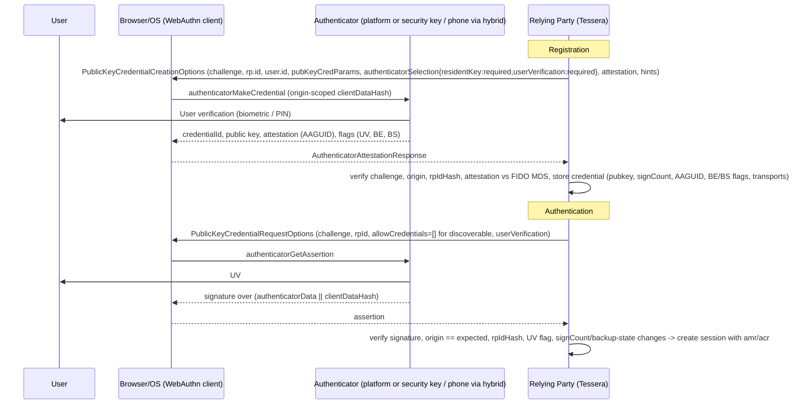
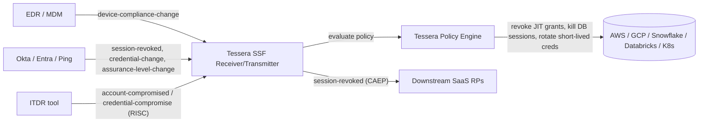

# 01 — Authentication, Identity Proofing, Sessions and Customer Identity

> Tessera knowledge base, domain 01. Research date: 2026-10-08. Facts were checked against standards bodies and vendor primary sources where possible. Claims that could not be confirmed against a primary source are marked **[unverified]**.

---

## 1. Scope and why it matters

Authentication answers one question: is the party at the keyboard (or the workload calling the API) the same subject that was enrolled earlier? Identity proofing answers an earlier one: is that enrolled subject a real person who is who they claim to be? Sessions carry the answer forward in time, and customer identity (CIAM) applies all of it to millions of external users who have no reason to tolerate friction.

This domain matters for Tessera for three reasons.

1. **Access-as-code is only as strong as the authentication event that unlocks it.** Every policy Tessera evaluates for cloud and data infrastructure (who may assume this role, query this warehouse, read this bucket) assumes the principal was authenticated at a known strength. If Tessera cannot see or require that strength, for example "phishing-resistant MFA within the last 15 minutes", its authorization decisions rest on an unchecked assumption.
2. **Most breaches now start with identity.** Recent high-profile incidents came in through stolen credentials, stolen session tokens or a talked-into-it help desk, not software exploits. Examples include Snowflake customer tenants in 2024 (infostealer passwords, no MFA), MGM and Caesars in 2023, M&S and the 2025 retail, insurance and airline wave attributed to Scattered Spider, and the AiTM phishing-as-a-service ecosystem led by Tycoon 2FA. Data platforms are prime targets.
3. **The standards baseline moved in 2025–2026.** NIST SP 800-63-4 was finalized (July 2025, with the web edition dated August 2025). The OpenID Shared Signals Framework, CAEP and RISC reached Final (September 2025). WebAuthn Level 3 became a W3C Recommendation (25 Aug 2026). Chrome shipped Device Bound Session Credentials on Windows (GA May 2026). Microsoft made synced passkeys GA in Entra ID (March 2026). A platform designed today should target this baseline.

**In scope:** identifiers and credentials, passwords, MFA and phishing resistance, FIDO2/passkeys, assurance levels (IAL/AAL/FAL), identity proofing, risk-based and continuous authentication, device trust, sessions and tokens, step-up, account recovery, passwordless, SSO UX, CIAM (including B2B multi-tenant), bot and fraud controls, ITDR and the attacks it addresses, and vendor implementations.

**Out of scope here (covered in other domains):** authorization models (RBAC/ABAC/ReBAC), governance and access reviews (IGA), privileged access (PAM), and workload/non-human identity in depth. This domain touches them only where authentication context feeds them.

---

## 2. Core concepts (precise definitions)

Definitions follow NIST SP 800-63-4 terminology where it exists.

- **Subject / subscriber / claimant / applicant.** A *subject* is the person represented by an identity. An *applicant* is a subject undergoing proofing. A *subscriber* holds an enrolled authenticator. A *claimant* is a subject trying to prove control of an authenticator. Keeping these states separate helps when modeling lifecycle.
- **Identifier.** A value that designates a subject within a namespace, such as an email, phone number, username, OIDC `sub`, or an `iss`+`sub` pair. An identifier is not a secret. Identifiers can be *reassigned*: phone numbers are recycled, and email domains lapse and get re-registered. That makes them dangerous as recovery channels.
- **Credential vs authenticator.** In 800-63 an *authenticator* is the thing the claimant possesses or controls (a password, OTP device, passkey or smart card). A *credential* binds an authenticator to a subscriber's identity record. In everyday industry usage "credential" covers both, so Tessera should use the NIST meanings internally.
- **Authentication factors.** Something you know (password, PIN), something you have (a device holding a key), something you are (a biometric). In 800-63, biometrics count only as part of multi-factor authentication when bound to a specific physical authenticator. They are never a standalone authenticator.
- **MFA.** Authentication with two or more *distinct* factors, either through one multi-factor authenticator (for example a passkey unlocked by on-device biometrics or a PIN) or through a combination of single-factor authenticators.
- **Phishing resistance (verifier-impersonation resistance).** The authentication protocol cryptographically binds its output to the verifier's identity, such as the origin or RP ID in WebAuthn or the TLS channel in mutual TLS (PIV/CAC). A proxy at a look-alike domain therefore cannot relay it. OTP codes, push approvals with or without number matching, SMS and email links are **not** phishing-resistant.
- **Replay resistance.** A captured authentication output cannot be reused (nonces, challenges, counters).
- **Passkey.** The FIDO Alliance's consumer term for a discoverable FIDO2/WebAuthn credential. *Synced passkeys* have private keys copied across a user's devices by a credential manager (iCloud Keychain, Google Password Manager, Microsoft, 1Password, Bitwarden). *Device-bound passkeys* stay on one authenticator (a security key, or a TPM or Secure Enclave with no sync).
- **Attestation.** A signed statement from an authenticator, made at registration, that identifies its make and model (via the AAGUID and a certificate chain to the FIDO Metadata Service). It lets a relying party enforce "only FIPS-certified security keys" and similar policies. Synced passkeys generally provide no attestation or "none" attestation.
- **Assurance levels (800-63-4).** *IAL* measures confidence in identity proofing (IAL1–IAL3). *AAL* measures confidence that the claimant controls the subscriber's authenticators (AAL1–AAL3). *FAL* measures confidence in a federated assertion (FAL1–FAL3). The levels are chosen independently, through a risk-based Digital Identity Risk Management (DIRM) process in 800-63-4.
- **Identity proofing.** Resolution (uniquely distinguishing the person), validation (checking that the evidence is genuine and the attributes are accurate) and verification (confirming the applicant is the person the evidence describes). 800-63A-4 adds *core attributes*, *fraud management*, and *digital injection* and *forged media* detection.
- **Liveness / presentation attack detection (PAD).** Detecting that a biometric sample comes from a live person present at the sensor rather than from a photo, mask or replay (ISO/IEC 30107). **Injection attack detection (IAD)** detects synthetic media fed straight into the capture pipeline, such as virtual cameras or deepfakes (CEN/TS 18099:2024).
- **Session.** The persistent state created after authentication, so the subscriber does not re-authenticate on every request. It is represented by session cookies, refresh tokens or access tokens. The 800-63-4 *reauthentication* limits are expressed per AAL.
- **Step-up authentication.** Requiring a stronger or more recent authentication event in the middle of a session for a sensitive action. In OAuth this is standardized by RFC 9470: the resource server tells the client which `acr` and/or `max_age` it needs.
- **acr / amr.** OIDC claims stating the *authentication context class* reached (a policy label, for example a URI for AAL2 or "phishing-resistant") and the *authentication methods* used (RFC 8176 values such as `pwd`, `otp`, `hwk`, `swk`, `mfa`, `face`, `pin`, `user`). RFC 8176 has no passkey-specific value; IdPs typically express passkeys as `hwk`/`swk` plus `user`/`pin`, or with vendor-specific values **[whether the IANA registry has since added a passkey value is unverified]**.
- **Adaptive / risk-based authentication.** Choosing authentication requirements at runtime from contextual signals: device, network, geovelocity, behavior, threat intelligence, and the sensitivity of the resource.
- **Continuous authentication / continuous access evaluation.** Re-assessing session validity after login as signals change, such as a password reset, a device falling out of compliance, an IP change or a user being disabled. Signals propagate via CAEP or vendor equivalents (Microsoft CAE).
- **Device trust.** Evidence that a request comes from a known, managed or compliant device. Typical evidence is a device certificate, a TPM-bound key, MDM/EDR posture, or OS attestation (Apple Managed Device Attestation, Android Key Attestation/Play Integrity).
- **ITDR (Identity Threat Detection and Response).** Gartner-coined category (2022): detecting attacks against identity infrastructure and identity usage (anomalous sign-ins, token replay, MFA manipulation, privilege escalation) and responding (revoke sessions, force reset, disable account). It is distinct from IGA, which handles posture and governance.
- **CIAM.** Customer (B2C) and business-customer (B2B) identity. The priorities are conversion, scale, self-service, consent and privacy, and fraud prevention, rather than workforce control.
- **B2B organizations / multi-tenant customer identity.** Modeling your customers' companies as *organizations*. Each organization can have its own IdP federation (SAML/OIDC), SCIM provisioning, domain verification, branding, delegated admins and policies.

---

## 3. Standards and specifications

| Standard | Body | Status as of Oct 2026 | Relevance | Link |
|---|---|---|---|---|
| SP 800-63-4 (base) / 63A-4 / 63B-4 / 63C-4 Digital Identity Guidelines | NIST | **Final**, July 2025 (web edition dated Aug 2025). Supersedes Rev. 3 (2017). | Definitive US baseline for IAL/AAL/FAL, passwords, syncable authenticators, recovery, DIRM | https://pages.nist.gov/800-63-4/ |
| Web Authentication (WebAuthn) Level 3 | W3C | **Recommendation**, 25 Aug 2026 (CR Snapshot 26 May 2026). Level 4 in progress. | Browser API for passkeys. L3 adds related origins, hints, client capabilities, JSON serialization helpers, and signals to update or delete credentials | https://www.w3.org/TR/webauthn-3/ |
| Client to Authenticator Protocol (CTAP) 2.2 | FIDO Alliance | CTAP 2.2 current. 2.3 in development (per passkeys.dev, Oct 2025). | Roaming authenticators and hybrid (QR/BLE cross-device) transport | https://fidoalliance.org/specifications/ |
| Credential Exchange Protocol / Format (CXP/CXF) | FIDO Alliance | Drafts (first published Oct 2024). CXF matured faster, and Apple/Google/1Password/Bitwarden ship import/export **[current maturity unverified]**. | Secure passkey portability between credential managers | https://fidoalliance.org/fido-alliance-credential-exchange-specifications-overview/ |
| FIDO Metadata Service (MDS3) | FIDO Alliance | Operational | Attestation trust anchors and authenticator status (e.g. revoked, compromised) | https://fidoalliance.org/metadata/ |
| FIDO Face Verification and Document Authenticity certifications | FIDO Alliance | Programs live since 2024 | Independent testing of selfie match, liveness and deepfake/injection resistance (≥10,000 tests, demographic bias) | https://fidoalliance.org/certification/ |
| OpenID Connect Core 1.0 (+ Discovery, Session/Front/Back-Channel Logout, RP-Initiated Logout) | OpenID Foundation | Final (Core also published as ISO/IEC 26131:2024) | Federation, `acr`/`amr`, logout | https://openid.net/developers/specs/ |
| Shared Signals Framework 1.0, CAEP 1.0, RISC 1.0 | OpenID Foundation | **Final**, approved 2 Sept 2025 | Real-time session revocation, credential change, and account-compromise signals between IdPs, RPs and security tools | https://openid.net/wg/sharedsignals/ |
| IPSIE (Interoperability Profiling for Secure Identity in the Enterprise) | OpenID Foundation | Active WG. OIDC "SL1" session-lifetime profile drafted 2025, with an implementation in Auth0 (`session_expiry`). No Final profile confirmed **[unverified]**. | Enterprise-ready SaaS: SSO, lifecycle, logout, token revocation, risk signals | https://openid.net/wg/ipsie/ |
| OpenID for Verifiable Presentations (OpenID4VP) 1.0 | OpenID Foundation | Final (2025). OpenID4VCI 1.0 and HAIP 1.0 also finalized in 2025 **[VCI/HAIP dates unverified]**. | Requesting mDL and EUDI wallet credentials for proofing | https://openid.net/specs/openid-4-verifiable-presentations-1_0.html |
| Digital Credentials API | W3C (Federated Identity WG) | Working Draft (updated Apr 2026). Shipped in Chrome (protocol-agnostic) and Safari (mdoc). | Browser-mediated wallet presentment for remote ID verification | https://www.w3.org/TR/digital-credentials/ |
| FedCM (Federated Credential Management) | W3C (FedID WG) | Working Draft. Shipped in Chromium. | Third-party-cookie-free federated login UX | https://www.w3.org/TR/fedcm/ |
| ISO/IEC 18013-5 / 18013-7 (mDL) | ISO/IEC JTC1 SC17 | 18013-5:2021 published. 18013-7 (online presentation) published 2024 **[2nd edition status unverified]**. | Mobile driver's licences as proofing evidence | https://www.iso.org/standard/69084.html |
| ISO/IEC 30107-1/-3 (Biometric PAD) | ISO/IEC JTC1 SC37 | Published (30107-3:2023) | Liveness/PAD testing (iBeta and similar labs) | https://www.iso.org/standard/79520.html |
| CEN/TS 18099:2024 Biometric data injection attack detection | CEN | Technical Specification, approved Oct 2024 (3-year provisional) | Deepfake and virtual-camera injection | https://www.evs.ee/en/cen-ts-18099-2024 |
| OAuth 2.0 Security BCP (RFC 9700, BCP 240) | IETF | Published Jan 2025 | Token theft mitigations, PKCE, no implicit grant | https://www.rfc-editor.org/rfc/rfc9700 |
| OAuth 2.0 DPoP (RFC 9449) | IETF | Published 2023 | Sender-constrained tokens (proof of possession) | https://www.rfc-editor.org/rfc/rfc9449 |
| OAuth 2.0 mTLS (RFC 8705) | IETF | Published 2020 | Certificate-bound tokens | https://www.rfc-editor.org/rfc/rfc8705 |
| OAuth 2.0 Step-up Authentication Challenge (RFC 9470) | IETF | Published 2023 | Standard `insufficient_user_authentication` challenge with `acr_values` / `max_age` | https://www.rfc-editor.org/rfc/rfc9470 |
| OAuth 2.0 Device Authorization Grant (RFC 8628) | IETF | Published 2019 | CLI/TV login. Also a common phishing vector (device-code phishing). | https://www.rfc-editor.org/rfc/rfc8628 |
| Authentication Method Reference Values (RFC 8176) | IETF | Published 2017 | `amr` vocabulary | https://www.rfc-editor.org/rfc/rfc8176 |
| OAuth 2.1 | IETF OAuth WG | Internet-Draft, consolidating BCP **[RFC status unverified]** | Simplified OAuth baseline | https://datatracker.ietf.org/doc/draft-ietf-oauth-v2-1/ |
| FAPI 2.0 Security Profile / Message Signing | OpenID Foundation | Security Profile Final (2025) | High-assurance API authorization (open banking) | https://openid.net/wg/fapi/ |
| Device Bound Session Credentials (DBSC) | W3C WebAppSec (incubated by Google) | Draft spec. Chrome GA on Windows (Chrome 146, May 2026), macOS to follow. | Binds browser session cookies to TPM keys, defeating cookie theft | https://w3c.github.io/webappsec-dbsc/ |
| SAML 2.0 | OASIS | Standard (2005), still dominant for enterprise SSO | B2B federation | https://docs.oasis-open.org/security/saml/v2.0/ |
| SCIM 2.0 (RFC 7643/7644) | IETF | Published. SCIM WG active on extensions. | Provisioning for B2B orgs | https://www.rfc-editor.org/rfc/rfc7644 |
| TOTP (RFC 6238) / HOTP (RFC 4226) | IETF | Published | OTP authenticators | https://www.rfc-editor.org/rfc/rfc6238 |
| eIDAS 2.0 / EU Digital Identity Wallet (Reg. (EU) 2024/1183) | EU | In force. Member states must offer wallets by late 2026, and relying-party acceptance obligations follow. | High-assurance proofing evidence in the EU | https://digital-strategy.ec.europa.eu/en/policies/eudi-regulation |
| CISA Phishing-Resistant MFA fact sheet / Scattered Spider advisory AA23-320A (updated 2025) | CISA | Guidance | Federal/critical-infrastructure expectations | https://www.cisa.gov/resources-tools/resources/implementing-phishing-resistant-mfa |

### 3.1 NIST SP 800-63B-4: what changed and what it requires

Verified against the final web text of 800-63B-4:

- **Passwords.**
  - Minimum length is **15 characters when the password is the only factor**. It may be shorter (but **≥ 8**) when used only as part of MFA.
  - Verifiers SHOULD allow at least 64 characters, and SHOULD accept printable ASCII, spaces and Unicode, counting each code point as one character.
  - Composition rules are **prohibited** (SHALL NOT), as are periodic forced rotation (change only on evidence of compromise), hints readable by unauthenticated claimants, and knowledge-based security questions.
  - The whole password must be checked against a blocklist of common, expected and compromised values, and the user told why a password was rejected.
  - Password managers and autofill MUST be allowed. Paste SHOULD be allowed.
  - Failed attempts on one authenticator are capped at **100** consecutive tries.
- **AAL1.** Single- or multi-factor. Overall reauthentication SHOULD be ≤ 30 days. Inactivity timeout is optional.
- **AAL2.** MFA, at least one replay-resistant authenticator. Verifiers **must offer at least one phishing-resistant option**, and federal agencies must *require* phishing resistance for their workforce. Reauthentication SHOULD be ≤ 24 h overall and ≤ 1 h of inactivity.
- **AAL3.** A phishing-resistant cryptographic authenticator with a **non-exportable** private key. Reauthentication SHALL be ≤ 12 h overall, and SHOULD be ≤ 15 min of inactivity.
- **Syncable authenticators** (synced passkeys) are normative, folding in the April 2024 supplement. They are allowed at **AAL1 and AAL2** and **not at AAL3**, because keys are exportable.
- **PSTN (SMS/voice) OTP** remains *restricted*. Verifiers must offer alternatives and should check SIM-swap and porting risk signals. **Email is not an acceptable out-of-band authenticator.**
- **Account recovery** is a first-class section (§4.2), including saved and issued recovery codes. Recovery must not be weaker than the AAL it restores.

### 3.2 SP 800-63A-4 (identity proofing) highlights

- IALs are restated around threats. IAL1 targets scalable attacks, synthetic identities and use of compromised PII. IAL2 adds targeted attacks, evidence falsification and theft, and social engineering. IAL3 requires supervised (in-person or supervised remote) proofing by a trained operator.
- New requirements cover **fraud management programs**, **digital injection prevention** and **forged media (deepfake) detection**. Attribute collection is decoupled from evidence collection. "Credible sources" are accepted for validation. Global requirements are separated from IAL-specific ones.
- Remote unattended proofing is permitted at IAL2 with these controls **[per-IAL detail unverified against the final text]**.

### 3.3 SP 800-63C-4 (federation) highlights

FAL1–FAL3 are defined in terms of assertion protection and audience restriction. FAL3 requires a *holder-of-key* / bound authenticator. The revision also adds explicit treatment of *proxied federation*, shared-signal-based session management, and IdP-to-RP trust agreements **[detailed FAL deltas not re-verified for this document]**.

---

## 4. How it works (key flows)

### 4.1 Passkey registration and authentication (WebAuthn)



The origin binding is the source of phishing resistance. The browser writes the real origin into `clientDataJSON`, and the authenticator scopes the key to `rp.id`, so a proxy at `rnicrosoft-login.com` can neither exercise nor relay the credential. The **BE/BS** (backup-eligible / backup-state) flags tell the RP whether a credential is a synced passkey, which lets policy distinguish AAL2-eligible (synced) from AAL3-eligible (device-bound, attested) credentials. *Hybrid* transport (QR code plus BLE proximity) supports cross-device sign-in, and the BLE proximity check stops remote relaying.

### 4.2 Federated SSO with step-up (OIDC + RFC 9470)

```
User ──► App (RP) ──302──► IdP /authorize?acr_values=urn:tessera:acr:phr&max_age=900
                               │ IdP evaluates policy: device posture, risk, existing session acr/auth_time
                               │ prompts passkey if needed
User ◄── App ◄──code── IdP     ▼
App ──code+PKCE──► IdP /token  → id_token{acr, amr, auth_time, sid}, access_token, refresh_token
App ──access_token──► Tessera PDP / Resource API
     if action needs higher assurance:
Resource ──401 WWW-Authenticate: Bearer error="insufficient_user_authentication",
                                  acr_values="urn:tessera:acr:phr", max_age=300 ──► App
App re-runs /authorize with those parameters → fresh token with satisfied acr/auth_time
```

For access-as-code this is the key integration. Tessera policies should be able to say `require acr >= phishing_resistant AND now - auth_time <= 15m AND device.managed == true` for actions like "grant prod-db write" or "approve a break-glass role". Tessera then emits standard RFC 9470 challenges so any compliant IdP can satisfy them.

### 4.3 Continuous access evaluation via Shared Signals (SSF/CAEP)



CAEP events include `session-revoked`, `token-claims-change`, `credential-change`, `assurance-level-change`, `device-compliance-change` and (in 1.0) `session-established` and `session-presented` **[last two event names per draft; verify in Final]**. They are carried as Security Event Tokens (RFC 8417) over push (RFC 8935) or poll (RFC 8936) delivery.

### 4.4 Remote identity proofing (IAL2-style)

```
1. Collect core attributes (name, DOB, address, ID number) → validate against authoritative/credible sources
2. Evidence capture: (a) document photo front/back + NFC chip read (ePassport/eID; strongest), or
                    (b) mDL / EUDI wallet presentation via OpenID4VP / Digital Credentials API (cryptographically signed by issuer)
3. Document authenticity: template, security features, MRZ/barcode consistency, tamper/forgery ML; chip passive/active authentication
4. Biometric verification: selfie / video → face match vs document portrait or chip image
5. Liveness (PAD, ISO 30107-3) + injection attack detection (virtual camera, emulator, deepfake; CEN/TS 18099)
6. Fraud checks: device intel, velocity, synthetic-identity scoring, phone/email tenure, watchlists
7. Decision + evidence record (retain minimal artefacts per privacy policy) → bind authenticator(s) at enrollment
```

Signed digital credentials (mDL, EUDI wallet) are reshaping step 2. They replace "photograph a plastic card and hope" with issuer-signed, selectively disclosed attributes, which removes most document-forgery risk. Holder binding (proving the presenter is the holder) and device security become the main concerns.

### 4.5 Session architecture and token lifetimes

| Artifact | Typical lifetime | Binding / hardening |
|---|---|---|
| IdP session cookie | 8–24 h workforce (800-63B AAL2: ≤ 24 h, 1 h idle). Weeks for consumer "remember me". | `Secure; HttpOnly; SameSite`, `__Host-` prefix, DBSC device-binding where supported |
| ID token | Minutes (consumed once at login) | Audience, nonce |
| Access token | 5–60 min | DPoP or mTLS sender-constraint. Introspection or CAE for revocation. |
| Refresh token | Hours to 90 days, rotating | Rotation with reuse detection, sender-constraint for public clients, revoke on CAEP events |
| Cloud/data credentials minted by Tessera (STS, DB short-lived users) | 15 min – 12 h | Tie to originating `sid`, kill on session revocation |

Step-up refreshes `auth_time` and `acr` without ending the session. Sensitive actions should check the **freshness** of authentication, not only that it happened at some point.

### 4.6 Account recovery: the weakest link

```
Strong ►  second registered passkey / security key
          recovery codes generated at enrollment (800-63B-4 "saved recovery codes")
          re-proofing at original IAL (doc + selfie + liveness) with manager/peer attestation for workforce
          in-person / supervised video with live ID verification
Weak   ►  email magic link, SMS OTP, KBA questions, help-desk "verify your employee ID + manager name"
```

The rule is that recovery must reach the same AAL as the credential it replaces. Otherwise the recovery path *is* the AAL. Notify all channels when recovery completes, impose a cooling-off period on privileged accounts, and emit a RISC/CAEP `credential-change` event.

---

## 5. How the market implements it

### 5.1 Workforce IdPs

- **Microsoft Entra ID.**
  - Conditional Access with *authentication strengths*, a built-in "Phishing-resistant MFA" strength covering FIDO2, Windows Hello for Business and certificate-based auth.
  - Passkey profiles and **synced passkeys reached GA in March 2026** (worldwide cloud; gov clouds later). A `passkeyType` setting allows device-bound, synced or both, scoped by group. Existing FIDO2 settings were auto-migrated into a default profile.
  - Passkeys in Microsoft Authenticator. ID Protection (risk-based sign-in/user risk). **Continuous Access Evaluation** (Microsoft's CAEP-like implementation). Token protection (sign-in session token binding on Windows). Entra Verified ID (verifiable credentials and Face Check).
  - Strong ecosystem gravity through M365.
- **Okta (Workforce Identity Cloud).**
  - Okta Identity Engine with authentication policies, FastPass (device-bound, phishing-resistant via Okta Verify with device posture), FIDO2/passkeys, and Identity Threat Protection (ITP) with Okta AI (continuous risk re-evaluation, universal logout via SSF/CAEP-style integrations).
  - Okta helped create IPSIE (Aaron Parecki co-chairs). Acquired Spera (ITDR/posture, 2024).
  - **Announced the acquisition of Permiso Security on 30 July 2026** to extend ITDR beyond Okta's own logs to cloud, SaaS and non-human/agentic identities (close expected by end of Oct 2026, price reported just under $200M [unverified official]).
- **Ping Identity** (merged with ForgeRock under Thoma Bravo, 2023). Hybrid and on-prem strength. PingOne DaVinci no-code orchestration. PingOne Protect (risk). PingOne Verify (proofing). Strong in banking and regulated CIAM. ForgeRock AM/IDM for self-hosted.
- **Google Cloud Identity / Workspace.** Passkeys, Titan keys, context-aware access. DBSC default-on for Workspace on Chrome/Windows (May 2026).
- **CyberArk (now Palo Alto Networks; deal closed 11 Feb 2026, ~$25B).** Identity Security platform (workforce SSO and MFA, PAM, secrets) is being folded into Palo Alto's platform. It signals consolidation of identity into security platforms.
- **Others.** JumpCloud (SMB), OneLogin (One Identity), Duo (Cisco; strong MFA, Duo Passport and device trust, ITDR via Cisco Identity Intelligence), Beyond Identity (device-bound passwordless plus posture), Secret Double Octopus, HYPR (passwordless plus identity verification for help-desk use cases), Yubico (hardware keys, YubiKey Bio, Enterprise Delivery).

### 5.2 CIAM

- **Auth0 (Okta Customer Identity).**
  - Developer-first: Actions (code hooks), Universal Login, **Organizations** for B2B (per-org connections, invitations, branding, `org_id` claim), plus self-service SSO and SCIM for B2B customers.
  - Bot Detection, Breached Password Detection, Brute-force protection, Adaptive MFA. Passkeys (consumer).
  - ITP for Customer Identity was announced as early access from Feb 2026 [GA unverified].
  - Supports an IPSIE-based `session_expiry` claim for enterprise connections.
- **Microsoft Entra External ID.** Successor to Azure AD B2C, which is no longer sold to new customers [unverified exact date]. Native authentication APIs, custom extensions.
- **Transmit Security (Mosaic).** Orchestration plus fraud prevention, identity verification, passwordless and risk in one CIAM platform. Positioned for banks and retail.
- **Ping (PingOne for Customers / ForgeRock).** Journeys and orchestration. Large-enterprise CIAM.
- **Developer CIAM and newer entrants.**
  - **WorkOS** (B2B-first: SSO, Directory Sync, AuthKit, Admin Portal; a common "enterprise-ready" layer for SaaS).
  - **Stytch** (Twilio acquisition announced 2025 [unverified completion]; device fingerprinting and B2B orgs).
  - **Descope** (no-code flows).
  - **Clerk** (frontend-centric).
  - **FusionAuth** (self-hostable).
  - **Keycloak** (CNCF open source, the de facto self-hosted IdP).
  - **Ory** (Kratos/Hydra, open-source API-first).
  - **Zitadel**, **SuperTokens**, **Frontegg** (B2B SaaS user management), **Corbado** (passkey adoption layer), **Hanko**.
- **Cloud provider CIAM.** Amazon Cognito (added passkeys and managed login in 2024), Firebase Auth / Google Identity Platform.

### 5.3 Identity proofing / IDV

Jumio, Onfido (Entrust), Socure (acquired Effectiv; strong US data-driven KYC), Persona (configurable flows, popular with tech companies), Veriff, iProov (first FIDO Face Verification certification), AU10TIX, Incode, IDnow, Mitek, Prove (phone-centric, Prove Pre-Fill), ID.me and Login.gov (US government IAL2), CLEAR. Differences come down to document coverage, NFC chip reading, PAD/IAD certifications (iBeta ISO 30107-3 Level 1/2, FIDO, CEN/TS 18099), orchestration, and whether they accept mDL/wallet credentials (an emerging differentiator).

### 5.4 Fraud, bot and risk

Cloudflare Turnstile and Bot Management, Akamai Account Protector and Bot Manager, HUMAN Security, Arkose Labs (challenge-based), DataDome, Kasada, Castle (account-security API), Fingerprint (device ID), BioCatch (behavioral biometrics, banking), Sardine and SEON (fraud), and Google reCAPTCHA Enterprise.

### 5.5 ITDR and identity security posture

- **CrowdStrike Falcon Identity Protection** (formerly Preempt; AD and Entra real-time).
- **Microsoft Defender for Identity**.
- **SentinelOne Singularity Identity** (Attivo).
- **Silverfort** (inline MFA for legacy protocols, service accounts; acquired Fabrix, Apr 2026).
- **Okta ITP + Spera + Permiso**.
- **Push Security** (browser-based detection of AiTM and shadow SaaS logins).
- **Vectra, Semperis, Proofpoint Identity Threat Defense** (Illusive).
- **SGNL** (continuous access, a major SSF/CAEP proponent).
- **Oasis Security** (NHI; acquisition by Cyera announced Jul/Aug 2026 [unverified close]).
- **Cisco Identity Intelligence**, **Rezonate**, **AuthMind**, **Grip**.

### 5.6 Notable differences that matter to Tessera

1. **Where policy lives.** Entra Conditional Access and Okta authentication policies are IdP-centric and coarse at the app level. None of them natively understands "this Snowflake role on this schema." This is the gap Tessera fills: resource-level policy that *consumes* IdP authentication context.
2. **Assurance signaling is inconsistent.** Entra emits `amr` values and authentication strength in its own claims. Okta uses `amr` plus custom `acr` values. Auth0 needs Actions to surface factor detail. Tessera needs a normalization layer.
3. **Continuous evaluation is proprietary-first.** Microsoft CAE, Okta Universal Logout and Google DBSC/CAA are vendor-specific. SSF/CAEP Final (2025) gives Tessera a neutral way in.
4. **Proofing is almost always integrated, not built.** Even Okta and Entra partner (Entra Verified ID with partners; Okta with Persona, Incode and others), and Ping bundles PingOne Verify.

---

## 6. Threats, attacks and failure modes

| Attack | How it works | Notable cases | Primary mitigations |
|---|---|---|---|
| **Credential stuffing / password spray** | Replay breached username/password pairs at scale, or try a few common passwords across many accounts | Snowflake customer tenants 2024 (UNC5537, infostealer creds, no MFA, ~165 orgs notified per Mandiant). Midnight Blizzard password-spray against a Microsoft legacy test tenant (2024). | MFA/passkeys, breached-password checks, bot detection, rate limiting, disabling legacy auth, network-policy allow-lists |
| **Infostealer malware** | Malware harvests saved passwords and session cookies from endpoints. Sold as logs. | Lumma and RedLine ecosystems. Root cause of the Snowflake wave. | Phishing-resistant MFA, DBSC/token binding, short sessions, EDR, monitoring for leaked-credential feeds |
| **AiTM (adversary-in-the-middle) phishing** | Reverse proxy relays the real login page and steals the post-MFA session cookie. Defeats OTP and push. | **Tycoon 2FA** (≥64,000 attacks; disrupted by Europol/Microsoft 4 Mar 2026, back to prior volume within weeks), EvilProxy, Evilginx, Starkiller (headless-Chrome proxy). Microsoft attributed ~62% of AiTM phishing it blocked in mid-2025 to Tycoon [secondary source]. | **Phishing-resistant MFA** (passkeys, FIDO2, CBA), token binding (DBSC, Entra token protection, DPoP), compliant-device requirements, impossible-travel and token-replay detection |
| **Session token / cookie theft and replay** | Steal cookies or refresh tokens (infostealer, AiTM, HAR files, XSS) and replay them | Okta support system 2023 (HAR files with session tokens). LastPass 2022 (engineer's home device). | Device-bound sessions, sender-constrained tokens, IP/ASN or device binding heuristics, CAE revocation, short TTLs, secret scrubbing in support uploads |
| **MFA fatigue / push bombing** | Flood the user with push requests until they approve | Uber 2022, Cisco 2022 | Number matching, rate limits on push, contextual info in prompts, move to phishing-resistant factors, alert on burst denials |
| **Device-code phishing** | Attacker starts an RFC 8628 flow and tricks the user into entering the code at the legitimate verification URL | Storm-2372 (2025), and campaigns mixing Tycoon with device-code flows (2026) | Block the device-code flow where unused (Conditional Access), restrict to known clients, warn in UX |
| **OAuth consent phishing / illicit grants** | Trick user into granting a malicious app scopes | Long-running Microsoft 365 campaigns | Admin consent workflows, publisher verification, app governance |
| **SIM swap / port-out** | Social-engineer the carrier to move the number. Intercept SMS OTP and recovery. | Crypto thefts, Scattered Spider early ops | Remove SMS from privileged paths, carrier SIM-change risk APIs (e.g. GSMA Open Gateway SIM Swap), NIST "restricted" handling |
| **Help-desk social engineering** | Caller impersonates an employee and convinces the help desk to reset password or MFA, or enroll a new device | MGM Resorts 2023. **M&S, Co-op, Harrods (UK retail, 2025)**. US insurers and airlines (mid-2025). CISA AA23-320A updated 2025 stresses help-desk impersonation. | Strong caller verification (re-proofing with ID + liveness, or verification through an existing passkey / FastPass push to an enrolled device), manager approval, no MFA reset without high assurance, cooling-off periods, alerts on recovery |
| **Account recovery abuse (consumer)** | Email takeover, then password reset everywhere. KBA answers guessed from OSINT. | Endemic | Passkey-based recovery, recovery codes, re-proofing, risk scoring on recovery |
| **Synthetic identities / new-account fraud** | Fabricated identity built from real and fake PII at onboarding | Rising with GenAI | IAL-appropriate proofing, data consortium checks, device intel, velocity |
| **Deepfake / injection attacks on IDV** | Virtual cameras, emulators, face swaps fed into selfie and liveness capture | Rapidly rising 2024–2026 | Certified IAD (CEN/TS 18099), PAD (ISO 30107-3), NFC chip reads, mDL/wallet signatures, FIDO Face Verification certification |
| **Downgrade attacks** | Phishing kit hides the passkey option, or forces fallback to SMS or password | Observed in AiTM kits | Remove weaker fallbacks for enrolled users, mark accounts "phishing-resistant only" |
| **Golden SAML / token forging** | Steal the IdP signing key, forge assertions | SolarWinds 2020 | HSM-protected signing keys, monitoring for assertion anomalies, ITDR |
| **Persistence via new MFA device or IdP federation** | After takeover, register attacker's authenticator or add a rogue federated IdP | Scattered Spider (adding federated IdPs to Okta tenants, 2023) | Alert and approval on authenticator/IdP config changes, admin-action step-up |
| **Session fixation, missing logout, stale sessions** | Sessions survive password change or offboarding | Common in SaaS | Revoke all sessions on credential change, back-channel logout, SSF/CAEP |

**Systemic failure modes.**
- MFA is only as strong as its weakest enrolled factor and its recovery path.
- "Remember this device" cookies become long-lived bearer tokens.
- Non-human identities and API keys bypass all human MFA.
- Break-glass accounts are left without phishing-resistant MFA.
- Policy exceptions accumulate without anyone tracking them.

---

## 7. Expert and authoritative sources

**Standards bodies and programs.**
- NIST Digital Identity program: David Temoshok, Ryan Galluzzo, Connie LaSalle, Andrew Regenscheid, Justin Richer (contributor).
- FIDO Alliance (Andrew Shikiar; passkeys.dev).
- W3C WebAuthn WG and FedID WG.
- OpenID Foundation: Gail Hodges (ED); SSF WG (Atul Tulshibagwale, SGNL; Tim Cappalli, Okta); IPSIE (Aaron Parecki, Dick Hardt).
- IETF OAuth WG.
- CISA.
- ENISA (remote identity proofing reports).
- UK NCSC (MFA and password guidance).
- Login.gov and 18F engineering blogs.

**Practitioners and writers.**
- **Aaron Parecki** (aaronparecki.com, oauth.net; *OAuth 2.0 Simplified*).
- **Justin Richer** (co-author of *OAuth 2 in Action*, GNAP; Bespoke Engineering blog).
- **Vittorio Bertocci** (Auth0 "Identity, Unlocked" podcast; *Modern Authentication with Azure AD*; passed away 2023, archive remains valuable).
- **Tim Cappalli** (passkeys, FIDO, WebAuthn editor).
- **Adam Langley** (ImperialViolet; Chrome security and passkeys).
- **Pamela Dingle** (Microsoft identity standards).
- **Ian Glazer** (Weave Identity; IDPro).
- **Mike Schwartz** (Gluu; *Securing the Perimeter*).
- **Ryan Galluzzo** (NIST).
- **Phil Windley** (*Learning Digital Identity*, O'Reilly 2023).
- **Kim Cameron** (Laws of Identity, archival).
- **Daniel Fett** (OAuth Security BCP / RFC 9700 co-author, OpenID4VC).
- **Brian Campbell** (DPoP, mTLS co-author).
- **Kristina Yasuda** (OpenID4VP, eIDAS).

**Threat-research teams.** Mandiant/Google Threat Intelligence (UNC3944 = Scattered Spider; UNC5537), Microsoft Threat Intelligence (Octo Tempest, Storm-1167 AiTM), CrowdStrike (Scattered Spider), Push Security research, Sekoia (Tycoon 2FA), Elastic Security Labs, Group-IB, Okta Threat Intelligence, KrebsOnSecurity.

**Books.**
- *Solving Identity Management in Modern Applications* (Wilson and Hingnikar, 2nd ed.).
- *OAuth 2 in Action* (Richer and Sanso).
- *Learning Digital Identity* (Windley).
- *Identity Attack Vectors* (Haber and Rolls, 2nd ed. 2024).
- *Modern Authentication with Azure Active Directory* (Bertocci).

**Blogs and newsletters.** IDPro Body of Knowledge; KuppingerCole; Gartner IAM research (paywalled); *Identity at the Center* podcast (Jim McDonald and Jeff Steadman); Start With Identity blog; Corbado passkey research; the passkeys.dev and passkeys.directory references; Okta and Auth0 developer blogs; Microsoft Entra blog (Alex Weinert's posts on MFA strength are canonical).

---

## 8. Implications for Tessera

### 8.1 Positioning conclusion

Tessera should **not build a general-purpose IdP or CIAM product in its first phase.** Workforce authentication is dominated by Entra and Okta, both with massive distribution, and CIAM is crowded (Auth0, Entra External ID, Ping, Transmit, WorkOS, Stytch, Descope and others). Tessera's differentiation is **resource-level, code-defined access decisions that consume authentication context**: assurance level, phishing resistance, freshness, device posture and risk. Tessera should also **actively shorten or revoke infrastructure access when that context changes.** It should be the best *relying party and policy enforcement point* for identity signals, an SSF transmitter and receiver, and a high-assurance step-up broker for privileged infrastructure actions. It should own a small, high-value authentication surface of its own: its admin console, CLI and break-glass access, which must be passkey-first and AAL3-capable.

### 8.2 Required capabilities

**MUST**
1. **MUST** federate with major IdPs via OIDC and SAML 2.0 (Entra, Okta, Ping, Google, Auth0, Keycloak, JumpCloud, Duo/Cisco). Use PKCE, follow the RFC 9700 BCP, and enforce strict audience and issuer validation.
2. **MUST** normalize authentication context from every IdP into a canonical `AuthnContext`: `aal` (1–3), `phishing_resistant` (bool), `methods[]` (RFC 8176 `amr` plus vendor mappings), `auth_time`, `acr`, device identifiers and posture, and risk level. Policies must be able to reference it (e.g. `require authn.phishing_resistant && authn.age < 15m`).
3. **MUST** support step-up authentication for sensitive infrastructure actions (JIT elevation, production data access, policy changes, break-glass), emitting RFC 9470-style challenges with `acr_values`/`max_age` and honoring the IdP's re-authentication result.
4. **MUST** make Tessera's own sign-in phishing-resistant by default: passkeys/WebAuthn L3 for console and CLI (via RFC 8628 device flow hardened against phishing, or a loopback PKCE flow); AAL3-capable device-bound/attested keys for admin and break-glass roles; no SMS or email OTP for admins.
5. **MUST** bind the lifetime of issued infrastructure credentials (cloud STS sessions, DB users, K8s tokens) to the originating identity session. Revoke them on logout, offboarding, credential change or a risk event.
6. **MUST** receive and act on OpenID SSF/CAEP/RISC events (`session-revoked`, `credential-change`, `assurance-level-change`, `device-compliance-change`, `account-disabled`, `account-credential-change-required`) and vendor equivalents (Okta Universal Logout/ITP webhooks, Entra CAE/ID Protection risk via Graph). Target revocation latency is minutes or less.
7. **MUST** sender-constrain Tessera-issued tokens (DPoP or mTLS) for API and CLI clients, rotate refresh tokens with reuse detection, and keep access-token TTLs short (≤ 15 min for privileged scopes).
8. **MUST** implement session controls aligned with 800-63B-4 AAL targets: configurable absolute and idle timeouts per policy tier (default for privileged: 12 h absolute / 15 min idle), `__Host-` secure cookies, and full session revocation on credential change.
9. **MUST** produce tamper-evident audit records for every authentication-dependent decision: which `AuthnContext` was presented, which policy required what, and the step-up outcome. ITDR and compliance (SOC 2, ISO 27001, FedRAMP-style AAL evidence) depend on this.
10. **MUST** harden Tessera's own account-recovery and admin-change paths: no MFA reset or new-authenticator enrollment for admins without high-assurance re-verification plus a second-admin approval; notification and cooling-off; alerts on new federated IdP or authenticator registration (the Scattered Spider persistence pattern).

**SHOULD**
11. **SHOULD** act as an SSF *transmitter*, so Tessera's own signals (e.g. "privileged grant used from new device", "anomalous data-volume access") flow to IdPs and SIEM/ITDR tools.
12. **SHOULD** ingest device trust and posture (MDM: Intune, Jamf, Kandji; EDR: CrowdStrike, SentinelOne, Defender; Okta FastPass/Device Assurance; Entra compliant-device claims). Expose them as policy attributes.
13. **SHOULD** offer identity-threat detections specific to infrastructure access: token replay from a new ASN or device, impossible travel between IdP sign-in and cloud API calls, privilege elevation directly after MFA reset or recovery, dormant-account reactivation, and break-glass use. Respond with automated playbooks.
14. **SHOULD** provide a "help-desk verification" workflow: a push-to-enrolled-passkey or re-proofing link the help desk triggers before any reset, with the outcome logged. This directly counters help-desk social engineering.
15. **SHOULD** support WebAuthn attestation policy (FIDO MDS3 AAGUID allow-lists, BE/BS flag inspection) to tell synced (AAL2) from device-bound (AAL3) credentials for privileged roles.
16. **SHOULD** model B2B multi-tenancy (organizations, per-org IdP connections, verified domains, SCIM, delegated admins), because Tessera itself sells to enterprises and later to their partners and contractors.
17. **SHOULD** expose authentication-context requirements in its access-as-code language and lint them: warn when a policy grants production write without requiring phishing resistance.

**COULD**
18. **COULD** integrate identity-verification providers (Persona, Incode, Socure, iProov, Jumio, or mDL/EUDI wallets via OpenID4VP and the Digital Credentials API) for re-proofing at recovery and for contractor onboarding. Store results as IAL attestations, not raw biometrics.
19. **COULD** ship a lightweight hosted login and passkey broker for organizations without an enterprise IdP (startups), built on an embedded open-source core (e.g. Ory or Keycloak). This would be an on-ramp, not a CIAM competitor.
20. **COULD** offer CIAM-adjacent policy for customers' customer-facing data products (e.g. row-level access driven by end-user identity claims from Auth0/Cognito tokens).
21. **COULD** support DBSC-aware session handling for the Tessera web console once the W3C spec stabilizes beyond Chrome/Windows.
22. **COULD** provide posture analytics: percentage of privileged principals with phishing-resistant factors, SMS still enrolled, stale sessions, and accounts recoverable by weak channels.

### 8.3 Data-model entities and fields

```yaml
Identity (Principal):
  id, tenant_id, type: human|service|agent, status: active|suspended|deprovisioned,
  primary_identifier, identifiers[]: {type: email|phone|username|external_sub, value, verified_at, source_idp_id},
  ial: 0|1|2|3, ial_evidence_ref, created_at, last_seen_at, risk_level

IdentityProviderConnection:
  id, tenant_id, organization_id?, protocol: oidc|saml, issuer, metadata_url, client_id, jwks_uri,
  acr_mapping: {idp_acr|amr -> tessera_aal/phishing_resistant}, signal_stream_id?, status, verified_domains[]

Authenticator (only for Tessera-native auth):
  id, identity_id, type: passkey|security_key|platform|totp|recovery_code,
  credential_id, public_key, sign_count, aaguid, attestation_format, attestation_trust: none|self|basic|attca|mds_verified,
  backup_eligible, backup_state, transports[], user_verifying: bool, aal_max: 1|2|3,
  created_at, last_used_at, revoked_at, registered_from_session_id

AuthenticationEvent:
  id, identity_id, idp_connection_id?, time, auth_time, acr, amr[], aal, phishing_resistant: bool,
  device_id?, ip, asn, geo, user_agent, risk_score, risk_reasons[], result: success|fail|stepup_required, session_id

Session:
  id (sid), identity_id, idp_sid?, created_at, last_activity_at, absolute_expiry, idle_expiry,
  current_aal, last_stepup_at, device_binding: none|dpop_jkt|mtls_x5t|dbsc, client_id, status, revoked_reason

IssuedCredential (downstream infra creds):
  id, session_id, identity_id, target: aws_sts|gcp|azure|snowflake|databricks|postgres|k8s, external_ref,
  scope/grant_id, issued_at, expires_at, revoked_at, revocation_trigger_event_id

Device:
  id, tenant_id, platform, os_version, managed: bool, mdm_source, compliant: bool, edr_status,
  hardware_key_bound: bool, attestation_ref, last_posture_at, owner_identity_id

SecurityEvent (SSF/CAEP/RISC + vendor):
  id, stream_id, direction: inbound|outbound, event_type (URI), subject {format, identifiers}, iat, txn,
  raw_set_jwt_hash, processed_at, actions_taken[]

StepUpChallenge:
  id, session_id, policy_id, required_acr, max_age, reason, issued_at, satisfied_at, satisfying_auth_event_id

RecoveryCase / HelpDeskVerification:
  id, identity_id, initiated_by, channel, verification_method: passkey_push|reproofing|manager_attest,
  ial_achieved, approvals[], outcome, cooling_off_until, notifications_sent[]

ProofingResult (if integrated):
  id, identity_id, provider, ial_target, evidence_types[], doc_auth_result, biometric_match_score, pad_result, iad_result,
  decision, decided_at, retention_expiry   # store references, not raw images
Organization (B2B):
  id, tenant_id, name, verified_domains[], idp_connections[], scim_endpoint, policy_overrides, admins[]
```

### 8.4 Integration points

- **IdPs (inbound authentication):** OIDC/SAML login. `acr`/`amr` mapping. Okta Event Hooks / System Log API, Entra sign-in logs and Identity Protection (Microsoft Graph), Google Workspace reports, Auth0 log streams.
- **Shared Signals:** SSF receiver and transmitter endpoints (push and poll), stream management API, CAEP/RISC event handling. Okta, Microsoft, Google and SGNL are known participants in SSF interop events [participant list unverified for 2026].
- **Device posture:** Intune/Entra compliant-device, Jamf Pro, Kandji, CrowdStrike ZTA scores, SentinelOne, Okta Device Assurance, Kolide (1Password).
- **ITDR/SIEM:** Splunk, Microsoft Sentinel, Google SecOps, Datadog, Panther. Export in OCSF format. Bi-directional with CrowdStrike Identity, Defender for Identity, Okta ITP.
- **Help desk:** ServiceNow, Jira Service Management, Zendesk, for verification-before-reset workflows.
- **IDV (COULD):** Persona, Incode, Socure, iProov, Jumio, Veriff. Wallets via OpenID4VP.
- **Downstream enforcement targets:** AWS IAM Identity Center/STS, GCP IAM/Workforce Identity Federation, Azure, Snowflake (OAuth/external OAuth, network policies), Databricks, BigQuery, Postgres/MySQL, Kubernetes OIDC, Terraform/CI (workload federation).

### 8.5 Build vs integrate recommendation

| Capability | Recommendation | Rationale |
|---|---|---|
| Workforce IdP (directory, SSO portal, MFA enrollment for all apps) | **Integrate** (Entra, Okta, Google, Ping, JumpCloud) | Entrenched, huge surface, low differentiation for Tessera |
| CIAM (B2C registration, social login, progressive profiling) | **Integrate / out of scope** | Crowded. Not aligned with infra positioning. |
| Tessera's own authentication (console, CLI, API) | **Build on proven libraries**: WebAuthn server lib (e.g. SimpleWebAuthn, go-webauthn, py_webauthn), OIDC client libs. Or embed an open-source core (Ory/Keycloak) for the "no IdP" path. | Must be phishing-resistant and auditable. Small scope. |
| AuthnContext normalization, step-up broker, session-to-credential binding | **Build (core IP)** | This is Tessera's differentiator |
| SSF/CAEP/RISC transmitter and receiver | **Build** (open spec, moderate complexity) | Neutral glue to every IdP and ITDR. Strategic. |
| ITDR for infrastructure access | **Build detections, integrate telemetry** | Infra-specific detections are differentiated. Generic sign-in risk comes from IdPs. |
| Identity proofing / liveness / document authentication | **Integrate** | Requires certified PAD/IAD, document libraries and data consortiums. Regulated. |
| Bot / fraud protection on Tessera's login | **Integrate** (Cloudflare Turnstile, or the IdP's) | Commodity |
| Hardware/attestation trust | **Integrate** FIDO MDS3 | Authoritative source |

**Phasing.** Phase 1: federation, AuthnContext, step-up, passkey-only Tessera admin, session-bound infra credentials, CAEP receiver. Phase 2: SSF transmitter, device posture, infra ITDR detections, help-desk verification. Phase 3: optional hosted login for IdP-less customers, IDV-backed re-proofing, B2B partner identity. A full IdP is worth revisiting only if the "all of IAM" strategy requires it, and then most likely through acquisition or an open-source core.

---

## 9. Glossary

- **AAL**: Authenticator Assurance Level (800-63B), 1–3.
- **AAGUID**: Authenticator Attestation GUID identifying a FIDO authenticator model.
- **acr / amr**: OIDC authentication context class reference / authentication methods references.
- **AiTM**: Adversary-in-the-Middle phishing via reverse proxy.
- **ATO**: Account takeover.
- **BE/BS flags**: WebAuthn backup-eligible / backup-state bits that indicate a synced passkey.
- **CAE / CAEP**: Continuous Access Evaluation (Microsoft) / Continuous Access Evaluation Profile (OpenID).
- **CBA**: Certificate-based authentication (PIV/CAC, smart cards).
- **CIAM**: Customer Identity and Access Management.
- **CTAP**: Client to Authenticator Protocol (FIDO).
- **CXP/CXF**: FIDO Credential Exchange Protocol/Format for passkey portability.
- **DBSC**: Device Bound Session Credentials. Browser cookies bound to a TPM key.
- **DIRM**: Digital Identity Risk Management (800-63-4 process).
- **DPoP**: Demonstrating Proof of Possession (RFC 9449).
- **FAL**: Federation Assurance Level (800-63C).
- **FedCM**: Federated Credential Management browser API.
- **FIDO2**: WebAuthn + CTAP.
- **Hybrid transport**: CTAP cross-device flow using QR + BLE proximity.
- **IAD**: Injection Attack Detection.
- **IAL**: Identity Assurance Level (800-63A).
- **IDV**: Identity verification (document + biometric).
- **IPSIE**: OpenID Interoperability Profiling for Secure Identity in the Enterprise.
- **ITDR**: Identity Threat Detection and Response.
- **KBA**: Knowledge-based authentication (security questions). Prohibited for password choice in 800-63B-4.
- **mDL / mdoc**: Mobile driving licence / mobile document (ISO/IEC 18013-5/-7).
- **MDS3**: FIDO Metadata Service v3.
- **OpenID4VP / VCI**: OpenID for Verifiable Presentations / Credential Issuance.
- **PAD**: Presentation Attack Detection (liveness), ISO/IEC 30107.
- **Passkey**: Discoverable FIDO credential, synced or device-bound.
- **PKCE**: Proof Key for Code Exchange (RFC 7636).
- **RISC**: Risk Incident Sharing and Coordination (OpenID).
- **RP**: Relying Party.
- **SET**: Security Event Token (RFC 8417).
- **SSF**: Shared Signals Framework (OpenID).
- **Step-up**: Mid-session re-authentication at a higher or fresher assurance.
- **Syncable authenticator**: NIST term for authenticators whose keys can be exported and synced (synced passkeys). AAL2 max.
- **UV / UP**: WebAuthn user verification / user presence.

---

## 10. Sources

**NIST**
- NIST SP 800-63-4 suite: https://pages.nist.gov/800-63-4/
- SP 800-63B-4: https://pages.nist.gov/800-63-4/sp800-63b.html
- SP 800-63A-4 changelog: https://pages.nist.gov/800-63-4/sp800-63a/changelog
- SP 800-63A-4 introduction: https://pages.nist.gov/800-63-4/sp800-63a/introduction
- Sakimura analysis of 800-63B-4 passwords: https://www.sakimura.org/en/2025/10/7710/

**FIDO and passkeys**
- FIDO: WebAuthn L3 Recommendation: https://fidoalliance.org/webauthn-level-3-is-now-a-w3c-recommendation/
- Start With Identity on WebAuthn L3 REC: https://startwithidentity.com/blog/2026-08-31-webauthn-level-3-becomes-a-w3c-recommendation/
- WebAuthn L3 CR snapshot: https://www.w3.org/TR/2026/CR-webauthn-3-20260113/
- passkeys.dev spec reference: https://passkeys.dev/docs/reference/specs/
- FIDO Credential Exchange overview: https://fidoalliance.org/fido-alliance-credential-exchange-specifications-overview/
- FIDO Face Verification certification coverage: https://idtechwire.com/fido-launches-certification-program-for-face-based-remote-idv

**OpenID Foundation**
- Shared Signals WG: https://openid.net/wg/sharedsignals/
- SSF/CAEP/RISC final approval: https://sgnl.ai/2025/09/sgnl-welcomes-the-publication-of-the-final-shared-signals-and-caep-specifications/
- SSF/CAEP/RISC final approval: https://biometricupdate.com/202509/openid-approves-3-standards-for-sharing-real-time-digital-identity-security-signals
- IPSIE WG: https://openid.net/wg/ipsie/
- IPSIE charter: https://openid.net/wg/ipsie/charter/
- IPSIE update at IETF 123: https://datatracker.ietf.org/meeting/123/materials/slides-123-scim-ipsie-wg-update-for-scim-wg-at-ietf123-00
- Auth0 IPSIE session expiry: https://auth0.com/docs/ja-jp/authenticate/enterprise-connections/session-expiry-enterprise-connections.md
- OpenID4VP final: https://www.openid.net/tag/openid4vc/

**W3C digital credentials**
- W3C Digital Credentials API blog: https://www.w3.org/blog/2025/w3c-digital-credentials-api-publication-the-next-step-to-privacy-preserving-identities-on-the-web
- W3C AC2026 DC API talk: https://www.w3.org/2026/Talks/AC/Onofri/W3C_-_Wallet_Panel_-_Digital_Credentials_API_@_AC2026.pdf

**Device-bound sessions**
- Google Workspace DBSC GA: https://workspaceupdates.googleblog.com/2026/05/prevent-account-takeovers-with-DBSC-now-generally-available-in-the-Chrome-browser-for-Windows.html
- Google DBSC blog: https://blog.google/security/protecting-cookies-with-device-bound-session-credentials/

**Microsoft Entra**
- Microsoft Entra passkey profiles (MC1221452): https://mc.merill.net/message/MC1221452
- Help Net Security on Entra synced passkeys: https://www.helpnetsecurity.com/?p=354504

**Vendor and market**
- Okta Oktane 2025 announcements: https://s205.q4cdn.com/566291348/files/doc_events/2025/Sep/25/FINAL-Okta-Oktane-2025-Announcements.pdf
- Okta Secure Identity Commitment whitepaper 2026: https://www.okta.com/sites/default/files/2026-05/okta-secure-identity-commitment-whitepaper-2026-05.PDF
- Okta–Permiso: https://startwithidentity.com/blog/2026-07-30-okta-signs-definitive-agreement-to-acquire-permiso-security/
- Okta–Permiso: https://www.bankinfosecurity.net/okta-buys-permiso-to-extend-itdr-beyond-native-identity-logs-a-32393
- Palo Alto–CyberArk close: https://pulse2.com/palo-alto-networks-cyberark-acquisition-closes-making-identity-security-a-core-platform-pillar/amp/
- Palo Alto 8-K: https://www.sec.gov/Archives/edgar/data/1327567/000119312526045600/d40626dex991.htm

**Threat reporting**
- Tycoon 2FA takedown: https://www.rescana.com/post/europol-dismantles-tycoon-2fa-inside-the-takedown-of-a-64-000-attack-phishing-as-a-service-platform
- Elastic Tycoon 2FA detection: https://www.elastic.co/es/security-labs/tycoon-2fa-aitm-detection-engineering
- Group-IB Tycoon 2FA: https://www.group-ib.com/masked-actors/tycoon2fa/
- CSA Tycoon2FA resurrection note: https://labs.cloudsecurityalliance.org/research/csa-research-note-tycoon2fa-phaas-resurrection-maas-resilien/
- Red Sift email security weekly: https://redsift.com/email-security-weekly/002
- Rapid7 on Scattered Spider: https://www.rapid7.com/blog/post/scattered-spider-rapid7-insights-observations-and-recommendations/
- Scattered Spider TfL arrests: https://securityaffairs.com/182341/security/uk-police-arrested-two-teen-scattered-spider-members-linked-to-the-2024-attack-on-transport-for-london.html
- Krebs on Scattered Spider: https://krebsonsecurity.com/tag/harrods/
- LMG on Scattered Spider indictments: https://www.lmgsecurity.com/inside-scattered-spider-indictments-what-security-leaders-need-to-know/
- CISA Scattered Spider advisory: https://www.cisa.gov/news-events/cybersecurity-advisories/aa23-320a
- CISA phishing-resistant MFA: https://www.cisa.gov/resources-tools/resources/implementing-phishing-resistant-mfa
- Mandiant UNC5537 (Snowflake): https://cloud.google.com/blog/topics/threat-intelligence/unc5537-snowflake-data-theft-extortion

**Biometric standards**
- CEN/TS 18099: https://www.evs.ee/en/cen-ts-18099-2024

**IETF RFCs**
- RFC 9700: https://www.rfc-editor.org/rfc/rfc9700
- RFC 9449: https://www.rfc-editor.org/rfc/rfc9449
- RFC 9470: https://www.rfc-editor.org/rfc/rfc9470
- RFC 8628: https://www.rfc-editor.org/rfc/rfc8628
- RFC 8176: https://www.rfc-editor.org/rfc/rfc8176
- RFC 8417: https://www.rfc-editor.org/rfc/rfc8417

**EU**
- EU Digital Identity regulation: https://digital-strategy.ec.europa.eu/en/policies/eudi-regulation
