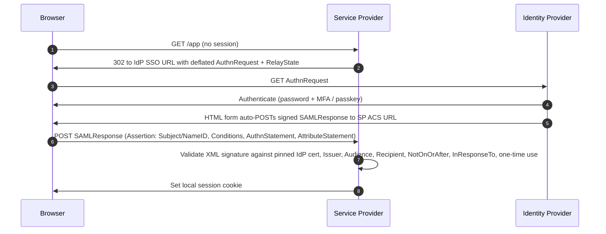
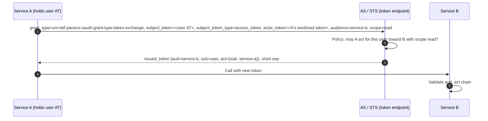
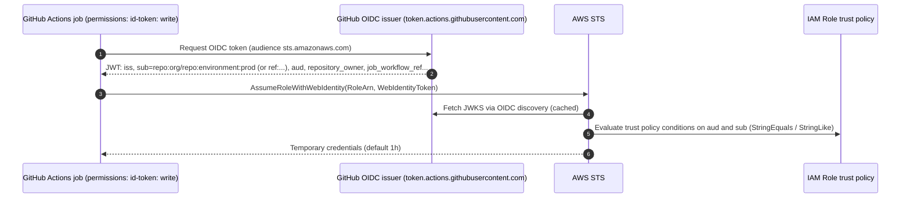
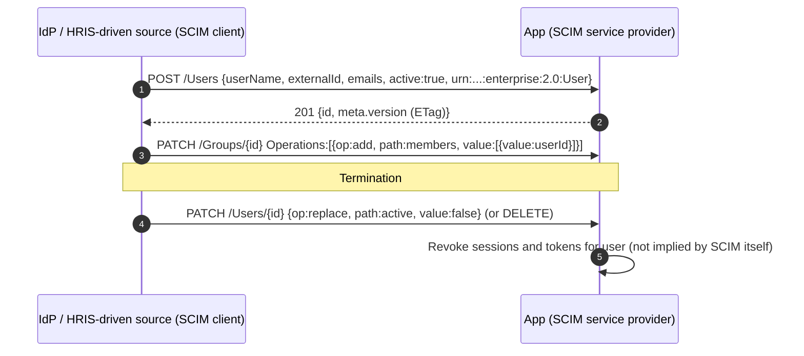
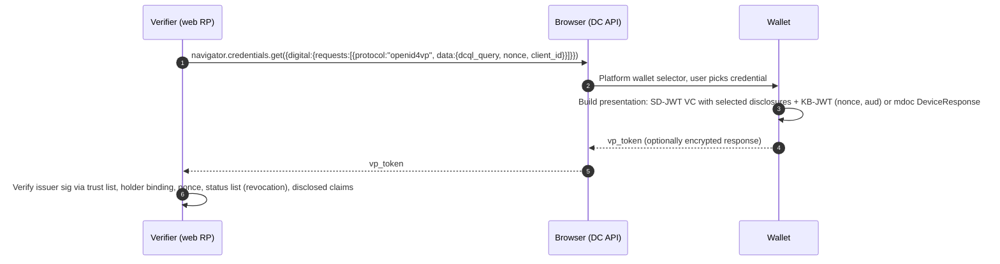

# 02 — Federation, Identity Protocols, Directories and Provisioning

*Tessera knowledge base. Research current as of 2026-10-08. Items marked [unverified] could not be confirmed against a primary source while this was written. Standards status changes quickly, so check the linked datatracker/openid.net pages before relying on a status in customer-facing material.*

---

## 1. Scope and why it matters

This document covers the **plumbing of identity**: where identities live (directories), how they are proven across trust boundaries (federation protocols), how tokens carry authorization (OAuth and its extensions), how identities are created and removed in downstream systems (provisioning), how systems tell each other about security-relevant changes (shared signals), how non-human workloads get identity (SPIFFE, cloud OIDC federation, WIMSE), and how portable, user-held credentials work (VCs, mDL, OpenID4VC).

Why it matters for Tessera:

- **Access-as-code depends on identity inputs.** Every policy Tessera evaluates for cloud and data infrastructure ("group `data-eng` may assume role `analytics-ro` in Snowflake") needs an authoritative answer to "who is this principal and which groups are they in?" That answer comes from an IdP or directory over OIDC, SAML, SCIM, LDAP or vendor APIs. Tessera will mostly *consume* identity, not originate it.
- **Enforcement happens through federation.** Granting someone access to AWS, GCP, Azure, Snowflake, Databricks or Kubernetes in practice means configuring SAML/OIDC trust, role mappings, SCIM pushes, or short-lived credentials minted through token exchange or STS. A platform that manages access must speak these protocols well.
- **Revocation latency is the real security metric.** Federation creates sessions and tokens that outlive the decision that granted them. CAEP/SSF, short token lifetimes, sender-constrained tokens and SCIM deprovisioning are how revocation reaches the edge.
- **Workloads now outnumber humans.** CI pipelines, services and AI agents need credentials. The direction of travel is clear: away from static secrets and toward federated, short-lived, attested workload identity (SPIFFE, GitHub Actions OIDC, WIMSE, Transaction Tokens).
- **The protocol surface is the attack surface.** Golden SAML, OAuth consent phishing, device-code phishing, stolen refresh tokens (for example the 2025 Salesloft Drift incident) and token-forgery bugs in large IdPs show that breaches increasingly start in federation.

---

## 2. Core concepts (precise definitions)

**Identity Provider (IdP) / OpenID Provider (OP).** The system that authenticates a subject and makes assertions about it. In SAML it issues Assertions; in OIDC it issues ID Tokens.

**Service Provider (SP) / Relying Party (RP).** The system that consumes an IdP's assertions to establish a local session.

**Authorization Server (AS).** The OAuth role that issues access tokens (and optionally refresh tokens) to clients after obtaining authorization from a resource owner or from policy.

**Resource Server (RS).** The API that accepts access tokens. RFC 9728 lets an RS publish metadata naming its authorization servers.

**Client.** The application requesting tokens. *Confidential* clients can authenticate to the AS (client secret, `private_key_jwt`, mTLS). *Public* clients cannot keep secrets (SPAs, native apps).

**Directory.** A hierarchical or graph store of identities, groups and attributes, queried over a protocol (LDAP) or an API (Microsoft Graph, Google Directory API).

**Federation.** An arrangement in which one party accepts identity claims issued by another under an agreed trust model: bilateral metadata exchange, a hub (an IdP broker) or a trust chain (OpenID Federation).

**Assertion vs. token.** A SAML *Assertion* is a signed XML statement about a subject (authentication, attributes, authorization decisions). An *ID Token* is a JWT stating that authentication happened, issued *to the client* (its `aud` is the client_id). An *access token* is a credential presented *to an RS*. Mixing these up, for example by using an ID token as an API credential, is a recurring design error.

**Bearer vs. sender-constrained token.** Anyone holding a bearer token can use it (RFC 6750). A sender-constrained token is bound to a key the legitimate client holds: DPoP (RFC 9449) binds it to an application-layer key proof, and mTLS (RFC 8705) binds it to a client certificate.

**Scope, audience, resource, authorization_details.** A *scope* is a coarse, space-delimited permission string. An *audience* (`aud`) names the intended recipient of a token. *Resource indicators* (RFC 8707) let the client tell the AS which RS a token is for. *authorization_details* (RAR, RFC 9396) carry structured, fine-grained JSON permission objects such as "transfer 45 EUR to account X" or "read table T in project P".

**Grant type.** The mechanism a client uses to obtain tokens: authorization code, client credentials, refresh token, device code (RFC 8628), CIBA, token exchange (RFC 8693), JWT bearer (RFC 7523), SAML bearer (RFC 7522).

**PKCE.** Proof Key for Code Exchange (RFC 7636). The client sends a hashed `code_challenge` with the authorization request and later proves possession of the `code_verifier`. This stops authorization-code interception and injection. OAuth 2.1 and RFC 9700 require it for all clients that use the code flow.

**Refresh token rotation.** Each use of a refresh token returns a new one and invalidates the old one. If an old token is reused, the AS can treat it as theft and revoke the whole token family. RFC 9700 requires public-client refresh tokens to be either sender-constrained or rotated.

**Opaque token + introspection.** A random handle the RS resolves by calling the AS's introspection endpoint (RFC 7662). It supports immediate revocation and hides claims from clients, at the cost of a network call per request or a cache.

**JWT / JWS / JWE / JWK.** A JSON Web Token (RFC 7519) is a claims set carried as a JWS (signed, RFC 7515) or a JWE (encrypted, RFC 7516). Keys are published as a JWK Set (RFC 7517), usually at a `jwks_uri`. The JWT access token profile is RFC 9068 (`typ: at+jwt`).

**Security Event Token (SET).** A JWT (RFC 8417) that describes a security event rather than granting access. It is delivered by push (RFC 8935) or poll (RFC 8936) and is the basis of SSF, CAEP, RISC and SCIM Events.

**Provisioning (JIT vs. SCIM).** *Just-in-time* provisioning creates the account at first federated login from assertion attributes; it cannot deprovision. *SCIM* provisioning creates, updates and deletes users and groups ahead of time over a REST API, so deprovisioning is explicit.

**Workload identity.** A cryptographically verifiable identity for software (a pod, a function, a CI job), usually short-lived and issued after *attestation* of the runtime environment. Examples: a SPIFFE ID with an SVID, a GitHub Actions OIDC token, a GCP service account token obtained through workload identity federation.

**Verifiable Credential (VC).** A tamper-evident set of claims from an *issuer*, held by a *holder* in a *wallet* and presented to a *verifier*, often with selective disclosure and holder binding. Main formats: W3C VC Data Model 2.0 (JSON-LD, secured with Data Integrity or JOSE/COSE), SD-JWT VC, and ISO mdoc (CBOR, ISO 18013-5).

**Trust model.** How a party decides an issuer or IdP is legitimate: pinned metadata (SAML), discovery plus TLS (OIDC), trust chains signed by federation operators (OpenID Federation), trust lists (eIDAS / EUDI), or a SPIFFE trust bundle.

**Kerberos / NTLM.** Kerberos (RFC 4120) is ticket-based authentication through a KDC. In Active Directory the KDC runs on domain controllers and issues TGTs and service tickets. NTLM is a legacy challenge-response protocol; Microsoft deprecated it in 2024 and is moving to disable it by default.

---

## 3. Standards and specifications

Status reflects what could be verified as of 2026-10-08.

### 3.1 Directories and enterprise authentication

| Name | Body | Identifier | Status (2026) | Link |
|---|---|---|---|---|
| LDAPv3 (technical spec road map, protocol) | IETF | RFC 4510, RFC 4511 | Proposed Standard (2006); still ubiquitous | https://www.rfc-editor.org/rfc/rfc4511 |
| LDAP auth methods / security | IETF | RFC 4513 | Proposed Standard | https://www.rfc-editor.org/rfc/rfc4513 |
| Kerberos V5 | IETF | RFC 4120 | Proposed Standard; AD's primary protocol | https://www.rfc-editor.org/rfc/rfc4120 |
| NTLM | Microsoft | MS-NLMP | Deprecated (June 2024). Phased disablement: audit available now, phase 2 expected H2 2026, default-off tied to the next major Windows Server release (no date announced) | https://learn.microsoft.com/windows/whats-new/deprecated-features |
| Kerberos RC4 removal | Microsoft | CVE-2026-20833 cycle | Auditing from Jan 2026; AES default from Apr 2026; enforcement in 2026 (exact July 2026 removal of rollback key is single-sourced [unverified]) | https://learn.microsoft.com (Kerberos RC4 guidance) |
| Microsoft Entra ID / Graph | Microsoft | Proprietary APIs + OIDC/SAML/SCIM | GA; legacy Azure AD Graph retired | https://learn.microsoft.com/entra/ |

### 3.2 Federation and SSO

| Name | Body | Identifier | Status (2026) | Link |
|---|---|---|---|---|
| SAML 2.0 (Core, Bindings, Profiles, Metadata) | OASIS | saml-core-2.0-os | OASIS Standard (2005); stable, no successor in development | https://docs.oasis-open.org/security/saml/v2.0/ |
| OpenID Connect Core 1.0 (errata set 2) | OIDF; also ISO/IEC 26131:2024 | — | Final; OIDC family published as ISO/IEC 26131–26139 (Oct 2024) | https://openid.net/specs/openid-connect-core-1_0.html |
| OIDC Discovery 1.0 | OIDF | — | Final | https://openid.net/specs/openid-connect-discovery-1_0.html |
| OIDC Dynamic Client Registration 1.0 | OIDF | — | Final | https://openid.net/specs/openid-connect-registration-1_0.html |
| OIDC RP-Initiated, Front-Channel, Back-Channel Logout, Session Management 1.0 | OIDF | — | Final (2022) | https://openid.net/specs/openid-connect-backchannel-1_0.html |
| OIDC Native SSO for Mobile Apps 1.0 | OIDF | — | Second Implementer's Draft (Oct 2025), not Final | https://openid.net/specs/openid-connect-native-sso-1_0.html |
| OpenID Federation 1.0 | OIDF | — | Final (vote closed 17 Feb 2026); 1.1 also approved as Final (date [unverified]) | https://openid.net/specs/openid-federation-1_0-final.html |
| IPSIE (Interoperability Profile for Secure Identity in the Enterprise) | OIDF IPSIE WG | Profiles of OIDC, SCIM, SSF, OAuth | Working group formed Oct 2024; profiles in draft | https://openid.net/wg/ipsie/ |

### 3.3 OAuth core and extensions

| Name | Body | Identifier | Status (2026) | Link |
|---|---|---|---|---|
| OAuth 2.0 Authorization Framework | IETF | RFC 6749 | Proposed Standard (2012) | https://www.rfc-editor.org/rfc/rfc6749 |
| Bearer Token Usage | IETF | RFC 6750 | Proposed Standard | https://www.rfc-editor.org/rfc/rfc6750 |
| OAuth 2.1 | IETF OAuth WG | draft-ietf-oauth-v2-1-15 (Mar 2026) | Internet-Draft; WG milestone to submit to IESG Dec 2026 | https://datatracker.ietf.org/doc/draft-ietf-oauth-v2-1/ |
| OAuth 2.0 Security BCP | IETF | RFC 9700 / BCP 240 (Jan 2025) | Best Current Practice | https://www.rfc-editor.org/rfc/rfc9700 |
| PKCE | IETF | RFC 7636 | Proposed Standard | https://www.rfc-editor.org/rfc/rfc7636 |
| OAuth for Native Apps | IETF | RFC 8252 (BCP 212) | BCP | https://www.rfc-editor.org/rfc/rfc8252 |
| Token Revocation / Introspection | IETF | RFC 7009 / RFC 7662 | Proposed Standard | https://www.rfc-editor.org/rfc/rfc7662 |
| AS Metadata | IETF | RFC 8414 | Proposed Standard | https://www.rfc-editor.org/rfc/rfc8414 |
| Protected Resource Metadata | IETF | RFC 9728 (2025) | Proposed Standard; used by MCP authorization | https://www.rfc-editor.org/rfc/rfc9728 |
| Dynamic Client Registration | IETF | RFC 7591 / 7592 | Proposed Standard / Experimental | https://www.rfc-editor.org/rfc/rfc7591 |
| Client ID Metadata Document (CIMD) | IETF OAuth WG | draft-ietf-oauth-client-id-metadata-document-02 (Jul 2026) | Internet-Draft | https://datatracker.ietf.org/doc/draft-ietf-oauth-client-id-metadata-document/ |
| Resource Indicators | IETF | RFC 8707 | Proposed Standard | https://www.rfc-editor.org/rfc/rfc8707 |
| AS Issuer Identification (mix-up defense) | IETF | RFC 9207 | Proposed Standard | https://www.rfc-editor.org/rfc/rfc9207 |
| Device Authorization Grant | IETF | RFC 8628 | Proposed Standard | https://www.rfc-editor.org/rfc/rfc8628 |
| Token Exchange | IETF | RFC 8693 | Proposed Standard | https://www.rfc-editor.org/rfc/rfc8693 |
| JWT Profile for client auth and grants | IETF | RFC 7523 (+ RFC 7521, 7522 SAML) | Proposed Standard | https://www.rfc-editor.org/rfc/rfc7523 |
| Mutual-TLS client auth and bound tokens | IETF | RFC 8705 | Proposed Standard | https://www.rfc-editor.org/rfc/rfc8705 |
| DPoP | IETF | RFC 9449 (2023) | Proposed Standard | https://www.rfc-editor.org/rfc/rfc9449 |
| Rich Authorization Requests (RAR) | IETF | RFC 9396 (2023) | Proposed Standard | https://www.rfc-editor.org/rfc/rfc9396 |
| Pushed Authorization Requests (PAR) | IETF | RFC 9126 (2021) | Proposed Standard | https://www.rfc-editor.org/rfc/rfc9126 |
| JWT-Secured Authorization Request (JAR) | IETF | RFC 9101 (2021) | Proposed Standard | https://www.rfc-editor.org/rfc/rfc9101 |
| JARM (JWT Secured Authorization Response Mode) | OIDF FAPI WG | — | Final | https://openid.net/specs/oauth-v2-jarm.html |
| Step-up Authentication Challenge | IETF | RFC 9470 | Proposed Standard | https://www.rfc-editor.org/rfc/rfc9470 |
| Transaction Tokens | IETF OAuth WG | draft-ietf-oauth-transaction-tokens-11 (Jul 2026) | WG consensus, waiting for write-up; IESG milestone Dec 2026 | https://datatracker.ietf.org/doc/draft-ietf-oauth-transaction-tokens/ |
| Identity and Authorization Chaining Across Domains | IETF OAuth WG | draft-ietf-oauth-identity-chaining-17 (Jul 2026) | Internet-Draft (Standards Track) | https://datatracker.ietf.org/doc/draft-ietf-oauth-identity-chaining/ |
| Attestation-Based Client Authentication | IETF OAuth WG | draft-ietf-oauth-attestation-based-client-auth-10 (Jul 2026) | Internet-Draft (Standards Track) | https://datatracker.ietf.org/doc/draft-ietf-oauth-attestation-based-client-auth/ |
| FAPI 2.0 Security Profile + Attacker Model | OIDF FAPI WG | — | Final (Feb 2025) | https://openid.net/specs/fapi-security-profile-2_0-final.html |
| FAPI 2.0 Message Signing | OIDF FAPI WG | — | Final (Sept 2025) | https://openid.net/fapi-2-message-signing-final-specification-approved/ |
| CIBA Core 1.0 | OIDF MODRNA WG | — | Final (2021) | https://openid.net/specs/openid-client-initiated-backchannel-authentication-core-1_0.html |
| GNAP | IETF (WG concluded) | RFC 9635 (Oct 2024); companion resource-server spec [status unverified] | Proposed Standard; adoption minimal | https://www.rfc-editor.org/rfc/rfc9635 |
| AuthZEN Authorization API 1.0 | OIDF AuthZEN WG | — | Final (Jan 2026) | https://openid.net/specs/authorization-api-1_0.html |

### 3.4 Token formats

| Name | Body | Identifier | Status | Link |
|---|---|---|---|---|
| JWT / JWS / JWE / JWK / JWA | IETF | RFC 7519 / 7515 / 7516 / 7517 / 7518 | Proposed Standard | https://www.rfc-editor.org/rfc/rfc7519 |
| JWT BCP | IETF | RFC 8725; replacement draft-ietf-oauth-rfc8725bis-10 (Aug 2026) | BCP; bis in progress | https://datatracker.ietf.org/doc/draft-ietf-oauth-rfc8725bis/ |
| JWT Access Token Profile | IETF | RFC 9068 | Proposed Standard | https://www.rfc-editor.org/rfc/rfc9068 |
| SD-JWT | IETF | RFC 9901 (Nov 2025) | Proposed Standard | https://www.rfc-editor.org/rfc/rfc9901 |
| SD-JWT VC | IETF OAuth WG | draft-ietf-oauth-sd-jwt-vc | Internet-Draft [latest revision unverified] | https://datatracker.ietf.org/doc/draft-ietf-oauth-sd-jwt-vc/ |

### 3.5 Provisioning and signals

| Name | Body | Identifier | Status (2026) | Link |
|---|---|---|---|---|
| SCIM 2.0 Core Schema / Protocol | IETF | RFC 7643 / RFC 7644 (2015) | Proposed Standard | https://www.rfc-editor.org/rfc/rfc7644 |
| SCIM Events | IETF SCIM WG (re-chartered) | draft-ietf-scim-events-16 (Nov 2025) | Internet-Draft; later revision/status [unverified] | https://datatracker.ietf.org/doc/draft-ietf-scim-events/ |
| SCIM use cases (reloaded), other SCIM WG drafts | IETF SCIM WG | draft-ietf-scim-use-cases-reloaded | Internet-Draft | https://datatracker.ietf.org/wg/scim/about/ |
| Security Event Token | IETF | RFC 8417; push RFC 8935; poll RFC 8936; Subject Identifiers RFC 9493 | Proposed Standard | https://www.rfc-editor.org/rfc/rfc8417 |
| Shared Signals Framework 1.0 | OIDF SSWG | — | Final (Sept 2025) | https://openid.net/specs/openid-sharedsignals-framework-1_0-final.html |
| CAEP 1.0 | OIDF SSWG | — | Final (Sept 2025) | https://openid.net/specs/openid-caep-1_0-final.html |
| RISC 1.0 | OIDF SSWG | — | Final (Sept 2025) | https://openid.net/specs/openid-risc-1_0-final.html |

### 3.6 Workload identity

| Name | Body | Identifier | Status (2026) | Link |
|---|---|---|---|---|
| SPIFFE (ID, SVID, Workload API, Federation) | CNCF | SPIFFE specs | CNCF Graduated (2022); SPIRE v1.14.x in 2026 | https://spiffe.io/docs/latest/spiffe-specs/ |
| WIMSE Architecture | IETF WIMSE WG | draft-ietf-wimse-arch-08 (Jul 2026) | Internet-Draft (Informational) | https://datatracker.ietf.org/doc/draft-ietf-wimse-arch/ |
| WIMSE Workload Identifier | IETF WIMSE WG | draft-ietf-wimse-identifier | Internet-Draft (Standards Track) | https://datatracker.ietf.org/doc/draft-ietf-wimse-identifier/ |
| WIMSE workload credentials, HTTP-Signature, mutual-TLS, WPT (successors to s2s-protocol) | IETF WIMSE WG | draft-ietf-wimse-workload-creds, -http-signature-06 (Aug 2026), -mutual-tls, -wpt | Internet-Drafts | https://datatracker.ietf.org/wg/wimse/documents/ |
| GitHub Actions OIDC | GitHub (vendor) | OIDC issuer `token.actions.githubusercontent.com` | GA | https://docs.github.com/actions/security-for-github-actions/security-hardening-your-deployments/about-security-hardening-with-openid-connect |
| AWS IAM OIDC federation / AssumeRoleWithWebIdentity | AWS | — | GA | https://docs.aws.amazon.com/IAM/latest/UserGuide/id_roles_providers_create_oidc.html |
| GCP Workload Identity Federation; Entra Workload ID federated credentials | Google / Microsoft | — | GA | https://cloud.google.com/iam/docs/workload-identity-federation |

### 3.7 Decentralized and wallet-based identity

| Name | Body | Identifier | Status (2026) | Link |
|---|---|---|---|---|
| Verifiable Credentials Data Model 2.0 | W3C | REC-vc-data-model-2.0-20250515 | W3C Recommendation (15 May 2025) | https://www.w3.org/TR/vc-data-model-2.0/ |
| VC Data Integrity, VC-JOSE-COSE, Bitstring Status List | W3C | — | Recommendations (May 2025) [individual dates unverified] | https://www.w3.org/TR/vc-jose-cose/ |
| Decentralized Identifiers (DID) 1.0 | W3C | — | Recommendation (2022); DID 1.1 in progress [unverified] | https://www.w3.org/TR/did-core/ |
| OpenID for Verifiable Presentations 1.0 | OIDF DCP WG | — | Final (2025) | https://openid.net/specs/openid-4-verifiable-presentations-1_0.html |
| OpenID for Verifiable Credential Issuance 1.0 | OIDF DCP WG | — | Final (vote Sept 2025) | https://openid.net/specs/openid-4-verifiable-credential-issuance-1_0.html |
| OpenID4VC High Assurance Interoperability Profile (HAIP) 1.0 | OIDF DCP WG | — | Proposed Final went to public review; final status [unverified] | https://openid.net/specs/openid4vc-high-assurance-interoperability-profile-1_0.html |
| W3C Digital Credentials API | W3C FedID WG | — | Working Draft; shipping in Chrome and Safari | https://www.w3.org/TR/digital-credentials/ |
| ISO mDL (in-person) | ISO/IEC JTC1 SC17 | ISO/IEC 18013-5:2021 | International Standard | https://www.iso.org/standard/69084.html |
| ISO mDL online presentation | ISO/IEC | ISO/IEC TS 18013-7:2025 (2nd ed., May 2025) | Technical Specification | https://www.iso.org/standard/91154.html |
| EUDI Wallet (eIDAS 2.0, Reg. (EU) 2024/1183) | European Commission | ARF v3.0 (2026); CIR 2024/2977–2982 (amended 2026) | Member states must offer wallets by end-2026 (24 vs. 31 Dec reported); regulated RP acceptance ~late 2027 | https://github.com/eu-digital-identity-wallet/eudi-doc-architecture-and-reference-framework |

---

## 4. How it works (key flows)

### 4.1 SAML 2.0 SP-initiated Web SSO (Redirect + POST bindings)



Key points: trust is **pinned metadata** (entityID, endpoints, signing certificate) exchanged out of band. Most SAML vulnerabilities live in step 7: XML Signature Wrapping, canonicalization tricks and parser differentials (ruby-saml CVE-2025-25291/25292). Single Logout (SLO) exists but is unreliable in practice.

### 4.2 OAuth 2.1 / OIDC authorization code with PKCE, PAR and DPoP (FAPI 2.0 shape)

```mermaid
sequenceDiagram
    autonumber
    participant C as Client (confidential)
    participant B as Browser
    participant AS as Authorization Server / OP
    participant RS as Resource Server
    C->>C: Generate code_verifier, code_challenge=S256(verifier), DPoP key pair
    C->>AS: POST /par (client auth: private_key_jwt or mTLS; scope, authorization_details, code_challenge, redirect_uri)
    AS-->>C: request_uri (short-lived)
    C->>B: 302 /authorize?client_id&request_uri
    B->>AS: Authorize (user authenticates, consents)
    AS->>B: 302 redirect_uri?code&state&iss
    B->>C: code, state, iss
    C->>C: Check state and iss (RFC 9207 mix-up defense)
    C->>AS: POST /token (code, code_verifier, client auth, DPoP proof JWT)
    AS-->>C: access_token (cnf.jkt bound), id_token, refresh_token (bound or rotated)
    C->>RS: GET /api, Authorization: DPoP <at>, DPoP: <proof with htm, htu, ath>
    RS->>RS: Verify AT (JWT sig or introspection), aud, exp, cnf.jkt equals proof key thumbprint
    RS-->>C: 200
```

FAPI 2.0 Security Profile in short: PAR required; PKCE (S256) required; only the code flow; client authentication with `private_key_jwt` or mTLS; sender-constrained access tokens through DPoP or mTLS; `iss` in the authorization response; short-lived codes; strict redirect URI matching. These are also sensible defaults for any high-value deployment.

### 4.3 OIDC logout variants

- **RP-Initiated Logout:** the RP redirects the browser to the OP's `end_session_endpoint` with `id_token_hint` and `post_logout_redirect_uri`.
- **Front-Channel Logout:** the OP renders hidden iframes pointing at each RP's `frontchannel_logout_uri`. Third-party cookie blocking is breaking it.
- **Back-Channel Logout:** the OP POSTs a signed *Logout Token* (a JWT with `events` claim `http://schemas.openid.net/event/backchannel-logout`, `sid` and/or `sub`) directly to each RP. This is the most reliable option and the one to prefer.
- **Session Management:** iframe polling with `check_session_iframe`. Effectively obsolete in modern browsers.

### 4.4 Token Exchange (RFC 8693): delegation across services and clouds



The `act` claim records delegation ("A acting on behalf of user"), as distinct from impersonation. Identity Chaining (draft) combines token exchange with the RFC 7523 JWT bearer grant to cross trust domains. Transaction Tokens (draft) use a similar pattern *inside* one trust domain to pass immutable, short-lived call-chain context between microservices.

### 4.5 CI workload federation: GitHub Actions to AWS (no static keys)



The critical control is the **trust-policy condition on `sub`**. A wildcard such as `repo:org/*` or a missing condition lets any repository, or any fork-triggered workflow, assume the role. This misconfiguration has been reported publicly many times. GCP Workload Identity Federation and Entra federated identity credentials work the same way. The SPIFFE equivalent: SPIRE attests the node and the workload, issues an X.509-SVID (for mTLS) or JWT-SVID with ID `spiffe://trust-domain/path`, and federates trust bundles across domains. A JWT-SVID can be exchanged with cloud STS because SPIRE can act as an OIDC discovery provider.

### 4.6 SCIM 2.0 provisioning and deprovisioning



SCIM's weak points: groups-as-attributes semantics vary between vendors, PATCH filter syntax interoperates poorly, there is no standard way to express entitlements or roles beyond the `entitlements` and `roles` multi-valued attributes, and pagination over large groups is a problem. **Deactivation does not by itself kill live sessions or tokens.** That gap is why CAEP and SCIM Events exist.

### 4.7 Shared Signals: CAEP session revocation

```mermaid
sequenceDiagram
    autonumber
    participant T as Transmitter (e.g., IdP / EDR / Tessera)
    participant R as Receiver (e.g., SaaS app, Tessera)
    R->>T: GET /.well-known/ssf-configuration
    R->>T: POST /streams {delivery: push|poll, events_requested:[caep session-revoked, credential-change...]}
    R->>T: POST /subjects:add {format: email|iss_sub|opaque|complex}
    Note over T: Admin disables user / risk detected
    T->>R: POST SET (JWT, signed): events{"https://schemas.openid.net/secevent/caep/event-type/session-revoked": {subject, event_timestamp, reason_admin}}
    R->>R: Verify signature, aud, txn dedupe; terminate sessions, revoke tokens
    R-->>T: 202 Accepted
```

CAEP event types include session-revoked, token-claims-change, credential-change, assurance-level-change, device-compliance-change and session-established/presented. RISC covers account-level events such as account-disabled, credential-compromise and identifier-changed.

### 4.8 Device authorization grant and CIBA (decoupled flows)

- **Device grant (RFC 8628):** the device POSTs to `/device_authorization` and receives a `device_code`, a `user_code` and a `verification_uri`. The user enters the code on a phone or laptop while the device polls `/token` until approval. This is the intended pattern for CLIs and TVs, and it is also the basis of **device-code phishing**: the attacker starts the flow and persuades the victim to enter the code.
- **CIBA:** the client (for example a call-center agent's app) calls the backchannel authentication endpoint with a `login_hint`. The OP authenticates the user out of band on their own device. The client receives tokens by poll, ping or push. Useful for privileged-action approvals ("approve this production access request on your phone").

### 4.9 Verifiable presentation (OpenID4VP + DC API)



---

## 5. How the market implements it

**Workforce IdPs (federation hubs).**
- **Microsoft Entra ID.** The dominant enterprise directory because of M365. It supports SAML, OIDC, WS-Fed, SCIM *outbound* provisioning to apps, inbound provisioning from HR systems, Conditional Access and Continuous Access Evaluation (Microsoft's CAE predates CAEP and is only partly aligned with it), and workload identity federation (federated identity credentials). Distinctives: tokens built around Graph scopes, a proprietary `.default` scope pattern, and a hybrid AD story (Entra Connect / Cloud Sync, Kerberos cloud trust). CVE-2025-55241 (actor tokens, legacy Azure AD Graph; reported July 2025 by Dirk-jan Mollema and fixed by Microsoft) showed how undocumented internal token types can sit outside the controls customers think they have.
- **Okta (Workforce Identity Cloud) and Auth0 (Customer Identity).** Broad SAML/OIDC app catalog (OIN), strong SCIM outbound, Okta Workflows, and Identity Threat Protection, which consumes and emits shared signals. Okta drove the formation of the IPSIE working group and markets IPSIE-aligned integrations. Auth0 leads developer-facing CIAM and supports PAR, DPoP and FAPI features on higher tiers.
- **Ping Identity (merged with ForgeRock under Thoma Bravo, 2023).** Strong in regulated and financial sectors, with FAPI/open-banking certification and PingFederate's deep SAML/WS-Fed legacy support.
- **Google Workspace / Cloud Identity**, **JumpCloud** (directory-as-a-service with an LDAP endpoint and RADIUS), **OneLogin**.
- **Open source.** **Keycloak** (CNCF incubating; very broad protocol support including token exchange, DPoP and FAPI profiles), **Ory** (Hydra OAuth/OIDC server, Kratos, Keto), **ZITADEL**, **Authentik**, **Duende IdentityServer** (.NET, commercial license), **Dex** (OIDC broker common in Kubernetes).
- **OAuth/OIDC engines for builders.** **Authlete** (API-first; spec authors on staff), **Curity**, **Connect2id**. These matter because standards-complete, certifiable AS behavior is hard to build.
- **B2B SaaS enablement.** **WorkOS**, **Stytch**, **Frontegg**, **SSOJet** sell "SAML/OIDC + SCIM directory sync for your SaaS" as an API. Tessera will compete with or partner alongside them when it exposes SSO to customers' customers.

**Provisioning and IGA.** SailPoint, Saviynt, Omada, One Identity and Microsoft Entra ID Governance consume SCIM, LDAP, JDBC and app connectors. In practice most target applications support SCIM inconsistently or not at all, so IGA vendors maintain hundreds of proprietary connectors. ConductorOne, Lumos, Opal, Veza and Indent (access-request and entitlement-graph newcomers) compete directly with Tessera's positioning. They tend to read entitlements through native APIs and treat SCIM as one connector among many.

**Shared signals.** Apple, Google, Microsoft, Okta, SailPoint, SGNL, Cisco/Duo, CrowdStrike and others have shown SSF/CAEP interoperability at OpenID interop events. Google's RISC implementation for "Sign in with Google" was an early production deployment. Many vendors still support only a subset of event types and only push delivery [unverified for any specific vendor].

**Workload identity.**
- Cloud-native: AWS IAM Roles Anywhere (X.509), IRSA / EKS Pod Identity, GCP Workload Identity Federation, Azure federated credentials.
- SPIFFE/SPIRE (with Red Hat and HPE among contributors); commercial SPIFFE platforms such as Defakto (formerly SPIRL) [rename unverified].
- Secrets and identity brokers: HashiCorp Vault (JWT/OIDC auth methods), Teleport (machine ID), Aembit, Astrix, Oasis, Clutch (non-human identity security posture).
- CI providers that issue OIDC tokens: GitHub Actions, GitLab CI (`id_tokens`), CircleCI, Buildkite, Bitbucket Pipelines, Terraform Cloud (dynamic provider credentials).

**Decentralized identity.** Walt.id, Spruce, MATTR, Microsoft Entra Verified ID, Google Wallet / Apple Wallet (mDL / digital ID with ISO 18013-5/-7 and DC API), Procivis, Animo, plus the EUDI reference implementation. Production use is concentrated in government ID (mDL, EUDI), age verification and some workforce use (Entra Verified ID for help-desk identity verification).

**Notable differences that bite integrators:**
1. **Group claims.** Entra emits group object IDs (GUIDs) by default and switches to an overage claim, which requires a Graph lookup, above about 200 groups in JWTs or 150 in SAML. Okta emits group names filtered by regex. Google needs Directory API calls for groups.
2. **SCIM dialects.** Entra's SCIM client and Okta's SCIM client use different PATCH shapes, filters and group-membership semantics. A robust SCIM server must accept both.
3. **Token formats.** Entra and Okta issue JWT access tokens. Some Entra tokens (Graph) are not meant to be validated by third parties. Google issues opaque access tokens and JWT ID tokens.
4. **Logout.** Back-channel logout support is uneven, especially in SaaS RPs.
5. **DPoP/PAR.** These are widely supported by OAuth engines (Keycloak, Authlete, Curity, Auth0, Okta for some flows) but rarely required by SaaS APIs yet.

---

## 6. Threats, attacks and failure modes

**Directory and enterprise authentication**
- *Kerberoasting / AS-REP roasting*: offline cracking of service tickets, made easier by RC4. This is the reason Microsoft is removing RC4.
- *Golden Ticket* (forged TGT with the stolen `krbtgt` key), *Silver Ticket* (forged service ticket), *Pass-the-Hash / Pass-the-Ticket*, *DCSync*.
- *NTLM relay*, including relays to AD CS (ESC8). ADCS misconfigurations (ESC1–ESC15+) let low-privilege users mint authentication certificates.
- *LDAP*: anonymous or simple binds over cleartext, LDAP injection, unsigned LDAP / missing channel binding.
- *Hybrid pivot*: compromise of AD Connect / Entra Connect servers or of the ADFS token-signing key gives cloud takeover.

**SAML**
- *Golden SAML*: theft of the IdP token-signing key (classically ADFS) lets attackers forge assertions for any user to any SP, bypassing MFA. CyberArk described it in 2017 and it was used in the SolarWinds/Solorigate campaign. *Silver SAML* (Semperis, 2024) is the variant in which a customer-supplied signing certificate for an Entra enterprise app is stolen.
- *XML Signature Wrapping (XSW)*, comment-injection and canonicalization bugs, *parser differentials* (ruby-saml CVE-2025-25291/25292, fixed in 1.12.4 / 1.18.0), and accepting unsigned assertions inside a signed response.
- *Replay* (missing `InResponseTo` / one-time-use checks), *audience confusion*, and *IdP-initiated SSO* abuse (unsolicited responses enable login-CSRF and injection).

**OAuth / OIDC** (RFC 9700 catalogs most of these)
- *Authorization code interception or injection*: mitigated by PKCE.
- *Mix-up attacks*: a client that talks to several ASes is tricked into sending a code or token to the attacker's AS. Mitigated by `iss` in the authorization response (RFC 9207) and per-AS redirect URIs.
- *Open redirectors and redirect URI abuse*: lax pattern matching on `redirect_uri` leaks codes or tokens. RFC 9700 requires exact string matching (localhost port flexibility excepted for native apps).
- *Implicit grant and ROPC*: removed in OAuth 2.1. Tokens in URL fragments leak through history, referrers and logs.
- *Token theft and replay*: bearer tokens and refresh tokens stolen from browser storage, logs, HAR files (the 2023 Okta support-system incident) or SaaS integrations. The **Salesloft Drift** campaign (Aug 2025, attributed to UNC6395) used stolen OAuth tokens for a third-party integration to pull data from many customers' Salesforce instances. Mitigations: sender-constraining (DPoP/mTLS), short lifetimes, refresh rotation, inventory and revocation of third-party grants.
- *Consent phishing / illicit consent grants*: a malicious multi-tenant app asks for `Mail.Read`, `offline_access` and similar scopes. Midnight Blizzard (2024) abused a legacy test OAuth app's permissions in Microsoft's own tenant. Mitigations: admin-consent workflows, publisher verification, restricting user consent.
- *Device-code phishing* (for example Storm-2372, reported by Microsoft in Feb 2025): the attacker starts a device flow and the victim enters the code. Mitigation: block the device-code flow by policy except for named clients.
- *CSRF on redirect*: missing or unvalidated `state` or nonce.
- *ID-token misuse*: accepting ID tokens as API access tokens, or skipping `aud`/`azp`/`nonce` checks.
- *Dynamic client registration abuse* (open registration with attacker-controlled `logo_uri` or `jwks_uri` leading to SSRF) and *metadata SSRF* through CIMD or `request_uri` fetches.

**JWT**
- `alg: none`; RS256-to-HS256 *algorithm confusion*; `kid`/`jku`/`x5u` header injection; missing `exp`/`aud`/`iss` checks; cross-JWT confusion (an ID token accepted where a logout token or access token is expected; prevented with explicit `typ`); weak HMAC secrets. RFC 8725 and its successor draft codify the defenses: an explicit algorithm allow-list, required `typ`, and issuer-to-key binding.
- *IdP signing-key theft*: **Storm-0558** (2023) used a stolen Microsoft consumer (MSA) signing key to forge tokens accepted by enterprise Exchange Online, because of a validation flaw. The lesson is that key scope and issuer validation are part of the protocol surface.

**Provisioning and signals**
- *Orphaned accounts*: JIT-only apps never deprovision; SCIM failures go unmonitored.
- *Attribute and identifier spoofing*: matching on mutable or email-based identifiers across tenants (the "nOAuth" pattern, where apps trusted Entra's mutable `email` claim). Use immutable `iss`+`sub` (or `tid`+`oid` in Entra).
- *SET spoofing or replay*: receivers must verify signature, `iss`, `aud`, `jti`/`txn`, and stream ownership.

**Workload identity**
- *Over-broad federation trust*: wildcard `sub` conditions in AWS, GCP or Azure trust policies; trusting `pull_request_target` workflows; not pinning `job_workflow_ref` for reusable workflows.
- *Attestation bypass*: weak node attestors such as join tokens; SVID theft from a compromised node.
- *Long-lived static keys* that remain after migrating to federation.

**Decentralized identity**
- Issuer trust-list compromise, replay of presentations without nonce or audience binding, correlation through reused signatures (mitigated by batch issuance), revocation-status privacy leaks, and wallet impersonation (which wallet attestation in HAIP and EUDI is meant to prevent).

---

## 7. Expert and authoritative sources

**Specification authors and recognized practitioners**
- **Aaron Parecki** (Okta): OAuth 2.1 editor, CIMD co-author, oauth.net maintainer, *OAuth 2.0 Simplified*. SCIM WG co-chair.
- **Dick Hardt**: OAuth 2.0 editor (RFC 6749), OAuth 2.1 co-editor.
- **Torsten Lodderstedt** (SPRIND): RFC 9700 lead author, RAR, PAR, OAuth 2.1 co-editor, EUDI/OpenID4VC.
- **Daniel Fett** (Authlete): RFC 9700, DPoP (RFC 9449), SD-JWT (RFC 9901), FAPI 2.0 attacker model and formal analysis.
- **Brian Campbell** (Ping Identity): DPoP, mTLS (RFC 8705), Token Exchange (RFC 8693), SD-JWT, JWT profiles.
- **Michael B. Jones** (self-issued.info): JWT/JOSE, OIDC, RFC 9728, VC 2.0 editor, OpenID Federation. His blog is the best changelog for OIDF/IETF milestones.
- **John Bradley** (Yubico), **Nat Sakimura** (OIDF chair; OIDC, FAPI, PKCE), **Justin Richer** (GNAP editor, *OAuth 2 in Action*, Bespoke Engineering), **Vittorio Bertocci** (d. 2023; *Modern Authentication with Azure AD*, Identity Unlocked podcast; still widely cited).
- **Atul Tulshibagwale** (SGNL): SSF/CAEP lead. **Tim Cappalli** (Okta): SSF, passkeys/WebAuthn.
- **Pieter Kasselman** (SPIRL/Defakto), **Justin Richer**, **Yaron Sheffer** and **Joe Salowey**: WIMSE drafts.
- **Phil Hunt** (Independent Identity), **Danny Zollner** (Microsoft): SCIM, SCIM events.
- **Kristina Yasuda** (SPRIND), **Oliver Terbu**, **Joseph Heenan**: OpenID4VP/VCI, conformance.
- **Manu Sporny** (Digital Bazaar): W3C VC/DID.
- **Ian Glazer** (Weave Identity), **Pamela Dingle** (Microsoft), **Gail Hodges** (OIDF Executive Director): strategy and standards context.
- **Dirk-jan Mollema** (Outsider Security; ROADtools), **Sean Metcalf** (adsecurity.org), **Will Schroeder / Lee Christensen** (SpecterOps, *Certified Pre-Owned* ADCS research), **Andy Robbins** (BloodHound): directory and Entra offensive research.

**Books**
- Justin Richer and Antonio Sanso, *OAuth 2 in Action* (Manning, 2017).
- Prabath Siriwardena, *Advanced API Security* (Apress, 2nd ed. 2020).
- Aaron Parecki, *OAuth 2.0 Simplified* (online/book).
- Vittorio Bertocci, *Modern Authentication with Azure Active Directory for Web Applications* (Microsoft Press, 2015), dated but foundational on claims-based identity.
- Evan Gilman and Doug Barth, *Zero Trust Networks* (O'Reilly, 2nd ed. 2024 with Razi Rais and others).
- *Solving the Bottom Turtle* (SPIFFE community book, free).
- Phillip J. Windley, *Learning Digital Identity* (O'Reilly, 2023).

**Blogs, sites, venues**
- oauth.net; self-issued.info; openid.net (WG pages, specs); datatracker.ietf.org (oauth, scim, wimse WGs); IETF OAuth Security Workshop (OSW) proceedings; Identiverse and EIC talks; PortSwigger Web Security Academy (OAuth/JWT labs); Microsoft Entra blog and MSRC; SpecterOps blog; Dr. Fett's and Authlete's blogs; IDPro Body of Knowledge (idpro.org).

---

## 8. Implications for Tessera

### 8.1 Required capabilities

**Identity ingestion and federation (consume)**
1. **MUST** act as an OIDC RP and a SAML 2.0 SP for admin and end-user SSO into Tessera, with per-tenant IdP configuration, signed-assertion enforcement, strict audience/recipient/`InResponseTo` checks, a hardened XML library (no parser differentials), and certificate-rollover handling.
2. **MUST** ingest users, groups and memberships from Entra ID (Graph), Okta, Google Workspace and generic SCIM 2.0 (as a SCIM *server*), plus LDAP/AD (read-only bind over LDAPS or StartTLS) through an on-prem agent, normalizing to an immutable `(issuer, subject)` key rather than email.
3. **MUST** resolve group overage and nested groups (Entra transitive membership, AD nested groups, Okta group rules) so policy evaluation uses effective membership.
4. **MUST** receive SSF streams (CAEP session-revoked, credential-change, assurance-level-change; RISC account-disabled/credential-compromise) and SCIM deactivations, and turn them into revocation of Tessera-issued grants and downstream credentials within a defined SLO (target under 60 s).
5. **SHOULD** implement OIDC Back-Channel Logout as an RP, and RP-Initiated Logout.
6. **SHOULD** support OpenID Federation trust chains for multi-org or public-sector customers. **COULD** defer this until a customer requires it.

**Token issuance and authorization surface (expose)**
7. **MUST** expose an OAuth 2.1-aligned authorization server for Tessera's own API, CLI and Terraform provider: authorization code + PKCE (S256) only for interactive clients, device authorization grant for the CLI (with device-flow phishing mitigations: short `user_code` TTL, client allow-list, clear consent screen), client credentials with `private_key_jwt` for automation, refresh rotation with reuse detection, exact redirect-URI matching, `iss` in responses, and RFC 8414 / RFC 9728 metadata.
8. **MUST** issue short-lived, audience-restricted JWT access tokens (RFC 9068, explicit `typ`, algorithm allow-list per RFC 8725), publish a JWKS with key rotation, and offer RFC 7662 introspection and RFC 7009 revocation.
9. **MUST** support sender-constrained tokens: DPoP (RFC 9449) for CLI and agent clients, mTLS-bound (RFC 8705) for server-to-server.
10. **MUST** support RFC 8693 Token Exchange as the core *just-in-time access broker* primitive: exchange a user's IdP token or a workload token for a narrowly scoped, short-lived credential to a target (and mint cloud STS credentials or database credentials downstream), recording the `act` delegation chain for audit.
11. **SHOULD** support Rich Authorization Requests (RFC 9396) to express resource-specific grants (`{type: "snowflake_role", role: "ANALYST", account: "...", duration: "PT2H"}`). This maps directly onto access-as-code policy objects.
12. **SHOULD** support PAR (RFC 9126) and be FAPI 2.0-compatible for regulated (financial) customers. **COULD** pursue OIDF certification.
13. **SHOULD** support CIBA (or an equivalent push approval) for out-of-band approval of privileged access requests.
14. **COULD** expose an AuthZEN Authorization API 1.0 PDP endpoint so third-party PEPs (API gateways, apps) can query Tessera decisions in a standard way.

**Provisioning (push)**
15. **MUST** act as a SCIM 2.0 *client* that provisions and deprovisions users and groups into target SaaS/data platforms that support SCIM (Snowflake, Databricks, GitHub Enterprise, Slack, etc.), tolerating Entra- and Okta-style dialects, with reconciliation (drift detection) and idempotent retries.
16. **SHOULD** emit SSF/CAEP events as a *transmitter* when Tessera revokes access or detects drift, so customer IdPs and SaaS apps can react.
17. **COULD** implement SCIM Events (draft) once it stabilizes.

**Workload identity**
18. **MUST** accept federated workload identities (GitHub Actions, GitLab CI, Terraform Cloud, Kubernetes service-account tokens, SPIFFE JWT-SVIDs, AWS/GCP/Azure instance identities) as subjects in policy, with strict claim-matching rules (no wildcard `sub` by default, and linting that flags dangerous trust policies).
19. **MUST** analyze and manage cloud federation trust (AWS IAM OIDC/SAML providers and role trust policies, GCP WIF pools, Entra federated credentials) as code, including detection of over-broad conditions.
20. **SHOULD** support SPIFFE federation (consume trust bundles) and track WIMSE / Transaction Tokens drafts for service-to-service and AI-agent delegation.
21. **SHOULD** support the MCP/agent pattern: AS discovery through RFC 9728, CIMD-style client identification, and token exchange for agent-on-behalf-of-user with an explicit `act` chain.

**Security posture and audit**
22. **MUST** inventory third-party OAuth grants and SAML/OIDC app trusts in connected IdPs (consented scopes, publisher, last use) and flag risky ones (consent phishing, stale high-privilege grants). This responds directly to the Drift/Midnight Blizzard incident classes.
23. **MUST** detect identity-infrastructure risks it can observe: SAML signing-certificate changes, new federated domains or IdPs in Entra (Golden/Silver SAML precursors), device-code flow allowed tenant-wide, legacy NTLM/RC4 dependencies (via AD agent).
24. **COULD** verify VCs/mDL (OpenID4VP + DC API) for high-assurance identity proofing during access requests or help-desk resets. This is a later-stage feature.

### 8.2 Data-model entities and fields

| Entity | Key fields |
|---|---|
| `IdentityProvider` | id, tenant_id, type (oidc, saml, scim_source, ldap, entra_graph, okta_api, google_dir), issuer / entity_id, metadata_url, jwks_uri, signing_certs[] (fingerprint, not_after), discovery_cache, trust_mode (pinned, discovery, oidfed_chain), status, last_sync_at |
| `Principal` (abstract) | id, tenant_id, kind (human, workload, agent, service_account), display_name, lifecycle_state (staged, active, suspended, deprovisioned), created_at, risk_level |
| `ExternalIdentity` | id, principal_id, idp_id, subject (immutable `sub`/`oid`/`NameID` persistent), issuer, tenant_hint (`tid`), username, emails[] (+verified), external_id (SCIM `externalId`), attributes (jsonb), last_authenticated_at, acr/amr last seen |
| `Group` | id, idp_id, external_id, name, type (security, distribution, dynamic, scim), source_of_truth, member_count |
| `GroupMembership` | group_id, member_principal_id or member_group_id, direct/transitive, source, valid_from/valid_to |
| `WorkloadIdentity` | principal_id, issuer (e.g., GitHub/SPIFFE trust domain), subject pattern, required_claims (repo, ref, environment, job_workflow_ref, k8s namespace/serviceaccount, spiffe_id), attestation_type, max_token_ttl |
| `FederationTrust` (downstream) | id, target_system (aws_account, gcp_project, azure_tenant, snowflake, k8s_cluster), provider_type (oidc, saml), trusted_issuer, audience, condition_expressions, linted_risk[], managed_by_tessera (bool), drift_state |
| `OAuthClient` | client_id, tenant_id, type (public/confidential), auth_method (private_key_jwt, tls_client_auth, none), jwks / jwks_uri / cimd_url, redirect_uris[] (exact), allowed_grants[], allowed_scopes[], dpop_required, par_required, owner_principal_id |
| `Grant` (consent / delegated) | id, principal_id, client_id, scopes[], authorization_details (jsonb, RAR), resource/audience, created_at, last_used_at, expires_at, revoked_at, revocation_reason |
| `Token` / `CredentialIssuance` | jti, grant_id, type (access, refresh, id, txn, cloud_sts, db_credential), aud, cnf (jkt or x5t#S256), act_chain[], issued_at, expires_at, family_id (refresh rotation), revoked_at |
| `ProvisioningTarget` | id, system, protocol (scim2, api, ldap), base_url, auth (ref to secret store), dialect_profile, schemas_supported, capabilities (patch, bulk, filter), last_reconcile_at |
| `ProvisionedAccount` | target_id, principal_id, remote_id, remote_username, state, last_pushed_hash, drift_detected_at |
| `SignalStream` | id, direction (transmit/receive), peer_issuer, delivery (push/poll), endpoint_url, events_requested[], subjects_scope, status, last_event_at |
| `SecurityEvent` | id, stream_id, set_jti, event_type (CAEP/RISC/SCIM URI), subject (RFC 9493 subject identifier, jsonb), event_timestamp, received_at, processed_at, actions_taken[] |
| `AuthenticationContext` | session_id, principal_id, idp_id, acr, amr[], auth_time, device_posture, ip/asn, risk_score (feeds step-up via RFC 9470) |

### 8.3 Protocols: consume vs. expose

| Protocol | Consume | Expose | Notes |
|---|---|---|---|
| OIDC | Yes (RP to customer IdPs) | Yes (OP for Tessera clients, CLI; optionally as broker) | Core |
| SAML 2.0 | Yes (SP) | Later, only if Tessera brokers SSO into legacy targets | Use a mature library |
| OAuth 2.1 / RFC 9700 profile | Yes (call IdP and SaaS APIs) | Yes (AS for Tessera API) | Core |
| Token Exchange (8693) | Yes (cloud STS, Entra OBO) | Yes (JIT credential broker) | Differentiator |
| DPoP / mTLS | Yes where targets support it | Yes | — |
| RAR / PAR / JAR | — | Yes (RAR first) | RAR maps to policy objects |
| Device grant | — | Yes (CLI) | With phishing controls |
| CIBA | — | Should (approvals) | — |
| SCIM 2.0 | Yes (server: ingest from IdPs/HRIS) | Yes (client: push to targets) | Core |
| LDAP / AD (Kerberos) | Yes (agent, read; later write for AD groups) | No | Hybrid customers |
| SSF / CAEP / RISC | Yes (receiver) | Yes (transmitter) | Revocation latency |
| SPIFFE / cloud OIDC federation | Yes | Manage trust as code | Core to the infra wedge |
| WIMSE / Transaction Tokens | Track | Later | Drafts |
| AuthZEN | — | Could (PDP API) | Standard decision API |
| OpenID Federation | Could | Could | Public sector / EU |
| OpenID4VP / mDL | Could (verifier) | No | Identity proofing |
| GNAP | No | No | Negligible adoption |

### 8.4 Build vs. integrate recommendation

- **Do not build a general-purpose workforce IdP or directory in the first phases.** Entra ID, Okta and Google own authentication and the user directory. Tessera should be the *authorization and access-lifecycle layer* that consumes them. Competing on primary SSO is expensive and not differentiating.
- **Integrate (embed) a proven protocol engine for OAuth/OIDC AS and SAML SP rather than writing one from scratch.** Options: an embeddable, conformance-tested library or engine (for example Ory Hydra/Fosite in Go, Keycloak if JVM is acceptable, Authlete as a service, or node-oidc-provider / Duende in other stacks), plus a well-maintained SAML library with a known-good security history. Run the OIDF conformance suite in CI. Protocol edge cases (PKCE downgrade, mix-up, JWT algorithm confusion, XSW) are where startups get breached.
- **Build** the differentiating layers: the normalized identity graph (principals, external identities, groups, workloads), the token-exchange / JIT credential broker with RAR-shaped grants, federation-trust-as-code (AWS/GCP/Azure/Kubernetes trust linting and drift), the SCIM client with dialect profiles and reconciliation, and the SSF transmitter/receiver with a revocation-SLO pipeline.
- **Partner or integrate** for HRIS sources (Workday, BambooHR via SCIM or their APIs), secrets backends (Vault, cloud KMS), SPIRE (consume rather than reimplement), and VC/mDL verification (walt.id, Spruce or vendor SDKs) when that becomes relevant.
- **Standards posture:** join the OIDF IPSIE and Shared Signals WGs and follow the IETF OAuth, SCIM and WIMSE WGs. IPSIE profiles define what "enterprise-ready" will mean to buyers, and early alignment is cheap.

---

## 9. Glossary

- **ACR / AMR**: Authentication Context Class Reference / Authentication Methods References. OIDC claims describing assurance level and methods used.
- **ADFS**: Active Directory Federation Services, Microsoft's on-prem SAML/WS-Fed/OIDC IdP.
- **AS**: Authorization Server.
- **CAEP**: Continuous Access Evaluation Profile (OIDF), session and credential change events over SSF.
- **CIBA**: Client-Initiated Backchannel Authentication.
- **CIMD**: OAuth Client ID Metadata Document, where the client_id is a URL to client metadata.
- **cnf**: Confirmation claim binding a token to a key (`jkt` for DPoP, `x5t#S256` for mTLS).
- **DCQL**: Digital Credentials Query Language (used in OpenID4VP 1.0).
- **DID**: Decentralized Identifier.
- **DPoP**: Demonstrating Proof of Possession (RFC 9449).
- **EUDI Wallet**: European Digital Identity Wallet under eIDAS 2.0.
- **FAPI**: Financial-grade API security profile (OIDF), now general high-security OAuth.
- **GNAP**: Grant Negotiation and Authorization Protocol (RFC 9635).
- **HAIP**: OpenID4VC High Assurance Interoperability Profile.
- **IPSIE**: Interoperability Profile for Secure Identity in the Enterprise (OIDF WG).
- **JAR / JARM**: JWT-secured authorization request / response mode.
- **JIT provisioning**: account creation at first login from assertion data.
- **JWKS**: JSON Web Key Set.
- **KDC / TGT**: Kerberos Key Distribution Center / Ticket-Granting Ticket.
- **mdoc / mDL**: ISO 18013-5 mobile document / mobile driving licence.
- **NameID**: SAML subject identifier (persistent, transient, email formats).
- **OBO**: On-Behalf-Of (Entra's token-exchange-like flow).
- **PAR**: Pushed Authorization Requests (RFC 9126).
- **PKCE**: Proof Key for Code Exchange (RFC 7636).
- **RAR**: Rich Authorization Requests (RFC 9396).
- **RISC**: Risk Information Sharing and Coordination (OIDF).
- **RP / SP**: Relying Party / Service Provider.
- **SCIM**: System for Cross-domain Identity Management.
- **SD-JWT**: Selective Disclosure JWT (RFC 9901).
- **SET**: Security Event Token (RFC 8417).
- **SPIFFE / SVID**: Secure Production Identity Framework for Everyone / SPIFFE Verifiable Identity Document (X.509 or JWT).
- **SSF**: Shared Signals Framework.
- **STS**: Security Token Service (e.g., AWS STS).
- **Txn-Token**: Transaction Token, a short-lived in-domain call-chain context token (draft).
- **WIMSE**: Workload Identity in Multi-System Environments (IETF WG).
- **WIT / WPT**: Workload Identity Token / Workload Proof Token (WIMSE drafts).
- **XSW**: XML Signature Wrapping.

---

## 10. Sources

IETF / RFC Editor
- https://datatracker.ietf.org/doc/draft-ietf-oauth-v2-1/
- https://www.rfc-editor.org/rfc/rfc9700.html
- https://www.rfc-editor.org/info/bcp240/
- https://www.rfc-editor.org/rfc/rfc6749
- https://www.rfc-editor.org/rfc/rfc7636
- https://www.rfc-editor.org/rfc/rfc8693
- https://www.rfc-editor.org/rfc/rfc8705
- https://www.rfc-editor.org/rfc/rfc9449
- https://www.rfc-editor.org/rfc/rfc9396
- https://www.rfc-editor.org/rfc/rfc9126
- https://www.rfc-editor.org/rfc/rfc9101
- https://www.rfc-editor.org/rfc/rfc9207
- https://www.rfc-editor.org/rfc/rfc8628
- https://www.rfc-editor.org/rfc/rfc9068
- https://www.rfc-editor.org/rfc/rfc9728
- https://www.rfc-editor.org/rfc/rfc9635.html
- https://datatracker.ietf.org/doc/rfc9635/history/
- https://www.rfc-editor.org/rfc/rfc9901.html
- https://www.rfc-editor.org/rfc/rfc7643
- https://www.rfc-editor.org/rfc/rfc7644
- https://www.rfc-editor.org/rfc/rfc8417
- https://datatracker.ietf.org/doc/draft-ietf-oauth-rfc8725bis/
- https://datatracker.ietf.org/doc/draft-ietf-oauth-transaction-tokens/
- https://datatracker.ietf.org/doc/draft-ietf-oauth-identity-chaining/
- https://www.ietf.org/archive/id/draft-ietf-oauth-identity-chaining-17.html
- https://datatracker.ietf.org/doc/draft-ietf-oauth-client-id-metadata-document/
- https://www.ietf.org/archive/id/draft-ietf-oauth-attestation-based-client-auth-10.html
- https://datatracker.ietf.org/doc/draft-ietf-scim-events/
- https://www.ietf.org/archive/id/draft-ietf-scim-events-16.html
- https://datatracker.ietf.org/wg/scim/about/
- https://datatracker.ietf.org/doc/draft-ietf-wimse-arch/
- https://www.ietf.org/archive/id/draft-ietf-wimse-arch-08.txt
- https://datatracker.ietf.org/doc/draft-ietf-wimse-identifier/
- https://datatracker.ietf.org/doc/draft-ietf-wimse-s2s-protocol/
- https://datatracker.ietf.org/doc/html/draft-ietf-wimse-http-signature-06
- https://datatracker.ietf.org/doc/charter-ietf-wimse/writeup/

OpenID Foundation
- https://openid.net/specs/openid-connect-core-1_0.html
- https://www.openid.net/10-years-on-openidconnect-published-as-iso-spec/
- https://openid.net/openid-federation-1-0-final-specification-approved/
- https://openid.net/specs/openid-federation-1_0-final.html
- https://www.openid.net/category/final-specification/page/2/ (SSF, CAEP, RISC final)
- https://openid.net/wg/sharedsignals/
- https://sgnl.ai/2025/09/sgnl-welcomes-the-publication-of-the-final-shared-signals-and-caep-specifications/
- https://openid.net/tag/fapi-2-0/page/2/ (FAPI 2.0 Security Profile final)
- https://openid.net/fapi-2-message-signing-final-specification-approved/
- https://openid.net/fapi2-0-final-conformance-tests-available/
- https://www.openid.net/tag/openid4vc/ (OpenID4VP final)
- https://openid.net/tag/digital-credentials-protocols/ (OpenID4VCI final)
- https://www.openid.net/tag/dcp/ (HAIP review)
- https://openid.net/wg/ipsie/
- https://openid.net/wg/ipsie/charter/
- https://openid.net/announcing-ipsie-working-group/
- https://openid.net/authorization-api-1-0-final-specification-approved/
- https://openid.net/public-review-period-for-proposed-second-implementers-draft-of-openid-connect-native-sso-for-mobile-apps/
- https://openid.net/specs/openid-client-initiated-backchannel-authentication-core-1_0.html
- https://self-issued.info/?cat=37

OASIS / W3C / ISO / EU
- https://docs.oasis-open.org/security/saml/v2.0/
- https://www.w3.org/TR/vc-data-model-2.0/
- https://www.w3.org/TR/did-core/
- https://www.w3.org/TR/digital-credentials/
- https://www.iso.org/standard/91154.html
- https://www.iso.org/standard/89056.html
- https://github.com/eu-digital-identity-wallet/eudi-doc-architecture-and-reference-framework
- https://www.biometricupdate.com/202607/conformance-framework-for-eu-digital-identity-wallets-arrives-with-arf-v3-0
- https://joinble.io/blog/eudi-wallet-eidas-2-kyc-compliance-2026
- https://docs.yivi.app/blog/2025-arf-1-5

Workload identity / vendor docs
- https://spiffe.io/docs/latest/spiffe-specs/
- https://www.infoq.com/news/2022/09/spire-graduates-cncf/
- https://pkg.go.dev/github.com/spiffe/spire@v1.14.5
- https://docs.github.com/actions/security-for-github-actions/security-hardening-your-deployments/about-security-hardening-with-openid-connect
- https://docs.aws.amazon.com/IAM/latest/UserGuide/id_roles_providers_create_oidc.html
- https://cloud.google.com/iam/docs/workload-identity-federation
- https://oauth.net/ipsie
- https://developer.chrome.com/blog/digital-credentials-api-143-issuance-ot
- https://docs.walt.id/concepts/data-exchange-protocols/dc-api

Threats and incidents
- https://nvd.nist.gov/vuln/detail/CVE-2025-25291
- https://www.wiz.io/vulnerability-database/cve/cve-2025-25291
- https://thehackernews.com/2025/09/microsoft-patches-critical-entra-id.html
- https://www.thestack.technology/critical-azure-vulnerability-cve-2025-55241-entraid/
- https://www.helpnetsecurity.com/2026/02/02/microsoft-windows-ntlm-disabling/
- https://thehackernews.com/2026/02/microsoft-begins-ntlm-phase-out-with.html
- https://www.govinfosecurity.com/microsoft-to-kill-rc4-in-kerberos-by-2026-a-30304
- https://petri.com/microsoft-phases-out-rc4-kerberos-security/
- https://hypergate.com/blog/kerberos-rc4-removal-mobile-sso/
- https://www.cyberark.com/resources/threat-research-blog/golden-saml-newly-discovered-attack-technique-forges-authentication-to-cloud-apps (Golden SAML, 2017)
- https://www.semperis.com/blog/meet-silver-saml/ (Silver SAML) [URL unverified]
- https://msrc.microsoft.com/blog/2023/07/microsoft-mitigates-china-based-threat-actor-storm-0558-targeting-of-customer-email/ (Storm-0558)
- https://www.microsoft.com/en-us/security/blog/2025/02/13/storm-2372-conducts-device-code-phishing-campaign/ (device-code phishing) [URL unverified]
- https://cloud.google.com/blog/topics/threat-intelligence/data-theft-salesforce-instances-via-salesloft-drift (Salesloft Drift / UNC6395) [URL unverified]
