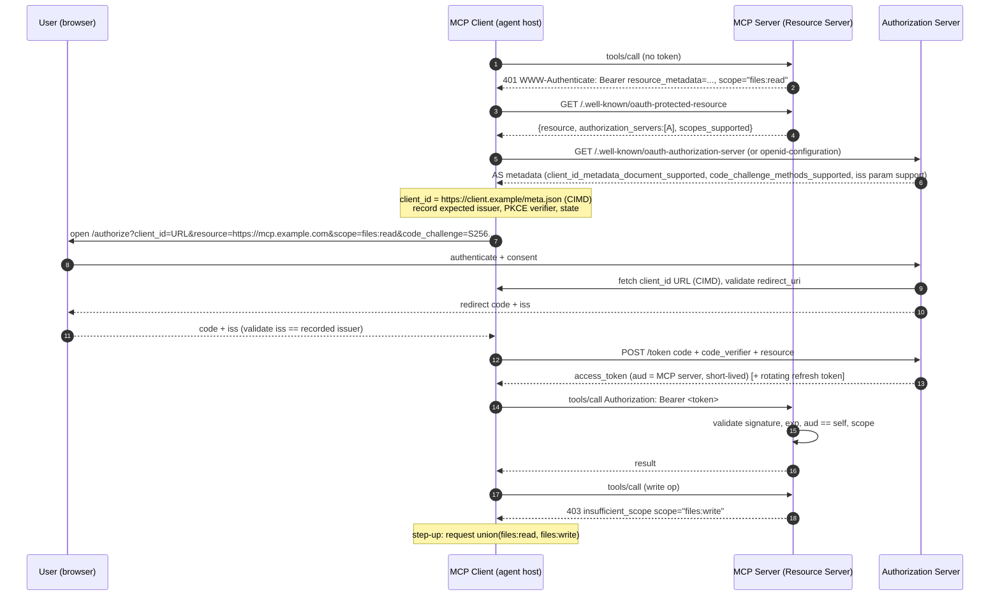
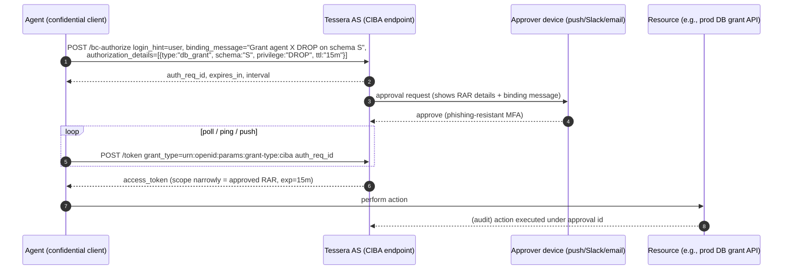

# 06 — AI Agent Identity & Authorization, and IAM Architecture, Operating Model & Measurement

*Tessera knowledge base. Research current as of 2026-10-08. Anything marked **[unverified]** could not be confirmed against a primary source while this was written. Statements about standards are paraphrased. Read the linked specs for normative text.*

---

## 1. Scope and why it matters

This document has two parts.

- **Part A, AI agents.** Covers how AI agents (LLM-driven software that plans and calls tools) are identified, authenticated, authorized and governed. Topics: delegation and on-behalf-of (OBO) flows, the Model Context Protocol (MCP) authorization model, agent-to-agent (A2A) protocols, emerging IETF and OpenID work, human-in-the-loop approval, threat models, and vendor products.
- **Part B, IAM architecture and operating model.** Covers the "identity fabric" reference architecture, maturity models, KPIs, team roles, why programs fail, and current analyst themes.

**Why this matters to Tessera.** Tessera is positioned as "access-as-code for cloud and data infrastructure", growing into a full IAM platform. Four developments in 2025–2026 make agent identity a first-order concern rather than a side feature:

1. **Agents are now a recognized identity type.** Gartner's *Hype Cycle for Digital Identity, 2026* (6 July 2026) added six entries. Four relate to agents and workloads: AI agent identity, CIAM for AI agents, intent-based access control, and workload access management. The other two are ISPM and authorization management platforms. Gartner also reported that 94% of organizations saw growth in machine identities, mostly driven by AI. Gartner's *Top Cybersecurity Trends for 2026* (5 Feb 2026) lists agentic AI first and tells leaders to discover both sanctioned and unsanctioned agents.
2. **The protocol layer has stabilized enough to build on.**
   - MCP's current revision is **2026-07-28**. It has a mature OAuth 2.1 resource-server model, and Dynamic Client Registration is now deprecated in favor of Client ID Metadata Documents.
   - Google's A2A protocol reached **v1.0** under the Linux Foundation.
   - The IETF has active drafts covering cross-app access (ID-JAG), transaction tokens, identity chaining and workload identity (WIMSE).
3. **The large incumbents have shipped agent identity products.** These include Microsoft Entra Agent ID (GA), Okta for AI Agents (GA 2026), AWS Bedrock AgentCore Identity, and Auth0 for AI Agents (GA). The market will expect any new IAM platform to treat agents as a governed identity class.
4. **Data infrastructure is where agents do damage.** Agents most often reach warehouses, object stores, databases and SaaS APIs, which are exactly the resources Tessera governs. Prompt injection turns any over-privileged agent into a data-exfiltration path. That makes least privilege, ephemeral grants and auditable delegation a core product requirement.

---

## 2. Core concepts (precise definitions)

| Term | Definition (as used in this KB) |
|---|---|
| **AI agent** | Software that pursues a goal by reasoning over context, often with an LLM, and calling tools autonomously or semi-autonomously. Microsoft's definition names four components: model, orchestration loop, memory and tools. From an IAM view, an agent is a **non-human identity (NHI) with non-deterministic behaviour**. |
| **Agent identity** | A distinct, governable principal representing an agent. It has its own identifier, credentials, owner/sponsor, lifecycle and audit trail. It is distinct from both the human it serves and the workload it runs on. Entra calls this an "agent identity". Gartner's term is "AI agent identity". |
| **Agent identity blueprint / template** | A reusable definition from which many agent instances are created. Policies apply to every instance created from it. This is Entra's concept and is useful for ephemeral agents created thousands of times per day. |
| **Workload identity** | The identity of the running software (container, function, VM), often a SPIFFE ID or cloud IAM role. An agent *runs as* a workload but *is* a separately accountable actor. |
| **Autonomous (app-only) access** | The agent acts on its own permissions, for example via OAuth `client_credentials`. |
| **Delegated / on-behalf-of (OBO) access** | The agent acts for a human. Effective permissions should be the **intersection** of the user's rights, the agent's allowed scope and the task's needs. |
| **Delegation chain** | The ordered set of actors from the originating human through agents and sub-agents to the resource. In JWTs it is represented by nested `act` (actor) claims (RFC 8693 §4.1). |
| **Subject vs actor** | In token exchange, `sub` is the party whose authority is being used (e.g. the user) and `act` identifies who is actually acting (the agent). Nesting `act` records prior actors. |
| **Token exchange** | RFC 8693. A client presents a `subject_token` (and optionally an `actor_token`) to an STS and receives a new token, typically with a narrower audience and scope. This is the basis for OBO and downscoping. |
| **ID-JAG (Identity Assertion JWT Authorization Grant)** | An IETF OAuth WG draft. An enterprise IdP issues a short-lived signed assertion that a client exchanges at a *resource* authorization server for an access token, so no user consent screen is needed. Okta markets this as **Cross App Access (XAA)**. MCP calls it **Enterprise-Managed Authorization**. |
| **Confused deputy** | A privileged intermediary is tricked into using its authority for an unauthorized party. In MCP this happens when a proxy uses a static client ID, or when a server acts with its own broad privileges instead of the caller's. |
| **Token passthrough** | An anti-pattern where a server forwards a token it received to a downstream API instead of obtaining its own. The MCP spec forbids it. |
| **Protected Resource Metadata (PRM)** | RFC 9728. A JSON document at `/.well-known/oauth-protected-resource` that tells clients which authorization server(s) protect a resource and which scopes it supports. |
| **Client ID Metadata Document (CIMD)** | An IETF OAuth WG draft. The `client_id` is an HTTPS URL that resolves to the client's metadata JSON. This allows registration without a prior relationship and without DCR. |
| **Human-in-the-loop (HITL)** | An explicit human approval step before an agent performs a sensitive action. It is usually implemented asynchronously via **CIBA** (OpenID Client-Initiated Backchannel Authentication), often combined with **RAR** (RFC 9396) so the human sees exactly what they are approving. |
| **Ephemeral / just-in-time (JIT) permission** | A grant created for one task or session that expires automatically. The goal is zero standing privilege (ZSP). |
| **Intent-based access control** | An emerging Gartner category. Access to back-end resources is decided from the captured or inferred intent of the user interacting with an agent, instead of standing roles. |
| **Identity fabric** | Gartner: an architectural approach that integrates IAM infrastructure, applications and services so all identities get consistent, controlled access. KuppingerCole uses a similar definition and publishes a dedicated Leadership Compass. |
| **Identity-first security** | A strategy that treats identity, rather than the network perimeter, as the primary control plane. Gartner introduced it as a top trend (2022) and later expanded it as "identity fabric immunity" (2023). |
| **ITDR** | Identity Threat Detection and Response: detecting and responding to attacks on identity infrastructure and on identities. |
| **ISPM / IVIP** | Identity Security Posture Management and Identity Visibility & Intelligence Platforms. ISPM continuously assesses IAM configuration risk. IVIP gives a unified view of identities, accounts and entitlements across silos. |
| **CIEM** | Cloud Infrastructure Entitlement Management: discovering and right-sizing cloud IAM permissions. |
| **Standing privilege** | A privileged entitlement that persists when not in use. Its counterpart is JIT/ZSP. |

---

## 3. Standards and specifications

Status is as of 2026-10-08. "I-D" means IETF Internet-Draft, which is work in progress and not an RFC.

### 3.1 Agent and MCP-specific

| Spec | Body | Version / status (Oct 2026) | Notes | Link |
|---|---|---|---|---|
| **MCP Specification** | MCP project (Agentic AI Foundation / LF lineage [unverified governance detail]) | **2026-07-28 = current.** 2025-11-25 was the prior version. | 2026-07-28 makes MCP stateless: no `initialize` handshake and no `Mcp-Session-Id`. It adds `server/discover`, Multi Round-Trip Requests, OpenTelemetry trace propagation in `_meta`, and RFC 9207 `iss` validation. It **deprecates DCR** in favor of CIMD and binds client credentials to the issuer. | https://modelcontextprotocol.io/specification/2026-07-28/changelog |
| **MCP Authorization** | MCP | Part of 2026-07-28 | Covered in §4.1. Built on OAuth 2.1 (draft-13), RFC 6750, 8414, 7591 (deprecated path), 8707, 9728, 9207, CIMD, OIDC Discovery and OIDC Registration. | https://modelcontextprotocol.io/specification/2026-07-28/basic/authorization |
| **MCP auth extensions** | MCP `ext-auth` repo | **Enterprise-Managed Authorization: Stable.** Client Credentials: Draft. | Extensions are optional, additive and composable. Client and server must both opt in. | https://github.com/modelcontextprotocol/ext-auth |
| **MCP Security Best Practices** | MCP | Living document | Covers confused deputy, token passthrough, SSRF, session hijacking, local server compromise and scope minimization. | https://modelcontextprotocol.io/specification/2025-11-25/basic/security_best_practices |
| **A2A (Agent2Agent) Protocol** | Linux Foundation (contributed by Google, June 2025) | **v1.0.0** (latest released). Earlier versions: 0.3.0, 0.2.6. | Agent Card declares `securitySchemes` (API key, HTTP auth, OAuth2, OIDC, mTLS). Cards can optionally be signed with JWS over JCS-canonicalized JSON. Defines an in-task `AUTH_REQUIRED` state. | https://a2a-protocol.org/latest/specification/ |

### 3.2 OAuth / IETF building blocks

| Spec | Status | Relevance to agents |
|---|---|---|
| OAuth 2.1 (draft-ietf-oauth-v2-1) | I-D, still not an RFC. MCP cites -13 and -14. Datatracker shows -15 (2 Mar 2026) and -16 (dated 2 Sep 2026 **[unverified, from a BibTeX record]**); WG milestone to submit to the IESG is Dec 2026. | Mandatory PKCE, no implicit grant, exact redirect matching. |
| draft-wzdk-scim-agent-resource, draft-kushwaha-scim-agent-governance | Individual I-Ds (Jun and Jul 2026), not WG-adopted **[adoption unverified]**. The first, by Microsoft, Okta and Nextident authors, defines a SCIM `Agent` resource (`urn:ietf:params:scim:schemas:core:2.0:Agent`); the second adds governance metadata (lifecycle state, autonomy class, validity window). | The likely wire format for provisioning agents through SCIM. Watch before designing agent SCIM schemas. |
| RFC 8693 Token Exchange | RFC (2020) | OBO, downscoping, `act` claim for delegation chains. |
| RFC 8707 Resource Indicators | RFC | Audience-binds tokens to a specific MCP server or API. MCP requires it. |
| RFC 9728 Protected Resource Metadata | RFC (2025) | Discovery of the AS from the resource. MCP requires it. |
| RFC 8414 AS Metadata / OIDC Discovery | RFC / OIDF Final | AS discovery. MCP clients must support both. |
| RFC 9207 AS Issuer Identification | RFC | Prevents mix-up attacks. MCP 2026-07-28: AS SHOULD send `iss`, and clients MUST validate it when present. |
| RFC 7591 Dynamic Client Registration | RFC | Deprecated in MCP 2026-07-28 and kept only for backward compatibility. |
| draft-ietf-oauth-client-id-metadata-document (CIMD) | I-D **-02 (6 Jul 2026)**, OAuth WG, Standards Track | URL-as-client_id. MCP's preferred registration method. |
| draft-ietf-oauth-identity-assertion-authz-grant (ID-JAG) | I-D **-04 (May 2026)**, OAuth WG | Enterprise IdP-mediated cross-app access for agents. Profiles RFC 8693 + RFC 7523. |
| draft-ietf-oauth-identity-chaining | I-D -16 (Jun 2026), with -17 seen on mirrors. Standards Track. | Carries identity and authorization across trust domains. One secondary source says it is in the RFC Editor queue **[unverified]**. |
| draft-ietf-oauth-transaction-tokens | I-D **-10 (Jul 2026)**, Standards Track | Short-lived, call-chain-scoped tokens that carry user/workload identity and authorization context inside a trust domain. |
| draft-oauth-transaction-tokens-for-agents | Individual I-D -06 (Apr 2026). Informational, expiring Oct 2026. | Puts the agent in `act` and the principal in `sub`, plus an optional `agentic_ctx`. Not WG-adopted. |
| draft-klrc-aiagent-auth ("AI Agent Authentication and Authorization") | Individual I-D **-03 (Jul 2026)**, Informational | Best-practice framework that composes WIMSE, SPIFFE, OAuth and OpenID SSF. Authors include people from OpenAI and Okta. Not WG-adopted as of the last check. |
| WIMSE (draft-ietf-wimse-arch -08, workload-creds -02, mutual-tls -01, identifier -02) | I-Ds, 2026 | Workload Identity Token (`wit+jwt`) and Workload Identity Certificate. The substrate for agent workload identity. |
| RFC 9449 DPoP | RFC | Sender-constrained tokens. Mitigates token theft from agent memory and logs. |
| RFC 9396 Rich Authorization Requests (RAR) | RFC | Fine-grained, structured authorization details. Useful for HITL approval screens and per-transaction agent grants. |
| RFC 9068 JWT Access Token profile | RFC | Standard `aud`/`sub`/`client_id` claims in access tokens. |

### 3.3 OpenID Foundation

| Spec / work | Status | Relevance |
|---|---|---|
| OpenID Connect Core / Discovery | Final | Agent login, discovery. |
| **CIBA Core 1.0** | Final | Asynchronous human approval for agents. Used by Auth0's "Async Authorization". |
| **Shared Signals Framework (SSF), CAEP, RISC** | Final 1.0, approved by OpenID Foundation members 16 Sep 2025 ([announcement coverage](https://biometricupdate.com/202509/openid-approves-3-standards-for-sharing-real-time-digital-identity-security-signals)). CAEP Interoperability Profile 1.0: 60-day review 27 Jul to 25 Sep 2026, member vote 26 Sep to 10 Oct 2026, **outcome not verified**. | Continuous revocation and session signals. Lets the platform kill agent sessions in near real time. Cited in draft-klrc-aiagent-auth. |
| **AuthZEN Authorization API** | 1.0 approved as Final: member vote ran 23 Dec 2025 to 6 Jan 2026; the final spec files on openid.net/specs are dated 12 Jan 2026 ([approval notice](https://openid.net/authorization-api-1-0-final-specification-approved/)). | Standard PEP→PDP API. Lets Tessera act as an externalized PDP for agent gateways. |
| **AI Identity Management Community Group (AIIM CG)** | Active | Whitepaper *Identity Management for Agentic AI* (7 Oct 2025, arXiv 2510.25819). Response to NIST RFI (Mar 2026). |

### 3.4 Government and security-community guidance

| Source | Status | Notes |
|---|---|---|
| **NIST NCCoE concept paper**, *Accelerating the Adoption of Software and AI Agent Identity and Authorization* | Draft, 5 Feb 2026. Comments closed 2 Apr 2026. | Proposes treating agents as identifiable entities within enterprise IAM. Focus areas: identification, authorization, auditing, non-repudiation and prompt-injection controls. Its proposed output is a demonstration project and practice guide. No follow-on project description had been found as of Oct 2026. |
| **CISA Zero Trust Maturity Model v2.0** | Apr 2023 (current) | Identity pillar functions: authentication, identity stores, risk assessment, access management, and visibility/automation/governance. Four stages: Traditional → Initial → Advanced → Optimal. Non-person entities are in scope. |
| **OWASP Top 10 for LLM Applications 2025** | Published Nov 2024 | LLM01 Prompt Injection, LLM02 Sensitive Info Disclosure, LLM03 Supply Chain, LLM04 Data & Model Poisoning, LLM05 Improper Output Handling, **LLM06 Excessive Agency**, LLM07 System Prompt Leakage, LLM08 Vector & Embedding Weaknesses, LLM09 Misinformation, LLM10 Unbounded Consumption. |
| **OWASP Top 10 for Agentic Applications 2026** | Published 9 Dec 2025 (OWASP GenAI Security Project) | ASI01 Agent Goal Hijack, ASI02 Tool Misuse & Exploitation, **ASI03 Identity & Privilege Abuse**, ASI04 Agentic Supply Chain, ASI05 Unexpected Code Execution, ASI06 Memory & Context Poisoning, **ASI07 Insecure Inter-Agent Communication**, ASI08 Cascading Failures, **ASI09 Human-Agent Trust Exploitation**, ASI10 Rogue Agents. |
| **OWASP MCP Security Cheat Sheet** | Living | Practical controls for MCP servers and clients. |
| **CSA research notes on MCP tool poisoning** (May & Jul 2026) | Published | Recommends hash-pinning tool definitions, allowlisting servers, and treating tool output as hostile. |

---

## 4. How it works

### 4.1 MCP authorization (revision 2026-07-28)

Roles: the **MCP server is an OAuth 2.1 resource server**, the **MCP client is an OAuth 2.1 client**, and the authorization server (AS) may be co-located or separate. Authorization is optional overall. HTTP transports SHOULD use it, and STDIO transports SHOULD get credentials from the environment instead.

Key normative points (paraphrased):

- **Discovery.**
  - Servers MUST publish RFC 9728 PRM listing at least one `authorization_servers` entry.
  - They advertise it either via `WWW-Authenticate: Bearer resource_metadata="…"` on a 401, or at the well-known URI. Clients try the path-specific URI first, then the root.
  - Clients MUST support both RFC 8414 and OIDC Discovery, trying them in a defined priority order.
- **Client registration priority.**
  1. Pre-registered client.
  2. **CIMD**, if the AS advertises `client_id_metadata_document_supported`.
  3. **DCR**, which is deprecated in 2026-07-28.
  4. Manual entry.
  
  Client credentials MUST be keyed by AS issuer and never reused with a different AS.
- **Scopes.** The `scope` in the 401/403 challenge is authoritative for the current request. Otherwise clients use `scopes_supported`, which is meant to be the minimal set. Step-up uses `403 insufficient_scope`, and the client requests the **union** of previously granted and newly challenged scopes, with retry limits.
- **Token request hygiene.**
  - PKCE is mandatory, with S256 when possible. Clients MUST refuse to proceed if AS metadata lacks `code_challenge_methods_supported`.
  - RFC 8707 `resource` is MUST in both the authorization and token requests.
  - RFC 9207 `iss` is validated before the code is redeemed.
  - Redirect URIs must be exact-match and either HTTPS or localhost.
- **Token handling.**
  - Bearer tokens go in the `Authorization` header on every request and never in the query string.
  - Servers MUST validate audience and accept only tokens issued for themselves.
  - **Servers MUST NOT pass through client tokens upstream.** To call an upstream API they act as a separate OAuth client with a separate token.
  - The AS SHOULD issue short-lived tokens and MUST rotate refresh tokens for public clients.
- **CIMD security.**
  - The AS fetches arbitrary URLs, so it must defend against SSRF.
  - Localhost redirect URIs allow impersonation of a legitimate client's metadata. The AS SHOULD warn, MAY require attestation, and MUST display the redirect hostname.
  - Domain trust policies (allowlists, reputation checks) are permitted.
- **Confused deputy.** MCP proxy servers that use a static client ID with a third-party AS MUST obtain per-client user consent before forwarding.



### 4.2 On-behalf-of delegation with token exchange (agent → downstream API)

This is the pattern Tessera should implement natively. The agent never holds the user's original token for downstream calls. It exchanges it for an audience-restricted, scope-reduced token that records **both** principals.

```mermaid
sequenceDiagram
    autonumber
    participant U as User
    participant AG as Agent (workload identity: SPIFFE/WIT)
    participant STS as Tessera STS / AS (policy engine)
    participant PDP as Tessera PDP (policy-as-code)
    participant API as Data API (e.g., warehouse proxy)
    U->>AG: "Summarize Q3 revenue" (user access token T_u, aud=agent)
    AG->>STS: POST /token grant_type=token-exchange<br/>subject_token=T_u, actor_token=WIT(agent),<br/>resource=https://wh.example, scope=sales:read, authorization_details=[RAR]
    STS->>PDP: evaluate(subject=user, actor=agent, resource, action, context: task, risk)
    PDP-->>STS: permit (scope = user ∩ agent-ceiling ∩ task), ttl=5m
    STS-->>AG: T_obo {sub:user, act:{sub:agent}, aud:wh, scope:sales:read, exp:+5m, cnf:DPoP}
    AG->>API: query + DPoP proof + T_obo
    API->>API: verify aud, cnf, scope; log sub+act chain
    API-->>AG: rows (row-level filtered for user)
    AG-->>U: answer
```

Design notes:

- Effective permission = **user entitlement ∩ agent ceiling ∩ task scope**. The agent ceiling is set at registration. The task scope comes from RAR or intent.
- If a sub-agent is called, nest `act` claims so the full chain (`act.act.sub`) is preserved. Downstream policy can then reason about chain length and trust.
- Inside a trust domain, transaction tokens can carry this context across internal microservice hops. Across domains, use identity chaining or ID-JAG.

### 4.3 Enterprise-managed cross-app access (ID-JAG / Okta XAA / MCP Enterprise-Managed Authorization)

```mermaid
sequenceDiagram
    autonumber
    participant C as Agent / MCP Client (Requesting App)
    participant IdP as Enterprise IdP (AS)
    participant RAS as Resource App Authorization Server
    participant RS as Resource / MCP Server
    Note over C,IdP: User already signed in to C via SSO (ID token)
    C->>IdP: Token Exchange (RFC 8693)<br/>subject_token=ID token, requested_token_type=id-jag, audience=RAS, resource=RS
    IdP->>IdP: admin policy: is C allowed to reach RS for this user?
    IdP-->>C: ID-JAG (short-lived signed JWT; not an access token)
    C->>RAS: JWT bearer grant (RFC 7523) assertion=ID-JAG
    RAS->>RAS: trust IdP via SSO relationship; map user; apply own policy
    RAS-->>C: access_token (aud=RS)
    C->>RS: API/MCP call with access token
```

Why it matters: an IT admin can centrally grant or revoke "agent X may reach app Y for these users" in the IdP, with no per-user OAuth consent sprawl. The resource AS stays the issuer of its own tokens. Okta (XAA) and Auth0 support it, and others are adopting it **[vendor dates unverified]**.

### 4.4 Human-in-the-loop approval with CIBA + RAR



A2A has an equivalent at the protocol level. An agent moves a task into `TASK_STATE_AUTH_REQUIRED`, obtains credentials out-of-band (for example via CIBA), and MUST NOT treat the auth-required state itself as authorization.

### 4.5 Agent-to-agent (A2A v1.0) auth summary

- **Discovery.** The Agent Card, a self-asserted JSON document, declares `securitySchemes` in OpenAPI style plus the required `security`. An *extended* card is available only after authentication.
- **Transport.** HTTPS/TLS is MUST in production, and TLS 1.3 is recommended. Clients SHOULD validate the server certificate.
- **Requests.** Credentials are obtained out-of-band and sent on **every** request. Servers MUST authenticate every request. Authorization is implementation-specific and may consider skill, action, data policy and scopes.
- **Card signing.**
  - Signing is optional and uses JWS. The protected header carries `alg` and `kid`, and optionally `jku`.
  - The card MUST be canonicalized with JCS (RFC 8785) before signing.
  - Verifiers SHOULD verify at least one signature, and MUST NOT accept expired or revoked keys.
  - A signed card proves provenance but **does not authorize requests**.
- **Push notifications.** Webhooks carry the configured credentials. Clients should verify the source and process notifications idempotently.

### 4.6 Reference architecture: enterprise IAM identity fabric with an agent control plane

```mermaid
flowchart TB
  subgraph Sources["Authoritative sources"]
    HR[HRIS / contractor systems]
    CMDB[CMDB / service catalog]
    AGREG[Agent registry<br/>(blueprints, owners, sponsors)]
  end

  subgraph Fabric["Identity fabric (control plane)"]
    DIR[Identity directory / graph<br/>humans · workloads · agents]
    IDP[Access mgmt / IdP<br/>SSO, MFA, OIDC/SAML, CIBA]
    STS[STS / OAuth AS<br/>token exchange, ID-JAG, txn-tokens, CIMD]
    PDP[Policy engine / PDP<br/>policy-as-code, AuthZEN API]
    IGA[IGA<br/>JML lifecycle, requests, certifications, SoD]
    PAM[PAM / JIT<br/>vault, session brokering, ZSP]
    CIEM[CIEM / DSPM entitlement graph<br/>cloud + data permissions]
    ISPM[ISPM / IVIP<br/>posture, orphaned, shadow agents]
    ITDR[ITDR + SSF/CAEP<br/>detect, revoke, kill switch]
  end

  subgraph Enforcement["Enforcement points (PEPs)"]
    GW[Agent / MCP gateway]
    APIGW[API gateway]
    DATA[Data-plane connectors<br/>Snowflake, Databricks, Postgres, S3]
    CLOUD[Cloud IAM<br/>AWS, GCP, Azure]
    SAAS[SaaS apps via SCIM/APIs]
  end

  subgraph Obs["Evidence & analytics"]
    LOG[Audit lake<br/>sub+act chains, decisions]
    KPI[KPI / compliance dashboards]
    SIEM[SIEM / SOAR]
  end

  HR --> IGA
  CMDB --> DIR
  AGREG --> DIR
  IGA <--> DIR
  DIR --> IDP
  IDP --> STS
  STS <--> PDP
  PAM <--> PDP
  CIEM --> ISPM
  DIR --> ISPM
  ISPM --> ITDR
  ITDR -->|revoke via SSF/CAEP| IDP
  ITDR -->|revoke| STS
  GW --> PDP
  APIGW --> PDP
  DATA --> PDP
  STS --> GW
  IGA -->|provision/deprovision| SAAS
  IGA -->|grants as code| CLOUD
  IGA -->|grants as code| DATA
  CIEM -->|scan| CLOUD
  CIEM -->|scan| DATA
  GW --> LOG
  PDP --> LOG
  DATA --> LOG
  LOG --> KPI
  LOG --> SIEM
  SIEM --> ITDR
```

**How the pieces fit.** The canonical enterprise stack is **IdP/AM + IGA + PAM + CIEM + ITDR**, joined by a shared identity graph and an externalized policy engine. Gartner and KuppingerCole call this composition an **identity fabric**: modular services under a common control plane rather than a single monolith. Agents add three components to the stack:

- an **agent registry** (owner, sponsor, blueprint, model, tools, risk tier);
- an **STS** that mints short-lived, audience-bound, delegation-aware tokens;
- an **agent/MCP gateway** acting as the PEP between agents and tools.

---

## 5. How the market implements it

### 5.1 Agent identity offerings (status as of Oct 2026)

| Vendor / product | Status | What it does |
|---|---|---|
| **Microsoft Entra Agent ID** | GA per Microsoft Learn "What's new" page (exact GA date **[unverified]**). Public preview since Build, May 2025. | Agent identities are a new principal type distinct from service principals. **Agent identity blueprints** allow bulk, ephemeral instances. A **sponsor** is recorded (e.g. the Copilot Studio creator). Optional 1:1 **agent user** accounts exist for systems that need a user object. Supports autonomous and delegated (OBO) access and inbound token validation. Conditional Access for Agents and ID Protection for Agents rolled out GA Jul–Aug 2026 and require **Microsoft Agent 365** licensing (included in M365 E7). |
| **Okta for AI Agents** | Announced 16 Mar 2026. GA slated 30 Apr 2026, and Okta materials state it is GA. | Discovery of known and shadow agents, registration as NHIs, credential and token management, **Agent Gateway** (central PEP with audit, virtual MCP server "coming soon" at EA), access certifications for agents, a one-click kill switch, ISPM integration. **Cross App Access (XAA)** implements ID-JAG. An "Agent SSO" GA on 24 Aug 2026 is reported by a secondary source **[unverified]**. Okta is named a Leader in the 2025 Gartner MQ for Access Management (Nov 2025) and in the 2026 KuppingerCole IGA Compass. |
| **Auth0 for AI Agents** | GA (date **[unverified]**, around late 2025) | User authentication for agents. **Token Vault** stores and refreshes third-party OAuth tokens (Google, Microsoft, Slack, GitHub, Box, custom) so agents can act for users with one-time consent. **Async Authorization** via CIBA with RAR. **FGA for RAG** applies ReBAC filtering of retrieved documents. Also supports ID-JAG. |
| **AWS Bedrock AgentCore Identity** | Launched Aug 2025 (preview then GA **[GA date unverified]**) | Automatic **workload identity** per agent runtime (name, ARN, OAuth return URLs). **Inbound auth** uses either SigV4 or JWT from an OIDC IdP (one per runtime). **Outbound auth** uses credential providers: client credentials, auth code (user consent), token exchange, API keys. A **token vault** encrypted with KMS releases credentials only to the matching agent+user pair. |
| **Google Cloud** | Vertex AI Agent Engine / Agentspace identity features **[unverified details]**. Originator of A2A. | A2A and Agent Cards. |
| **MCP gateways** | Crowded, fast-moving market | **Cloudflare MCP Server Portals**: one endpoint behind Cloudflare Access, per-server OAuth, curated tools. **Kong** AI MCP Proxy (Gateway 3.12+). **Docker MCP Gateway**: open source, image provenance, secret scanning. **agentgateway** (Solo.io / LF): tool-level RBAC, filters `tools/list`. Also Microsoft MCP Gateway, IBM ContextForge, Obot, Composio, and others. Most "best gateway" rankings are vendor-authored. |
| **Authorization engines** | Mature | Cerbos, OPA/Styra, AWS Cedar / Verified Permissions, OpenFGA / Auth0 FGA, Permit.io, Topaz. Increasingly marketed as the PDP behind MCP gateways, often with AuthZEN. |
| **NHI / secrets specialists** | Mature | Astrix, Oasis, Aembit (workload IAM), CyberArk (Secure AI Agents), Teleport (KuppingerCole 2026 Zero Trust Platforms Leader; MCP access control), HashiCorp Vault, Akeyless. |

### 5.2 Common implementation patterns observed

1. **Agents as first-class NHIs with an owner/sponsor.** Microsoft, Okta and AWS all converge on this. Orphan prevention is a selling point: "retire agents without leaving orphaned credentials".
2. **Token vault / credential broker.** The agent never stores long-lived third-party secrets. Credentials are released per (agent, user, resource).
3. **Gateway as PEP.** Central logging, tool allow-listing, per-tool authorization, and filtering of `tools/list` by caller.
4. **IdP-mediated cross-app access (ID-JAG)** replaces per-user consent prompts in enterprises.
5. **Async HITL via CIBA** for high-risk actions.
6. **Fine-grained data authorization** (ReBAC/ABAC) applied to RAG retrieval and data queries, not just API endpoints.
7. **Kill switch / continuous revocation** via SSF/CAEP or vendor-specific session revocation.

### 5.3 Analyst view (themes only, from public summaries)

- **Gartner Hype Cycle for Digital Identity, 2026** (Jul 2026).
  - Three forces: AI agents, identity visibility and identity threats.
  - New entries: AI agent identity, CIAM for AI agents (Innovation Trigger, high benefit), intent-based access control, workload access management, ISPM, and authorization management platforms.
  - Removed as mature: device-bound passkeys, passive behavioural biometrics, third-party biometrics.
- **Gartner Top Cybersecurity Trends 2026** (Feb 2026). Agentic AI is trend #1: discover sanctioned and unsanctioned agents, apply controls, and build IR playbooks. Gartner's 4Q25 forecast puts the IAM market at $18.7B (2024) growing to $29.0B (2029), per a secondary summary **[unverified]**.
- **Gartner MQ Access Management 2025** (Nov 2025). 13 vendors. Okta is confirmed as a Leader. A secondary source also lists Microsoft, Ping Identity, IBM and Transmit Security as Leaders **[unverified]**.
- **Gartner MQ PAM 2025** (Oct 2025). CyberArk, BeyondTrust and Delinea are Leaders, per vendor releases. The full list is not verified.
- **Gartner identity fabric / identity fabric immunity** (2023 trend). Fragile, misconfigured identity infrastructure is the root problem. Gartner's remedy is ITDR plus "completing and properly configuring" the fabric. Its prediction: by 2027 this would prevent 85% of new attacks (a forecast, not a measurement). Gartner also reports that over 50% of IGA deployments are "distressed" (secondary citation **[unverified]**).
- **KuppingerCole.**
  - The 2026 IGA Leadership Compass (around May 2026) frames next-gen IGA as continuous, real-time governance extended to AI agents and autonomous systems, with AI/ML access intelligence. Leaders cited by vendors include SailPoint, Saviynt, Omada and Okta.
  - The 2025 Identity Fabrics Leadership Compass is published. A 2026 edition was planned for Sept 2026 **[unverified publication]**.
  - An "Agentic AI Security" Compass is planned for Feb 2027.
  - The 2026 research agenda theme is "Identity Fabric Architecture Takes Hold".

---

## 6. Threats, attacks and failure modes

### 6.1 Agent-specific threats (mapped to OWASP)

| Threat | Mechanism | OWASP mapping | IAM-layer mitigations |
|---|---|---|---|
| **Indirect prompt injection / goal hijack** | Instructions hidden in email, docs, web pages, tickets or tool output redirect the agent. Examples: EchoLeak against M365 Copilot (zero-click exfiltration), and Invariant Labs' GitHub MCP issue-injection showing private-repo leakage. | LLM01, ASI01 | Least privilege so a hijacked agent can do little. Task-scoped ephemeral tokens. HITL for sensitive actions. Egress/data-flow policies. Separate read-untrusted and write-sensitive capabilities across sessions. |
| **Excessive agency / over-privileged agent** | The agent inherits a human's full rights or a broad service account. | LLM06, ASI03 | Agent ceiling ∩ user ∩ task. No standing privilege. Periodic certification of agent entitlements. |
| **Tool poisoning** | Malicious instructions in a tool *description*, invisible to the user but read by the model. Variants use zero-width characters, base64 or XML tags. Cross-server shadowing lets one server's tool influence the use of another's. | ASI02, ASI04 | Allowlisted servers. Tool-definition hash pinning. Description scanning. Gateway-mediated tool catalogs. |
| **Rug pull** | A server changes tool definitions after approval (via `list_changed`). CVE-2025-54136 is cited as an instance. | ASI04 | Pin by content hash. Require re-approval on change. Version-lock tool catalogs in policy-as-code. |
| **Confused deputy (MCP proxy)** | A proxy uses one static client ID at a third-party AS. Attacker-registered clients reuse existing consent cookies to obtain codes. | ASI03 | Per-client consent registry (an MCP MUST). Exact redirect matching. `state` validation. |
| **Token passthrough** | A server forwards a client token upstream, bypassing audience checks and breaking audit attribution. | ASI03 | Forbidden by MCP. Enforce RFC 8707 audience and use token exchange for upstream calls. |
| **Token theft / replay** | Tokens leak from agent memory, logs, prompt context or vector stores. | LLM02, ASI03 | Short TTL. DPoP/mTLS sender-constraint. Never place secrets in model context. Vault-brokered credentials. Refresh-token rotation. |
| **Authorization mix-up** | A client is tricked into sending a code to the wrong AS. | — | RFC 9207 `iss` validation (MCP 2026-07-28). Credentials keyed by issuer. |
| **CIMD abuse** | SSRF via `client_id` URL fetch. Localhost redirect impersonation. | — | SSRF guards. Domain trust policy. Display the redirect host. Attestation. |
| **Session hijacking** | A stolen session ID is used to inject events or impersonate. This is reduced in stateless MCP 2026-07-28. | — | Never authenticate by session ID. Verify every request's token. |
| **Insecure inter-agent comms** | Spoofed Agent Cards, replayed messages, unauthenticated webhooks. | ASI07 | Signed Agent Cards. mTLS/WIMSE. Per-request auth. Webhook source verification. |
| **Recursive delegation / privilege amplification** | Sub-agents accumulate the union of permissions. Delegation chains are not recorded. | ASI03, ASI08 | Nested `act`. Chain-length limits. Scope can only narrow at each hop. Transaction tokens. |
| **Human-agent trust exploitation / approval fatigue** | The agent persuades a human to approve, or floods them with prompts. | ASI09 | RAR-rendered approval details. Binding messages. Rate-limited approvals. Risk-tiered HITL. Approval metrics. |
| **Memory / context poisoning** | Poisoned RAG data or long-term memory causes future misuse. | ASI06, LLM08 | Permission-aware retrieval (FGA for RAG). Provenance tags. Per-tenant memory isolation. |
| **Shadow / rogue agents** | Unregistered agents built in low-code tools or run on developer laptops using personal tokens. | ASI10 | Discovery (OAuth grant scanning, API key inventory, gateway telemetry). Registration mandate. Kill switch. |
| **Orphaned agents** | The creator leaves and the agent keeps credentials. | ASI03 | Required sponsor. JML hooks transfer or disable agents when the sponsor leaves. |

### 6.2 Classic IAM program failure modes

Synthesized from Gartner-cited statistics, practitioner guides and IDPro commentary. Most percentages come from secondary sources.

1. **Treated as a tool deployment, not an operating model.** Gartner is widely cited as saying over 50% of IGA projects are "distressed" **[unverified primary]**.
2. **No accountable executive owner.** Identity crosses HR, IT, security and the business, and without an owner decisions stall at every boundary.
3. **Big-bang scope.** Too many apps are onboarded at once, integrations drag, and dependencies compound. Phase by risk instead.
4. **Bad identity data.** Wrong manager fields misroute reviews. Inconsistent departments break RBAC rules. Stale status leaves leavers with access. HR data also misses local, privileged and non-human accounts. One report says only 5.7% of organizations have full visibility of service accounts **[unverified]**.
5. **Role explosion and RBAC rigidity.** Thousands of overlapping roles with no owners.
6. **Rubber-stamp certifications.** Reviewers approve everything because they lack context, so revocation rates near 0% are a red flag.
7. **Manual operations and backlogs.** Ticket queues for provisioning become exception handling rather than policy.
8. **No measurement baseline.** IDPro's 2026 series ("We Still Don't Have a Standard Way to Measure IAM Maturity") found five surveys converging on 60–70% of organizations at early-to-mid maturity, with no standard model. One industry average is 2.4 out of 5 (Simeio). Ponemon/GuidePoint 2025 found only 50% rate their IAM investments effective.
9. **NHI and agent blind spot.** Governance programs cover humans but not service accounts, API keys or agents. These now outnumber humans by large multiples.
10. **Identity infrastructure itself is the target.** Examples: IdP misconfiguration, MFA fatigue, helpdesk social engineering, token theft. This is what ITDR and ISPM exist to address.

---

## 7. Expert and authoritative sources

**Standards editors and key individuals**
- **Aaron Parecki** (Okta): editor of OAuth 2.1, ID-JAG and CIMD; co-author of draft-klrc-aiagent-auth. Blog: aaronparecki.com.
- **Pieter Kasselman** (SPIRL / Defakto): WIMSE, transaction tokens, identity chaining; hosts the agent2agent-auth-framework repo.
- **Brian Campbell** (Ping): RFC 8693, DPoP, RFC 9728.
- **Michael B. Jones** (self-employed): RFC 9728 and many JOSE/OAuth specs.
- **George Fletcher** and **Atul Tulshibagwale** (SGNL): transaction tokens and SSF/CAEP.
- **Tobin South** (Stanford Loyal Agents / OpenID AIIM CG): lead author of the OIDF agentic identity whitepaper.
- **Den Delimarsky** (MCP core maintainer for authorization): den.dev blog explains MCP auth revisions.
- **Invariant Labs** (now part of Snyk **[unverified]**): tool-poisoning and GitHub MCP research.
- **Simon Willison**: coined "prompt injection" and the "lethal trifecta" framing (private data + untrusted content + exfiltration channel).

**Bodies and working groups**
- IETF OAuth WG, IETF WIMSE WG
- OpenID Foundation: AIIM CG, AuthZEN WG, Shared Signals WG
- MCP specification project
- A2A project (Linux Foundation)
- OWASP GenAI Security Project
- CSA AI Safety Initiative
- NIST NCCoE, NIST CAISI
- CISA
- IDPro (Body of Knowledge, newsletter)
- Identity Defined Security Alliance (IDSA)

**Analysts:** Gartner (IAM Summit, Hype Cycle for Digital Identity, MQs for AM/PAM), KuppingerCole (Leadership Compasses, EIC conference), Forrester (Wave reports), Omdia.

---

## 8. Implications for Tessera

### 8.1 Required capabilities

*MUST = needed to be credible at launch in the agent and data-access space. SHOULD = needed for enterprise competitiveness within 12 months. COULD = differentiating or optional.*

1. **MUST: model agents as a first-class identity type.** Agents should be distinct from humans, service accounts and workloads, each with a mandatory **owner/sponsor**, purpose, risk tier and lifecycle state. Support blueprints/templates so ephemeral instances inherit policy.
2. **MUST: delegation-aware token issuance via RFC 8693 token exchange.** Emit `sub` (principal) plus nested `act` (agent chain). Enforce *scope narrowing at every hop* and *effective = user ∩ agent ceiling ∩ task*.
3. **MUST: short-lived, audience-bound credentials.** Support RFC 8707 `resource`/`aud`, TTLs of minutes, and DPoP or mTLS sender-constraint. No standing secrets in agent code. Brokered credentials come from a vault.
4. **MUST: JIT / ephemeral grants for data and cloud resources expressed as code.** Examples: Snowflake/Databricks/Postgres roles, AWS/GCP/Azure IAM. Grants are time-boxed, automatically revoked and reconciled against drift. This is Tessera's core wedge, extended to agent principals.
5. **MUST: MCP-compliant authorization server and resource-server SDK for revision 2026-07-28.**
   - RFC 9728 PRM, RFC 8414 and OIDC discovery.
   - CIMD support with SSRF protection and a domain trust policy. DCR kept for compatibility only.
   - PKCE S256, RFC 9207 `iss`, `insufficient_scope` step-up, and refresh-token rotation.
   - Hard rejection of token passthrough.
6. **MUST: policy-as-code PDP for agent actions.** Decisions take (subject, actor chain, action, resource, context) and are versioned in Git, testable, and evaluated at tool-call time. Expose decisions through an **AuthZEN-compatible** API so third-party gateways can use Tessera as the PDP.
7. **MUST: full-fidelity audit.** Each decision and token issuance records the human principal, agent chain, tool, resource, policy version and approval ID. The record must be exportable to SIEM and give non-repudiation (NIST NCCoE focus area).
8. **MUST: kill switch and continuous revocation.** Allow instant disable of an agent, blueprint or sponsor's agents, revoking tokens and grants and propagating via SSF/CAEP where supported.
9. **MUST: human-in-the-loop approvals** for risk-tiered actions via CIBA with RAR-rendered details. Delivery channels: Slack, Teams, mobile push. Approvals produce narrowly scoped, short-TTL tokens.
10. **MUST: agent and NHI discovery.** Find unregistered agents and their credentials from cloud IAM, OAuth grant logs, SaaS app-to-app connections, API keys and gateway telemetry. Flag shadow and orphaned agents.
11. **SHOULD: ID-JAG / Enterprise-Managed Authorization.** Support it as both IdP (issue ID-JAGs) and resource AS (accept them), interoperating with Okta XAA and Entra.
12. **SHOULD: integrate with incumbent agent identity platforms** rather than replace them: Entra Agent ID, Okta for AI Agents, AgentCore Identity and Auth0 Token Vault. Ingest their agent inventories and govern their entitlements.
13. **SHOULD: provide an MCP/agent gateway PEP**, or first-class plugins for agentgateway, Kong, Cloudflare and Envoy. It should include tool allowlists, **tool-definition hash pinning with re-approval on change**, and per-caller `tools/list` filtering.
14. **SHOULD: access certifications for agents.** Sponsors periodically attest to each agent's purpose and entitlements. Unused entitlements are auto-revoked based on usage telemetry.
15. **SHOULD: workload identity federation.** Accept SPIFFE SVIDs, WIMSE WITs and cloud-native OIDC (GitHub Actions, Kubernetes service accounts) as agent `actor_token`s, eliminating static client secrets.
16. **SHOULD: permission-aware retrieval (RAG) filtering.** Use relationship/attribute checks so agents only retrieve what the delegating user may see. Integrate with OpenFGA/Cedar-style engines.
17. **SHOULD: transaction tokens** to carry principal, actor and context across internal service hops within the customer's trust domain.
18. **SHOULD: IAM KPI and posture dashboards** (§8.3), covering humans, NHIs and agents uniformly, with CISA ZTMM identity-pillar mapping.
19. **COULD: intent-based authorization.** Bind grants to a declared task intent captured at request time, for example "read Q3 revenue for region EMEA". This aligns with Gartner's new Hype Cycle entry.
20. **COULD: A2A support.** Validate signed Agent Cards, issue credentials for A2A `securitySchemes`, and handle `AUTH_REQUIRED` tasks via CIBA.
21. **COULD: behavioral ITDR for agents.** Baseline per-agent tool and data-access patterns and alert or auto-suspend on anomalies, such as a sudden bulk export or new egress destination.
22. **COULD: agent-policy simulation.** Dry-run "what could this agent reach if hijacked?" and compute blast radius from the entitlement graph.

**Agent scopes (AC-7).** Tessera declares an agent's allowed action and resource classes in YAML (`agents/<key>.yaml`) and compiles them to an offline graph invariant in Go, not a runtime decision point. That is fine while the scopes only report violations. If agent scopes ever gate live requests, they need Cedar permit/forbid semantics: keep the YAML as the source and generate Cedar from it.

### 8.2 Data-model entities and fields

| Entity | Key fields |
|---|---|
| **Principal** (abstract) | `id`, `type` ∈ {human, service_account, workload, agent, agent_instance}, `display_name`, `status` (active/suspended/disabled/deleted), `created_at`, `source_system`, `risk_score`, `tags` |
| **Human** | `principal_id`, `employee_id`, `hr_status`, `manager_id`, `department`, `employment_type`, `start_date`, `end_date`, `mfa_methods[]`, `phishing_resistant` (bool) |
| **Agent** | `principal_id`, `blueprint_id`, `owner_id` (human, required), `sponsor_id`, `purpose`, `risk_tier` (low/med/high/critical), `autonomy_level` (assistive / supervised / autonomous), `model_provider`, `model_id`, `runtime` (e.g. AgentCore / Entra / k8s), `workload_identity_ref` (SPIFFE ID / WIT / cloud role ARN), `client_id` (CIMD URL or registered ID), `allowed_delegators` (groups), `entitlement_ceiling_ref`, `max_delegation_depth`, `hitl_policy_ref`, `external_ids` (Entra agent object ID, Okta agent ID), `last_active_at`, `expires_at` |
| **AgentBlueprint** | `id`, `name`, `publisher`, `version`, `default_policies[]`, `allowed_tools[]`, `allowed_resources[]`, `max_token_ttl`, `instance_count`, `approved_by`, `approved_at` |
| **AgentInstance** | `id`, `blueprint_id`, `agent_id`, `session_id`/`task_id`, `started_at`, `ended_at`, `delegating_principal_id` |
| **Credential** | `id`, `principal_id`, `kind` (client_secret, private_key_jwt, mTLS cert, WIT, API key, OAuth refresh token, vault-brokered), `issuer`, `fingerprint/kid`, `created_at`, `expires_at`, `last_used_at`, `rotation_policy`, `storage_location` (vault/env/unknown), `sender_constrained` (bool) |
| **Resource** | `id`, `type` (database, schema, table, bucket, cloud account, SaaS app, MCP server, API), `canonical_uri` (RFC 8707 resource), `system`, `data_classification`, `owner_id`, `environment` |
| **Tool** (MCP/A2A) | `id`, `server_resource_id`, `name`, `description_hash`, `input_schema_hash`, `version`, `approved_hash`, `approval_status`, `risk_tier`, `side_effects` (read/write/destructive/external_egress), `first_seen`, `last_changed` |
| **Entitlement** | `id`, `resource_id`, `privilege` (e.g. SELECT, s3:GetObject, scope string), `granularity`, `sensitivity` |
| **Grant** | `id`, `principal_id`, `entitlement_id`, `grant_type` (standing / JIT / delegated / break-glass), `source` (policy-as-code commit SHA, request ID, approval ID), `granted_at`, `expires_at`, `revoked_at`, `last_used_at`, `justification` |
| **DelegationGrant** | `id`, `delegator_id` (human), `delegatee_id` (agent), `scope[]`, `authorization_details` (RAR JSON), `constraints` (time window, max amount, resources), `consent_method` (interactive / admin / ID-JAG), `created_at`, `expires_at`, `revoked_at` |
| **TokenIssuance** | `jti`, `issuer`, `sub`, `act_chain[]`, `client_id`, `aud`, `scope`, `authorization_details`, `cnf` (DPoP jkt / x5t), `grant_type` (token-exchange / jwt-bearer / ciba / client_credentials / auth_code), `issued_at`, `expires_at`, `policy_decision_id` |
| **PolicyDecision** | `id`, `timestamp`, `subject`, `actor_chain[]`, `action`, `resource_id`, `tool_id`, `context` (intent, risk signals, IP, device), `decision` (permit/deny/step-up/hitl), `policy_bundle_version`, `matched_rules[]`, `latency_ms` |
| **Approval** (HITL) | `id`, `auth_req_id`, `requested_by_agent_id`, `approver_id`, `binding_message`, `authorization_details`, `status` (pending/approved/denied/expired), `requested_at`, `decided_at`, `auth_method` (phishing-resistant?) |
| **AccessReview / Certification** | `campaign_id`, `scope` (humans/agents/NHIs/resources), `reviewer_id`, `item` (grant_id), `decision` (keep/revoke/modify), `decided_at`, `due_at`, `auto_revoked` (bool) |
| **Finding** (posture/ITDR) | `id`, `type` (orphaned_agent, shadow_agent, standing_admin, unused_grant, tool_hash_changed, token_passthrough_detected, sod_violation, stale_credential), `severity`, `principal_id`, `resource_id`, `detected_at`, `status`, `remediation_ref` |
| **LifecycleEvent** | `id`, `principal_id`, `event` (joiner/mover/leaver/agent_registered/agent_retired/sponsor_left), `source`, `occurred_at`, `processed_at`, `sla_met` (bool) |

### 8.3 KPIs Tessera should compute and show

Each KPI should be split out by principal type (human / NHI / agent), system and environment, and trended over time.

**Lifecycle**
- **Time to provision (TTP)**: median and p95 time from joiner event (HR record or agent registration) to first working access.
- **Time to deprovision (TTD)**: median and p95 time from leaver event (or agent retirement or sponsor departure) to *all* grants and credentials revoked. Target: minutes for automated systems and ≤24h overall.
- **Deprovisioning SLA compliance %**: share of leaver events fully completed within SLA.
- **Orphaned account %**: accounts or agents with no valid owner or HR match, divided by total accounts.
- **Agents without an active sponsor (count and %)**.

**Privilege**
- **Standing privilege %**: privileged grants that are standing, divided by all privileged grants. Target trends to 0 (ZSP).
- **JIT adoption %**: privileged access sessions served via JIT, divided by all privileged sessions.
- **Unused entitlement %**: grants unused for 90 days or more, divided by all grants. This is a right-sizing indicator, compatible with CIEM.
- **Mean grant lifetime**: average for JIT and for delegated grants.
- **Agent over-privilege ratio**: entitlements granted to the agent divided by entitlements actually exercised (30 days).
- **Blast radius score per agent**: count or sensitivity-weighted resources reachable if compromised.

**Governance**
- **Certification completion rate**: items decided by the due date, divided by items in the campaign.
- **Certification revocation rate**: revoked divided by reviewed. Persistent rates near 0% suggest rubber-stamping, and very high rates suggest poor provisioning hygiene.
- **Mean time to remediate revocations**: time from decision to actual removal.
- **SoD violations open (count and age)**.
- **Policy-as-code coverage %**: grants defined in code, divided by all grants on managed systems.
- **Drift rate**: out-of-band grants detected per week.

**Authentication**
- **MFA coverage %**: humans with MFA enforced. Track separately for **phishing-resistant MFA coverage %** (CISA ZTMM "Advanced").
- **Static secret ratio for NHIs/agents**: principals using long-lived secrets, divided by those using federated or short-lived credentials.
- **Credential age p95** and **% credentials past rotation policy**.

**Agent-specific runtime**
- **Agent registration coverage %**: registered agents divided by discovered agents (shadow agent ratio).
- **Delegated vs autonomous action mix**.
- **HITL approval volume, approval rate, median approval latency**, plus **approval fatigue indicator** (approvals per approver per day).
- **Denied / step-up decision rate** per agent. A spike suggests hijack or misconfiguration.
- **Tool definition changes pending re-approval** (rug-pull exposure).
- **Token TTL p95** and **% sender-constrained tokens**.
- **Kill-switch MTTR**: time from trigger to all tokens and grants invalid.

**Program maturity**
- Self-assessed or derived **CISA ZTMM identity-pillar stage** per function: authentication, identity stores, risk assessment, access management, visibility, automation, governance.

### 8.4 Build vs integrate

| Capability | Recommendation | Rationale |
|---|---|---|
| Workforce SSO / MFA / human IdP | **Integrate** (Okta, Entra, Ping, Google) | Mature, commoditized. Customers already own one. Tessera consumes identities and signals. |
| Agent registry, ownership, lifecycle | **Build** | Central to governance. Incumbents' registries are siloed per ecosystem, so Tessera can be the cross-ecosystem system of record. Ingest Entra Agent ID, Okta and AgentCore inventories. |
| Policy-as-code PDP | **Build on an OSS engine** (Cedar or OPA/Rego; OpenFGA for ReBAC) and expose AuthZEN | Core differentiator is the authoring, testing and GitOps experience. Do not write a new policy language. |
| STS / OAuth AS for agent tokens (token exchange, CIBA, CIMD, ID-JAG, txn-tokens) | **Build** a focused AS, or embed a proven OSS core (e.g. Ory Hydra, Keycloak, node-oidc-provider **[evaluate]**) | Delegation semantics and data-plane grant minting are Tessera's wedge. A full general-purpose IdP is not needed. |
| JIT grant engines for data and cloud (Snowflake, Databricks, BigQuery, Postgres, AWS/GCP/Azure IAM) | **Build** | Core access-as-code product. |
| MCP / agent gateway (data path) | **Integrate first** (agentgateway, Kong, Cloudflare, Envoy ext_authz), then **build** a thin reference gateway | Gateways are crowded. Tessera wins as the PDP and policy plane behind them. A lightweight first-party gateway helps with tool pinning and demos. |
| Secrets vault / token vault | **Integrate** (HashiCorp Vault, AWS Secrets Manager, Auth0 Token Vault, AgentCore) | Commodity with high trust requirements. Tessera brokers access and should avoid storing secrets. |
| Workload identity (SPIFFE/SPIRE, cloud OIDC) | **Integrate** | Accept as actor credentials. |
| IGA certifications and access requests | **Build** (lightweight, code-native, covering agents and data grants) and **integrate** with SailPoint/Saviynt for enterprises that have them | Agent and data-grant reviews are underserved. Full HR-driven IGA is a later expansion. |
| PAM session brokering | **Integrate** (CyberArk, BeyondTrust, Teleport) initially | Deep, crowded market. Overlap only at JIT for data and cloud. |
| ITDR / anomaly detection | **Build basic** agent-behavior detections and **integrate** with SIEM/SOAR and SSF/CAEP | Tessera has unique decision logs, which give a high-value signal. |
| HITL approval UX (Slack/Teams/push) | **Build** on CIBA | Differentiating UX with simple plumbing. |
| Discovery of shadow agents and NHIs | **Build connectors** (cloud IAM, OAuth app grants in Google/M365/Slack/GitHub, API keys) | Needed for "% coverage" metrics and the land motion. |

---

## 9. Glossary

- **A2A**: Agent2Agent protocol (Linux Foundation, v1.0), for agent discovery (Agent Cards) and task exchange between agents.
- **`act` claim**: JWT claim (RFC 8693) identifying the acting party in delegation. Nesting records the chain.
- **Agent Card**: A2A JSON descriptor of an agent's skills, endpoints and security schemes. Can be optionally JWS-signed.
- **AS / RS**: Authorization Server / Resource Server.
- **AuthZEN**: OpenID Foundation standard API between policy enforcement and decision points.
- **CAEP / SSF / RISC**: OpenID Shared Signals specs for continuous access evaluation and security event sharing.
- **CIBA**: Client-Initiated Backchannel Authentication. Decoupled, asynchronous user approval.
- **CIEM**: Cloud Infrastructure Entitlement Management.
- **CIMD**: Client ID Metadata Document. The URL is the client_id.
- **Confused deputy**: A privileged component misused on behalf of an unauthorized party.
- **DCR**: Dynamic Client Registration (RFC 7591). Deprecated in MCP 2026-07-28.
- **DPoP**: Demonstrating Proof of Possession (RFC 9449). Sender-constrained tokens.
- **HITL**: Human in the loop.
- **ID-JAG / XAA**: Identity Assertion JWT Authorization Grant / Okta's Cross App Access product.
- **Identity fabric**: Composable, integrated set of IAM services under a common control plane.
- **IGA**: Identity Governance and Administration (lifecycle, requests, certification, SoD).
- **ISPM / IVIP**: Identity Security Posture Management / Identity Visibility & Intelligence Platform.
- **ITDR**: Identity Threat Detection and Response.
- **JIT / ZSP**: Just-in-time access / zero standing privilege.
- **JML**: Joiner-Mover-Leaver lifecycle.
- **MCP**: Model Context Protocol. Current revision 2026-07-28.
- **NHI**: Non-human identity (service accounts, workloads, API keys, bots, agents).
- **OBO**: On-behalf-of (delegated) access.
- **PAM**: Privileged Access Management.
- **PDP / PEP**: Policy Decision Point / Policy Enforcement Point.
- **PKCE**: Proof Key for Code Exchange.
- **PRM**: Protected Resource Metadata (RFC 9728).
- **RAR**: Rich Authorization Requests (RFC 9396).
- **ReBAC / ABAC / RBAC**: Relationship-, attribute-, role-based access control.
- **Rug pull**: A tool definition changing maliciously after approval.
- **SoD**: Segregation of duties.
- **SPIFFE / SVID**: Workload identity framework / its verifiable identity document.
- **STS**: Security Token Service.
- **Tool poisoning**: Malicious instructions embedded in tool metadata consumed by an LLM.
- **Transaction token (Txn-Token)**: Short-lived token propagating identity and context through an internal call chain.
- **WIMSE / WIT**: IETF Workload Identity in Multi-System Environments / Workload Identity Token.

---

## 10. Sources (URLs)

**MCP**
- MCP versioning (current = 2026-07-28): https://modelcontextprotocol.io/specification/versioning
- MCP 2026-07-28 changelog: https://modelcontextprotocol.io/specification/2026-07-28/changelog
- MCP 2026-07-28 Authorization: https://modelcontextprotocol.io/specification/2026-07-28/basic/authorization
- MCP 2025-11-25 Authorization: https://modelcontextprotocol.io/specification/2025-11-25/basic/authorization
- MCP Security Best Practices: https://modelcontextprotocol.io/specification/2025-11-25/basic/security_best_practices
- MCP auth extensions repo: https://github.com/modelcontextprotocol/ext-auth
- Den Delimarsky on the Nov 2025 auth spec: https://den.dev/blog/mcp-november-authorization-spec/
- Keycloak MCP integration guide: https://www.keycloak.org/securing-apps/mcp-authz-server

**A2A**
- A2A specification: https://a2a-protocol.org/latest/specification/
- API7 on A2A 1.0 at the gateway: https://api7.ai/blog/a2a-protocol-gateway-layer

**IETF**
- ID-JAG draft -04: https://datatracker.ietf.org/doc/html/draft-ietf-oauth-identity-assertion-authz-grant-04
- CIMD draft -02: https://datatracker.ietf.org/doc/html/draft-ietf-oauth-client-id-metadata-document-02
- Identity chaining draft -16: https://datatracker.ietf.org/doc/html/draft-ietf-oauth-identity-chaining-16
- Transaction tokens draft -10: https://datatracker.ietf.org/doc/html/draft-ietf-oauth-transaction-tokens-10
- Transaction tokens for agents -06: https://datatracker.ietf.org/doc/html/draft-oauth-transaction-tokens-for-agents-06
- AI Agent Auth draft -03: https://www.ietf.org/archive/id/draft-klrc-aiagent-auth-03.html
- WIMSE architecture: https://datatracker.ietf.org/doc/draft-ietf-wimse-arch/
- WIMSE workload credentials -02: https://datatracker.ietf.org/doc/html/draft-ietf-wimse-workload-creds-02
- RFC 8693: https://www.rfc-editor.org/rfc/rfc8693
- RFC 9728: https://datatracker.ietf.org/doc/html/rfc9728
- RFC 8707: https://www.rfc-editor.org/rfc/rfc8707.html
- RFC 9207: https://datatracker.ietf.org/doc/html/rfc9207
- RFC 9396: https://www.rfc-editor.org/rfc/rfc9396
- RFC 9449: https://www.rfc-editor.org/rfc/rfc9449

**OpenID Foundation**
- CIBA Core: https://openid.net/specs/openid-client-initiated-backchannel-authentication-core-1_0.html
- OpenID Foundation agentic AI whitepaper announcement: https://openid.net/new-whitepaper-tackles-ai-agent-identity-challenges/
- Whitepaper (arXiv): https://arxiv.org/abs/2510.25819
- OIDF AIIM response to NIST RFI: https://openid.net/wp-content/uploads/2026/03/Attachment1_NIST-2025-0035-0001.pdf

**Government**
- NIST NCCoE concept paper news: https://www.nist.gov/news-events/news/2026/02/new-concept-paper-identity-and-authority-software-agents
- NCCoE project page: https://www.nccoe.nist.gov/projects/software-and-ai-agent-identity-and-authorization
- NCCoE concept paper PDF: https://www.nccoe.nist.gov/sites/default/files/2026-02/accelerating-the-adoption-of-software-and-ai-agent-identity-and-authorization-concept-paper.pdf
- CISA ZTMM v2.0 (Microsoft summary): https://learn.microsoft.com/en-us/security/zero-trust/cisa-zero-trust-maturity-model-intro
- CISA ZTMM v2.0 (primary): https://www.cisa.gov/zero-trust-maturity-model

**OWASP and threat research**
- OWASP Top 10 for LLM Applications 2025: https://genai.owasp.org/2024/11/17/owasp-reveals-updated-2025-top-10-risks-for-llms-announces-new-llm-project-sponsorship-program-and-inaugural-sponsors/
- OWASP Top 10 for Agentic Applications 2026 (summary): https://www.giskard.ai/knowledge/owasp-top-10-for-agentic-application-2026
- OWASP MCP Security Cheat Sheet: https://cheatsheetseries.owasp.org/cheatsheets/MCP_Security_Cheat_Sheet.html
- CSA MCP tool poisoning whitepaper: https://labs.cloudsecurityalliance.org/research-rb/csa-whitepaper-mcp-security-tool-poisoning-20260506-csa-styl/
- CSA MCP tool poisoning research note: https://labs.cloudsecurityalliance.org/research/csa-research-note-mcp-tool-poisoning-ai-agent-exfiltration-2/

**Vendors**
- Microsoft Entra Agent ID, what are agent identities: https://learn.microsoft.com/en-us/entra/agent-id/what-are-agent-identities
- Microsoft Entra Agent ID, what's new: https://learn.microsoft.com/en-us/entra/agent-id/whats-new-agent-id
- Message Center MC1395007 (Conditional Access / ID Protection for agents): https://mc.merill.net/message/MC1395007
- Okta Showcase 2026 press release: https://www.okta.com/newsroom/press-releases/showcase-2026/
- Okta for AI Agents early access: https://www.okta.com/blog/ai/okta-ai-agents-early-access-announcement/
- WorkOS on ID-JAG: https://workos.com/blog/mcp-enterprise-managed-authorization-id-jag
- Auth0 for AI Agents GA: https://auth0.com/blog/auth0-for-ai-agents-generally-available/
- Auth0 for AI Agents docs: https://auth0.com/docs/get-started/auth-for-ai-agents
- AWS AgentCore Runtime OAuth: https://docs.aws.amazon.com/bedrock-agentcore/latest/devguide/runtime-oauth.html
- Introducing AgentCore Identity: https://aws.amazon.com/blogs/machine-learning/introducing-amazon-bedrock-agentcore-identity-securing-agentic-ai-at-scale/
- Cloudflare MCP Server Portals: https://developers.cloudflare.com/cloudflare-one/access-controls/ai-controls/mcp-portals/
- agentgateway MCP authorization: https://agentgateway.dev/docs/configuration/security/mcp-authz
- Cerbos on MCP gateways: https://www.cerbos.dev/blog/what-is-an-mcp-gateway

**Analysts**
- Gartner Top Cybersecurity Trends 2026: https://gartner.com/en/newsroom/press-releases/2026-02-05-gartner-identifies-the-top-cybersecurity-trends-for-2026
- Gartner Hype Cycle for Digital Identity 2026 (abstract): https://www.gartner.com/en/documents/8100597
- Descope summary of the 2026 Hype Cycle: https://www.descope.com/blog/post/2026-gartner-hype-cycle-digital-identity
- Silverfort takeaways from the 2026 Hype Cycle: https://silverfort.com/blog/3-takeaways-from-the-2026-gartner-hype-cycle-for-digital-identity/
- Radiant Logic on the 2026 Hype Cycle: https://www.radiantlogic.com/resource/gartner-2026-digital-identity-hype-cycle/
- Okta, 2025 Gartner MQ for Access Management: https://www.okta.com/newsroom/press-releases/okta-named-a-leader-in-2025-gartner-magic-quadrant/
- CyberArk, 2025 Gartner MQ for PAM: https://www.cyberark.com/press/cyberark-named-a-leader-in-the-2025-gartner-magic-quadrant-for-privileged-access-management/
- BeyondTrust, 2025 Gartner MQ for PAM: https://www.beyondtrust.com/press/2025-gartner-magic-quadrant-privileged-access-management
- Okta, 2026 KuppingerCole IGA Leadership Compass: https://www.okta.com/newsroom/articles/okta-named-leader-2026-kuppingercole-iga-leadership-compass/
- KuppingerCole IAM Research Compass 2026: https://www.kuppingercole.com/research/an82012/research-compass-identity-and-access-management-2026
- CyberArk, 2025 KuppingerCole Identity Fabrics Compass: https://www.cyberark.com/resources/analyst-reports/2025-kuppingercole-analysts-leadership-compass-for-identity-fabrics
- Gartner identity fabric immunity (2023 trend coverage): https://www.digit.fyi/new-gartner-research-identifies-top-cybersecurity-trends/

**IAM maturity and program failure**
- IDPro, The Measurement Problem: https://idpro.org/the-measurement-problem/
- IDPro, incompatible approaches to IAM maturity: https://idpro.org/incompatible-approaches-to-iam-maturity/
- SC World, IAM program strategy and what goes wrong: https://www.scworld.com/implementation-guides/how-to-build-an-iam-program-strategy-phasing-and-what-goes-wrong
- NHI Mgmt Group, why IGA projects fail: https://nhimg.org/articles/why-iga-projects-fail-and-what-changes-for-identity-governance/
- Lumos, identity governance best practices: https://www.lumos.com/identity-matters/identity-governance/identity-governance-best-practices
