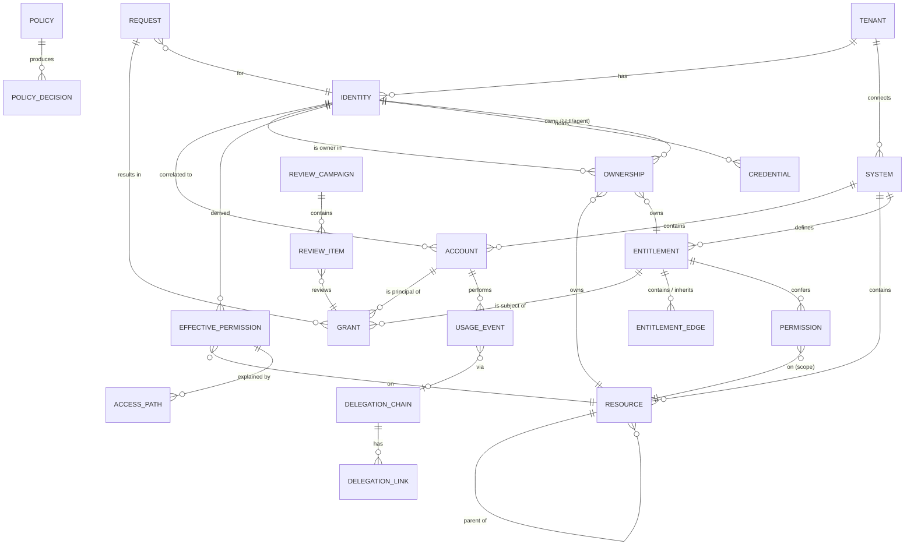
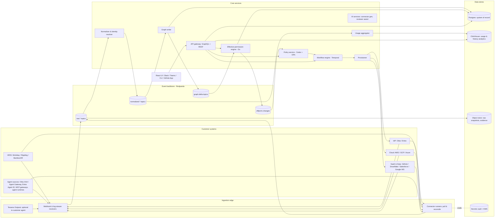

# Tessera: Product and Architecture Specification

| | |
|---|---|
| **Status** | Draft v1.0, for founder and seed-round technical diligence. Revised after the competitive analysis (`docs/competitive-analysis.md`) |
| **Date** | 2026-10-08 |
| **Working name** | Tessera (a tessera is one tile of a mosaic: every grant is a tile, and Tessera shows the whole picture) |
| **Audience** | Founders, first 10 engineers, design partners, investors |
| **Owner** | Founding team |

> **One-line pitch:** Tessera is **access-as-code for cloud and data infrastructure**. Every entitlement for people, workloads and AI agents is a reviewed, tested Cedar policy in Git. Every change is simulated against a live, usage-aware permissions graph before it merges. Unused access is removed automatically, safely and reversibly.

**Category we claim:** "Access-as-code" and "continuous least privilege". We deliberately avoid leading with "IGA", which pulls us into SailPoint/Saviynt RFPs, and with "AI agent security", which at least 12 vendors shipped in 2025–26 (including every major IdP).

### What changed in v1.0 (from v0.9)

| Area | v0.9 | v1.0 |
|---|---|---|
| Headline differentiator | Real-time effective-permissions graph | **Access-as-code**: Cedar in Git, PR review, CI tests, pre-merge blast-radius simulation |
| #2 differentiator | Usage-based least privilege | Same, sharpened: **usage-verified, staged, reversible auto-revoke** |
| Graph | Headline | Foundation that powers simulation and usage evidence. Veza/ServiceNow, SailPoint Atlas and C1 all have graphs, so it is not a claim of novelty |
| NHI / AI agents, JIT | Headline differentiators | **First-class in the graph, table stakes.** We integrate with Okta, Entra and MCP gateways rather than replace them |
| ICP | 1,000–15,000 employees, IAM-led | **500–5,000 employees, cloud-native and AI-heavy; buyer is security or platform engineering**. Secondary: customers stranded by M&A |
| MVP exit | Five broad demo moments | **Git policy repo + simulation + usage-based revoke** for AWS, Snowflake, GitHub and Okta |
| New | | Competitive response to ConductorOne (2.4); market risks (18.1); OSS CLI/simulator in pricing |

---

## Table of contents

1. [Problem and vision](#1-problem-and-vision)
2. [Market, ICP and personas](#2-market-icp-and-personas)
3. [Differentiators and user stories](#3-differentiators-and-user-stories)
4. [Domain and data model](#4-domain-and-data-model)
5. [System architecture](#5-system-architecture)
6. [Effective-permission computation](#6-effective-permission-computation)
7. [Policy engine and policy-as-code](#7-policy-engine-and-policy-as-code)
8. [Workflows, JIT and provisioning](#8-workflows-jit-and-provisioning)
9. [Connector framework](#9-connector-framework)
10. [Multi-tenancy and platform security](#10-multi-tenancy-and-platform-security)
11. [Scale targets and SLOs](#11-scale-targets-and-slos)
12. [Tech stack and rationale](#12-tech-stack-and-rationale)
13. [API sketch](#13-api-sketch)
14. [MVP vs production architecture](#14-mvp-vs-production-architecture)
15. [Roadmap and exit criteria](#15-roadmap-and-exit-criteria)
16. [Key metrics](#16-key-metrics)
17. [Pricing model](#17-pricing-model)
18. [Top risks and mitigations](#18-top-risks-and-mitigations)
19. [Open questions](#19-open-questions)

---

## 1. Problem and vision

### 1.1 The problem

Platform teams manage infrastructure as code. Every Terraform change gets a pull request, a plan, a reviewer and a CI check. **Access is the exception.** Entitlements to AWS, Snowflake, GitHub and Okta change through consoles, tickets, Slack DMs and one-off scripts, or through Terraform that nobody can evaluate for *effect*. ("This PR adds a group to a permission set. Who can now read the PII bucket?") The result:

1. **Access changes are unreviewable.** A reviewer sees a YAML diff, not its consequence. No tool answers "what changes if we merge this?" before merge. Incumbent IGA moves the other way, toward plain-language policy authored in an admin UI. Engineers can't diff, test or roll that back.
2. **Least privilege is a report, not a loop.** Every vendor recommends removals. Few will remove access in production, because one bad revocation can take down a workload and end a deployment. So unused access piles up, and quarterly certifications rubber-stamp it (approval rates above 95% are normal).
3. **Assignments are governed, not effective access.** IGA knows that Alice is in `aws-prod-admins`. It does not know that this grants `s3:*` on a PII bucket through an Identity Center permission set, minus an SCP deny. Auditors and attackers both care about the second statement.
4. **Identity counts are exploding.** Non-human identities already outnumber humans 20:1 to 50:1, and AI agents add more principals and delegation hops every quarter. Human review at that volume is impossible. Policy plus usage evidence plus automation is the only approach that scales.
5. **Legacy IGA takes 12 to 24 months** and seven-figure services fees to deploy (451 Research, via vendor citations). Bespoke connectors and admin-UI configuration don't fit how engineering-led companies work.

### 1.2 The vision

**Access managed the way infrastructure is managed: declared in code, reviewed in a pull request, simulated before merge, verified against real usage and continuously reconciled.**

```
   policy repo (Cedar + YAML)          live, usage-aware graph            target systems
  +--------------------------+      +---------------------------+      +-----------------+
  | birthright, eligibility, |  PR  |  effective permissions    | plan |  AWS, Snowflake, |
  | SoD, agent scopes,       |----->|  + who used what, when    |----->|  GitHub, Okta,   |
  | auto-revoke rules        | sim  |  + paths, sensitivity     | apply|  Entra, GCP ...  |
  +--------------------------+      +---------------------------+      +-----------------+
             ^                                   |                              |
             |   drift: out-of-band change ->    |   usage events, audit logs   |
             +------ "explain or revert" PR -----+<-----------------------------+
```

Three principles drive every design decision:

| Principle | Implication |
|---|---|
| **Git is the source of truth for intended access** | Every governed entitlement is explained by a policy version (commit SHA). Anything the graph shows that no policy explains is *drift*, and drift becomes a PR: codify it or revert it. |
| **Ground truth over declared intent** | Simulation and verification run against effective permissions computed with each target system's own semantics (AWS policy evaluation, Snowflake role hierarchy, GitHub base + team + repo roles), never against a role catalog. |
| **Usage is the evidence; revocation must be reversible** | Every grant carries `last_used_at` and an observability level. Unused access is removed in stages, with instant restore and JIT as the fallback path. Reviews show usage evidence or don't happen. |

### 1.3 Why now (October 2026)

- **Consolidation created a neutral-vendor gap and a displacement pipeline.** ServiceNow bought Veza; CrowdStrike bought SGNL; Cisco bought Astrix; Cyera bought Oasis; 1Password bought Apono; SailPoint bought Entro; PANW closed CyberArk. Their customers face re-platforming or bundling in 2026–27. Heterogeneous stacks (Okta and Entra, AWS and GCP) want a vendor not tied to one security platform.
- **The agent wave makes manual governance impossible.** Platforms (Okta for AI Agents, Entra Agent ID, MCP gateways) now handle agent *authentication and runtime enforcement*. Nobody manages the resulting *entitlement sprawl* as reviewable code. Agents are the reason our approach is needed, not the product we sell.
- **Platform engineering is the new buyer.** At cloud-native companies, security and platform engineering teams already run Terraform, OPA/Conftest, GitHub Actions and code owners. They want access to work the same way, and they hold budget the classic IAM admin does not.
- **Cedar is mature, open source (Apache-2.0) and formally analyzable**, so "prove no policy grants restricted access without approval" is technically credible, not marketing.
- **Usage telemetry is universally available**: CloudTrail (incl. data events), Okta System Log, Entra logs, GitHub audit log streaming, Snowflake `ACCESS_HISTORY`. Evidence-based revocation is now a data-engineering problem.
- **Auditors are moving toward continuous evidence.** Policy history in Git plus usage evidence is a better control artifact than a quarterly spreadsheet, if we engage audit firms early (risk M6).

### 1.4 Non-goals

- **Not an IdP, an agent identity provider, or an MCP/agent gateway.** Okta (XAA, Agent Gateway, free Agent SSO), Entra Agent ID and the MCP gateways (Okta, C1, Natoma/Snowflake, Britive, Aembit) own authentication and runtime enforcement. We ingest their logs and configuration, and we use them as enforcement points.
- **Not a standalone NHI-discovery product.** NHI discovery is now a platform feature. We inventory NHIs because they are principals in the graph, not because inventory is the product.
- Not a PAM session-recording vault. JIT is the fallback path for revoked access, not a PAM replacement.
- Not a secrets manager. We score secrets (age, owner, rotation) and trigger rotation in Vault or AWS Secrets Manager.
- Not a CSPM/CNAPP.
- No SAP/mainframe GRC depth before v2. Global 2000 SAP-heavy IGA is SailPoint/Saviynt home turf and is anti-ICP for now.

---

## 2. Market, ICP and personas

### 2.1 Ideal customer profile

**Primary ICP (MVP through v1): cloud-native, AI-heavy companies with 500–5,000 employees**

- **Stack:** heavy single-cloud or multi-cloud (AWS first, then GCP/Azure). A data platform: Snowflake, Databricks or BigQuery. GitHub. Okta or Entra as the identity source. Kubernetes common.
- **AI-heavy:** builds internal agents (Bedrock, Vertex, Claude, internal MCP servers). NHIs outnumber employees by 10x or more.
- **Compliance:** SOC 2 or ISO 27001 today; SOX (IPO prep) or FedRAMP on the horizon.
- **Engineering culture:** infrastructure in Terraform, policy in OPA/Conftest or Sentinel, code owners and required reviews on everything.
- **Buyer:** Head of Security Engineering, Platform Security or Cloud Security, or the VP of Platform Engineering. *Not* the traditional IAM/IGA admin.
- **Champion:** a staff security or platform engineer who writes Terraform and lives in GitHub.
- **Trigger events:**
  - first SOX audit or IPO prep
  - an incident involving an over-privileged service account or agent
  - a Snowflake/AWS permission sprawl clean-up mandate
  - an Okta + AWS shop that won't buy Entra governance

**Secondary ICP: customers of acquired startups facing re-platforming**

| Acquired product | Acquirer | Why its customers are in play |
|---|---|---|
| Veza (access graph) | ServiceNow (closed ~Mar 2026) | Roadmap bends toward AI Control Tower and the ServiceNow motion. Non-ServiceNow customers may feel deprioritized |
| Astrix (NHI) | Cisco (~May 2026) | Being folded into Cisco Identity Intelligence/Duo/Splunk. Non-Cisco stacks face bundling |
| SGNL (continuous access) | CrowdStrike (Jan 2026) | Moving inside Falcon. Customers on other EDRs need a neutral path |
| Also: Apono (1Password), Oasis (Cyera), Entro (SailPoint) | | Same dynamic |

Motion: renewal-timed outreach, a migration kit (import their entitlement model and policies into a Tessera policy repo; see v2 roadmap), and a "neutral, Git-native, your policies are portable files" message.

**Anti-ICP (for now):** Global 2000 with SAP/mainframe-heavy IGA requirements; Microsoft-only shops where Entra ID Governance at $4–7/user/month is "already paid for"; buyers whose main need is SaaS app access requests (C1/Lumos home turf).

### 2.2 Personas

| Persona | Role | Job to be done | What they hate today | What Tessera gives them |
|---|---|---|---|---|
| **Priya, Head of Security Engineering** (economic buyer) | Owns cloud/data access risk and audit outcome | Shrink blast radius, pass SOC 2/SOX, show a trend line | Can't say who can read customer PII; access changes skip review | Policy-coverage and standing-privilege trends; every access change reviewed and simulated |
| **Marcus, Staff Platform/Security Engineer** (champion) | Runs Terraform, AWS org, Okta, Snowflake RBAC | Make access reviewable, testable and revertible like infrastructure | Console clicks, opaque role names, fear of revoking anything | Cedar repo, `tessera plan` in CI, blast-radius PR comments, safe auto-revoke |
| **Dana, Cloud/Data engineer** (power user) | Ships services and pipelines | Get access fast; prove workloads are least-privilege | Tickets for prod access; can't tell which IAM role is safe to trim | Right-sized policies as PRs; JIT when something she needs was revoked |
| **Sam, GRC/Compliance manager** | Runs SOC 2/SOX/ISO evidence | Clean, auditor-accepted evidence | Chasing reviewers; screenshots | Policy history + usage evidence mapped to controls; exception-only certifications |
| **Leo, Engineering manager** (approver/reviewer) | Approves access for the team | Approve or review quickly | 400-row spreadsheets | Code-owner review of policy PRs; a handful of exceptions with usage context |
| **Aisha, AI platform lead** (user, not buyer) | Deploys internal agents and MCP servers | Ship agents with scoped access | Security blocks launches for lack of visibility | Agent scopes as code, simulated like any other policy; delegation provenance |
| **External auditor** (influencer) | Tests ITGCs | Reproducible, complete evidence | Inconsistent populations | Read-only evidence packs: policy versions, simulations, decisions, hash-chained log |

### 2.3 Competitive positioning

| Capability | SailPoint / Saviynt | Veza (ServiceNow) | C1 (ConductorOne) | Okta / Microsoft bundles | **Tessera** |
|---|---|---|---|---|---|
| Entitlements as code (Cedar in Git, PR review, CI tests) | No; admin UI and plain-language policy drafting | No | Policy engine exposed via API/CLI ("Headless", May 2026); not Git-native as far as public material shows | No | **Core** |
| Pre-merge blast-radius simulation | No (SailPoint has config versioning) | No | Not shipped publicly | No | **Core** |
| Usage-verified, staged, reversible auto-revoke | Right-sizing agents announced | Partial | Recommendations | Limited | **Core** |
| Effective-permissions graph | Atlas | Category owner | Yes | Own estate only | Yes (foundation; event-driven, freshness SLOs published) |
| NHI and agents in the graph | Yes (Entro, Agentic Fabric) | Yes | Yes (runtime governance) | Yes (own estate) | Yes: table stakes, plus cross-vendor delegation provenance |
| JIT | Announced | Partial | Strong | Strong (PIM, Axiom) | Yes: table stakes, the restore path for auto-revoke |
| Classic IGA (JML, SoD, certifications) | Strongest | Partial | Good | Good enough | Good (v1), aimed at engineering-led companies |
| Neutral across IdPs, clouds and security platforms | Mostly | Tied to ServiceNow | Yes (CrowdStrike investor) | No | **Yes** |

**Message against incumbents:** "SailPoint lets admins describe policy in a UI. Tessera lets your engineers review, test and simulate access changes like any other code, and removes what nobody uses."

**Message against modern challengers:** "C1 helps people request access. Tessera makes access a reviewed artifact with a provable blast radius. Requests are the exception, not the workflow."

**Message against bundles:** "Okta and Entra govern what Okta and Entra can see. Your risk lives in AWS, Snowflake and GitHub permissions, below the IdP."

### 2.4 Competitive response: ConductorOne (C1)

C1 is our closest and most dangerous competitor (see `docs/competitive-analysis.md` 2.2). Relevant facts:

- In **May 2026** C1 launched "Headless Identity Infrastructure", which exposes its graph, policy engine and audit via API, MCP, CLI and SDK.
- It already ships JIT, AI-assisted reviews and agent runtime governance (per-tool-call policy), plus enterprise-managed MCP authorization and an LLM gateway.
- It is well funded ($79M Series B, Oct 2025; CrowdStrike Falcon Fund participating) and has strong logos among cloud-native companies.

**What C1 could do next:** add Git sync and a "plan" command. That would narrow our headline. We assume they can ship a credible v1 of that within 2–3 quarters of deciding to.

**Our response:**

1. **Don't out-feature C1 on breadth.** No vault, LLM gateway, app hosting or SaaS request catalog race. We win deals where the buyer is security or platform engineering and the risk sits in AWS, Snowflake, GitHub and Kubernetes. Deals centered on SaaS app requests are a C1/Lumos fight, and we walk away from them.
2. **Win on simulation fidelity, not on having a CLI.** An API to a policy engine is not the same as a correct blast radius. Ours runs on per-system evaluators (AWS SCPs, RCPs, permission boundaries and resource policies; Snowflake role hierarchy and future grants; GitHub base/team/repo roles). We publish *predicted vs actual* diff accuracy per connector (metric in 16.2). Copying the UX is easy; copying the evaluators and their differential test corpus takes years.
3. **Formal analysis as a moat.** Cedar schema validation and SMT-backed checks ("no principal reaches `restricted` data without an approval path") run as CI gates. We ship a library of pre-proven guardrail packs (SOC 2 CC6, SOX ITGC, PII/PHI).
4. **Usage evidence attached to every diff.** Each simulated change shows "31 of 37 removed grants unused in 90 days, observability: full". Simulation plus usage plus reversible apply is one loop. That loop is harder to bolt on than a Git sync.
5. **Own developer mindshare early.** Open-source the `tessera` CLI, the Cedar schemas for AWS/Snowflake/GitHub/Okta, and the local simulator (runs on a read-only snapshot) at v1 (Apache-2.0). The OSS tool is the top of the funnel; the hosted live graph, usage evidence, auto-revoke and evidence packs are the product.
6. **Coexist where C1 is entrenched.** Treat C1 as a source: ingest C1-granted access, simulate it, and flag drift against policy. Platform engineering can adopt Tessera without ripping out the request front-end that the IT team already uses.
7. **Battlecard trigger questions:** "Can a reviewer see the effective-permission diff of an access change before it merges?" "What is your measured prediction accuracy?" "Will you auto-revoke in production, and how do you restore?"

---

## 3. Differentiators and user stories

Three differentiators (D1–D3) carry the positioning. D1 and D2 are the reason to buy; D3 is the foundation that makes them correct. Four table-stakes capabilities (T1–T4) must exist and be good, but we don't lead with them. Stories marked **[MVP]** must ship in the first ~3 months.

### D1. Access-as-code: Cedar in Git, PR review, CI tests, pre-merge blast-radius simulation

**What:** All governed access lives in a customer-owned Git repo (GitHub/GitLab):
- birthright rules
- role and entitlement bundles
- JIT eligibility
- SoD rules
- agent scopes
- auto-revoke rules
- certification scope

Cedar is the primary language. Simple birthright/SoD use Tessera YAML, which compiles to Cedar. OPA/Rego is supported for compatibility. Every change is a pull request. The Tessera GitHub App and the `tessera` CLI run validation, formal checks and a **blast-radius simulation** against the live graph, and post the diff before merge. On merge, Tessera plans and applies the change through the provisioner. Out-of-band changes become drift PRs.

Repo layout (generated by `tessera init` / `tessera import`):

```
tessera-policies/
  schema/                 # Cedar schema generated per tenant (entity types, actions)
  birthright/             # who gets what by HR attributes (YAML -> Cedar)
  entitlements/           # bundles: aws/, snowflake/, github/, okta/
  eligibility/            # JIT eligibility (fallback paths)
  sod/                    # toxic combinations (YAML)
  agents/                 # agent scopes and delegation constraints
  least-privilege/        # auto-revoke rules and exclusions
  guardrails/             # invariants checked in CI (Cedar analysis + graph queries)
  tests/                  # "alice (data-eng) CAN read FINANCE.GL", "no agent CAN write prod PII"
  CODEOWNERS              # GRC owns guardrails/ and sod/
```

| ID | Story | Acceptance criteria |
|---|---|---|
| D1.1 **[MVP]** | As Marcus, I run `tessera import` and get a policy repo that reproduces current access in AWS (Identity Center permission sets and assignments), Snowflake (roles and grants), GitHub (teams and repo roles) and Okta (groups and app assignments) | Generated policies explain ≥ 80% of current grants. The rest are listed as "unexplained" drift candidates. Importing then planning shows zero diff |
| D1.2 **[MVP]** | As Marcus, I open a PR that changes a birthright rule. The Tessera bot comments with the blast radius: identities affected (humans/service/agents), grants +/-, effective permissions +/-, newly reachable `restricted` resources, new SoD violations, usage of removed grants | Comment within 5 min for a 10k-identity tenant (MVP: < 2 min on design-partner-sized data). Links to a diff explorer |
| D1.3 **[MVP]** | As Sam, guardrails in `guardrails/` (e.g. "no standing access to `restricted` resources outside break-glass") run as a required CI check. A PR that breaches one fails | Check run fails with the violating principals and paths. Cedar schema validation always runs. SMT-based analysis runs where the policy fragment supports it, and we fall back to graph-query checks otherwise |
| D1.4 **[MVP]** | As Marcus, I write access tests (`tests/*.yaml`): "principal X CAN/CANNOT do action on resource" evaluated against the simulated graph | `tessera test` runs locally and in CI; output in JUnit format |
| D1.5 | As Marcus, after merge Tessera shows a plan ("225 provisioning ops: Okta 140, Snowflake 61, GitHub 24, in 3 batches") and applies it with verification, or holds for approval if the plan exceeds a size threshold | Apply is idempotent; each op verified by re-read; plan/apply logs linked to the merge SHA |
| D1.6 | As Marcus, when someone grants access in a console, Tessera opens a drift PR within 5 min of the event: "codify this grant (adds policy) or revert it" | Drift PR contains the event, actor and simulated effect of both options. Auto-revert is possible for systems with full event coverage when the tenant opts in |
| D1.7 | As Leo (code owner for `entitlements/team-payments/`), I approve access changes for my team as PR reviews, with the blast radius and usage evidence in the PR | Review rules come from CODEOWNERS; approvals are recorded as evidence |
| D1.8 | As Sam, for any grant I see the policy version (commit SHA), the PR, its reviewers, the simulation result and the apply log | One-click evidence export per grant and per control |
| D1.9 | As a non-Git user (GRC, managers), I edit simple policies in the UI, which opens a PR under my name | UI edits never bypass review |

### D2. Usage-verified, safe, reversible least privilege

**What:** For every grant, compare *granted* vs *used* using usage telemetry with explicit observability. Remove unused access automatically in **stages** (notify → canary → batch), with **instant restore** (one click, or automatic on an observed denial or JIT re-request) and a **circuit breaker**. Removals are policy changes too: each auto-revoke run is a simulated plan, and the resulting state is codified back into the repo.

**Usage observability is explicit.** Every grant carries `usage_observability: full | partial | none` per action class (e.g. "S3 data events disabled → read on this bucket is `none`"). Auto-revoke is only allowed when observability is `full` and usage attribution is unambiguous. Everything else is a recommendation. This rule prevents most production breakage.

| ID | Story | Acceptance criteria |
|---|---|---|
| D2.1 **[MVP]** | As Marcus, I see grants unused for N days (default 90) across AWS, Snowflake, GitHub and Okta, with observability level and attribution confidence | List, filters, export. Observability matrix per system |
| D2.2 **[MVP]** | As Marcus, I select unused grants and run **simulate → staged revoke**: blast radius shown, owners notified, canary batch applied, then the remainder | Simulation identical to D1.2. Canary size configurable. All revocations recorded with a restore snapshot |
| D2.3 **[MVP: manual trigger; v1: scheduled policy]** | As Marcus, I commit an auto-revoke rule: "Revoke Snowflake role grants unused 120 days, non-break-glass, max 50/day, notify owner 7 days ahead, restore window 30 days" | Rule lives in `least-privilege/`. Runs as a Temporal workflow with dry-run report, rate limit, notification and one-click restore |
| D2.4 **[MVP]** | As Dana, when access I needed was revoked, I get it back in under 2 minutes: a "restore" button in the notification, or automatic restore after an observed `AccessDenied` on a previously-held permission (opt-in), or JIT | Restore is logged, counts toward the circuit breaker, and suggests codifying the access as JIT eligibility |
| D2.5 | Circuit breaker: if restores in a run exceed 5% of revocations, the rule pauses and alerts | Tested in chaos drills |
| D2.6 | As Dana, I get a right-sized AWS IAM policy based on 90 days of CloudTrail, delivered as a PR to the Terraform repo or the Tessera policy repo | 100% of observed actions covered; "rarely used" (e.g. quarterly jobs) flagged |
| D2.7 | As Sam, quarterly certifications only include exceptions: unused, peer-outlier, SoD, high-sensitivity, or access not explained by policy. Everything explained by a reviewed policy and used within window is auto-certified with evidence | Campaign shows "auto-certified: 11,420 (evidence attached) / for review: 312". Evidence format agreed with at least one audit firm before GA (risk M6) |
| D2.8 | As Leo, review items show last used, a frequency sparkline and peer comparison | Inline in UI, Slack and Teams |

### D3. Live, usage-aware effective-permissions graph (the foundation)

**What:** The graph spans IdP (Okta, Entra), cloud (AWS, GCP, Azure), data (Snowflake, Databricks, BigQuery), code (GitHub) and selected SaaS. Event-driven ingestion keeps it fresh; reconciliation pulls keep it correct. **It is not the pitch; it is what makes simulation (D1) and revocation (D2) trustworthy.** We publish per-connector freshness and usage-signal SLOs instead of claiming "real-time" everywhere. Many SaaS APIs can't support real-time (risk M4).

| ID | Story | Acceptance criteria |
|---|---|---|
| D3.1 **[MVP]** | As Marcus, I search a resource (e.g. `PROD.FINANCE.GL`) and see every identity that can read/write it, with path and `last_used_at` | Path such as `Okta user -> group fin-analysts -> Snowflake role FIN_READ -> inherited by ANALYST -> SELECT on FINANCE`. p95 < 500 ms for < 10k principals |
| D3.2 **[MVP]** | As Priya, I open an identity (human, service or agent) and see all accounts and effective permissions grouped by sensitivity | Correlated accounts; orphaned accounts flagged |
| D3.3 | As Marcus, I see *why* a permission is denied (SCP, boundary, explicit deny, missing future grant) | "Denied by" with the blocking statement |
| D3.4 | A console change in AWS is reflected within 60 s (p95) | Published SLO per connector; SaaS connectors state their actual freshness |
| D3.5 | As an auditor, I ask "who could access the GL table on 2026-06-30?" | Bitemporal point-in-time query, exportable |

### Table stakes: first-class in the graph, not the headline

These must be strong because buyers check for them, but they are crowded categories. Okta gives agent SSO away; Microsoft bundles agent controls into Agent 365/E7; JIT is offered by Britive, Opal, Apono/1Password, C1, Okta+Axiom and Entra PIM. We integrate where others own the control point.

#### T1. Non-human identities and AI agents as principals in the graph

Service accounts, IAM roles, access keys, OAuth apps, GitHub Apps/PATs, workload identities and AI agents are `Identity` records (`kind = service | agent`) with owners, lifecycle and credential hygiene. They are governed by the same policies, simulations and auto-revoke rules as humans. **Integrate, don't replace:**

- **Okta for AI Agents / Cross App Access (XAA):** ingest agent registrations, XAA grants and Agent Gateway logs; use Okta as the enforcement point for agent-to-app scopes.
- **Entra Agent ID / Agent 365:** ingest agent identities, sponsors and Conditional Access assignments.
- **MCP gateways** (Okta Agent Gateway, C1, Natoma/Snowflake, Britive, Aembit): ingest tool-call logs for usage and delegation; push scope policy where the gateway supports it.
- **Cloud agent runtimes** (Bedrock AgentCore, Vertex): ingest execution roles and invocation logs.

The open slice we do differentiate on is **cross-vendor delegation provenance**: reconstructing `human -> agent -> sub-agent -> MCP tool -> cloud role -> data` across Okta, Entra, gateways and cloud IAM, and computing an agent's *maximum reach*, including what it can borrow from its delegators.

| ID | Story | Acceptance criteria |
|---|---|---|
| T1.1 **[MVP, seeded]** | NHIs and agents appear in the graph with owner, credential age, last used and effective permissions, and are included in simulation and auto-revoke | Same query and simulation paths as humans |
| T1.2 | Agent scopes are declared in `agents/` as Cedar; a PR that widens an agent's scope shows the blast radius and any **amplification** (agent reach exceeds every principal it acts for) | CI guardrail: "no agent may exceed its delegator's effective access" |
| T1.3 | For an action performed by an agent, I see the delegation chain across vendors | Chain view from a usage event; exportable |
| T1.4 | Owner suggestions for unowned NHIs (CloudTrail creator, CODEOWNERS, app installer, OAuth consenter), confirmed in Slack | ≥ 70% acceptance |
| T1.5 | Leaver workflow re-owns or revokes NHIs and agent delegations | None silently orphaned |
| T1.6 | Agent kill switch: revoke an agent's grants across write-enabled connectors, and call the IdP/gateway disable APIs where available | < 2 min for supported systems |

#### T2. Just-in-time access as the fallback path

JIT is how we make aggressive revocation safe: if standing access is removed, the escape hatch must be fast. Eligibility is policy-as-code (`eligibility/`). Approvals happen in Slack/Teams. Expiry is enforced by Temporal timers *and* target-native time bounds. Where a customer already runs Entra PIM, Okta (Axiom) or another JIT tool, Tessera ingests those grants and governs eligibility rather than competing on the request UX.

| ID | Story | Acceptance criteria |
|---|---|---|
| T2.1 **[MVP, demo-level]** | `/tessera request aws prod-readonly 2h "INC-4412"` in Slack; auto-approved per eligibility policy; auto-expires | End to end < 60 s; expiry backstopped natively where supported |
| T2.2 | Approvers see current access, peers, usage, SoD and risk | Slack/Teams card |
| T2.3 | Tessera proposes converting standing grants used < N times/month into JIT eligibility, as a PR | Simulated; owner notified |

#### T3. Connectors: declarative YAML + SCIM + AI-assisted generation

Necessary to compete, not a differentiator: Okta, CyberArk/Zilla and C1 also market fast connectors. We compete on **depth per connector** (read, write, usage, events, evaluator semantics) and publish build times and coverage. Stories: connect AWS, Snowflake, GitHub and Okta read-only in under an hour total **[MVP]**; any SCIM app in < 15 min; a Standard-tier connector from an OpenAPI spec in 1–2 engineer-days; customer-built YAML connectors run in the Outpost.

#### T4. Classic IGA coverage

Required to replace spreadsheets and pass audits, scoped for engineering-led companies:

| ID | Story | Acceptance criteria |
|---|---|---|
| T4.1 | Joiner: HRIS (Workday, Rippling, BambooHR, HiBob) triggers birthright from `birthright/` policies | Provision via IdP first |
| T4.2 | Mover: new birthright applied; access not explained by the new policy enters a 14-day review-or-revoke window | Diff shown to new manager |
| T4.3 | Leaver: disable across all connected systems within 15 min, plus NHI/agent re-ownership | Leaver evidence pack |
| T4.4 | SoD on *effective* permissions, preventive (fails the PR or request) and detective | YAML SoD in `sod/` |
| T4.5 | Access requests for anything not in birthright/eligibility, which open a PR on approval when the access should become standing | Requests don't bypass the repo |
| T4.6 | Evidence packs for SOX ITGC, SOC 2 CC6.x, ISO 27001:2022 A.5.15–5.18/A.8.2, HIPAA 164.308(a)(4) | Populations + policy history + hash-chained logs; export to Vanta/Drata/AuditBoard |

---

## 4. Domain and data model

### 4.1 Modeling principles

1. **Separate the identity (who) from the account (where).** A human has one `Identity` and many `Account`s. NHIs often have exactly one account; agents can have many credentials across systems.
2. **Normalize to a common vocabulary, preserve native detail.** Every entity has normalized fields plus a `raw` JSONB of the source payload and a `native_type`.
3. **Grants are edges; effective permissions are derived.** We store what the source system says (grants) and compute what it means (effective permissions). Derived data is always reproducible from grants + policies.
4. **Bitemporal history.** Every grant and effective permission has `valid_from/valid_to` (when true in the world) and `recorded_at` (when Tessera learned it). Point-in-time audit queries depend on this.
5. **Action classes for cross-system reasoning.** Native permissions (`s3:GetObject`, Snowflake `SELECT`, GitHub `push`) map to a small normalized taxonomy: `read`, `write`, `delete`, `admin`, `execute`, `share`, `manage_access`. Policies and SoD can be written against either.
6. **Every row is tenant-scoped.** `tenant_id` is the first column of every primary key and every index.

### 4.2 Entity-relationship diagram



### 4.3 Entities

Field conventions: all entities have `tenant_id UUID`, `id UUID (v7)`, `created_at`, `updated_at`, `recorded_at`, `valid_from`, `valid_to` (nullable = current), `source_system_id`, `native_id`, `raw JSONB`, `labels JSONB` unless noted. Omitted below for brevity.

#### Identity

The "who". One per human; one per NHI/agent.

| Field | Type | Notes |
|---|---|---|
| `kind` | enum `human \| service \| agent` | Drives lifecycle and UI |
| `subkind` | text | `employee, contractor, external` / `iam_role, service_account, api_key_holder, oauth_app, github_app, workload_identity, ci_pipeline` / `assistant, autonomous, coding_agent, mcp_server_client` |
| `display_name` | text | |
| `primary_email` | citext | humans, nullable for NHIs |
| `hr_worker_id` | text | from HRIS; authoritative key for humans |
| `status` | enum `active, suspended, pending_start, terminated, orphaned, decommissioned` | |
| `employment` | JSONB | department, cost_center, title, manager_identity_id, location, start/end dates |
| `risk_score` | numeric(5,2) | computed; see 6.6 |
| `criticality` | enum `low, medium, high, crown_jewel` | inherited max from effective permissions |
| `lifecycle_policy_id` | FK Policy | e.g. NHI must be re-attested every 180 days |
| `agent_profile` | JSONB | agents only: `runtime` (e.g. bedrock-agentcore, langgraph, custom), `model_provider`, `mcp_servers[]`, `autonomy_level` (`human_in_loop, supervised, autonomous`), `declared_purpose` |
| `correlation_confidence` | numeric | how sure we are this identity is correctly linked |

#### System

A connected source (one Okta org, one AWS organization, one GitHub org, one Snowflake account).

| Field | Type | Notes |
|---|---|---|
| `connector_type` | text | `okta`, `aws`, `github`, `snowflake`, `scim:<app>` ... |
| `connector_version` | semver | |
| `mode` | enum `read_only, read_write` | read_only default |
| `credential_ref` | text | pointer into the secrets vault, never the secret |
| `ingest_state` | JSONB | cursors per stream, last full sync, health |
| `usage_observability` | JSONB | per action class: `full/partial/none` + reason (e.g. "S3 data events disabled") |
| `sensitivity_default` | enum | |

#### Account

An identity's presence in a system: Okta user, AWS IAM user / IAM role / Identity Center user, GitHub user, Snowflake user, Salesforce user, Google user, API key.

| Field | Type | Notes |
|---|---|---|
| `system_id` | FK | |
| `identity_id` | FK nullable | null = uncorrelated; status `orphaned` if source identity is terminated |
| `account_type` | text | `user, role, service_principal, api_key, oauth_client, group_principal` |
| `username` | text | |
| `status` | enum `active, disabled, locked, deleted` | |
| `is_privileged` | bool | derived |
| `mfa_state` | enum | where available |
| `last_login_at` | timestamptz | |
| `last_activity_at` | timestamptz | any usage event |
| `correlation` | JSONB | rule that matched (email, employee id, manual), confidence |

#### Entitlement

A grantable thing in a system: Okta group, Okta app assignment, AWS IAM policy, permission set, IAM role (as assumable), GitHub team, repo role, Snowflake role, Salesforce profile/permission set, Google group, OAuth scope.

| Field | Type | Notes |
|---|---|---|
| `system_id` | FK | |
| `entitlement_type` | text | `group, role, policy, permission_set, team, scope, app_assignment, license` |
| `name`, `description` | text | |
| `requestable` | bool | in catalog |
| `jit_eligible` | bool | |
| `sensitivity` | enum `public, internal, confidential, restricted` | max of reachable resources, overridable |
| `max_duration` | interval | for JIT |
| `owner_ids` | via Ownership | |

`ENTITLEMENT_EDGE` captures containment/inheritance: Okta group pushed to GitHub team; Snowflake role granted to role; AWS permission set provisioned into account as role; Okta group assigned to AWS app; nested groups. Fields: `from_entitlement_id`, `to_entitlement_id`, `edge_type` (`contains, inherits, maps_to, can_assume`), `conditions JSONB`.

#### Resource

Anything access is about: AWS account, S3 bucket, KMS key, RDS instance, GCP project, GitHub org/repo, Snowflake account/database/schema/table, Salesforce object, Google Drive shared drive, MCP tool.

| Field | Type | Notes |
|---|---|---|
| `system_id` | FK | |
| `resource_type` | text | `aws:s3:bucket`, `snowflake:table`, `github:repo`, `mcp:tool` |
| `arn_or_uri` | text | canonical native identifier |
| `parent_id` | FK Resource | hierarchy: org > account > bucket; account > db > schema > table |
| `path` | ltree | materialized hierarchy for scope matching |
| `sensitivity` | enum | from tags, data classification integrations (Macie, Snowflake classification, Cyera/BigID), or manual |
| `data_classes` | text[] | `pii, phi, pci, financial, source_code, secrets` |
| `environment` | enum `prod, staging, dev, sandbox, unknown` | |

#### Permission

What an entitlement confers, as a normalized statement.

| Field | Type | Notes |
|---|---|---|
| `entitlement_id` | FK | |
| `effect` | enum `allow, deny` | |
| `native_actions` | text[] | `s3:GetObject`, `SELECT`, `push` (wildcards preserved) |
| `action_classes` | enum[] | normalized |
| `resource_selector` | JSONB | concrete resource id, ltree pattern, ARN pattern, tag condition |
| `conditions` | JSONB | AWS condition keys, IP, MFA, time; evaluated where possible, otherwise marked `conditional` |
| `source_policy_ref` | text | e.g. policy ARN + statement Sid, for explanation |

#### Grant

The binding of a principal to an entitlement. The core governed object.

| Field | Type | Notes |
|---|---|---|
| `principal_account_id` | FK Account | or `principal_entitlement_id` for group-to-role grants (these are entitlement edges) |
| `entitlement_id` | FK | |
| `grant_source` | enum `birthright, request, jit, direct_native, inherited_sync, auto_policy, unknown` | `direct_native` = out-of-band |
| `request_id` | FK nullable | provenance |
| `policy_id` / `policy_version` | FK nullable | which policy justifies it |
| `starts_at`, `expires_at` | timestamptz | JIT and time-bound |
| `state` | enum `active, pending_provision, pending_revoke, revoked, expired, failed` | |
| `justification` | text | |
| `last_used_at` | timestamptz | rolled up from usage |
| `usage_30d`, `usage_90d` | int | counts |
| `usage_observability` | enum | full/partial/none |
| `last_certified_at`, `last_certified_by` | | |
| `revocation_protected` | bool | break-glass, legal hold |

#### EffectivePermission (derived)

| Field | Type | Notes |
|---|---|---|
| `identity_id` | FK | rolled up from account |
| `account_id` | FK | |
| `resource_id` | FK | or resource scope (for wildcards, materialized at a configurable granularity, see 6.4) |
| `action_class` | enum | |
| `native_actions` | text[] | compressed |
| `is_conditional` | bool | conditions not fully evaluable |
| `path_ids` | UUID[] | AccessPath references (k-shortest, max 5 retained) |
| `via_jit` | bool | |
| `last_used_at` | timestamptz | |
| `computed_epoch` | bigint | graph version |

`ACCESS_PATH`: ordered list of `(node_type, node_id, edge_type)` hops plus the terminal permission statement. Paths are deduplicated by hash and shared across many effective permissions.

#### UsageEvent

Stored in ClickHouse, not Postgres (volume).

| Field | Type | Notes |
|---|---|---|
| `event_id` | text | source id, dedupe key |
| `occurred_at` | DateTime64 | |
| `system_id`, `account_id`, `identity_id` | | identity resolved at ingest when possible |
| `native_action` | text | `GetObject`, `user.session.start`, `git.push`, `SELECT` |
| `action_class` | enum | |
| `resource_id` | | resolved; or `resource_native_ref` if unresolved |
| `outcome` | enum `success, denied, error` | denied events are gold for explaining access gaps |
| `source_ip`, `user_agent` | | |
| `session_ref` | text | AWS assumed-role session, Okta session |
| `delegation_chain_id` | | if agent/delegated |
| `matched_grant_ids` | UUID[] | attribution of which grant(s) enabled it (best-effort, see risk R3) |

Aggregated into `usage_daily(tenant, account, entitlement, resource, action_class, day, count)` materialized views for fast granted-vs-used.

#### Credential

| Field | Type | Notes |
|---|---|---|
| `identity_id`, `account_id` | | |
| `credential_type` | enum `password, access_key, api_key, oauth_refresh_token, client_secret, certificate, ssh_key, pat, federated` | |
| `fingerprint` | text | hash or key id; **never** the secret |
| `created_at`, `last_rotated_at`, `expires_at`, `last_used_at` | | |
| `storage_location` | text | e.g. "AWS Secrets Manager arn:...", "GitHub Actions secret", "unknown" |
| `scopes` | text[] | OAuth/PAT scopes |

#### Owner (Ownership)

| Field | Type | Notes |
|---|---|---|
| `owner_identity_id` | FK Identity (human) | or `owner_group_ref` (team) |
| `subject_type` | enum `identity, entitlement, resource, system, policy` | |
| `subject_id` | UUID | |
| `role` | enum `primary, secondary, technical, business` | |
| `source` | enum `declared, inferred, hr_derived, tag` | |
| `confidence` | numeric | for inferred |
| `attested_at` | timestamptz | owner confirmed |

Invariants: every NHI and agent must have a primary owner who is an active human or the identity enters `orphaned` and triggers a workflow. Owner of a terminated human is reassigned to their manager by default.

#### DelegationChain

Captures "agent acting on behalf of user" and multi-hop delegation.

| Field | Type | Notes |
|---|---|---|
| `root_identity_id` | FK | usually the human |
| `links` | ordered `DelegationLink[]` | see below |
| `established_at`, `expires_at` | | |
| `mechanism` | enum `oauth_obo, token_exchange_rfc8693, aws_assume_role_chain, mcp_session, impersonation, api_key_shared` | |
| `effective_scope_hash` | text | intersection of scopes along the chain |
| `status` | enum `active, expired, revoked` | |

`DelegationLink`: `from_identity_id`, `to_identity_id`, `credential_id`, `scopes[]`, `constraints JSONB` (resource limits, time, purpose), `evidence_ref` (consent event, token exchange log).

Effective permission of a chain = intersection along links, capped by the root's effective permissions when the mechanism is OBO. Tessera flags chains where the intersection exceeds the root (amplification) or where `mechanism = api_key_shared` (no attribution possible).

#### Policy

| Field | Type | Notes |
|---|---|---|
| `policy_type` | enum `access_rule, birthright, sod, jit_eligibility, auto_revoke, certification_scope, lifecycle, approval_routing` | |
| `language` | enum `cedar, rego, tessera_yaml` | yaml for simple birthright, compiles to Cedar |
| `repo_ref` | text | git repo + path |
| `version` | text | git commit SHA |
| `status` | enum `draft, simulating, active, retired` | |
| `enforcement` | enum `detective, preventive, auto_remediate` | |
| `schema_version` | text | Cedar schema of the tenant's entity model |

`POLICY_DECISION` logs every evaluation that changed state: `policy_version`, `principal`, `action`, `resource`, `decision`, `determining_policies[]`, `context_hash`.

#### Request

| Field | Type | Notes |
|---|---|---|
| `requester_identity_id`, `beneficiary_identity_id` | | beneficiary can be an NHI/agent |
| `items` | `[{entitlement_id, duration, resource_scope}]` | |
| `type` | enum `standing, jit, revoke, ownership_transfer, exception` | |
| `justification`, `ticket_ref` | | |
| `channel` | enum `web, slack, teams, api, cli, agent` | agents can request via API |
| `state` | enum `submitted, pending_approval, approved, denied, provisioning, fulfilled, expired, failed, cancelled` | |
| `approval_steps` | JSONB | approver, decision, timestamp, context shown |
| `risk_context` | JSONB | snapshot of SoD/peer/usage data shown to approvers (evidence) |
| `workflow_id` | text | Temporal workflow id |

#### Review (Campaign + Item)

`REVIEW_CAMPAIGN`: `type` (`manager, owner, resource, nhi_attestation, agent_attestation`), `scope_policy_id`, `mode` (`full, exception_only`), `due_at`, `control_ids[]`, `status`.

`REVIEW_ITEM`: `grant_id`, `reviewer_identity_id`, `reason_included` (`unused, peer_outlier, sod, high_sensitivity, new_out_of_policy, sample`), `usage_snapshot JSONB`, `decision` (`certify, revoke, modify, delegate, auto_certified`), `decision_rationale`, `decided_at`, `remediation_workflow_id`.

---

## 5. System architecture

### 5.1 Architecture overview



### 5.2 Ingestion

Two complementary paths per connector. **Neither alone is sufficient**: events give freshness, snapshots give correctness.

| Path | Mechanism | Purpose | Examples |
|---|---|---|---|
| **Event stream** | Push or tail: EventBridge/CloudTrail via SQS or Kinesis, Okta Log Streaming / System Log polling with cursor, Entra diagnostic settings to Event Hub, GitHub audit log streaming, Google Workspace Reports API push, Snowflake `ACCESS_HISTORY` / `LOGIN_HISTORY` incremental query, Salesforce Event Monitoring / Real-Time Event Monitoring | (a) usage events, (b) change signals that trigger targeted re-fetch | `AttachRolePolicy`, `group.user_membership.add`, `team.add_member`, `GRANT ROLE` |
| **Reconciliation pull** | Full or incremental snapshot via APIs: IAM `GetAccountAuthorizationDetails`, Organizations SCPs, Okta Users/Groups/Apps, GitHub GraphQL, Snowflake `SHOW GRANTS` / `ACCOUNT_USAGE.GRANTS_TO_*` | Ground truth; catches missed events | Every 1 to 24 h depending on system and tier |

**Change-event handling: "event as hint, fetch as truth."** For entitlement changes, we do not trust event payloads to fully describe the new state (CloudTrail `PutRolePolicy` contains the document, but many SaaS audit events don't). The normalizer emits a **targeted re-fetch** for the affected object (e.g. `GetRolePolicy`), and the result is applied. This doubles API calls for changes but eliminates a whole class of drift bugs.

**Topics (Redpanda), keyed by `tenant_id:system_id:object_key`** to preserve per-object ordering:

- `raw.events.<connector>`: source events as received, retained 7 days, also archived to object store (encrypted per tenant).
- `raw.snapshots.<connector>`: snapshot pages.
- `normalized.entities`: upserts/deletes of Account/Entitlement/Resource/Permission/Grant/Credential in canonical schema (Protobuf, schema registry).
- `normalized.usage`: canonical UsageEvent.
- `graph.delta`: committed graph mutations with `graph_epoch`.
- `effperm.changes`: added/removed effective permissions, consumed by policy, alerts, webhooks.
- `workflow.commands`: provisioning/revocation commands.

**Delivery semantics:** at-least-once everywhere, idempotent consumers. Entity upserts carry `(source_version, observed_at)`; the graph writer applies last-writer-wins by `observed_at` within an object and rejects stale writes. Snapshots carry a `sync_generation`; objects not seen in a completed generation are tombstoned (with a safety threshold: if > 20% of objects would be deleted, the sync is quarantined for review rather than applied, protecting against partial-API-response disasters).

### 5.3 Normalizer and identity resolver

- Stateless Go workers, one consumer group per connector family.
- Applies the connector's declarative mapping (see section 9) to produce canonical entities.
- **Identity resolution** (correlation): deterministic rules first (HR worker id, immutable IdP id, verified email), then fuzzy (name + manager + department) with confidence < 1 routed to a review queue. For NHIs: correlation is by ARN/client id; owner inference is a separate async job.
- **Resource resolution** for usage events: maps native refs (ARN, `DB.SCHEMA.TABLE`, `org/repo`) to `resource_id` via a tenant-scoped cache (Redis/Valkey), with unresolved refs emitted for lazy resource creation.
- **Delegation detection**: recognizes AWS `AssumeRole` chains (via `sourceIdentity`, session tags, `userIdentity.sessionContext`), OAuth token exchange events, MCP gateway logs, and agent platform audit logs; emits `DelegationChain` upserts. Agent identity, authentication and runtime enforcement stay with the platforms that own them: Okta for AI Agents (XAA grants, Agent Gateway logs), Entra Agent ID and MCP gateways (Okta, C1, Natoma/Snowflake, Britive, Aembit) are **sources** and, where they expose an API, **enforcement points**. Tessera stitches their per-vendor hops into one cross-vendor chain; it does not issue agent tokens or broker tool calls.

### 5.4 Graph store: decision

This is the most consequential architectural choice. The requirements:

1. Multi-tenant, strong tenant isolation, cheap per-tenant cost for small tenants.
2. Bitemporal history for point-in-time audit queries.
3. Transitive closure over heterogeneous edges (group nesting, role inheritance, assume-role chains, resource hierarchy), with **per-system evaluation semantics** (AWS deny precedence, SCPs, permission boundaries; Snowflake role hierarchy + future grants; GitHub base permissions).
4. Incremental recompute on small deltas with p95 seconds latency.
5. Path explanation (why does Alice have this?) and reverse queries (who has this?).
6. Large tenants: 10^6 identities/accounts, 10^7 to 10^8 resources, 10^9+ effective permission tuples.

| Option | Pros | Cons | Verdict |
|---|---|---|---|
| **Postgres + recursive CTEs** | One operational store; transactional; RLS for tenancy; bitemporal is straightforward; team familiarity | Recursive CTEs over deep/wide graphs are slow and unpredictable (planner can't estimate recursion); no native path semantics; per-system evaluation logic (AWS deny/SCP/boundary) cannot be expressed cleanly in SQL; computing "who can access X" at query time is O(graph) | **Good as system of record, bad as the compute engine.** Fine for MVP-size and for simple ancestry (ltree for resource hierarchy) |
| **Neo4j (or Memgraph, Neptune)** | Natural path queries (Cypher); good for exploration | Multi-tenancy is weak (database-per-tenant is expensive; label-based isolation is a security risk); bitemporal history awkward; still can't express AWS policy evaluation natively; write amplification under high-churn ingestion; licensing cost (Enterprise for clustering); operational burden; query-time traversal still slow for "all effective permissions" materialization at 10^9 scale | **Reject as primary.** Possibly offer read replica export for customers who want ad-hoc Cypher (v2, low priority) |
| **Purpose-built engine** (Go, in-memory, per-tenant partition, incremental, materializes results to Postgres) | Exact control over evaluation semantics; incremental recompute with dependency tracking; compact memory layout (CSR adjacency, interned strings, bitsets for action sets); predictable latency; path explanation built in | Engineering cost; we must own correctness and durability; recovery requires rebuild or snapshot | **Choose, in a hybrid** |

**Decision: hybrid.**

- **Postgres is the system of record** for all entities, grants, edges, policies, workflows metadata, and the **materialized `effective_permission` and `access_path` tables**. Every UI/API read of "who has access" is a Postgres index lookup, not a traversal.
- **The Effective-Permission Engine (EPE)** is a purpose-built Go service (Rust only if profiling shows Go cannot meet the latency or memory targets; see section 12) that loads a tenant's grant graph into memory, evaluates per-system semantics via pluggable evaluators, incrementally recomputes on deltas, and writes diffs back to Postgres and to `effperm.changes`.
- **ClickHouse** holds usage events, usage rollups, and the long-term bitemporal history of effective permissions (append-only change log), which makes point-in-time and trend queries cheap.
- Recursive CTEs remain for small, bounded things (resource ancestry fallback, org chart, nested group display).

This mirrors how mature authorization systems are built (Zanzibar-style systems keep a durable tuple store and a separate computation/caching layer) while adding what Zanzibar doesn't need: per-system policy evaluation and usage.

### 5.5 Policy service

See section 7. Stateless Go service embedding Cedar (via the Rust `cedar-policy` crate exposed through a small FFI/gRPC sidecar, or `cedar-go` if it has reached parity; decide at build time) and OPA (embedded Go library) for Rego compatibility. Consumes `effperm.changes` for detective policies, called synchronously for preventive checks (requests, JIT), and runs batch simulations against EPE snapshots.

### 5.6 Workflow engine: Temporal

All long-running, human-in-the-loop or multi-system processes are Temporal workflows:

- Access request -> approvals -> provisioning -> verification -> expiry
- JIT grant with timer-based expiry (Temporal durable timers survive restarts; this is the main reason to use Temporal)
- Joiner/mover/leaver orchestration
- Certification campaigns (fan-out to thousands of items, reminders, escalations, remediation)
- Auto-revoke batches with rate limits and rollback windows
- Connector syncs (scheduled), with retries and backoff
- Owner inference and attestation loops

**Why Temporal over alternatives:** Step Functions locks us to AWS and to per-transition pricing; Airflow is batch-oriented; homegrown state machines on Postgres are the classic IGA trap that becomes unmaintainable. Temporal gives durable timers, deterministic replay, versioning, and visibility. Use **Temporal Cloud** until scale or data residency forces self-hosting; workflow payloads are encrypted with a per-tenant data converter so Temporal never sees plaintext identity data.

### 5.7 Provisioner

- Executes changes against target systems via connector write operations: add/remove group membership, attach/detach policy, create/disable account, rotate credential (via the customer's secrets manager), revoke OAuth grant.
- **Prefers the highest-leverage control point:** if a target is SCIM-provisioned from Okta, Tessera changes the Okta group, not the target. Direct writes only when no upstream control point exists. This avoids fighting with the IdP's own sync.
- Every write is: (1) policy-checked, (2) recorded as intent, (3) executed idempotently, (4) **verified by re-reading the target**, (5) recorded as outcome with evidence. Unverified writes stay `pending` and alert.
- Write credentials are separate from read credentials and can be held exclusively in the Outpost (customer network), so Tessera SaaS never holds write capability for customers who require that.
- Fallback: ticket creation (Jira/ServiceNow) for manual fulfillment, with verification by re-read.

### 5.8 API layer

- **External API**: REST (OpenAPI 3.1) for automation and integrations; **GraphQL** for the UI's graph-shaped reads. Both served by the API gateway (Go), backed by Postgres read replicas, ClickHouse, and EPE for live "what-if" queries.
- **Webhooks and event subscriptions** off `effperm.changes` and workflow events (signed, HMAC + timestamp).
- **GitHub/GitLab app** (the primary surface: PR comments, required check runs, drift PRs), **CLI** (`tessera init | import | validate | test | plan | apply`, written in Go and open-sourced at v1, with the same simulation contract as the hosted API), **Slack/Teams apps**, **Terraform provider** (manage Tessera config as code), **MCP server** (so customers' own agents can ask Tessera "can I/should I", and request JIT).
- AuthN: OIDC SSO for users; OAuth client credentials / workload identity federation for machines. AuthZ: Tessera eats its own dog food: platform authorization uses Cedar with tenant-scoped policies.

### 5.9 UI

React + TypeScript, Vite, TanStack Query, a component system on Radix primitives. Key surfaces:

1. **Explorer**: graph view of paths (Cytoscape.js or a WebGL renderer such as Sigma.js for large neighborhoods; always paired with a tabular view, since graphs > 50 nodes are unreadable).
2. **Identity passport**, **Resource access**, **NHI inventory**, **Agent registry** with delegation chain view.
3. **Least-privilege workbench**: unused grants, right-sizing recommendations, auto-revoke policies and their dry-run results.
4. **Requests & JIT**, **Reviews** (exception-only), **Policies** (with simulation diff explorer), **Evidence**.
5. **Admin**: connectors, health, usage observability matrix, audit log.

### 5.10 AI services

Bounded, auditable uses, never in the authorization decision path:

- **Connector generation** (section 9.4).
- **Reviewer assist**: natural-language summary of a review item ("Granted 14 months ago via request REQ-112 for project Atlas, unused for 210 days, 0 of 6 peers have it. Recommend revoke.").
- **Natural-language query** over the graph, compiled to the Tessera query DSL, shown to the user before execution.
- **Owner inference** ranking and **entitlement description** generation for cryptic role names.
- **Policy authoring assist**: draft Cedar from English, always run through validation + simulation before PR.

Tenant data used for inference is never used for training; model calls go through a gateway that strips/pseudonymizes identifiers where feasible and logs prompts per tenant. Customers can disable AI features or bring their own model endpoint (Bedrock/Azure OpenAI/Vertex) in v1.

---

## 6. Effective-permission computation

### 6.1 Graph model inside the engine

```
Nodes:   Identity | Account | Entitlement | Resource | Credential | DelegationChain
Edges:   Identity  --owns_account-->     Account
         Account   --member_of/granted--> Entitlement        (Grant)
         Entitlement --contains/inherits/maps_to/can_assume--> Entitlement
         Entitlement --confers--> PermissionStatement --applies_to--> ResourceSelector
         Resource  --child_of--> Resource
         Identity  --delegates_to--> Identity (via DelegationChain)
```

Example path (cross-system), which is exactly what incumbents cannot show:

```
 [Identity: alice@acme]                                   (human, Eng)
     |  owns_account
     v
 [Account: okta/alice]
     |  member_of (grant_source=birthright, policy=eng-default@a1b2c3)
     v
 [Entitlement: okta group "eng-data"]
     |  maps_to (Okta -> AWS IAM Identity Center assignment)
     v
 [Entitlement: permission set "DataEngineer" in acct 1111 (prod)]
     |  confers
     v
 [PermissionStatement: Allow s3:GetObject,s3:PutObject on arn:aws:s3:::acme-cust-pii/*]
     |  minus SCP "deny-delete-prod" (no effect on Get/Put)
     |  minus permission boundary: none
     v
 [Resource: s3 bucket acme-cust-pii]  sensitivity=restricted, data_classes=[pii]
     => EffectivePermission(alice, acme-cust-pii, read+write), last_used 3 days ago (GetObject)
```

### 6.2 Per-system evaluators

Graph reachability gives candidate permissions; **evaluators** apply each system's semantics. Each evaluator is a Go package implementing (v1 of this spec wrote it as a Rust trait; the backend is all Go, with Rust only if profiling demands it):

```go
type Evaluator interface {
	// Expand an entitlement's permission statements into (resource_scope, action_set, conditions)
	Expand(ent *Entitlement, ctx *SystemContext) []ScopedGrant
	// Combine all candidate statements reaching a principal into effective allow/deny per resource scope
	Combine(principal *Principal, candidates []ScopedGrant, ctx *SystemContext) EffectiveSet
	// Reverse index hints: which principals are affected when this object changes
	Dependents(changed ObjectRef, ctx *SystemContext) DependentSet
}
```

| System | Evaluator semantics (non-exhaustive) |
|---|---|
| **AWS** | Identity policies, resource policies (S3, KMS, SQS, SNS, Lambda, Secrets Manager, ECR...), SCPs and RCPs at OU/account, permission boundaries, session policies, explicit-deny-wins, cross-account trust, `AssumeRole` chains, Identity Center permission sets, condition keys (evaluated where static: `aws:PrincipalTag`, `aws:ResourceTag`, `aws:SourceVpce` marked conditional). Wildcard actions expanded against a versioned IAM action catalog |
| **GCP** | IAM bindings at org/folder/project/resource with inheritance, deny policies, conditions (CEL, partially evaluable), service account impersonation (`iam.serviceAccountTokenCreator`) as `can_assume` edges, Workload Identity Federation |
| **Azure / Entra** | RBAC role assignments across management group/subscription/RG/resource, Entra directory roles, PIM eligible vs active, group nesting, app role assignments, managed identities |
| **Okta** | Groups, group rules, app assignments (direct and group), admin roles, push groups as `maps_to` |
| **GitHub** | Org base permission, outside collaborators, teams (nested), repo roles (custom roles), branch protection / rulesets as constraints on `write`, GitHub Apps installation permissions, fine-grained PATs, deploy keys |
| **Snowflake** | Role hierarchy (role-to-role), database roles, ownership, future grants, managed access schemas, `ACCOUNTADMIN/SECURITYADMIN` special cases, row access/masking policies flagged as conditional |
| **Salesforce** | Profiles, permission sets/groups, object/field permissions, "View/Modify All Data", sharing rules flagged as partially modeled (record-level is v2) |
| **Google Workspace** | Admin roles, group membership, Drive shared drive membership, OAuth grants per user (third-party app scopes) |
| **MCP / agents** | Agent -> MCP server -> tool; tool -> backing credential -> effective permissions of that credential; capped by delegator when OBO |

**Correctness strategy:** each evaluator has a golden-test corpus. For AWS we additionally run **differential tests against the IAM Policy Simulator API** and against observed `AccessDenied`/success events in CloudTrail (an observed successful call that our model says is denied is a P1 correctness bug, auto-filed).

### 6.3 Incremental recompute

Full recompute of a 1M-account tenant is minutes; we cannot do it on every event. The engine maintains:

1. **Forward adjacency** (principal -> entitlements -> statements) and **reverse adjacency** (statement/entitlement -> principals), as CSR arrays rebuilt per compaction plus a delta overlay for recent mutations.
2. **Dependency index**: for each effective-permission row, the set of node ids on its paths (stored compactly as a path-hash reference, not per row).

On a `graph.delta` batch:

```
1. Coalesce deltas per (tenant, object) within a 250 ms micro-batch window.
2. For each changed object, compute the affected principal set:
     - Grant added/removed on account A          -> {A}
     - Entitlement edge changed E1->E2           -> reverse-reachable principals of E1
     - Permission statement changed on E        -> reverse-reachable principals of E
     - SCP / boundary / resource policy changed  -> evaluator.dependents() (e.g. all principals
                                                    in that account/OU with any path to it)
     - Resource moved/created/deleted            -> principals with a selector matching the resource
3. If |affected| > threshold (e.g. 25% of tenant principals), schedule a full recompute
   for that system partition instead (cheaper than incremental at that size).
4. Recompute effective sets for affected principals only (parallel, work-stealing).
5. Diff old vs new; emit add/remove rows; write to Postgres in one transaction per
   batch with new graph_epoch; publish effperm.changes.
```

**Wildcard/large-scope compression:** a statement like `s3:* on *` would materialize to millions of rows. We store **scope-level effective permissions** (`resource_scope = aws:account/1111`, `action_class = admin`) and expand to resource-level only for resources with `sensitivity >= confidential` or on demand. Queries on "who can access resource R" union resource-level rows with scope rows whose ltree path is an ancestor of R. This keeps materialization at roughly O(principals x distinct scopes) rather than O(principals x resources).

**Consistency model:** reads are snapshot-consistent at a `graph_epoch`. The UI shows "as of 14 s ago". Workflows that make decisions (e.g., SoD check before approving a request) read at the latest epoch and re-check after provisioning.

**Durability and restart:** EPE state is reconstructible from Postgres. To avoid cold-start rebuild latency on large tenants, EPE writes periodic compact snapshots (Arrow IPC / custom binary) to object storage per tenant partition; restart = load snapshot + replay `graph.delta` since snapshot epoch.

### 6.4 Partitioning

- EPE workers own **tenant partitions**; small tenants are bin-packed many per worker, large tenants get dedicated workers and are further partitioned by **system** (AWS org, GitHub org) with a cross-system stitching pass only for `maps_to` edges (IdP -> target). Most cross-system edges originate at the IdP, so partitioning "IdP + each target" keeps stitching cheap.
- Memory budget target: ~1 to 1.5 KB per node and ~40 B per edge after interning. A 1M-account, 50M-resource, 500M-edge tenant fits in roughly 64 to 128 GB, served by 1 to 4 dedicated workers. Validate in v1 load tests (risk R1).

### 6.5 Granted vs used

Join effective permissions with `usage_daily` rollups per (account, entitlement, action_class, resource_scope):

- `used` if any successful usage event attributable to that grant within window.
- **Attribution problem:** when a principal has two paths to the same permission, which grant was "used"? Rules: (1) if the source event identifies the role/session (AWS assumed-role ARN, Snowflake `ROLE_NAME` in query history, Okta app id), attribute exactly; (2) otherwise attribute to all candidate grants and mark `attribution = ambiguous`; ambiguous grants are never auto-revoked, only recommended.
- Right-sizing for AWS roles: union of observed `(eventSource, eventName, resource)` over window, mapped to IAM actions via a maintained catalog; output least-privilege policy with resource ARNs where observed; actions appearing only in data events require data events enabled (observability check).

### 6.6 Risk scoring

`risk(identity) = f(max sensitivity reachable, # privileged effective permissions, unused privileged %, standing vs JIT, credential hygiene (age, MFA, rotation), ownership status, peer outlier score, toxic combination count, external/agent amplification)`. Transparent weighted model with explanations, not a black box; weights configurable per tenant. ML-based peer outlier detection (clustering by HR attributes vs access vectors) is a v1 feature, with explanations ("unusual for Finance Analysts: 0/34 peers have Snowflake ACCOUNTADMIN").

---

## 7. Policy engine and policy-as-code

### 7.1 Why Cedar primary

- **Analyzable**: Cedar was designed for automated reasoning (validation against a schema, and SMT-based analysis for equivalence and "can any principal reach X" questions). This is what lets us offer D1.3 ("prove no policy grants restricted access without approval").
- **Fast and bounded**: no unbounded loops; predictable evaluation latency.
- **Readable by non-engineers** (GRC, auditors) relative to Rego.
- **Apache-2.0**, multiple implementations, growing adoption (Amazon Verified Permissions, AWS-native ecosystem).

**OPA/Rego compatibility** exists because some customers already have Rego (Kubernetes, Terraform/Conftest policies). We embed OPA and support Rego for `access_rule` and `sod` policy types, with the explicit tradeoff that Rego policies are not eligible for static analysis guarantees, only simulation.

### 7.2 Tessera Cedar schema (excerpt)

```cedar
namespace Tessera {
  entity Identity in [Team, Department] = {
    kind: String,                // "human" | "service" | "agent"
    department: String,
    title: String,
    employment_status: String,
    risk_score: Long,
    on_call: Bool,
  };
  entity Team, Department;
  entity Entitlement = {
    system: String,
    sensitivity: String,
    jit_eligible: Bool,
    max_duration_minutes: Long,
  };
  entity Resource in [Resource] = {
    sensitivity: String,
    environment: String,
    data_classes: Set<String>,
  };

  action "request" appliesTo {
    principal: Identity, resource: Entitlement,
    context: { duration_minutes: Long, justification: String, ticket: String,
               delegation_root_kind: String }
  };
  action "auto_approve" appliesTo { principal: Identity, resource: Entitlement,
    context: { duration_minutes: Long } };
  action "hold" appliesTo { principal: Identity, resource: Entitlement };  // standing grant allowed
}
```

### 7.3 Example policies

```cedar
// JIT: on-call engineers auto-approved for prod read-only, max 4h
@id("jit-oncall-prod-ro")
permit (
  principal in Tessera::Team::"platform-eng",
  action == Tessera::Action::"auto_approve",
  resource
) when {
  resource.system == "aws" &&
  resource.sensitivity != "restricted" &&
  principal.on_call &&
  context.duration_minutes <= 240
};

// No standing access to restricted entitlements, ever, for anyone except break-glass
@id("no-standing-restricted")
forbid (principal, action == Tessera::Action::"hold", resource)
when { resource.sensitivity == "restricted" }
unless { principal in Tessera::Team::"break-glass" };

// Agents cannot request write access to prod unless acting on behalf of a human
@id("agent-prod-write-requires-human-root")
forbid (principal, action == Tessera::Action::"request", resource)
when {
  principal.kind == "agent" &&
  resource.sensitivity in ["confidential", "restricted"] &&
  context.delegation_root_kind != "human"
};
```

SoD is expressed in Tessera YAML (compiled to Cedar + an effective-permission query) because toxic combinations are set predicates over effective permissions, which Cedar handles awkwardly:

```yaml
apiVersion: tessera.dev/v1
kind: SoDPolicy
metadata:
  id: sod-vendor-payment
  controls: [SOX-ITGC-AC-07]
spec:
  description: Same person cannot create vendors and approve payments
  conflicts:
    - name: create_vendor
      match: { system: netsuite, native_actions: ["Vendor.Create", "Vendor.Edit"] }
    - name: approve_payment
      match: { system: netsuite, native_actions: ["VendorPayment.Approve"] }
  scope: { identity.kind: [human, service, agent] }   # agents included by default
  enforcement: preventive        # block requests that would create the conflict
  detective_action: open_review  # existing violations -> owner review with 14d SLA
  mitigating_controls_allowed: true
```

### 7.4 Git workflow and blast-radius simulation

```mermaid
sequenceDiagram
    participant Dev as Marcus (IAM eng)
    participant GH as GitHub repo (tessera-policies)
    participant App as Tessera GitHub App
    participant Sim as Simulation service
    participant EPE as Effective-Permission Engine
    participant Pol as Policy service

    Dev->>GH: Open PR: change birthright for Data team
    GH->>App: webhook pull_request.opened
    App->>Pol: validate(policies@head) vs schema; static analysis
    Pol-->>App: valid; analysis: no restricted grants without approval
    App->>Sim: simulate(base_sha, head_sha)
    Sim->>EPE: fork tenant snapshot at current epoch (copy-on-write)
    Sim->>Pol: evaluate birthright/SoD/JIT under head policies
    Pol-->>Sim: desired grant set (head) vs (base)
    Sim->>EPE: apply desired-state diff on fork, recompute effective perms
    EPE-->>Sim: effperm diff (+/-), SoD deltas, sensitivity buckets
    Sim-->>App: report + diff explorer link
    App->>GH: PR comment + check run (fail if guardrails breached)
    Dev->>GH: Merge (after CODEOWNERS approval: GRC)
    GH->>App: push to main
    App->>Pol: activate policies@merge_sha
    Pol->>Pol: enqueue remediation workflows (rate limited)
```

PR comment format (example):

```
Tessera blast radius for 4f2a91c (base: 9b7e002)
  Identities affected:        142   (humans 131, service 9, agents 2)
  Grants:                     +188 / -37
  Effective permissions:      +2,904 / -611
  Restricted resources newly reachable: 3   <-- requires @acme/grc approval
  New SoD violations:         0
  Break-glass affected:       0
  Unused-access impact:       31 of 37 removed grants unused > 90d
  Estimated provisioning ops: 225 (Okta 140, Snowflake 61, GitHub 24); rollout: 3 batches
Guardrails: PASS (1 warning)   Diff explorer: https://app.tessera.dev/sim/...
```

After merge, the same machinery produces the **plan** (ordered provisioning ops) and, after **apply**, compares the predicted effective-permission diff to the observed one. That comparison is the published simulation-accuracy metric (16.2), and every mismatch files an evaluator bug. The OSS CLI runs the same simulation locally against a read-only snapshot, without the live graph or usage overlay.

The **copy-on-write fork** is the key enabler: EPE supports overlay graphs on top of a frozen epoch, so simulation doesn't disturb production compute and costs only the delta.

---

## 8. Workflows, JIT and provisioning

### 8.1 JIT request flow

```mermaid
sequenceDiagram
    participant U as Dana (Slack)
    participant S as Slack app
    participant API as Tessera API
    participant P as Policy (Cedar)
    participant T as Temporal: JitGrantWorkflow
    participant A as Approver (Slack)
    participant PV as Provisioner
    participant AWS as AWS Identity Center

    U->>S: /tessera request aws:prod-readonly 2h "INC-4412"
    S->>API: POST /v1/requests (channel=slack)
    API->>P: is_authorized(request), is_authorized(auto_approve)
    P-->>API: request=allow, auto_approve=deny (not on call)
    API->>T: start workflow
    T->>A: approval card (usage, peers, risk, SoD = none)
    A-->>T: approve (1h instead of 2h)
    T->>PV: provision(grant, expires_at=+1h)
    PV->>AWS: CreateAccountAssignment
    PV->>AWS: verify (ListAccountAssignments)
    PV-->>T: verified
    T-->>U: granted until 15:42, link to console
    Note over T: durable timer (1h)
    T->>PV: revoke(grant)
    PV->>AWS: DeleteAccountAssignment + verify
    T-->>U: access expired; usage summary recorded
```

**Defense in depth on expiry:** where the target supports native time bounds (Entra PIM, GCP IAM conditions with `request.time`, AWS session duration, Okta group rules with time-based membership via Okta Workflows), Tessera sets them *in addition to* the Temporal timer, so a Tessera outage cannot extend access.

### 8.2 Auto-revoke guardrails (D2.3)

Every auto-revoke policy must specify (validated by schema):

- `observability_required: full` (enforced, not optional)
- `min_unused_days` (>= 30)
- `exclusions`: break-glass, `revocation_protected`, identities created < N days ago, seasonal-access tags
- `max_revocations_per_run` and `max_per_system_per_day`
- `notice_days` with owner/user notification and one-click "keep" (with justification, which itself expires)
- `restore_window_days`: snapshot of revoked grants allows one-click restore (re-provision) without approval within window
- `canary`: first run limited to N grants and requires human confirmation before scaling up
- Circuit breaker: if restore rate > 5% in a run, pause the policy and alert
- `restore_triggers`: one-click restore from the notification; automatic restore on an observed `AccessDenied`/permission error for a just-revoked permission (opt-in, deep connectors only); JIT request for the same entitlement auto-approved within the restore window
- Every run is a simulated plan with a PR-style report. The resulting removals are committed back to the policy repo (`least-privilege/applied/`), so Git stays the source of truth

### 8.3 Joiner / mover / leaver

```
HRIS event (webhook or poll)
   -> Identity upsert (pending_start / active / terminated)
   -> LifecycleWorkflow (Temporal)
        Joiner : evaluate birthright policies -> desired grants -> provision via IdP first
        Mover  : diff desired(new attributes) vs current; add new birthright now;
                 non-birthright access from old role -> 14-day new-manager review, then revoke
        Leaver : T0 disable IdP account + revoke sessions (Okta/Entra) -> fan-out disable
                 direct accounts (AWS IAM users, Snowflake, GitHub org removal) -> rotate any
                 credentials they owned -> reassign NHI/agent ownership -> revoke delegations
                 -> evidence pack. SLA tracking per system.
```

---

## 9. Connector framework

### 9.1 Connector tiers

| Tier | Built by | Mechanism | Examples |
|---|---|---|---|
| **Deep** | Tessera, code + spec | Custom evaluator (Go) + ingestion (Go) + usage stream | AWS, GCP, Azure, Okta, Entra, GitHub, Snowflake, Salesforce, Google WS |
| **Standard** | Tessera or AI-generated, spec only | Declarative YAML over REST/GraphQL, generic RBAC evaluator | Jira, Confluence, Slack, Zoom, PagerDuty, Datadog, Databricks, NetSuite, Workday |
| **SCIM** | Generic | SCIM 2.0 + optional audit log mapping | Any SCIM app |
| **Custom** | Customer | YAML spec, runs in Outpost | Internal apps, DB-backed apps |

### 9.2 Declarative connector spec (YAML)

```yaml
apiVersion: tessera.dev/connector/v1
kind: Connector
metadata:
  name: pagerduty
  version: 1.2.0
  tier: standard
auth:
  type: api_key            # api_key | oauth2_client_credentials | oauth2_auth_code | aws_sigv4 | jwt_bearer
  header: Authorization
  format: "Token token={{secret.api_key}}"
  required_scopes: [read]  # displayed in setup; read-only template
http:
  base_url: https://api.pagerduty.com
  rate_limit: { requests_per_minute: 900, respect_headers: [Retry-After] }
  pagination: { type: offset, limit_param: limit, offset_param: offset, more_field: more, page_size: 100 }

resources:
  accounts:
    request: { method: GET, path: /users, params: { "include[]": teams } }
    records: $.users[*]
    map:
      native_id: $.id
      username: $.email
      display_name: $.name
      status: '{{ "disabled" if $.invitation_sent == false and $.job_title == "deactivated" else "active" }}'
      correlation: { email: $.email }
  entitlements:
    - name: base_role
      static_values: [owner, admin, manager, user, limited_user, observer, restricted_access]
      grants_from: { record: accounts, field: $.role }
      permissions:
        owner:   { action_classes: [admin, manage_access], scope: "pagerduty:account" }
        admin:   { action_classes: [admin, manage_access], scope: "pagerduty:account" }
        user:    { action_classes: [read, write], scope: "pagerduty:account" }
        observer:{ action_classes: [read], scope: "pagerduty:account" }
    - name: team_membership
      request: { method: GET, path: /teams/{{team.id}}/members, for_each: teams }
      records: $.members[*]
      grant: { principal: $.user.id, entitlement: "team:{{team.id}}:{{$.role}}" }
  resources:
    teams: { request: { method: GET, path: /teams }, records: $.teams[*], map: { native_id: $.id, name: $.name } }

usage:
  source: { method: GET, path: /audit/records, cursor: { param: cursor, field: $.next_cursor } }
  records: $.records[*]
  map:
    occurred_at: $.execution_time
    actor: $.actors[0].id
    native_action: $.action
    resource: $.root_resource.id
  action_class_map: { create: write, update: write, delete: delete, "*read*": read }

provisioning:          # optional; disabled unless mode=read_write
  add_grant:
    team_membership: { method: PUT, path: "/teams/{{entitlement.team_id}}/users/{{account.native_id}}", body: { role: "{{entitlement.role}}" } }
  remove_grant:
    team_membership: { method: DELETE, path: "/teams/{{entitlement.team_id}}/users/{{account.native_id}}" }
  verify: reread

tests:
  fixtures: ./fixtures/   # recorded, scrubbed API responses
  expectations: ./expect.yaml
```

The spec compiles to a sandboxed execution plan: no arbitrary code, only JSONPath/JMESPath + a small expression language (CEL) for transforms. This is what makes connectors safe to run multi-tenant and safe to AI-generate.

### 9.3 Connector runtime

- **Cloud runners**: Go workers pull from the per-tenant scheduler, fetch credentials just-in-time from the vault (short-lived, never cached on disk), emit to `raw.*`.
- **Outpost**: a single signed container/binary deployed in the customer's VPC/K8s. Connects outbound-only (mTLS to Tessera), runs the same connector specs, holds credentials locally (customer's Vault/Secrets Manager), and forwards normalized data. Required for on-prem systems and for customers who refuse to give SaaS any credentials. Write operations can be restricted to Outpost-only.

### 9.4 AI-assisted connector generation

Pipeline (internal tooling first, customer-facing in v2):

1. Ingest OpenAPI spec / docs URL / Postman collection + a sandbox credential.
2. LLM proposes: auth block, pagination, account/entitlement/resource/usage mappings, permission semantics for roles (with citations to doc passages).
3. **Static validation** against the spec schema; **live dry run** against the sandbox (read-only), recording fixtures.
4. LLM-generated tests + conformance suite (every connector must pass: pagination completeness, rate-limit handling, idempotent sync, deletion detection, correlation fields present).
5. Human review of permission semantics (the part most likely to be wrong and most consequential). Diff UI highlights inferred-from-docs vs observed.
6. Publish to the connector registry with provenance.

**Target: a Standard-tier connector in 1 to 2 engineer-days** versus the industry's weeks-to-months.

---

## 10. Multi-tenancy and platform security

Tessera holds the most sensitive map in the enterprise: who can reach the crown jewels, plus credentials to read (and sometimes change) access. A Tessera breach is a skeleton key. Security of the platform is a product feature and a sales prerequisite.

### 10.1 Tenancy model: cells

```
                         +------------------------------+
                         |   Global control plane        |
                         |   (tenant registry, billing,  |
                         |    routing, no customer data) |
                         +---------------+--------------+
                                         |
          +------------------------------+-------------------------------+
          |                              |                               |
+---------v---------+        +-----------v---------+        +------------v--------+
| Cell us-1 (pooled)|        | Cell eu-1 (pooled)  |        | Cell dedicated-acme  |
|  Postgres cluster |        |  ...                |        |  single tenant,      |
|  ClickHouse       |        |                     |        |  customer's KMS,     |
|  Redpanda         |        |                     |        |  optional customer   |
|  EPE workers      |        |                     |        |  AWS account (BYOC)  |
|  ~200-500 tenants |        |                     |        |                      |
+-------------------+        +---------------------+        +----------------------+
```

- **Cell-based architecture**: each cell is a full, independent data plane stack in one region. Blast radius of any incident is one cell. Tenants are pinned to a cell (data residency: US, EU at v1; others on demand).
- **Pooled cells** for mid-market: shared infrastructure, logical isolation (below).
- **Dedicated cells** for enterprise (v1) and **BYOC** (cell deployed into the customer's cloud account, operated by Tessera) for highly regulated customers (v2).

### 10.2 Isolation within pooled cells

| Layer | Mechanism |
|---|---|
| Postgres | `tenant_id` leading column on every table/index; **Row-Level Security** enforced with a per-request `SET app.tenant_id` from a verified token; application connects as a role without `BYPASSRLS`; separate schemas for the largest tenants. Automated tests that attempt cross-tenant reads on every table on every CI run |
| ClickHouse | Per-tenant databases for large tenants; row policies + query-side tenant filter injected by a query gateway (no raw SQL from app code) |
| Redpanda | Tenant id in key and headers; consumers validate; per-tenant topics for dedicated cells |
| EPE | Tenant partitions in separate memory arenas; no cross-tenant data structures; process-per-large-tenant |
| Object storage | Per-tenant prefix with per-tenant data key; bucket policies deny cross-prefix access by service role |
| Caches | Tenant-prefixed keys; values encrypted with tenant data key |
| Temporal | Namespace per cell; workflow payloads encrypted with tenant key via custom data converter |
| Logs/telemetry | Identity data scrubbed from application logs; structured logging with tenant id but not PII |

### 10.3 Encryption and BYOK

- **Envelope encryption** with a per-tenant Key Encryption Key (KEK) in AWS KMS (or GCP KMS), and per-data-class Data Encryption Keys.
- **BYOK** (v1): customer provides a KMS key ARN in their account; Tessera's role has `kms:Encrypt/Decrypt/GenerateDataKey` via key policy. Customer can revoke the grant to crypto-shred their tenant. **HYOK/external key store** (v2) for regulated customers.
- Application-level encryption of sensitive columns (credential metadata, raw payloads, HR attributes) in addition to storage encryption.
- TLS 1.3 everywhere; mTLS service-to-service (SPIFFE identities via the service mesh).

### 10.4 Connector credentials: least privilege, read-only by default

- **Read-only by default.** Every connector ships with a read-only credential template, and write is a separate credential, separately approved and separately revocable. The UI shows a persistent "write-enabled" badge per system.
- **Credential-less where possible**: AWS via cross-account IAM role with external ID (no keys); GCP via Workload Identity Federation; Azure via federated credentials; GitHub via GitHub App (installation tokens, 1-hour lifetime); Okta via OAuth 2.0 service app with scoped `okta.*.read` scopes and private-key JWT; Snowflake via key-pair auth on a dedicated `TESSERA_READER` role with `IMPORTED PRIVILEGES` on `SNOWFLAKE` database only.
- **Templates we publish and test**: CloudFormation StackSet / Terraform module for AWS org-wide read role (based on `SecurityAudit` plus a minimal custom policy, explicitly *not* `ReadOnlyAccess`, which can read data); Okta scopes list; GitHub App manifest; Snowflake SQL script.
- **Tessera must never be able to read customer data content** (S3 objects, Snowflake table rows, repo code). Read permissions are metadata-only. This is verified by an automated "least-privilege self-audit" that runs Tessera's own evaluator on its connector roles and alerts if any data-plane read is possible.
- Secrets stored in HashiCorp Vault (or AWS Secrets Manager) per cell, namespaced per tenant, encrypted under the tenant KEK, fetched just-in-time by connector runners via short-lived Vault tokens bound to the runner's workload identity and the specific tenant/system.

### 10.5 Platform access and audit

- **No standing human access to production data.** Tessera engineers use Tessera JIT (dogfood) with two-person approval; customer data access additionally requires customer-granted support access (time-boxed, visible in the customer's audit log).
- **Tamper-evident audit log** per tenant: every API call, policy decision, workflow step, provisioning action, and support access. Hash-chained (each entry includes the hash of the previous), periodically anchored (hash published to an append-only store such as S3 Object Lock in compliance mode). Exportable to the customer SIEM (Splunk, Sentinel, Chronicle, Panther) via streaming.
- **Customer-facing security posture**: SOC 2 Type II (start the audit window in MVP phase; report at v1), ISO 27001 (v1), penetration tests twice yearly with summaries shared, bug bounty at v1, FedRAMP Moderate path evaluated at v2.
- **Supply chain**: signed builds (Sigstore/cosign), SLSA level 3 target for Outpost, SBOMs, pinned dependencies, reproducible connector spec execution.
- **Write-path safeguards**: all provisioning commands are signed by the policy service with the decision context; the provisioner refuses unsigned commands. A compromised API node cannot issue writes without a valid policy-signed command.

---

## 11. Scale targets and SLOs

### 11.1 Design targets (v1 GA, per large tenant)

| Dimension | Target | Notes |
|---|---|---|
| Human identities | 100k | |
| Non-human identities | 1M | IAM roles, service accounts, keys, OAuth apps, agents |
| Accounts | 2M | |
| Entitlements | 2M | |
| Resources | 50M | S3 buckets/prefixes, Snowflake tables, repos, etc. |
| Grant + entitlement edges | 500M | |
| Materialized effective permissions | 2B rows (scope-compressed) | |
| Usage events ingested | 50k events/s sustained, 200k/s burst | ~4B/day for the largest tenant |
| Usage retention | 13 months hot (ClickHouse), 7 years cold (Parquet in object store) | SOX evidence |
| Connected systems | 300 | |

**Platform-wide (v1, end of 2027):** 300 tenants, 1M events/s aggregate peak.

### 11.2 SLOs

| SLO | Target |
|---|---|
| Event-to-effective-permission freshness (deep connectors, change events) | p95 < 60 s, p99 < 5 min |
| Reconciliation interval | Deep: 1 h incremental, 24 h full; Standard: 4 to 24 h |
| "Who can access resource R" API | p95 < 300 ms (< 10k principals), p99 < 1 s |
| Identity passport | p95 < 800 ms |
| Blast-radius simulation (10k identities) | < 5 min; (100k identities) < 20 min |
| JIT auto-approved grant end to end | p95 < 30 s (excl. target system propagation) |
| Leaver disablement (IdP) | p95 < 5 min from HRIS event; all deep connectors < 15 min |
| API availability | 99.9% (v1), 99.95% (v2) |
| JIT expiry correctness | 100%; any late expiry > 5 min is a Sev-2 |
| RPO / RTO (per cell) | 5 min / 1 h |

---

## 12. Tech stack and rationale

**Language decision (2026-10-09): an all-Go backend.** API, auth, connectors, workflows, CLI and the effective-permission engine are Go. Rust is used only if profiling later shows Go is too slow for the engine, and then only for its hot path, as a port that must reproduce the Go engine's output. The frontend stays React + TypeScript. See [`docs/design/aws-effective-permission-evaluator.md`](design/aws-effective-permission-evaluator.md) §12.6 and Q1.

| Layer | Choice | Rationale | Rejected alternatives |
|---|---|---|---|
| Platform services (API, connectors runtime, normalizer, provisioner, policy service) | **Go** | Excellent for I/O-heavy concurrent services; simple deployment; strong cloud SDKs (AWS, GCP, Azure, Okta all first-class); easy to hire | Java/Kotlin (heavier, though viable); Python (too slow for normalizer at 50k events/s, GIL) |
| Effective-permission engine, Cedar integration, AWS/GCP evaluators | **Go** (Rust only if profiling demands it) | One backend language; the engine's compact layout (bitsets, interned strings, CSR adjacency) and per-tenant partitioning keep heaps and GC pressure bounded; profiled from the first scale tests. Cedar's reference implementation is Rust, so Cedar features `cedar-go` lacks stay behind a Rust sidecar (section 5.5) | Rust up front (a second runtime with no measured need; kept as the fallback if Go's GC overhead or memory density misses the SLOs), C++ (safety), JVM graph libs |
| Event backbone | **Redpanda** | Kafka API compatibility (ecosystem, Kafka Connect, clients), single binary, no ZooKeeper/KRaft tuning, lower tail latency, tiered storage to S3. Managed Redpanda Cloud / BYOC early; can swap to MSK/Confluent if a customer mandates | Kinesis (AWS lock-in, harder per-tenant isolation), Pulsar (ops complexity), NATS JetStream (less ecosystem for analytics sinks) |
| System of record | **PostgreSQL 17** (Aurora PostgreSQL or Cloud SQL early; self-managed or Crunchy/Neon for BYOC) | RLS for tenancy, ltree for hierarchies, JSONB for raw payloads, partitioning, mature ops. Citus as the horizontal-scale path if a cell's Postgres outgrows vertical scaling | CockroachDB/Spanner (cost, RLS gaps, latency), Neo4j (see 5.4) |
| Analytics / usage / history | **ClickHouse** (ClickHouse Cloud early) | Columnar compression for billions of usage events, fast aggregations, materialized views for rollups, TTL tiers | Druid/Pinot (heavier ops), BigQuery/Snowflake (cost and latency for interactive queries, and multi-tenant isolation awkward), Elasticsearch (cost) |
| Cold archive | **S3 + Parquet + Iceberg** | Cheap 7-year retention, queryable for audits via DuckDB/Athena | |
| Workflow | **Temporal** (Cloud, then self-hosted per cell if needed) | Durable timers, human-in-the-loop, versioning, replay | Step Functions, Airflow, Camunda, homegrown |
| Policy | **Cedar** (primary), **OPA** (compat) | See section 7 | Custom DSL (no analysis), XACML (no) |
| Cache | **Valkey** | Resource resolution cache, rate limit tokens | |
| Secrets | **HashiCorp Vault** (per cell) + **AWS KMS** | Dynamic short-lived tokens, namespaces, audit | |
| API | REST (OpenAPI 3.1) + **GraphQL** (gqlgen) + gRPC internal (Connect-RPC) | REST for integrations, GraphQL for UI graph traversals, Connect for typed internal APIs | |
| UI | **React + TypeScript**, Vite, TanStack Query/Table/Router, Radix + Tailwind, Cytoscape.js / Sigma.js | Hiring pool, ecosystem, graph viz options | |
| Infra | **Kubernetes (EKS)**, Terraform, Argo CD, Cilium (mTLS, network policy), SPIFFE/SPIRE | Cell template as code; GitOps; per-cell reproducibility | ECS (fine early, but BYOC and multi-cloud favor K8s) |
| Observability | OpenTelemetry, Grafana stack (Mimir, Loki, Tempo), Sentry | Vendor-neutral, cost control | |
| AI | Model gateway with provider abstraction (Anthropic, OpenAI, Bedrock, Azure OpenAI, Vertex), prompt/eval harness, per-tenant logging | Customer choice and data residency | |
| Primary cloud | **AWS** (cells), with GCP/Azure regions in v2 | ICP is AWS-heavy; marketplace (AWS Marketplace) for procurement | |

**Language count discipline:** Go + TypeScript, plus Rust only if profiling demands it (EPE hot path) or for a Cedar sidecar. Python only for offline data science/ML (peer analysis, eval harnesses), never in the hot path in production.

---

## 13. API sketch

Base: `https://api.<cell>.tessera.dev/v1`. Auth: `Authorization: Bearer <token>` (OIDC user or machine client). All list endpoints are cursor-paginated; all responses carry `graph_epoch` and `as_of`.

### 13.1 REST resources

```
# Identities and accounts
GET    /identities?kind=agent&status=orphaned&risk_gte=70
GET    /identities/{id}
GET    /identities/{id}/accounts
GET    /identities/{id}/effective-permissions?sensitivity=restricted&unused_days_gte=90
GET    /identities/{id}/delegations                       # chains where identity is root or link
PATCH  /identities/{id}/owners                            # set/attest owner

# Resources
GET    /resources?type=snowflake:table&data_class=pii
GET    /resources/{id}/access?action_class=write&include_paths=true&as_of=2026-06-30T23:59:59Z

# Effective-permission queries (graph)
POST   /access/query                                      # DSL, see below
POST   /access/explain                                    # why does X have/not have Y
POST   /access/what-if                                    # simulate grant/revoke/policy change

# Least privilege
GET    /recommendations?type=revoke_unused|rightsize|convert_to_jit&system=aws
POST   /recommendations/{id}/apply                        # creates a workflow (dry_run supported)
GET    /recommendations/{id}/artifact?format=terraform    # right-sized IAM policy as TF

# Requests and JIT
POST   /requests
GET    /requests/{id}
POST   /requests/{id}/decisions                           # approve/deny/modify
POST   /grants/{id}/extend
POST   /grants/{id}/revoke

# Reviews
POST   /review-campaigns
GET    /review-campaigns/{id}/items?reason=unused
POST   /review-items/{id}/decision

# Policies
GET    /policies
POST   /policies/import                                   # generate policy repo from current state (per system)
POST   /policies/simulate                                 # {base_ref, head_ref} or inline
POST   /policies/plan                                     # ordered provisioning ops for a merged ref
POST   /policies/apply                                    # apply a plan (idempotent, verified)
GET    /policies/coverage                                 # % of grants explained by policy, per system
GET    /drift?status=open                                 # out-of-band grants + generated drift PRs
POST   /revocations/{run_id}/restore                      # restore revoked grants within window
GET    /simulations/{id}
GET    /policy-decisions?principal=...&from=...

# Connectors and systems
GET    /connectors                                        # catalog
POST   /systems                                           # connect a system
GET    /systems/{id}/health
GET    /systems/{id}/observability                        # usage coverage matrix
POST   /systems/{id}/sync                                 # trigger reconciliation

# Evidence and audit
POST   /evidence/packs                                    # {framework: "sox", control: "ITGC-AC-03", period}
GET    /evidence/packs/{id}
GET    /audit-log?actor=...&action=...                    # hash-chained entries with proofs

# Agents
POST   /agents                                            # register agent
POST   /agents/{id}/kill-switch
GET    /agents/{id}/tools                                 # MCP tools + backing credentials + effective perms
```

### 13.2 Query DSL (POST /access/query)

```json
{
  "find": "principals",
  "where": {
    "resource": { "data_classes": { "contains": "pii" }, "environment": "prod" },
    "action_class": { "in": ["write", "delete", "admin"] },
    "identity": { "kind": { "in": ["service", "agent"] } },
    "grant": { "standing": true, "unused_days_gte": 60 }
  },
  "include": ["paths:3", "usage", "owners"],
  "as_of": "now",
  "limit": 100
}
```

### 13.3 Explain response (POST /access/explain)

```json
{
  "graph_epoch": 88123451,
  "principal": { "identity_id": "idn_01J...", "display": "alice@acme.com" },
  "resource": { "id": "res_01J...", "native": "arn:aws:s3:::acme-cust-pii" },
  "action": "s3:DeleteObject",
  "decision": "deny",
  "candidate_paths": [
    {
      "hops": [
        { "type": "account", "ref": "okta/alice" },
        { "type": "entitlement", "ref": "okta:group/eng-data", "edge": "member_of", "grant_source": "birthright" },
        { "type": "entitlement", "ref": "aws:permission-set/DataEngineer@1111", "edge": "maps_to" }
      ],
      "allow_statement": { "policy": "DataEngineer-inline", "sid": "S3RW", "actions": ["s3:*Object"] },
      "blocked_by": { "type": "scp", "ref": "ou-prod/deny-delete-prod", "sid": "DenyDeletes" }
    }
  ],
  "usage": { "action": "s3:DeleteObject", "denied_attempts_30d": 4, "last_denied_at": "2026-10-06T11:02:09Z" }
}
```

### 13.4 Events (webhook / stream)

`effective_permission.added`, `effective_permission.removed`, `grant.created`, `grant.expired`, `request.approved`, `sod.violation.detected`, `nhi.orphaned`, `credential.stale`, `agent.amplification.detected`, `drift.detected`, `connector.health.degraded`. CloudEvents 1.0 envelope, HMAC-signed.

---

## 14. MVP vs production architecture

The parallel MVP (Python FastAPI + SQLite + in-memory graph + React UI, seeded demo connectors for Okta, AWS, GitHub, Snowflake) is the right tool for the next 3 months: it proves the access-as-code loop (14.2) to design partners and investors with minimal infrastructure. It should be built so the **domain model, API contract and UI** carry forward while the **runtime** is replaced.

### 14.1 Mapping

| Concern | MVP (now) | Production | Carry forward? |
|---|---|---|---|
| API | FastAPI, OpenAPI | Go API gateway, same OpenAPI contract + GraphQL | **Contract yes** (generate both from one OpenAPI spec; UI uses generated client) |
| Domain model | SQLAlchemy/Pydantic models of entities in section 4 | Postgres schema with same entity names and fields + tenant_id + bitemporal columns | **Yes**: keep field names identical; add `tenant_id`, `valid_from/valid_to` to SQLite now even if single-tenant |
| Store | SQLite single file | Postgres (SoR) + ClickHouse (usage/history) | No (runtime); schema yes |
| Graph | In-memory Python graph (e.g. dicts or networkx), full recompute on load/change | Go EPE with incremental recompute, materialized effective permissions in Postgres | **Semantics yes**: the MVP evaluator outputs (effective perms + paths) become golden tests for the production (Go) evaluators |
| Evaluators | Simplified: AWS identity policies + permission sets + SCP deny; Snowflake role hierarchy; GitHub teams/repo roles; Okta groups/apps | Full evaluator semantics (section 6.2) | Test fixtures yes |
| Ingestion | Seeded demo data + optional one-shot pulls | Event streams + reconciliation via Redpanda | No |
| Usage | Seeded synthetic usage events in SQLite | ClickHouse with rollups from real streams | Schema of UsageEvent yes |
| Policies | Local Git checkout of `tessera-policies/`; Cedar via `cedarpy`; YAML birthright/SoD; schema validation + graph-query guardrails; GitHub Action/App on a sandbox repo for PR comments | Cedar (`cedar-go`, or the Rust crate as a sidecar where `cedar-go` lacks a feature) + OPA, GitHub/GitLab apps, SMT guardrail packs, copy-on-write simulation, plan/apply | **Yes**: repo layout, Cedar schema, simulation API and diff format are frozen contracts |
| CLI | Go `tessera` CLI calling the MVP API | Same CLI, open-sourced at v1 | **Yes** |
| Workflows | Synchronous handlers + background tasks; JIT expiry via a scheduler loop | Temporal | No; but model Request/Grant states identically |
| Provisioning | Simulated (state change only, plus optionally a real Okta group write in a sandbox) | Provisioner with verify-by-reread | No |
| Multi-tenancy | Single tenant | Cells, RLS, BYOK | No (but tenant_id present) |
| Auth | Demo login | OIDC SSO + Cedar platform authZ | No |
| UI | React | React (same codebase evolves) | **Yes**, largest carry-forward asset |
| Slack | Optional demo slash command | Slack app | Partial |
| AI | Optional: LLM explanation of review items over seeded data | Model gateway + evals | Prompts yes |

### 14.2 MVP scope: access-as-code first

The MVP exists to prove one loop on four systems (**AWS, Snowflake, GitHub, Okta**): **import current access into a Git policy repo → change it in a PR → see a correct blast radius before merge → apply → find unused access → revoke it in stages → restore instantly.** Everything else is supporting cast.

**Must build (in priority order):**

1. **Policy repo + import.** `tessera import` generates `tessera-policies/` (Cedar + YAML, layout in D1) from the seeded data and, for design partners, from real read-only pulls of Okta and GitHub (AWS and Snowflake from read-only pulls where partners allow). The MVP backend reads policies from a local Git checkout and records the commit SHA on every decision.
2. **Simulation.** `POST /v1/policies/simulate {base_ref, head_ref}`: compute desired grants under both refs, apply them to a copy of the in-memory graph, and return the effective-permission diff with usage of removed grants. A thin **GitHub App or GitHub Action** on a sandbox repo posts the PR comment and check run. The same output is shown in the React diff explorer.
3. **Guardrails and tests in CI.** Cedar schema validation (`cedarpy`), 3–5 guardrail packs (no standing `restricted` access, no agent exceeds its delegator, SoD sample), and `tessera test` assertions.
4. **Usage-based revoke.** Unused-grant view with an observability column; **simulate → staged revoke (canary, then batch) → restore** with a circuit breaker. Provisioning is simulated against the seeded systems. For one design partner, writes are real against an **Okta sandbox group** and a **Snowflake non-prod role**, with verify-by-reread.
5. **Explain path** across Okta → AWS and Okta → Snowflake (the graph foundation that makes 2 and 4 credible).
6. **Table stakes, seeded only:** NHIs and one AI agent with a delegation chain appear in the graph and in simulations; JIT is the restore path (Slack demo optional).

**The five demo moments (in this order):**

1. `tessera import` turns a messy Okta/AWS/Snowflake/GitHub estate into a repo; "84% of grants explained by policy, 16% drift".
2. A PR widens the `data-eng` birthright. The bot comments: "+142 identities, 3 newly reachable `restricted` tables, 2 are agents". The guardrail check fails. Fix, re-push, check passes.
3. Merge → plan → apply → effective permissions updated, with evidence linked to the SHA.
4. "38% of Snowflake role grants unused in 90 days (observability: full)" → simulate → canary revoke → a user hits a denial → one-click restore in < 2 min.
5. Console drift in AWS → drift PR "codify or revert".

**Must not claim:** real-time freshness, scale, multi-tenancy, production-grade AWS evaluation (conditions; resource policies beyond S3), formal SMT analysis (MVP uses schema validation + graph-query guardrails), or write-back safety beyond the sandbox. Demo copy says "as of last sync".

### 14.3 MVP engineering guidance so it carries forward

- Freeze the **entity names, the OpenAPI contract and the policy repo layout** in week 2. The repo layout is a customer-facing interface: once a design partner commits to it, changing it is a migration.
- The **simulation API contract** (`base_ref`, `head_ref`, diff schema) is identical in MVP and production. The production engine changes, not the shape.
- Put **every evaluator behind an interface** mirroring the Go interface in 6.2, and record input/output fixtures. Fixtures plus "predicted vs applied" simulation diffs become the production engine's acceptance tests.
- Write the **CLI in Go from the start** (it is the future OSS artifact), calling the MVP API. Only the server is throwaway.
- Seed data generator **parameterized by scale** (500 / 5k / 50k identities) to stress the diff explorer and PR comments.
- Treat SQLite as disposable; keep SQL behind a repository layer.

---

## 15. Roadmap and exit criteria

```mermaid
gantt
    dateFormat  YYYY-MM-DD
    title Tessera roadmap (from 2026-10-08)
    section MVP
    Access-as-code MVP: repo, simulation, usage revoke  :mvp, 2026-10-08, 2027-01-15
    Production core foundations (Go/PG)                 :found, 2026-11-15, 2027-02-28
    section v1
    v1: production loop, OSS CLI, auto-revoke GA        :v1, 2027-01-15, 2027-07-31
    SOC 2 Type II window                                :soc2, 2027-01-01, 2027-06-30
    Audit-firm evidence review (exception-only certs)   :audit, 2027-03-01, 2027-06-30
    v1 GA                                               :milestone, 2027-08-01, 0d
    section v2
    v2: breadth, provenance, M&A migration kits         :v2, 2027-08-01, 2028-03-31
```

### Phase 0: MVP (now to mid-January 2027, ~3 months)

**Scope:** 14.2. In parallel, two engineers start production foundations: Postgres schema, Go EPE skeleton with AWS and Snowflake evaluators, and the Go `tessera` CLI.

**Team:** 4 to 6 engineers (2 MVP/UI, 2 core platform/evaluators, 1 connectors/CLI, founder-PM), 1 contract designer.

**Exit criteria (all centred on the access-as-code loop for AWS, Snowflake, GitHub and Okta):**

| # | Criterion | Measure |
|---|---|---|
| 1 | **Policy repo is real** | On ≥ 2 design-partner estates (real read-only data for at least Okta and GitHub, plus AWS or Snowflake), `tessera import` explains ≥ 80% of current grants, and import → plan shows zero diff. At least 2 partners host the repo in their own GitHub org |
| 2 | **Simulation is correct** | Predicted effective-permission diff equals the post-apply diff on 100% of golden scenarios across all four systems. ≥ 95% on partner data, where every mismatch is triaged to an evaluator bug |
| 3 | **Simulation is fast and in the PR** | PR comment + check run in < 2 min on partner-sized data. At least 10 real policy PRs reviewed by partners through the bot |
| 4 | **Usage-based revoke works end to end** | Staged revoke executed on ≥ 2 of the 4 systems (sandbox/non-prod writes for at least Okta and Snowflake): ≥ 1 canary + batch run, restore verified in < 2 min, circuit breaker tested, zero unrestorable revocations |
| 5 | **Buyer appetite validated** (risk M3) | 5 design partners (LOI or paid pilot). ≥ 3 have security/platform engineering as the buyer, and ≥ 3 say they would pay for access-as-code + revoke without JIT or certifications. Track partners who decline because "our IAM team won't use Git" |
| 6 | **Engine parity** | Go EPE matches MVP evaluator fixtures 100% for AWS and Snowflake |
| 7 | **Financing** | Seed closed or term sheet in hand |

### Phase 1: v1 GA (mid-January 2027 to end of July 2027, ~6.5 months)

**Scope**
- **Production access-as-code loop:**
  - GitHub and GitLab apps
  - required checks
  - plan/apply with verification
  - drift PRs
  - simulation on EPE copy-on-write forks
  - Cedar SMT guardrail packs (SOC 2 CC6, SOX ITGC, PII/PHI)
- **OSS release (Apache-2.0):** `tessera` CLI, Cedar schemas for AWS/Snowflake/GitHub/Okta, and a local simulator that runs on a read-only snapshot. This is the top-of-funnel and C1 response (2.4).
- **Least privilege GA:**
  - scheduled auto-revoke rules for AWS, Snowflake, GitHub and Okta, with observability gating, canary, restore window and circuit breaker
  - AWS right-sizing as PRs
  - Entra, GCP, Databricks, BigQuery, Kubernetes RBAC and Postgres as read + usage, with revoke where observability allows
- **Production platform:**
  - one US and one EU cell
  - Redpanda, Postgres, ClickHouse, Temporal and the Go EPE with incremental recompute
  - Vault/KMS and BYOK
  - Outpost v1
  - per-connector freshness SLOs published
- **Table stakes:**
  - NHI/agent ingestion from Okta for AI Agents (XAA, Agent Gateway logs), Entra Agent ID and one or two MCP gateways
  - delegation chains for AWS assume-role and OAuth OBO
  - JIT via Slack/Teams as the restore path
  - 25 Standard-tier connectors plus generic SCIM
- **IGA for engineering-led companies:**
  - JML from HRIS
  - SoD on effective permissions
  - access requests that become PRs
  - exception-only certifications with evidence packs **reviewed with at least one audit firm**
- SOC 2 Type II report; ISO 27001 in progress; pen test.

**Exit criteria**
- 15+ paying customers, $2M+ ARR, ≥ 70% where the buyer is security/platform engineering. ≥ 3 wins against C1 or Veza/ServiceNow, and ≥ 2 from the M&A-stranded secondary ICP.
- Policy coverage: median customer has ≥ 70% of in-scope grants (AWS/Snowflake/GitHub/Okta) explained by policy, and ≥ 80% of access changes flow through PRs.
- Simulation accuracy ≥ 99.5% (predicted vs applied) on deep connectors, published per connector.
- Auto-revoke enabled in production at ≥ 8 customers; restore rate < 2%; zero Sev-1 incidents caused by revocation.
- At least one customer passes a SOC 2 or SOX audit using exception-only certification + policy history as primary evidence. Written feedback from at least one audit firm.
- OSS CLI: 1,000+ GitHub stars or 300+ weekly active installs, with ≥ 10% of pipeline sourced from OSS users.
- Freshness and query SLOs met in a 1M-NHI / 50M-resource load test; zero cross-tenant incidents; infrastructure gross margin > 75%.

### Phase 2: v2 (August 2027 to March 2028, ~8 months)

**Scope**
- **Cross-vendor delegation provenance:** human → agent → sub-agent → MCP tool → cloud role → data, across Okta XAA, Entra Agent ID, the major MCP gateways and cloud IAM. Includes "maximum reach" analysis and amplification guardrails. This is the open slice of the agent market; we still don't build a gateway.
- **M&A migration kits:** import entitlement models, policies and review history from Veza, Astrix, SGNL, Apono, plus SailPoint/Saviynt coexistence exports, into a Tessera policy repo.
- **Breadth:** AI-assisted Standard connectors (self-serve with review UI; 100+ connectors, median < 2 engineer-days); Salesforce and Google Workspace at depth; Active Directory via Outpost.
- **Enterprise:** dedicated cells, BYOC, HYOK, auditor portal, FedRAMP Moderate readiness assessment.
- **Least privilege autopilot:** default-on auto-revoke for low-sensitivity systems within a tenant risk appetite; role mining from usage clusters, emitted as policy PRs.

**Exit criteria**
- $8M–10M ARR, NRR > 130%, ≥ 3 customers with > 5,000 employees, ≥ 5 migrations from acquired products.
- ≥ 50% of customers use delegation-provenance guardrails in CI.
- Largest tenant > 2M identities including NHIs, with SLOs held.
- OSS: an external contributor community for Cedar schemas/guardrail packs (≥ 20 external contributors).

---

## 16. Key metrics

### 16.1 Customer outcome metrics (shown in product, used in sales)

| Metric | Definition | Target after 90 days in production |
|---|---|---|
| **Policy coverage** | % of in-scope grants explained by a reviewed policy version | > 70% |
| **Reviewed-change rate** | % of access changes that went through a simulated PR (vs console/ticket) | > 80% |
| **Drift rate** | Out-of-band grants per week, and median time-to-resolve drift PRs | Trending down; < 48 h |
| **Unused access removed** | Grants unused > 90 days removed or converted to JIT | > 60% of identified |
| **Standing privilege reduction** | % decrease in standing grants to `confidential/restricted` resources | -50% |
| **Revocation safety** | Restore rate after auto-revoke; median time to restore | < 2%; < 2 min |
| **Review load reduction** | Items needing a human decision vs an equivalent full campaign | -85% to -95% |
| **NHI ownership coverage** | NHIs and agents with an attested human owner | > 90% |
| **Agent amplification findings** | Agents whose reach exceeds all of their delegators | Trend to 0 |
| **Leaver time-to-revoke** | HRIS termination → all accounts disabled | p95 < 15 min |

### 16.2 Product and engineering metrics

- **Simulation accuracy:** predicted vs applied effective-permission diff, per connector. Target ≥ 99.5% on deep connectors; published (part of the C1 response).
- Simulation latency (PR comment time) p50/p95.
- `tessera import` explain rate on first run (target ≥ 80%).
- Time to first value: connect → first simulated PR, median < 1 day.
- Evaluator correctness vs the IAM Policy Simulator and observed CloudTrail outcomes (< 0.01% mismatch).
- Freshness p95/p99 per connector; reconciliation drift rate (< 0.5%).
- OSS: weekly active CLI installs, conversion from OSS to hosted trial.

### 16.3 Business metrics

ARR; NRR (> 130%, driven by connector and identity expansion); gross margin (> 75%); CAC payback (< 18 months); sales cycle (< 60 days for the primary ICP); design partner → paid conversion (> 60%); % of deals where the buyer is security/platform engineering; win rate vs C1 and vs bundles.

---

## 17. Pricing model

**Principles:**
- **Price per governed identity, including NHIs and agents, in volume bands, not per employee.** This aligns with value (agents and NHIs are where entitlement sprawl grows). It also avoids a head-to-head comparison with Entra ID Governance at $4–7/user/month.
- **Never charge per connector.** Connector-based pricing is a deployment tax.
- **The developer tool is free.** The OSS CLI and local simulator seed bottom-up adoption; the hosted product sells the live graph, usage evidence, safe apply and audit evidence.

| Package | Includes | Indicative list price (hypothesis to validate with design partners) |
|---|---|---|
| **Open source** (free) | `tessera` CLI, Cedar schemas, local simulator against a read-only snapshot, guardrail test runner | Free (Apache-2.0) |
| **Core: access-as-code + least privilege** | Hosted live graph, GitHub/GitLab apps with blast-radius simulation, plan/apply, drift PRs, usage-verified staged auto-revoke, JIT restore path, NHIs/agents in the graph, deep cloud/data connectors | Per governed identity per month: $1.50 for the first 2,500, $0.25 for 2,501–50,000, $0.08 above 50,000. Floor $40k ACV |
| **Platform** | Core + JML, SoD, access requests, exception-only certifications, SOX/SOC 2/ISO evidence packs, Standard SaaS connectors | Core + 40% |
| **Enterprise** | Platform + dedicated cell/BYOC, BYOK/HYOK, Outpost write path, auditor portal, delegation provenance across vendors, premium SLA | Custom; $200k+ ACV |

Worked example: a 2,000-employee company with 40,000 NHIs and 200 agents has 42,200 governed identities.
- Core list: (2,500 × $1.50 + 39,700 × $0.25) × 12 ≈ **$164k/year**.
- Platform list: ≈ **$230k/year**.
- Expected after discount: ~$120k–170k.

Validate against (a) C1 per-user quotes, (b) the cost of the platform engineers currently hand-maintaining Snowflake/AWS RBAC, and (c) SailPoint/Saviynt TCO including SI fees.

**Land motion:** OSS CLI, then a free 30-day hosted "Access-as-code assessment" (import + simulation + unused-access report on read-only connectors), then Core.

**M&A-stranded customers:** migration credit equal to remaining term on the acquired product, up to 12 months.

---

## 18. Top risks and mitigations

### 18.1 Market and positioning risks

| # | Risk | Likelihood / impact | Mitigation |
|---|---|---|---|
| M1 | **Git-native policy gets copied.** C1 already exposes its graph and policy engine via API/MCP/CLI (May 2026) and could add Git sync and a plan command. SailPoint has config versioning and could follow | High / High | Compete on what is hard to copy: per-system evaluator fidelity with published simulation accuracy; Cedar formal-analysis guardrail packs; usage evidence in every diff; safe reversible apply. Open-source the CLI/schemas/simulator early to own developer mindshare and make Tessera's repo format the de facto standard. See 2.4 |
| M2 | **Okta / Microsoft bundling.** Okta gives agent SSO away and sells OIG; Microsoft bundles Entra ID Governance ($4–7) and agent controls (Agent 365/E7). Budget holders accept "good enough" | High / Medium-High | Integrate with, don't fight, the IdP: Okta/Entra are sources and enforcement points. Position below the IdP: AWS/Snowflake/GitHub/Kubernetes permissions the IdP can't see. Neutrality across Okta+Entra and multi-cloud. Avoid Microsoft-only shops (anti-ICP). Price per governed identity so we are never compared per user with Entra |
| M3 | **Buyer appetite for policy-as-code is unproven.** IAM teams historically don't write code; security engineering may see "nice infra" rather than a budget line | Medium / High | Target the buyer who already writes code (security/platform engineering), not IAM admins. Make MVP exit criterion 5 a hard gate: ≥ 3 partners willing to pay for access-as-code + revoke alone. `tessera import` means nobody starts from a blank repo. UI editing opens PRs for non-Git users. Sell outcomes (reviewed changes, removed unused access, audit evidence) rather than "Cedar". If appetite fails, fall back to D2 (usage-verified revoke) as the lead, with policy-as-code as the power-user surface |
| M4 | **SaaS API freshness limits "live".** Many SaaS apps lack change webhooks or usage/audit APIs, or rate-limit them heavily. Over-claiming real-time damages credibility | High / Medium | Publish per-connector freshness and usage-observability SLOs in-product. Lead with deep infrastructure connectors (AWS, Snowflake, GitHub, Okta) where event streams exist. Gate auto-revoke on `observability = full`. Simulation states the snapshot epoch and age of each system's data. Reconciliation pulls guarantee eventual correctness |
| M5 | **Customers don't trust auto-revoke.** One revocation that takes down production can end a deployment and spread by word of mouth | Medium / Critical | Defaults are conservative: recommendations only until a tenant opts in per system. Observability and attribution gating; simulation before every run; canary → batch staging; notice period; restore in < 2 min (button, JIT, or auto-restore on observed denial); circuit breaker at 5% restores; protected identities. Publish restore-rate stats. Start customers on dev/non-prod and low-sensitivity systems |
| M6 | **Auditors reject exception-only certifications** and still require periodic full attestations, weakening the "fewer reviews" value | Medium / Medium-High | Engage 2 audit firms during v1 (roadmap item) to agree evidence format: policy versions with reviewers, simulation records, usage evidence, populations and hash-chained logs. Keep full-campaign mode available as a fallback. Position exception-only as "risk-based review with evidence" mapped to specific control IDs. Collect the first customer audit outcome as a reference case |
| M7 | **Agent/MCP standards churn** (MCP spec revisions, XAA, Entra Agent ID APIs in preview) | High / Medium | Agents are table stakes, not the headline, so churn hits less of the product. Model delegation abstractly (DelegationChain + mechanism enum). Integrate via logs and configuration exports rather than inline enforcement. Quarterly protocol review |
| M8 | **Capital asymmetry**: C1 ($79M B), Saviynt ($700M), platforms buying categories once proven | High / Medium | A narrow category (access-as-code) that is not a feature of an existing suite. Capital-efficient ICP with short sales cycles. OSS-led acquisition |

### 18.2 Technical risks

| # | Risk | Likelihood / impact | Mitigation |
|---|---|---|---|
| R1 | **Effective-permission computation doesn't scale** (wildcards, cross-account trust, recompute storms on SCP changes) | Medium / High | Scope-level compression (6.3); per-system partitioning; full-recompute fallback; synthetic 1M-NHI/50M-resource load tests from month 3; dedicated workers for large tenants |
| R2 | **Evaluator correctness**, which directly determines simulation accuracy, our headline | High / High | Golden corpus; differential testing vs the IAM Policy Simulator and observed CloudTrail outcomes; continuous "predicted vs applied" comparison on every apply; `conditional`/`unknown` as first-class answers; never auto-revoke on uncertain evidence |
| R3 | **Usage attribution ambiguity and observability gaps** | High / High | `usage_observability` per action class; `attribution = ambiguous` blocks auto-revoke; guided enablement of CloudTrail data events and Snowflake access history with cost estimates |
| R4 | **Platform breach** (we hold the access map and connector credentials) | Low-Medium / Critical | Read-only by default; credential-less federation; metadata-only scopes with a self-audit; Outpost for write credentials; cells, RLS and automated cross-tenant tests; BYOK; policy-signed provisioning commands; no standing employee access; hash-chained audit log |
| R5 | **Policy repo becomes unmanageable** (thousands of generated policies nobody reads; merge conflicts; slow CI) | Medium / Medium | `tessera import` emits grouped, human-readable bundles, not one policy per grant. Ownership via CODEOWNERS per directory. Incremental simulation scoped to changed files. Linting and a "policy debt" report |
| R6 | **Simulation cost/latency on large tenants** (copy-on-write forks, many concurrent PRs) | Medium / Medium | Overlay graphs on a frozen epoch; simulate only affected principals; queue with per-tenant concurrency; cache base-ref results per epoch |
| R7 | **Write-back causes outages** | Medium / Critical | See M5; also provision via the IdP control point first, verify by re-read, and a customer-controlled kill switch for all automation |
| R8 | **Connector long tail and API fragility** | High / Medium | Declarative specs with a conformance suite; nightly contract tests; quarantine snapshots that would delete > 20% of objects; SCIM fallback; Outpost for custom apps |
| R9 | **Event ingestion cost** eats gross margin | Medium / Medium | Filter at the edge, aggregate early into `usage_daily`, ClickHouse compression + TTL tiers, pre-aggregation in the Outpost |
| R10 | **Two-runtime gap**: the Python MVP diverges from Go production | Medium / Medium | The MVP backend is being ported to Go (`mvp/server/`, branch `go-backend`), which leaves one backend language; shared OpenAPI, simulation contract and repo layout; Go CLI from day one; MVP fixtures (and the port's JSON parity fixtures) as production acceptance tests; MVP frozen to demo-only once v1 build starts |
| R11 | **Operational burden** of Temporal/Redpanda/ClickHouse for a small team | Medium / Medium | Managed services through v1; self-host only for dedicated/BYOC cells in v2 |
| R12 | **Cedar expressiveness limits** for set-based SoD and graph-shaped guardrails | Medium / Low | Cedar for per-decision rules; Tessera YAML compiled to effective-permission queries for set predicates; OPA for edge cases |
| R13 | **Identity correlation errors** poison simulation and revocation | Medium / High | Deterministic-first correlation; confidence scores; no provisioning or revocation on correlations < 1.0 without confirmation |

---

## 19. Open questions

1. **Cedar in Go vs Rust sidecar:** confirm `cedar-go` parity for schema validation and partial evaluation, or standardize on a Rust policy sidecar. As of `cedar-go` v1.8.0 (checked 2026-10-09) the validator is experimental (`x/exp/schema`) and partial evaluation, templates and symbolic analysis are missing, so a sidecar is still needed for those; the rest of the backend is Go.
2. **Repo granularity:** one tenant repo vs per-team repos vs a directory in the customer's existing Terraform monorepo. Interview design partners in MVP weeks 1–4.
3. **Terraform relationship:** should Tessera emit Terraform for target systems (fits existing pipelines) or apply directly (single source of truth)? Likely both, chosen per tenant; decide by v1.
4. **OSS boundary:** exactly what is open (CLI, schemas, simulator on snapshots) vs hosted (live graph, usage, apply, evidence). Must be settled before v1 to avoid relicensing pain.
5. **Agent integration priority:** which of Okta XAA/Agent Gateway, Entra Agent ID and the MCP gateways give the best delegation coverage for the ICP in 2027?
6. **Auto-revoke liability:** contract language and defaults for customers enabling automation.
7. **Audit-firm partners** for exception-only certification evidence: which two firms, and do we need a formal attestation (e.g. a SOC 1-style report on Tessera's control logic)?

---

*End of specification.*
